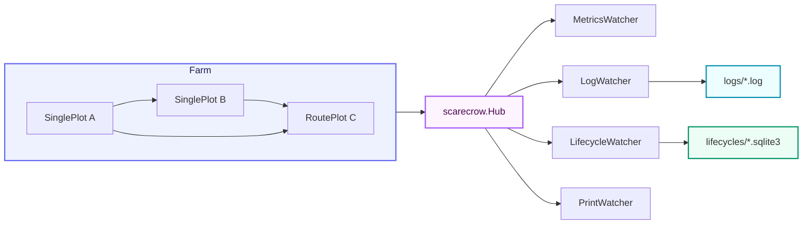

# CelestialGrow

> 📅 Last Updated: 2026/11/13

<p align="center">
  
  
  
</p>

**CelestialGrow** is a lightweight, composable Go concurrent task orchestration framework built on the `Plot` / `Farm` model.

It splits task processing into two layers:

- **Plot**: a generic concurrent processing node that consumes seeds, runs cultivators, and produces fruits. By output style it is divided into `SinglePlot[S, F]` (single-in single-out), `SplitPlot[S, F]` (one-to-many), and `RoutePlot[S, Y]` (name-based targeted forwarding)
- **Farm**: a static directed graph composed of multiple Plots, responsible for registration, connection, startup, and global scheduling

Beyond execution orchestration itself, CelestialGrow also ships with:

- Task lifecycle tracking based on event IDs
- State snapshot persistence based on SQLite
- Structured runtime logs based on files
- Event-driven observability (`Hub`, `MetricsWatcher`, `PrintWatcher` in `pkg/scarecrow`)
- A runtime resource assembly layer, `pkg/assembly`
- A unified public entry package, `pkg/api`

If you want to express task flows in Go in a more structured way than "scattered goroutines + channels", yet without pulling in an overly heavy workflow system, CelestialGrow is made for exactly this scenario.

## Project Structure



CelestialGrow's core data flow can be summarized as:

1. External input seed
2. The Plot's tender goroutines run the cultivator concurrently
3. On success, produce a fruit and forward it to downstream Plots
4. On failure, record the weed / wither lifecycle; when the pruning predicate hits, record prune and skip cultivation
5. Every stage of execution emits a `scarecrow.Event`, dispatched by the `Hub` to the registered watchers
6. The log and lifecycle watchers write events into `logs/` and `lifecycles/`

## Quick Start

Install:

```bash
go get github.com/Mr-xiaotian/CelestialGrow@latest
```

It is recommended to start with the unified entry `pkg/api`.

A minimal `Farm` example (identical to `demo/demo_farm/main.go`):

```go
package main

import grow "github.com/Mr-xiaotian/CelestialGrow/pkg/api"

// double 将种子翻倍。
func double(num int) (int, error) {
	return num * 2, nil
}

// addOne 为种子加一。
func addOne(num int) (int, error) {
	return num + 1, nil
}

// main 演示一条 Farm 流水线：root 将种子翻倍后传给 head 加一。
func main() {
	root := grow.NewSinglePlot("root", double, grow.WithTenders(2))
	head := grow.NewSinglePlot("head", addOne, grow.WithTenders(2))

	farm := grow.NewFarm("demo_farm")
	if err := farm.AddPlot(root, head); err != nil {
		panic(err)
	}
	if err := farm.Connect([]grow.PlotNode{root}, []grow.PlotNode{head}); err != nil {
		panic(err)
	}
	if err := farm.Run(map[string][]any{
		"root": {1, 2, 3},
	}, "INFO"); err != nil {
		panic(err)
	}
}
```

After running, two kinds of artifacts are produced:

- `logs/grow_log(YYYY-MM-DD).log`: the run log
- `lifecycles/YYYY-MM-DD/grow_lifecycle(...).sqlite3`: lifecycle events and state snapshots

If you only want to run a single `Plot`, you can also use standalone mode directly:

```go
package main

import (
	"fmt"

	grow "github.com/Mr-xiaotian/CelestialGrow/pkg/api"
)

func main() {
	plot := grow.NewSinglePlot("double", func(seed int) (int, error) {
		return seed * 2, nil
	}, grow.WithTenders(4))

	plot.Run([]int{1, 2, 3, 4, 5}, "INFO")

	fmt.Printf("seed=%d fruit=%d weed=%d prune=%d\n",
		plot.GetSeedNum(), plot.GetFruitNum(), plot.GetWeedNum(), plot.GetPruneNum())

	records, err := plot.Harvest()
	if err != nil {
		panic(err)
	}
	for _, record := range records {
		fmt.Println(record.SeedJSON, record.Status, record.FruitJSON)
	}
}
```

When some seeds need to be skipped, use `WithPruneIf` to decide before cultivation; a seed that hits the predicate is recorded as prune and is neither retried nor forwarded downstream:

```go
package main

import (
	"fmt"

	grow "github.com/Mr-xiaotian/CelestialGrow/pkg/api"
)

func main() {
	plot := grow.NewSinglePlot("dedup", func(seed int) (int, error) {
		return seed * 2, nil
	},
		grow.WithTenders(3),
		grow.WithPruneIf(func(seed int) bool { return seed%2 == 0 }),
	)

	plot.Run([]int{1, 2, 3, 4, 5}, "INFO")

	fmt.Printf("fruit=%d prune=%d\n", plot.GetFruitNum(), plot.GetPruneNum())
}
```

For more combinations see [`docs/zh-CN/demo/demo_prune/main.md`](./demo/demo_prune/main.md): it uses a seen set protected by a mutex for concurrent-safe deduplication, and demonstrates both the single-Plot and the Farm attachment points.

## Core Features

- **Generic Plot nodes**: `SinglePlot[S, F]`, `SplitPlot[S, F]`, and `RoutePlot[S, Y]` explicitly express the input seed type and the output fruit type
- **Type-safe connections**: when upstream `Y` and downstream `S` do not match, `Connect` reports an error directly
- **Concurrent cultivation model**: control the number of concurrent tending goroutines (tenders) via `WithTenders`, and the channel buffer via `WithChanSize`
- **Failure retry mechanism**: supports `WithMaxRetries`, `WithRetryDelay`, `WithRetryIf`; panics inside the cultivator are caught and treated as failures
- **Pruning mechanism**: `WithPruneIf` skips the specified seeds before cultivation
- **Graph-level scheduling**: `Farm` centrally manages node registration, edge connection, source node sealing, and overall execution; `Run` blocks while running the whole graph, while `Start` hands control back to the caller
- **Runtime injection**: `Farm.InjectTasks` / `Farm.InjectTerminations` can dynamically add seeds or terminate nodes while `Start` is blocking
- **Lifecycle persistence**: writes the event graph and state snapshots to SQLite by default
- **Observability**: `scarecrow.Hub` dispatches events uniformly, with the built-in `MetricsWatcher` (metrics), `PrintWatcher` (standard-output progress), and the log / lifecycle watchers assembled by `assembly`

## Packages

- `pkg/api`: the unified public entry, wrapping `Farm`, `SinglePlot`, `SplitPlot`, `RoutePlot`, `PlotNode`, and all configuration options (including the generic `WithPruneIf`)
- `pkg/farm`: graph structure (`OrderGraph`), node registration, hyperedge connection, structure rendering, and overall scheduling
- `pkg/plot`: generic task nodes (`SinglePlot`/`SplitPlot`/`RoutePlot`), the shared run skeleton `basePlot`, concurrent execution, retries, pruning, and upstream/downstream data propagation
- `pkg/scarecrow`: the runtime event model (`Event` and the Farm/Plot/Seed/Seal events), the `Watcher` interface, the dispatch center `Hub`, `MetricsWatcher` metrics, and the `PrintWatcher` print observer
- `pkg/assembly`: runtime resource assembly, creating and starting the metrics / lifecycle / log observers and registering them on the `Hub`, reclaiming them uniformly through `Resources.Stop`
- `pkg/persist`: watchers, record handlers, and query interfaces for the lifecycle SQLite and structured run logs
- `pkg/funnel`: generic asynchronous record production / consumption infrastructure (`Inlet` / `Spout`)
- `pkg/runtime`: runtime base types such as `Payload`, event ID allocation (`EventClient`), and control signals

## Observability

Runtime events are dispatched uniformly by `scarecrow.Hub`. The metrics, lifecycle, and log observers are assembled automatically by `pkg/assembly` on every `Run` / `Start`; `PrintWatcher` must be registered by yourself and is suited to local debugging:

```go
package main

import (
	grow "github.com/Mr-xiaotian/CelestialGrow/pkg/api"
	"github.com/Mr-xiaotian/CelestialGrow/pkg/scarecrow"
)

func main() {
	root := grow.NewSinglePlot("root", func(seed int) (int, error) {
		return seed * 2, nil
	})
	head := grow.NewSinglePlot("head", func(seed int) (int, error) {
		return seed + 1, nil
	})

	farm := grow.NewFarm("demo_farm")
	if err := farm.AddPlot(root, head); err != nil {
		panic(err)
	}
	if err := farm.Connect([]grow.PlotNode{root}, []grow.PlotNode{head}); err != nil {
		panic(err)
	}
	if err := farm.AddWatcher(scarecrow.NewPrintWatcher("farm")); err != nil {
		panic(err)
	}
	if err := farm.Run(map[string][]any{"root": {1, 2, 3}}, "INFO"); err != nil {
		panic(err)
	}
}
```

Farm-level watchers are registered on the Farm's own Hub, and that Hub is in turn attached to every Plot's Hub, so it receives both `FarmStartEvent` / `FarmEndEvent` and the seed events of all Plots. After the run, the metrics and persistence observers remain in the Hub and can be retrieved through `scarecrow.Find` (`SinglePlot.Harvest` queries the lifecycle SQLite based on this mechanism).

> `Plot` and `Farm` themselves only hold a `scarecrow.Hub` and do not hold spouts or persistence observer instances directly; runtime resources such as logs and lifecycle are created, registered, started, and reclaimed uniformly by `pkg/assembly`.

## Typical Usage

The recommended order of calls is:

1. Define processing nodes with `api.NewSinglePlot(...)` / `api.NewSplitPlot(...)` / `api.NewRoutePlot(...)`
2. Create the scheduling graph with `api.NewFarm(name)`
3. Call `farm.AddPlot(...)` to register the nodes
4. Call `farm.Connect(...)` to establish upstream/downstream relationships
5. Optionally call `farm.AddWatcher(...)` to attach self-built observers such as `PrintWatcher`
6. Call `farm.Run(inputs, logLevel)` to inject the initial input and execute

Here `Farm.Connect` uses "group-to-group full connection" semantics, that is, it establishes Cartesian-product connections between the source group and the target group. If you need one seed to derive multiple downstream tasks, use `api.NewSplitPlot(...)` (one-to-many) or `api.NewRoutePlot(...)` (name-based targeted forwarding) instead.

When the task flow needs to be driven externally, switch to `Start` / `InjectTasks` / `InjectTerminations`:

```go
package main

import grow "github.com/Mr-xiaotian/CelestialGrow/pkg/api"

func main() {
	plot := grow.NewSinglePlot("double", func(seed int) (int, error) {
		return seed * 2, nil
	})

	farm := grow.NewFarm("external_driver")
	if err := farm.AddPlot(plot); err != nil {
		panic(err)
	}

	go func() {
		if err := farm.InjectTasks(map[string][]any{"double": {1, 2, 3}}); err != nil {
			panic(err)
		}
		// 没有外部终止信号时 Start 不会返回。
		if err := farm.InjectTerminations([]string{"double"}); err != nil {
			panic(err)
		}
	}()

	if err := farm.Start("INFO"); err != nil {
		panic(err)
	}
}
```

## File Structure

```text
pkg/
  api/        # 对外统一入口
  assembly/   # 运行期资源装配
  farm/       # 图结构与调度
  funnel/     # 通用异步消费基础设施
  persist/    # 日志与生命周期持久化
  plot/       # 泛型并发节点
  runtime/    # 事件、信号与运行时载体
  scarecrow/  # 事件模型、分发 Hub 与观察者

demo/
  demo_farm/  # 最小 Farm 流水线
  demo_prune/ # prune 去重（单 Plot 与 Farm）
```

## Requirements

The current module declares:

- `go 1.25.5`
- `toolchain go1.26.2`

Core dependencies are as follows:

| Dependency | Description |
| --- | --- |
| `modernc.org/sqlite` | Pure Go SQLite driver, used for lifecycle persistence |

## Development

```bash
go mod tidy
go test ./pkg/...
```

If you modify `pkg/**/*.go`, it is recommended to run the relevant tests of the corresponding package, prioritizing verification of the behavior affected by your change.

## Documentation Index

The detailed Chinese documentation in this repository is organized in a mirrored way following `pkg/<name>/<file>.go` → `docs/zh-CN/pkg/<name>/<file>.md`. The currently generated Chinese sub-documents are as follows:

### pkg/api

- [`docs/zh-CN/pkg/api/api.md`](./pkg/api/api.md) — unified public entry package

### pkg/assembly

- [`docs/zh-CN/pkg/assembly/assembly.md`](./pkg/assembly/assembly.md) — runtime resource assembly (`StartPlotResources` / `StartFarmResources` / `Resources.Stop`)
- [`docs/zh-CN/pkg/assembly/assembly_test.md`](./pkg/assembly/assembly_test.md) — resource assembly test highlights

### pkg/farm

- [`docs/zh-CN/pkg/farm/farm.md`](./pkg/farm/farm.md) — Farm scheduler
- [`docs/zh-CN/pkg/farm/graph.md`](./pkg/farm/graph.md) — topology graph (OrderGraph)
- [`docs/zh-CN/pkg/farm/render.md`](./pkg/farm/render.md) — graph structure text rendering (RenderStructureList)
- [`docs/zh-CN/pkg/farm/farm_structure_test.md`](./pkg/farm/farm_structure_test.md) — Farm structure test highlights
- [`docs/zh-CN/pkg/farm/farm_connect_test.md`](./pkg/farm/farm_connect_test.md) — Farm Connect test highlights
- [`docs/zh-CN/pkg/farm/farm_start_test.md`](./pkg/farm/farm_start_test.md) — Farm Start test highlights
- [`docs/zh-CN/pkg/farm/farm_inject_test.md`](./pkg/farm/farm_inject_test.md) — Farm runtime injection test highlights
- [`docs/zh-CN/pkg/farm/farm_harvest_test.md`](./pkg/farm/farm_harvest_test.md) — Farm post-run lifecycle query test highlights
- [`docs/zh-CN/pkg/farm/farm_split_test.md`](./pkg/farm/farm_split_test.md) — Farm SplitPlot end-to-end test highlights
- [`docs/zh-CN/pkg/farm/farm_route_test.md`](./pkg/farm/farm_route_test.md) — Farm RoutePlot end-to-end test highlights
- [`docs/zh-CN/pkg/farm/graph_test.md`](./pkg/farm/graph_test.md) — OrderGraph test highlights
- [`docs/zh-CN/pkg/farm/render_test.md`](./pkg/farm/render_test.md) — graph structure rendering test highlights

### pkg/plot

- [`docs/zh-CN/pkg/plot/plot.md`](./pkg/plot/plot.md) — shared run skeleton (`basePlot` / `PlotNode`) and standalone execution
- [`docs/zh-CN/pkg/plot/plot_single.md`](./pkg/plot/plot_single.md) — single-in single-out node (SinglePlot)
- [`docs/zh-CN/pkg/plot/plot_split.md`](./pkg/plot/plot_split.md) — one-to-many node (SplitPlot)
- [`docs/zh-CN/pkg/plot/plot_route.md`](./pkg/plot/plot_route.md) — targeted forwarding node (RoutePlot)
- [`docs/zh-CN/pkg/plot/option.md`](./pkg/plot/option.md) — Plot optional configuration (Option)
- [`docs/zh-CN/pkg/plot/constant.md`](./pkg/plot/constant.md) — Plot constants and signal definitions
- [`docs/zh-CN/pkg/plot/helper.md`](./pkg/plot/helper.md) — Plot internal helper functions
- [`docs/zh-CN/pkg/plot/plot_harvest_test.md`](./pkg/plot/plot_harvest_test.md) — Plot Harvest test highlights
- [`docs/zh-CN/pkg/plot/plot_prune_test.md`](./pkg/plot/plot_prune_test.md) — Plot pruning mechanism test highlights
- [`docs/zh-CN/pkg/plot/plot_retry_test.md`](./pkg/plot/plot_retry_test.md) — Plot retry test highlights
- [`docs/zh-CN/pkg/plot/plot_split_test.md`](./pkg/plot/plot_split_test.md) — SplitPlot test highlights
- [`docs/zh-CN/pkg/plot/plot_route_test.md`](./pkg/plot/plot_route_test.md) — RoutePlot test highlights

### pkg/scarecrow

- [`docs/zh-CN/pkg/scarecrow/event.md`](./pkg/scarecrow/event.md) — runtime event definitions
- [`docs/zh-CN/pkg/scarecrow/watcher.md`](./pkg/scarecrow/watcher.md) — the Watcher interface and function adapters
- [`docs/zh-CN/pkg/scarecrow/hub.md`](./pkg/scarecrow/hub.md) — the event dispatch center Hub
- [`docs/zh-CN/pkg/scarecrow/metrics.md`](./pkg/scarecrow/metrics.md) — the metrics observer (MetricsWatcher)
- [`docs/zh-CN/pkg/scarecrow/print.md`](./pkg/scarecrow/print.md) — the standard-output progress observer (PrintWatcher)
- [`docs/zh-CN/pkg/scarecrow/event_test.md`](./pkg/scarecrow/event_test.md) — event definition test highlights
- [`docs/zh-CN/pkg/scarecrow/hub_test.md`](./pkg/scarecrow/hub_test.md) — Hub dispatch and ring detection test highlights
- [`docs/zh-CN/pkg/scarecrow/metrics_test.md`](./pkg/scarecrow/metrics_test.md) — metrics rebuild test highlights
- [`docs/zh-CN/pkg/scarecrow/print_test.md`](./pkg/scarecrow/print_test.md) — print observer test highlights

### pkg/persist

- [`docs/zh-CN/pkg/persist/lifecycle.md`](./pkg/persist/lifecycle.md) — lifecycle event records
- [`docs/zh-CN/pkg/persist/log.md`](./pkg/persist/log.md) — structured run logs
- [`docs/zh-CN/pkg/persist/sqlite.md`](./pkg/persist/sqlite.md) — SQLite state snapshots
- [`docs/zh-CN/pkg/persist/lifecycle_test.md`](./pkg/persist/lifecycle_test.md) — lifecycle persistence test highlights
- [`docs/zh-CN/pkg/persist/log_test.md`](./pkg/persist/log_test.md) — log persistence test highlights
- [`docs/zh-CN/pkg/persist/sqlite_test.md`](./pkg/persist/sqlite_test.md) — SQLite persistence test highlights

### pkg/funnel

- [`docs/zh-CN/pkg/funnel/inlet.md`](./pkg/funnel/inlet.md) — generic Inlet consumption interface
- [`docs/zh-CN/pkg/funnel/spout.md`](./pkg/funnel/spout.md) — generic Spout production interface

### pkg/runtime

- [`docs/zh-CN/pkg/runtime/event.md`](./pkg/runtime/event.md) — event ID allocation and propagation
- [`docs/zh-CN/pkg/runtime/type.md`](./pkg/runtime/type.md) — runtime base types

### demo

- [`docs/zh-CN/demo/demo_farm/main.md`](./demo/demo_farm/main.md) — minimal Farm example walkthrough
- [`docs/zh-CN/demo/demo_prune/main.md`](./demo/demo_prune/main.md) — prune deduplication example walkthrough
