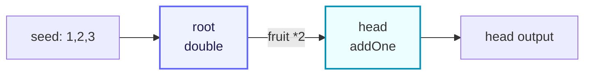

# demo/demo_farm/main.go

> 📅 Last Updated: 2026/11/13

## Purpose

`demo/demo_farm/main.go` is the simplest `Farm` example shipped with the CelestialGrow project. It shows how to use the unified public entry `pkg/api` to build and run a small pipeline made of two `SinglePlot` nodes:

- use `NewSinglePlot` to create two concurrent processing nodes (`root` and `head`);
- use `NewFarm` to create the scheduling graph and register the nodes into it;
- use `Connect` to establish the upstream/downstream relationship between the two nodes;
- use `Run` to inject the initial seeds and execute the whole graph.

The semantics of the whole pipeline are "root doubles the seed and forwards it to head, which adds one", making it a minimal closed loop that is ideal as a starter demo.

## Code Structure

The file consists of three parts:

1. **Package and imports**: it provides an executable entry as `package main` and imports only `pkg/api` under the alias `grow`.
2. **Two cultivator functions**: `double` and `addOne`, serving as the processing logic of `root` and `head` respectively.
3. **The `main` function**: it builds the two `SinglePlot` nodes, then registers, connects, and runs the Farm in order.

The corresponding data flow (two nodes + one edge) can be simplified as:



## Key Calls

Key APIs appearing in `main.go` (constructors and configuration come from `pkg/api`, Farm methods are provided by `pkg/farm`):

| Call | Source | Purpose |
|------|------|------|
| `grow.NewSinglePlot[S, F](name, cultivator, opts...)` | `pkg/api` → `plot.NewSinglePlot` | Constructs a single-in single-out generic concurrent node, where `S` is the seed type and `F` is the fruit type. |
| `grow.NewFarm(name)` | `pkg/api` → `farm.NewFarm` | Constructs a Farm, internally creating the event client and the observer Hub; the log level is now passed to `Run` / `Start`. |
| `farm.AddPlot(plots ...plot.PlotNode)` | `pkg/farm` | Registers several `PlotNode`s into the Farm and adds them to the topology graph. |
| `farm.Connect(fromPlots, toPlots []plot.PlotNode)` | `pkg/farm` | Establishes a full connection (Cartesian product) between the source group and the target group, validating the seed/fruit types of every connection. |
| `farm.Run(inputs map[string][]any, logLevel string)` | `pkg/farm` | Executes the whole graph synchronously; `logLevel` is the minimum log level for this run (an empty string means `INFO`), blocking until all Plots finish. |
| `grow.WithTenders(n int)` | `pkg/api` → `plot.WithTenders` | Sets the number of concurrent tenders (tending goroutines) of a Plot, defaulting to `runtime.NumCPU()`. |
| `grow.PlotNode` | `pkg/api` → `plot.PlotNode` | The unified interface used as the `Farm.Connect` parameter, with the generic parameters of `SinglePlot` / `SplitPlot` / `RoutePlot` erased. |

## Key Flow

Inside the `main` function, execution follows this order:

1. Build the `root` node with cultivator `double` and 2 concurrent tenders.
2. Build the `head` node with cultivator `addOne` and 2 concurrent tenders.
3. Create `demo_farm`: `NewFarm` only constructs the Farm (event client, Hub, registry, and topology graph); it does not take a log level.
4. `AddPlot(root, head)`: registers both nodes into the Farm; names must be unique.
5. `Connect({root}, {head})`: establishes one edge from `root` → `head`.
6. `Run({"root": {1, 2, 3}}, "INFO")`: injects 3 initial seeds into `root` and starts executing the whole graph. `Run` uses `pkg/assembly` to start the log, lifecycle, and metrics observers, registers the Farm Hub on every Plot, and then waits for all Plots to finish before returning.

## Runtime Artifacts

After `Run` returns, two kinds of artifacts are produced (or appended) in the current working directory:

- `logs/grow_log(YYYY-MM-DD).log`: the structured log produced by this Farm run, appended per day; the log level is controlled by the second `Run` argument `"INFO"`.
- `lifecycles/YYYY-MM-DD/grow_lifecycle(HH-MM-SS.mmm).sqlite3`: the lifecycle database of this Farm run, stored in a subdirectory named after the current date, with the startup time in the file name.

The SQLite database contains three tables: `events` (seed/fruit/weed/prune/seal events), `event_parents` (parent-child edges between events), and `status` (the state snapshot of every seed, with states `seed` / `ripen` / `wither` / `prune`).

> These paths and file names are determined by `pkg/persist`; this example performs no custom configuration. To clean up, simply delete the `logs/` and `lifecycles/` directories.

## Usage Example

The following code is identical to the source of `demo/demo_farm/main.go` and can be copied and run directly:

```go
package main

import grow "github.com/Mr-xiaotian/CelestialGrow/pkg/api"

// double 将种子翻倍。
func double(num int) (int, error) {
	return num * 2, nil
}

// addOne 为种子加一。
func addOne(num int) (int, error) {
	return num + 1, nil
}

// main 演示一条 Farm 流水线：root 将种子翻倍后传给 head 加一。
func main() {
	root := grow.NewSinglePlot("root", double, grow.WithTenders(2))
	head := grow.NewSinglePlot("head", addOne, grow.WithTenders(2))

	farm := grow.NewFarm("demo_farm")
	if err := farm.AddPlot(root, head); err != nil {
		panic(err)
	}
	if err := farm.Connect([]grow.PlotNode{root}, []grow.PlotNode{head}); err != nil {
		panic(err)
	}
	if err := farm.Run(map[string][]any{
		"root": {1, 2, 3},
	}, "INFO"); err != nil {
		panic(err)
	}
}
```

### Line-by-Line Notes

- **Imports**: only `pkg/api` is imported, referenced with the alias `grow`, avoiding a conflict with the local variable name `farm`.
- **`double` / `addOne`**: the two simplest `func(S) (F, error)` cultivators; they never return a non-nil error, so every seed produces a fruit and is consumed downstream.
- **`NewSinglePlot`**: the seed and fruit types of both nodes are `int`, so the compiler infers `S = F = int`; `WithTenders(2)` limits the number of concurrent tenders per Plot to 2.
- **`NewFarm`**: only constructs the Farm (event client, Hub, registry, and topology graph); it does not start log/lifecycle resources, which `pkg/assembly` assembles uniformly during `Run`.
- **`AddPlot`**: adds the `SinglePlot`s to the Farm's `plots` map and topology graph and makes them share the Farm's event client; an empty or duplicate name returns an error.
- **`Connect`**: uses "group-to-group full connection" semantics; here both groups contain a single node, so only one directed edge `root → head` is created.
- **`Run`**: after validating `inputs`, starts the log/lifecycle/metrics observers, registers the Farm Hub on every Plot, starts all Plots, injects the seeds, sends a seal to the source nodes (here `root`), and waits for all Plots to finish before stopping the resources and returning.

### How to Run

Execute the following in the project root:

```bash
go run ./demo/demo_farm
```

After a successful run:

- the terminal stays completely silent: `double` / `addOne` have no side effects and all logs are written to files rather than standard output; errors from the resource teardown stage are not printed either.
- the current directory contains `logs/grow_log(YYYY-MM-DD).log` and `lifecycles/YYYY-MM-DD/grow_lifecycle(HH-MM-SS.mmm).sqlite3`.

At the `INFO` level, every message written to the log file by this run is `INFO` (graph structure, Plot start/stop, Farm start/end); the lower-level `SeedInput` (`DEBUG`) and `SeedRipen` (`SUCCESS`) messages are filtered out. To observe seed-level details, change the `logLevel` of `Run` to `"DEBUG"`:

```go
if err := farm.Run(map[string][]any{
	"root": {1, 2, 3},
}, "DEBUG"); err != nil {
	panic(err)
}
```

## Notes

1. **Dependency requirements**: this example belongs to the same `github.com/Mr-xiaotian/CelestialGrow` module as the project, so no extra import path is needed; `pkg/persist` writes the lifecycle database through `modernc.org/sqlite`, and you can run `go mod download` before the first run to ensure the dependencies are ready.
2. **`Run` only seals source nodes**: `inputs` can inject initial seeds into any registered Plot, but `Run` only sends the termination signal to source nodes (here `root`); when the input of a non-source node (here `head`) is closed depends on the seal forwarded from its upstream. By design, seeds should therefore only be injected into source nodes.
3. **Error handling**: the example uses `panic(err)`, which is for demonstration only; production code should return `AddPlot` / `Connect` / `Run` errors to the caller for centralized handling.
4. **Execution is synchronously blocking**: `farm.Run` blocks until all Plots finish; to run several Farms in parallel, use separate goroutines.
5. **Observers and progress output**: this example registers no watcher, so no progress bar or event printout appears in the terminal. To observe progress, import `pkg/scarecrow` before `Run` and call `farm.AddWatcher(scarecrow.NewPrintWatcher("demo_farm"))`; `pkg/assembly` already registers `MetricsWatcher` during `Run`, so counting methods such as `GetFruitNum` / `GetWeedNum` / `GetPruneNum` can be read normally after the run.
6. **Type safety**: `Connect` validates whether the "upstream fruit type" matches the "downstream seed type" and returns an error on mismatch; both Plots here use `int` for S/F, so no error occurs.
7. **Other node types**: this example only demonstrates `SinglePlot`. `pkg/api` also exports `NewSplitPlot` (one-in many-out) and `NewRoutePlot` (name-based targeted routing); both implement `PlotNode` and can be mixed with `SinglePlot` in the same graph.
