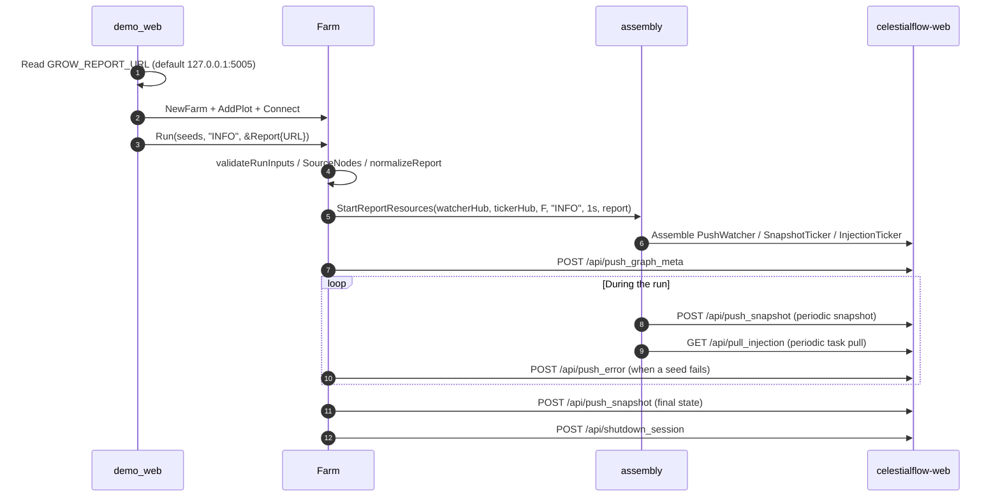

# demo/demo_web/main.go

> 📅 Last Updated: 2026/11/26

## Purpose

`demo/demo_web/main.go` is CelestialGrow's **remote reporting example**: it uses `pkg/api` to build a mixed graph containing `SinglePlot`, `SplitPlot`, and `RoutePlot`, and passes a reporting config to `Farm.Run`, pushing the graph structure, node states, periodic snapshots, task failures, and session end to `celestialflow-web`.

Compared with [`demo_farm`](../demo_farm/main.md), which only runs locally, this example additionally covers:

- how to use `grow.Report` (i.e. `reporter.Config`) and how the default `SessionID` is generated;
- how `pkg/assembly` wires `PushWatcher`, `SnapshotTicker`, and `InjectionTicker` in reporting mode;
- fan-out, splitting, and name-based routing when `SinglePlot` / `SplitPlot` / `RoutePlot` are mixed;
- deliberately produced failures, so the error panel can be observed on the web page.

## Example Topology

```mermaid
flowchart LR
    R[root<br/>int→int<br/>fails: multiples of 5] -->|fruit| SP[split<br/>int→[]int]
    SP -->|seed, seed+1| RT[route<br/>int→map[string]int]
    RT -->|even| E[even<br/>int→int]
    RT -->|odd| O[odd<br/>int→int<br/>fails: 9]

    style R fill:#eef2ff,stroke:#6366f1,stroke-width:2px,color:#1e1b4b
    style SP fill:#f5f3ff,stroke:#8b5cf6,stroke-width:2px
    style RT fill:#ecfeff,stroke:#0891b2,stroke-width:2px
```

- `root`: sleeps 2 seconds; returns an error when `seed%5==0`, otherwise doubles the seed.
- `split`: sleeps 2 seconds; splits every seed into `seed` and `seed+1`.
- `route`: sleeps 2 seconds; routes even seeds to `even` and odd seeds to `odd`.
- `even`: sleeps 2 seconds; halves the seed.
- `odd`: sleeps 2 seconds; multiplies the seed by 3 and deliberately fails on `9`.

Every Plot uses `grow.WithTenders(3)` to set 3 concurrent tenders. The input seeds are `1..12`, among which `5` and `10` are rejected by `root` and `9` is rejected by `odd`, so the web side should show **3 failure records**.

## Key Calls

| Call | Source | Purpose |
|------|------|------|
| `grow.NewSinglePlot` / `grow.NewSplitPlot` / `grow.NewRoutePlot` | `pkg/api` → `plot` | Creates the three kinds of nodes; all of them implement `grow.PlotNode` and can be mixed in one Farm. |
| `grow.NewFarm("demo_web")` | `pkg/api` → `farm.NewFarm` | Creates the scheduling graph, internally initializing the event client, the observer Hub, and the tick Hub. |
| `farm.AddPlot(root, split, route, even, odd)` | `pkg/farm` | Registers all nodes; names must be unique. |
| `farm.Connect(...)` | `pkg/farm` | Group-to-group full connection, validating the upstream fruit type against the downstream seed type. |
| `farm.Run(inputs, "INFO", &grow.Report{URL: reportURL})` | `pkg/farm` | Runs synchronously with remote reporting enabled; `SessionID` is generated automatically when left empty. |
| `os.Getenv("GROW_REPORT_URL")` | standard library | Overrides the default reporting address. |

### Reporting Config

```go
type Config struct {
    URL             string // 上报服务基础地址
    SessionID       string // 上报会话标识；为空时由运行入口生成
    SnapshotPeriod  int    // 状态快照节拍周期
    InjectionPeriod int    // 注入拉取节拍周期
}
```

The example only sets `URL`:

- `SessionID` is generated by `Farm.normalizeReport` in the form `demo_web@<UnixNano>`;
- `SnapshotPeriod` / `InjectionPeriod` are 0, so the default periods of `pkg/reporter` are used;
- the base tick period is passed in by `pkg/assembly` as `metronome.DefaultInterval` (1 second).

## How to Run

1. Start `celestialflow-web` first (it listens on `http://127.0.0.1:5005` by default). That project lives in the sibling directory `..\celestialflow-web` of this repository; just start it following its README.
2. This example has **no command-line arguments**; the only configurable item is the `GROW_REPORT_URL` environment variable. Run it in the CelestialGrow project root:

```bash
go run ./demo/demo_web
```

To connect to another address:

```bash
GROW_REPORT_URL=http://192.168.1.10:5005 go run ./demo/demo_web
```

The equivalent in PowerShell:

```powershell
$env:GROW_REPORT_URL = "http://192.168.1.10:5005"
go run ./demo/demo_web
```

After startup the terminal prints:

```text
上报地址: http://127.0.0.1:5005
请先启动 celestialflow-web，并打开对应页面查看实时状态。
```

When the run finishes it prints:

```text
运行结束：web 端会话已标记为结束，历史快照与错误仍可查看。
```

## Key Flow



- `/api/push_graph_meta` is sent only once on `FarmStartEvent`, containing nodes, edges, source nodes, and `node_meta`.
- `/api/push_snapshot` is sent periodically by `SnapshotTicker`; one more final-state snapshot is pushed on `FarmEndEvent`.
- `/api/push_error` is triggered by `SeedWitherEvent`, which in this example corresponds to `5` / `10` of `root` and `9` of `odd`.
- `/api/shutdown_session` is sent after the final-state snapshot of `FarmEndEvent`, marking the session as ended; the session history remains viewable.
- `/api/pull_injection` is requested periodically by `InjectionTicker`, handing the `tasks` / `terminations` submitted by the web side back to `Farm.InjectTasks` / `Farm.InjectTerminations`.

## Full Source

The following code is identical to the source of `demo/demo_web/main.go`:

```go
package main

import (
	"fmt"
	"os"
	"time"

	grow "github.com/Mr-xiaotian/CelestialGrow/pkg/api"
)

// defaultReportURL 是 celestialflow-web 的默认监听地址。
const defaultReportURL = "http://127.0.0.1:5005"

// rootCultivator 将种子翻倍；部分种子会失败，用于在 web 端展示错误面板。
func rootCultivator(seed int) (int, error) {
	time.Sleep(2 * time.Second)
	if seed%5 == 0 {
		return 0, fmt.Errorf("root 拒绝处理 5 的倍数: %d", seed)
	}
	return seed * 2, nil
}

// splitter 将一颗种子拆成相邻的两个下游任务。
func splitter(seed int) ([]int, error) {
	time.Sleep(2 * time.Second)
	return []int{seed, seed + 1}, nil
}

// router 按奇偶把种子定向到 even / odd 两个下游节点。
func router(seed int) (map[string]int, error) {
	time.Sleep(2 * time.Second)
	if seed%2 == 0 {
		return map[string]int{"even": seed}, nil
	}
	return map[string]int{"odd": seed}, nil
}

// evenCultivator 处理偶数种子。
func evenCultivator(seed int) (int, error) {
	time.Sleep(2 * time.Second)
	return seed / 2, nil
}

// oddCultivator 处理奇数种子；遇到 9 时失败，用于展示叶子节点的错误上报。
func oddCultivator(seed int) (int, error) {
	time.Sleep(2 * time.Second)
	if seed == 9 {
		return 0, fmt.Errorf("odd 节点遇到 9，故意失败")
	}
	return seed * 3, nil
}

// main 演示把 Farm 运行状态上报到 celestialflow-web。
//
// 请先启动 web 服务（默认 http://127.0.0.1:5005），再运行本示例。运行期间可在
// web 页面看到图结构、节点状态、周期快照与失败任务；结束后会话保留并可继续查看。
// 上报地址可通过环境变量 GROW_REPORT_URL 覆盖。
func main() {
	reportURL := os.Getenv("GROW_REPORT_URL")
	if reportURL == "" {
		reportURL = defaultReportURL
	}

	root := grow.NewSinglePlot("root", rootCultivator, grow.WithTenders(3))
	split := grow.NewSplitPlot("split", splitter, grow.WithTenders(3))
	route := grow.NewRoutePlot("route", router, grow.WithTenders(3))
	even := grow.NewSinglePlot("even", evenCultivator, grow.WithTenders(3))
	odd := grow.NewSinglePlot("odd", oddCultivator, grow.WithTenders(3))

	farm := grow.NewFarm("demo_web")
	if err := farm.AddPlot(root, split, route, even, odd); err != nil {
		panic(err)
	}
	if err := farm.Connect([]grow.PlotNode{root}, []grow.PlotNode{split}); err != nil {
		panic(err)
	}
	if err := farm.Connect([]grow.PlotNode{split}, []grow.PlotNode{route}); err != nil {
		panic(err)
	}
	if err := farm.Connect([]grow.PlotNode{route}, []grow.PlotNode{even, odd}); err != nil {
		panic(err)
	}

	fmt.Printf("上报地址: %s\n", reportURL)
	fmt.Println("请先启动 celestialflow-web，并打开对应页面查看实时状态。")

	if err := farm.Run(map[string][]any{
		"root": {1, 2, 3, 4, 5, 6, 7, 8, 9, 10, 11, 12},
	}, "INFO", &grow.Report{URL: reportURL}); err != nil {
		panic(err)
	}

	fmt.Println("运行结束：web 端会话已标记为结束，历史快照与错误仍可查看。")
}
```

## Notes

1. **The web service is not required**: HTTP failures of `PushWatcher` are only logged and never make `Run` return an error. The example still completes when the web service is not running, but nothing shows up on the page; the local `logs/` and `lifecycles/` artifacts are produced as usual.
2. **The URL must be valid**: `report.URL` must be an `http://` or `https://` address, and a trailing `/` is normalized; an invalid address makes `StartReportResources` return an error, and `Run` fails before any Plot starts.
3. **Session identifier**: the example does not set `SessionID`, so each run generates a new `demo_web@<UnixNano>`; to fix the session name on the web side, pass one explicitly.
4. **Route target names**: the keys of the `RoutePlot` routing table must match the names of the connected downstream Plots (`even` / `odd`); keys that are not connected or not registered are silently skipped.
5. **Duration**: every node sleeps `Sleep(2s)` for each seed, and each stage depends serially on the previous one, so a full demo of 12 seeds usually takes more than half a minute; this gives the web page enough time to show intermediate states.
6. **Deliberate failures**: `5` / `10` of `root` and `9` of `odd` enter `SeedWitherEvent`, reporting only the error without forwarding downstream; the other seeds complete normally.
7. **Synchronous blocking**: `Farm.Run` blocks until all Plots exit and the reporting resources are stopped; do not shut down the web service before `Run` returns, otherwise the final-state snapshot and the shutdown request may fail to be pushed.
