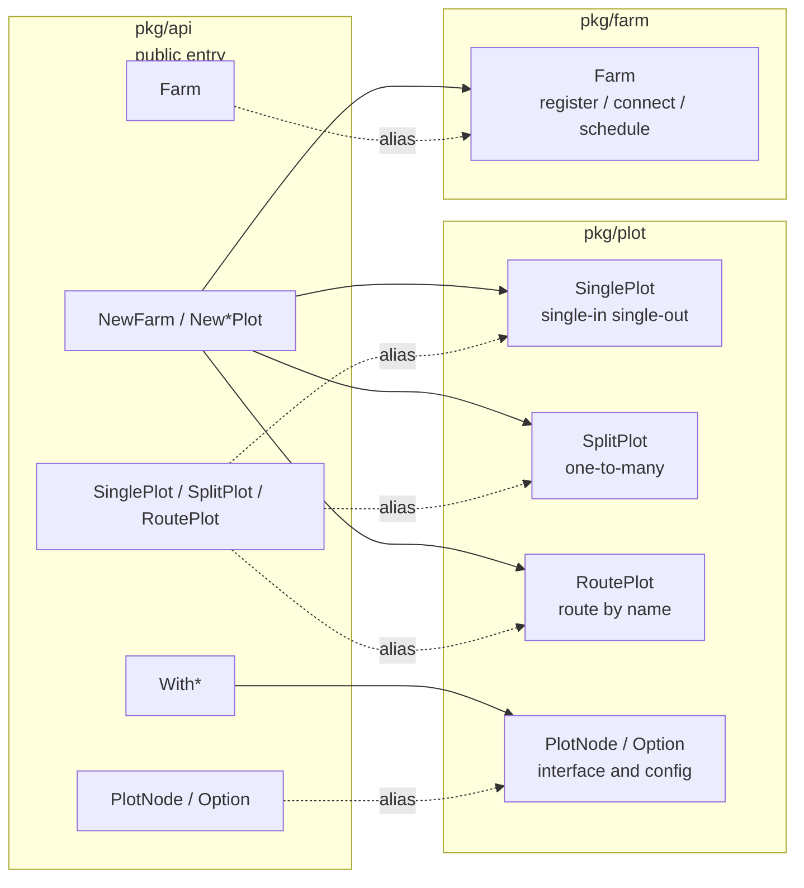
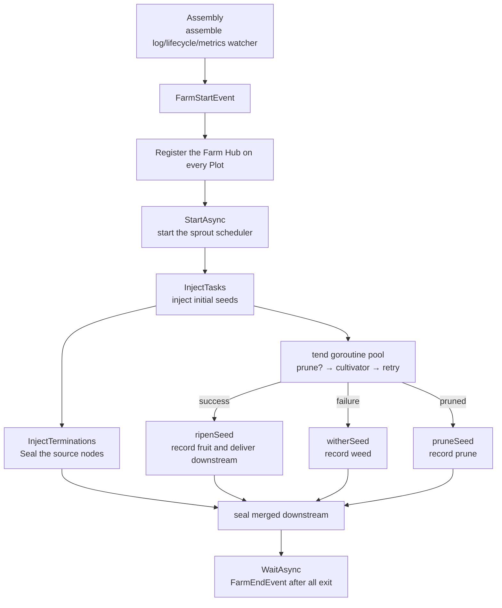

# pkg/api/api.go

> 📅 Last Updated: 2026/11/13

## Purpose

`pkg/api` is the **unified public entry package** of CelestialGrow. It introduces no new implementation; it only re-exposes the core types and common configuration of the underlying packages in three forms:

1. **Type aliases** (`type X = pkg.Y`): `Farm`, `SinglePlot`, `SplitPlot`, `RoutePlot`, `PlotNode`, `Option`;
2. **Thin constructor wrappers**: `NewFarm`, `NewSinglePlot`, `NewSplitPlot`, `NewRoutePlot`;
3. **Configuration items**: the package-level variables `WithTenders`, `WithChanSize`, `WithMaxRetries`, `WithRetryDelay`, `WithRetryIf`, plus the generic function `WithPruneIf`.

There are only two underlying dependency packages:

| Underlying package | Provided content |
|--------|----------|
| `pkg/farm` | `Farm`: node registration, hyperedge-style connection, overall scheduling, and external injection |
| `pkg/plot` | `SinglePlot` / `SplitPlot` / `RoutePlot` / `PlotNode` / `Option` and their configuration functions |

> Runtime event observation (progress printing, metrics, etc.) is provided by `pkg/scarecrow` and injected through `AddWatcher`. `pkg/api` offers no observer constructors; use `scarecrow.NewPrintWatcher` or a custom `scarecrow.Watcher` when you need progress output.

Since all exported items are aliases, function values, or one-layer pass-through wrappers, the behavioral contract of this package is entirely determined by the underlying packages. This document focuses on "the list of exported symbols + type parameter semantics + defaults + error scenarios".

## Exported Symbols Overview

| Symbol | Category | Points to | Description |
|------|------|------|------|
| `Farm` | Type alias | `farm.Farm` | A static directed graph composed of multiple nodes, responsible for node registration, connection, scheduling, and external injection. |
| `SinglePlot[S, F]` | Generic type alias | `plot.SinglePlot[S, F]` | The single-in single-out node. For each seed processed successfully, it forwards **1** `F` to **every** downstream. |
| `SplitPlot[S, F]` | Generic type alias | `plot.SplitPlot[S, F]` | The split node. The processing function returns `[]F`, and **each element** is sent to every downstream as an independent yield. |
| `RoutePlot[S, Y]` | Generic type alias | `plot.RoutePlot[S, Y]` | The routing node. The processing function returns `map[string]Y`, where `key` is the target downstream name and `value` is sent only to that downstream. |
| `PlotNode` | Type alias | `plot.PlotNode` | The unified node interface with generic parameters erased; `Farm` uses it to hold nodes of differing types. |
| `Option` | Type alias | `plot.Option` | Optional node configuration, whose underlying type is `func(*plotOptions)`; `plotOptions` is unexported, so `Option` **cannot be customized** outside the package. |
| `NewFarm(name string) *Farm` | Constructor | `farm.NewFarm` | Creates a Farm (and its internal event Hub along with it). |
| `NewSinglePlot[S, F](name string, cultivator func(S) (F, error), opts ...Option) *SinglePlot[S, F]` | Constructor | `plot.NewSinglePlot` | Creates a single-in single-out node. |
| `NewSplitPlot[S, F](name string, splitter func(S) ([]F, error), opts ...Option) *SplitPlot[S, F]` | Constructor | `plot.NewSplitPlot` | Creates a split node. |
| `NewRoutePlot[S, Y](name string, cultivator func(S) (map[string]Y, error), opts ...Option) *RoutePlot[S, Y]` | Constructor | `plot.NewRoutePlot` | Creates a routing node. |
| `WithTenders(n int) Option` | Package-level variable | `plot.WithTenders` | Number of concurrent tenders. |
| `WithChanSize(n int) Option` | Package-level variable | `plot.WithChanSize` | Buffer size of the seed channel. |
| `WithMaxRetries(n int) Option` | Package-level variable | `plot.WithMaxRetries` | Maximum number of retries (excluding the first execution). |
| `WithRetryDelay(fn func(int) time.Duration) Option` | Package-level variable | closure wrapping `plot.WithRetryDelay` | Retry interval strategy. |
| `WithRetryIf(fn func(error) bool) Option` | Package-level variable | `plot.WithRetryIf` | Error filter; only errors for which it returns `true` are retried. |
| `WithPruneIf[S any](fn func(S) bool) Option` | Generic function | `plot.WithPruneIf` | Pruning predicate; a hit skips cultivation and terminates the seed as prune. |

> A type alias (`type X = Y`) means that using these types in `pkg/api` is **completely equivalent** to using the underlying package directly, and the method set is inherited as well; methods added or changed in the underlying package are immediately reflected here.

## Mapping to Underlying Packages



## Generic Parameter Semantics

The three node types share the same convention: **the output type of an upstream must equal the seed type of the downstream**, validated at connection time by runtime type assertions.

| Type | Generic parameters | Processing function signature | Output after success |
|------|----------|--------------|--------------|
| `SinglePlot[S, F]` | `S`: input seed type; `F`: fruit type | `func(S) (F, error)` | Sends 1 `F` to each connected downstream; this node counts as 1 fruit. |
| `SplitPlot[S, F]` | `S`: input seed type; `F`: element type after splitting | `func(S) ([]F, error)` | Sends `len(fruits)` `F`s to each connected downstream; the seed still counts as only 1 fruit. |
| `RoutePlot[S, Y]` | `S`: input seed type; `Y`: downstream yield type | `func(S) (map[string]Y, error)` | Sends the corresponding `Y` only to downstreams that are hits in the `map` and are connected; this node counts as 1 fruit. |

> The downstream node's `S` must match the upstream's `F` (the element type of `SplitPlot`) or `Y` (the value type of `RoutePlot`), otherwise `Farm.Connect` returns a type-incompatible error. Cross-node generics cannot be checked at compile time, so this validation happens at connection time.

## Common Farm Methods

`Farm` is implemented by `pkg/farm` and is fully available through the alias.

| Method | Description |
|------|------|
| `AddPlot(plots ...PlotNode) error` | Registers one or more nodes; the name must be non-empty and unique within the Farm. After registration the nodes share the Farm's event client. |
| `Connect(fromPlots, toPlots []PlotNode) error` | Establishes a **full connection** (Cartesian product) between the two groups and calls the upstream `ConnectTo` on each pair for type validation. |
| `AddWatcher(watcher scarecrow.Watcher) error` | Registers a Farm-level watcher, which receives both Farm events and all Plot events (the Farm Hub is registered on every Plot as a child Hub). |
| `Run(inputs map[string][]any, logLevel string) error` | Synchronous run: validate `inputs`, start all nodes, inject the initial seeds, send the termination signal to the **source nodes**, and finally wait for all of them to exit. An empty `logLevel` is treated as `INFO`. |
| `Start(logLevel string) error` | Only assembles and starts; injects no seeds/termination signals; blocks until all nodes exit. Suited to external-driver scenarios. If nobody injects termination signals, `Start` never returns. |
| `InjectTasks(tasks map[string][]any) error` | Injects seeds into the specified nodes. Can be called while `Start`/`Run` is running. |
| `InjectTerminations(nodes []string) error` | Injects termination signals into the specified nodes; seeds sown into a node after its termination are not processed. |
| `PlotCount() int` | Number of registered nodes. |
| `HasPlot(name string) bool` | Whether the given name is registered. |
| `GetPlot(name string) (PlotNode, bool)` | Retrieves a node by name; `ok` is `false` when not found. |

Differences between `Run` and `Start`:

| Scenario | Use `Run` | Use `Start` |
|------|----------|-----------|
| Data is known before startup | ✅ Done in a single call | Also possible, but you must inject yourself |
| Continuously deliver tasks at runtime (streaming/external driver) | ❌ Seals immediately | ✅ Together with `InjectTasks` / `InjectTerminations` |
| Return timing | After all nodes have processed and exited | After all termination signals are received and processing is done |

## Common Plot Methods

`SinglePlot` / `SplitPlot` / `RoutePlot` share the same set of `basePlot` methods (see the generic signatures above).

| Method | Description |
|------|------|
| `AddWatcher(watcher scarecrow.Watcher) error` | Registers a node-level watcher; registering twice means receiving events twice. Must be called before `Run`/`StartAsync`. |
| `Run(seeds []S, logLevel string)` | Standalone mode: assembles the log/lifecycle/metrics resources, starts the node, sows, seals, and waits for completion. **No return value**. |
| `Harvest() ([]persist.LifecycleStatusRecord, error)` | Reads the persisted seed state snapshots of this node; callable after a standalone `Run` or after `Farm.Run/Start` finishes. |
| `GetSeedNum() int` | Total input count (external injection + upstream delivery). |
| `GetFruitNum() int` | Success count (ripened). |
| `GetWeedNum() int` | Failure count (withered). |
| `GetPruneNum() int` | Pruned count (skipped). |
| `GetCompleted() int` | Completed count = ripened + withered + pruned. |
| `IsFinish() bool` | Whether all input seeds have produced a result (`Processed == InputTotal`). |
| `GetName() string` | Node name. |
| `GetState() int32` | State: `0` = idle, `1` = running, `2` = done. |
| `Seed(seed S)` | Sows one seed (writes synchronously into `seedChan`, blocking when the buffer is full). |
| `Seal()` | Sends the "external input terminated" signal; for nodes that already have upstreams this is a **hard termination** that no longer waits for the remaining upstreams. |
| `SeedAny(seed any) error` | Sows as `any`, asserting it to `S` internally. |
| `StartAsync()` / `WaitAsync()` | Start asynchronously / wait for exit; used internally by Farm — standalone usage normally just calls `Run`. |

> **The metrics methods depend on `MetricsWatcher`**: `assembly` automatically registers a `scarecrow.MetricsWatcher` when assembling `Run` / `Start`. Therefore, calling these getters before `Run` returns `0` (`IsFinish` returns `false`); after the run they keep the last statistics. `Harvest` likewise depends on the lifecycle observer.

## PlotNode Interface Contract

`PlotNode` is the unified interface `Farm` uses to manage nodes (the implementation lives in `basePlot` in `pkg/plot/plot.go`):

| Method | Purpose |
|------|------|
| `GetName() string` | Returns the node name, used for uniqueness validation and connection addressing. |
| `GetState() int32` | Returns the state: `0` = idle, `1` = running, `2` = done. |
| `GetSeedChanAny() any` | Returns the seed channel as `any`, for `ConnectTo` to perform a type assertion. |
| `ConnectTo(next PlotNode) error` | Connects this node's output to the downstream input; returns an error when the upstream/downstream types are incompatible. |
| `AddUpstream(name string)` | Registers an upstream name (called by the upstream in `ConnectTo`), used for seal aggregation. |
| `AddWatcher(listener scarecrow.Watcher) error` | Registers an observer. |
| `SetEventClient(eventClient runtime.EventClient)` | Injects the event client; `Farm.AddPlot` makes all nodes share the Farm's client. |
| `StartAsync()` | Starts the scheduler asynchronously. |
| `WaitAsync()` | Waits for the background goroutines to exit. |
| `SeedAny(seed any) error` | Sows one seed as `any`, performing a type assertion internally. |
| `Seal()` | Sends the "external input terminated" signal. |

The typical implementations are the three nodes that embed `basePlot`: `*plot.SinglePlot[S, F]`, `*plot.SplitPlot[S, F]`, and `*plot.RoutePlot[S, Y]`.

## Key Functions

### `NewFarm(name string) *Farm`

Creates and returns a `Farm`.

- `name`: the Farm name, used as the log identifier and for `FarmStartEvent` / `FarmEndEvent`.
- Returns no error; after creation you can immediately call `AddPlot` / `Connect` / `Run`.
- The Farm's own log level is not set here but passed in `Run(inputs, logLevel)` / `Start(logLevel)`.

### `NewSinglePlot[S any, F any](name string, cultivator func(S) (F, error), opts ...Option) *SinglePlot[S, F]`

Creates a single-in single-out node.

- `name`: the node name, which must be unique within the same Farm.
- `cultivator`: the processing function. When it returns an error, a retry is performed according to the `WithMaxRetries` / `WithRetryDelay` / `WithRetryIf` strategy; once retries are exhausted it is recorded as a weed.
- On success it forwards `F` to each connected downstream; one seed counts as only 1 fruit.
- Returns no error.

### `NewSplitPlot[S any, F any](name string, splitter func(S) ([]F, error), opts ...Option) *SplitPlot[S, F]`

Creates a split node. `splitter` maps one seed to `[]F`; on success the whole seed counts as 1 fruit, but it sends `len(fruits)` yields to **each** connected downstream (`nil` / an empty slice produces nothing).

### `NewRoutePlot[S any, Y any](name string, cultivator func(S) (map[string]Y, error), opts ...Option) *RoutePlot[S, Y]`

Creates a routing node. In the routing table returned by `cultivator`, `key` is the target downstream name and `value` is the yield sent to that downstream: different downstreams can receive different yields, and downstreams that are not routed to receive nothing; downstreams that appear in the routing table but are not connected are skipped, without affecting the remaining routing entries.

## Configuration Functions

Except for `WithPruneIf`, which is a generic function, all other `With*` are **package-level variables** (function values) forwarded directly to the underlying package; `WithRetryDelay` additionally wraps a closure to explicitly annotate the return type `Option`, without changing the external behavior.

```go
package main

import (
    "context"
    "errors"
    "time"

    grow "github.com/Mr-xiaotian/CelestialGrow/pkg/api"
)

func main() {
    p := grow.NewSinglePlot("worker", func(seed int) (int, error) {
        return seed * 2, nil
    },
        grow.WithTenders(4),
        grow.WithChanSize(16),
        grow.WithMaxRetries(3),
        grow.WithRetryDelay(func(attempt int) time.Duration {
            return time.Duration(attempt) * 100 * time.Millisecond
        }),
        grow.WithRetryIf(func(err error) bool { return !errors.Is(err, context.Canceled) }),
        grow.WithPruneIf(func(seed int) bool { return seed < 0 }), // 负数种子直接修剪
    )

    p.Run([]int{1, 2, 3}, "DEBUG")
}
```

| Function | Purpose | Default | Note |
|------|------|--------|------|
| `WithTenders(n int)` | Number of concurrent tenders (tending goroutines). | `runtime.NumCPU()` | Determines the parallelism of a single node. |
| `WithChanSize(n int)` | Buffer size of the seed channel `seedChan`. | `runtime.NumCPU()` | When the buffer is full, upstream and downstream block, forming natural backpressure; for `Start` + injection scenarios, set a sufficiently large value explicitly. |
| `WithMaxRetries(n int)` | Maximum number of retries (**excluding** the first execution). | `1` | `WithMaxRetries(2)` means at most 3 executions. |
| `WithRetryDelay(fn func(attempt int) time.Duration)` | Retry interval strategy; `attempt` starts at `1` and increments. | `func(int) time.Duration { return 0 }` (retry immediately) | This package wraps it a second time with a closure; parameter types match the underlying ones. |
| `WithRetryIf(fn func(error) bool)` | Error filter; only errors for which it returns `true` trigger a retry. | `func(error) bool { return true }` (retry all) | Can be used to mask non-retryable errors (such as `context.Canceled`). |
| `WithPruneIf[S any](fn func(S) bool)` | Pruning predicate; evaluated before each seed is cultivated, and returning `true` skips cultivation and terminates the seed as prune. | `nil` (no pruning) | The generic parameter `S` is inferred from the predicate parameter; hits count toward `GetPruneNum` and `GetCompleted` and produce nothing downstream. |

> The defaults all come from `defaultOptions()` in `pkg/plot/option.go`.
>
> **Retry semantics** (`basePlot.tend`): executes at most `maxRetries + 1` times; when `retryIf(err)` returns `false`, retrying stops immediately; a `SeedReplantEvent` is emitted before each retry. If `cultivator` panics, the panic is caught by `recover` and recorded as a failure, with the error text `cultivator panic: ...`.
>
> **Pruning semantics**: `pruneIf` is evaluated **before the cultivator**; a hit follows the `pruneSeed` path — **pruning takes precedence over retry**, and nothing is produced downstream.

## Usage Examples

### Example 1: Farm pipeline + PrintWatcher

```go
package main

import (
    "fmt"

    grow "github.com/Mr-xiaotian/CelestialGrow/pkg/api"
    "github.com/Mr-xiaotian/CelestialGrow/pkg/scarecrow"
)

// double 将种子翻倍。
func double(seed int) (int, error) { return seed * 2, nil }

// format 把数字格式化为字符串。
func format(seed int) (string, error) { return fmt.Sprintf("result=%d", seed), nil }

func main() {
    doublePlot := grow.NewSinglePlot("double", double, grow.WithTenders(2))
    formatPlot := grow.NewSinglePlot("format", format)

    f := grow.NewFarm("demo_farm")
    if err := f.AddPlot(doublePlot, formatPlot); err != nil {
        panic(err)
    }
    if err := f.Connect(
        []grow.PlotNode{doublePlot},
        []grow.PlotNode{formatPlot},
    ); err != nil {
        panic(err)
    }

    // Farm 级 watcher：同时收到 Farm 事件与所有 Plot 事件。
    if err := f.AddWatcher(scarecrow.NewPrintWatcher("demo_farm")); err != nil {
        panic(err)
    }

    if err := f.Run(map[string][]any{
        "double": {1, 2, 3, 4},
    }, "INFO"); err != nil {
        panic(err)
    }

    fmt.Printf("double: seed=%d fruit=%d\n", doublePlot.GetSeedNum(), doublePlot.GetFruitNum())
    fmt.Printf("format: seed=%d fruit=%d finish=%v\n",
        formatPlot.GetSeedNum(), formatPlot.GetFruitNum(), formatPlot.IsFinish())
}
```

After `farm.Run` is called, the framework processes each node in the following order:



### Example 2: standalone SinglePlot (`Run` + `Harvest`)

When there is only one node and you do not need to build a `Farm`, you can use standalone mode directly:

```go
package main

import (
    "fmt"

    grow "github.com/Mr-xiaotian/CelestialGrow/pkg/api"
    "github.com/Mr-xiaotian/CelestialGrow/pkg/scarecrow"
)

func main() {
    p := grow.NewSinglePlot("double", func(seed int) (int, error) {
        return seed * 2, nil
    }, grow.WithTenders(4))

    if err := p.AddWatcher(scarecrow.NewPrintWatcher("double")); err != nil {
        panic(err)
    }

    p.Run([]int{1, 2, 3, 4, 5}, "INFO")

    fmt.Printf("seed=%d fruit=%d weed=%d completed=%d finish=%v\n",
        p.GetSeedNum(), p.GetFruitNum(), p.GetWeedNum(), p.GetCompleted(), p.IsFinish())

    records, err := p.Harvest()
    if err != nil {
        panic(err)
    }
    for _, record := range records {
        fmt.Println(record.SeedJSON, record.Status, record.FruitJSON)
    }
}
```

`Plot.Run` internally creates local log/lifecycle resources, binds the metrics observer, and stops the resources at the end; `Harvest` returns `[]persist.LifecycleStatusRecord`, used to read all persisted seed state snapshots of this node (`Status` is `seed` / `ripen` / `wither` / `prune`).

### Example 3: Splitting and routing

```go
package main

import (
    "fmt"

    grow "github.com/Mr-xiaotian/CelestialGrow/pkg/api"
)

func main() {
    // 一颗种子拆成多个 yield（F = string）
    split := grow.NewSplitPlot("split", func(seed int) ([]string, error) {
        return []string{fmt.Sprintf("v%d", seed), fmt.Sprintf("x%d", seed)}, nil
    }, grow.WithTenders(2))

    // 按 yield 内容路由到不同下游（Y = string）
    route := grow.NewRoutePlot("route", func(seed string) (map[string]string, error) {
        if len(seed)%2 == 0 {
            return map[string]string{"left": "L-" + seed}, nil
        }
        return map[string]string{"right": "R-" + seed}, nil
    })

    left := grow.NewSinglePlot("left", func(seed string) (string, error) { return seed, nil })
    right := grow.NewSinglePlot("right", func(seed string) (string, error) { return seed, nil })

    f := grow.NewFarm("dispatch_farm")
    if err := f.AddPlot(split, route, left, right); err != nil {
        panic(err)
    }
    if err := f.Connect([]grow.PlotNode{split}, []grow.PlotNode{route}); err != nil {
        panic(err)
    }
    if err := f.Connect([]grow.PlotNode{route}, []grow.PlotNode{left, right}); err != nil {
        panic(err)
    }

    if err := f.Run(map[string][]any{
        "split": {1, 2, 3},
    }, "INFO"); err != nil {
        panic(err)
    }
}
```

### Example 4: `Start` + runtime injection

Use `Start` when tasks need to be delivered continuously from outside. The example uses a watcher to wait for `PlotStartEvent`, ensuring the node has started and the Farm Hub is attached to each node (so metrics work) before injecting:

```go
package main

import (
    "fmt"

    grow "github.com/Mr-xiaotian/CelestialGrow/pkg/api"
    "github.com/Mr-xiaotian/CelestialGrow/pkg/scarecrow"
)

func main() {
    root := grow.NewSinglePlot("root", func(seed int) (int, error) {
        return seed * 2, nil
    }, grow.WithTenders(2), grow.WithChanSize(8))

    f := grow.NewFarm("stream_farm")
    if err := f.AddPlot(root); err != nil {
        panic(err)
    }

    started := make(chan struct{})
    if err := f.AddWatcher(scarecrow.WatcherFunc(func(event scarecrow.Event) error {
        if e, ok := event.(scarecrow.PlotStartEvent); ok && e.Plot == "root" {
            close(started)
        }
        return nil
    })); err != nil {
        panic(err)
    }

    errCh := make(chan error, 1)
    go func() { errCh <- f.Start("INFO") }()

    <-started // 等节点启动，Farm Hub 已接入，指标统计才完整

    if err := f.InjectTasks(map[string][]any{"root": {1, 2, 3}}); err != nil {
        panic(err)
    }
    if err := f.InjectTerminations([]string{"root"}); err != nil {
        panic(err)
    }

    if err := <-errCh; err != nil {
        panic(err)
    }

    fmt.Printf("root: seed=%d fruit=%d\n", root.GetSeedNum(), root.GetFruitNum())
}
```

> `Start` injects no initial tasks. If `InjectTerminations` is not called on the **source nodes**, or if some node is still waiting for an upstream seal, `Start` never returns.

## Error Scenarios

| Entry | Possible error |
|------|--------------|
| `Farm.AddPlot` | A `nil` node is passed, the name is empty, or the name is duplicated (`plot %q already exists`). |
| `Farm.Connect` | `from` / `to` is empty after deduplication and nil removal; a node is not registered in this Farm; the upstream/downstream types are incompatible (the `ConnectTo` assertion fails). |
| `Farm.AddWatcher` / `Plot.AddWatcher` | The watcher is `nil`; registration would form a Hub ring. |
| `Farm.Run` | An unregistered node name appears in `inputs`; assembly resource setup or internal watcher registration fails; the seed type does not match when injecting. On injection failure it still seals the source nodes and waits for exit, then returns the error. |
| `Farm.Start` | Assembly resource setup or internal watcher registration fails; other errors must be checked by yourself via `InjectTasks` / `InjectTerminations`. |
| `Farm.InjectTasks` | The target node is not registered (validated up front; nothing is injected if any is unregistered); the seed type does not match the node's `S` (`plot %q seed type mismatch: got %T`). A type error may be returned only after some nodes have already been injected. |
| `Farm.InjectTerminations` | The target node is not registered (validated up front; no termination signal is sent if any is unregistered). |
| `Plot.SeedAny` | The passed value cannot be asserted to the node's `S`. |
| `Plot.Harvest` | No lifecycle observer is assembled (for example, it was not started through `Run` / `Farm.Run`); or the database path is not ready yet. |
| `NewFarm` / `NewSinglePlot` / `NewSplitPlot` / `NewRoutePlot` | Returns no error. |
| `Plot.Run` | **Returns no error**; when assembly fails it returns silently and the node does not run. |

## Notes

1. **A type alias is not a new type**: `Farm`, `SinglePlot[S, F]`, `SplitPlot[S, F]`, `RoutePlot[S, Y]`, `PlotNode`, and `Option` are all `type X = pkg.Y` and can be used interchangeably with the underlying types.
2. **Option is not extensible**: `Option` is `func(*plotOptions)` underneath, and `plotOptions` is unexported, so `Option` cannot be customized outside the package — only the built-in `With*` can be used. Configuration is applied in the order passed, and a later value for the same field overrides the earlier one; the defaults are maintained by `defaultOptions()` in `pkg/plot/option.go`.
3. **`With*` are variables**: `WithTenders`, `WithChanSize`, `WithMaxRetries`, `WithRetryDelay`, and `WithRetryIf` are package-level variables rather than function declarations, so assigning to them at runtime changes the behavior of the whole package — **do not reassign them**.
4. **Metrics must be assembled first**: the six metrics methods and `IsFinish` depend on `MetricsWatcher`; `Run` / `Farm.Run` / `Farm.Start` register it automatically, so calling them before a run only yields `0` / `false`. In the `Start` scenario the Farm Hub is attached to each Plot only after `FarmStartEvent`, so it is best to wait for `PlotStartEvent` before injecting tasks, so that the events enter the metrics.
5. **Watcher registration timing**: `AddWatcher` should preferably be done before `Run` / `Start`. A Farm-level watcher receives both Farm events and all Plot events; when `PrintWatcher` is attached to the Farm it counts **the cumulative input of all Plots** (including seeds forwarded between nodes), while attaching it to a single Plot only looks at that node.
6. **Connections are validated at runtime**: `Farm.Connect` fully connects the source group and the target group, calling `ConnectTo` on each pair so a type assertion validates whether "upstream `F`/`Y` and downstream `S`" match, returning an error immediately on failure.
7. **Termination semantics**: `InjectTerminations` / `Seal` are external hard terminations — they no longer wait for the remaining upstream seals; a node first finishes the seeds it has already received, then merges the seal downstream. Sowing into an already sealed node is not processed.
8. **`Run` swallows assembly errors**: the standalone `Plot.Run` has no return value, so when assembly fails (for example, the `lifecycles/` directory cannot be created or SQLite cannot be opened) the node does not run, and a later `Harvest` returns an error of the "lifecycle observer not registered" kind.
9. **Runtime artifacts land in the working directory**: the lifecycle SQLite is written to `<cwd>/lifecycles/<date>/` and logs to `<cwd>/logs/`, so write permission must be reserved in the deployment environment.
10. **Import alias**: the recommended form is `grow "github.com/Mr-xiaotian/CelestialGrow/pkg/api"`, avoiding conflicts with local variable names (`farm`, `plot`).
