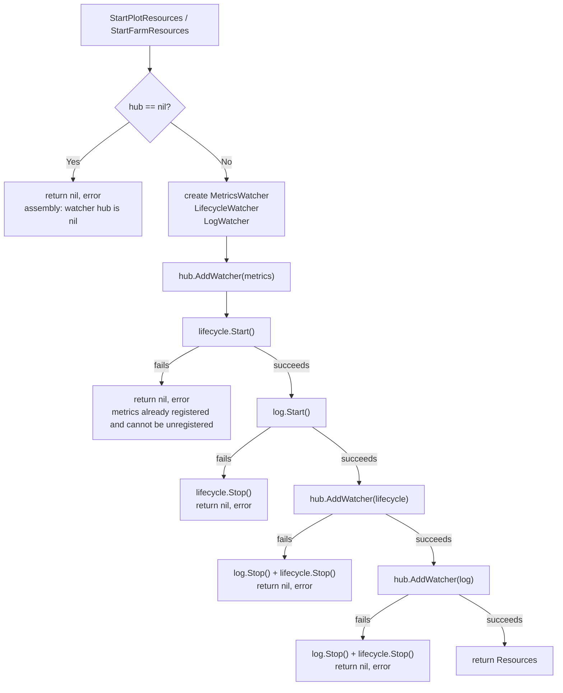
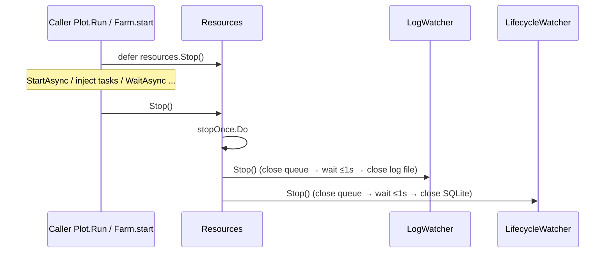
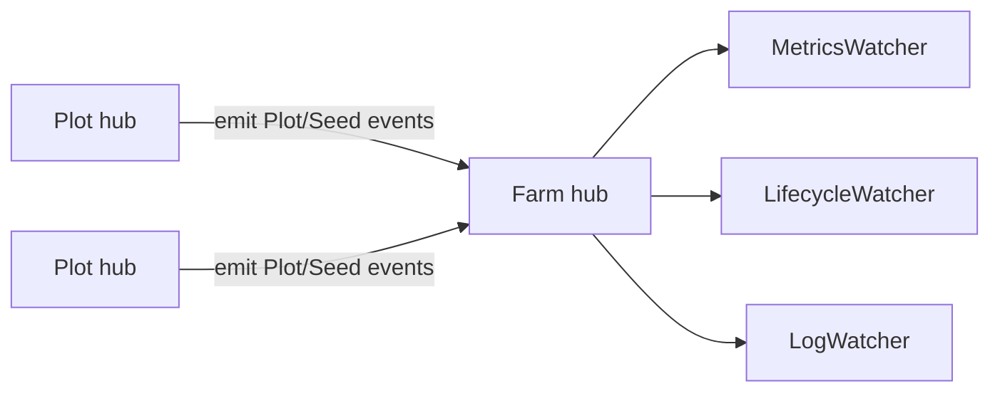

# pkg/assembly/assembly.go

> 📅 Last Updated: 2026/11/13

`pkg/assembly` is the **runtime resource assembly layer**. It moves "creating observer instances, registering them on the Hub, and starting/stopping their consumption loops" out of `Plot` / `Farm`: `Plot` and `Farm` themselves only hold a `scarecrow.Hub` and no longer hold `funnel.Spout` or `persist` observer instances directly.

This file exposes only 3 public symbols: the resource handle `Resources` (with its `Stop` method) and the two assembly entries `StartPlotResources` / `StartFarmResources`; all three share the internal flow `startResources`. The Plot-level and Farm-level assembly contents are currently identical; the two entries are split to leave an extension point for Farm-only resources (such as remote reporting).

## Purpose

- Create three kinds of observers at the start of every run: metrics (`scarecrow.MetricsWatcher`), lifecycle (`persist.LifecycleWatcher`), and log (`persist.LogWatcher`).
- Start the observers' consumption loops in a fixed order and register them on the `*scarecrow.Hub` passed in by the caller; events are dispatched uniformly by the Hub from then on.
- Stop the observers, flush to disk, and release file / SQLite handles at the end of the run through the returned `*Resources`.
- Roll back already-started resources when startup fails, so that no consumption goroutine is left "started but never reclaimed".

## Core Objects

### `Resources`

```go
type Resources struct {
	lifecycle *persist.LifecycleWatcher
	log       *persist.LogWatcher
	stopOnce  sync.Once
}
```

| Field | Meaning |
|------|------|
| `lifecycle` | The lifecycle observer, which translates events into `seed` / `ripen` / `wither` / `prune` records and writes them to SQLite asynchronously |
| `log` | The log observer, which translates events into text lines and writes them asynchronously to `logs/grow_log(<date>).log`; the counts in the Plot end log are read directly from the `MetricsWatcher` snapshot |
| `stopOnce` | Ensures that the resource reclamation of `Stop` runs only once |

None of the three fields is exported; the outside world can only reclaim through `Stop` and cannot operate on an individual observer. When you need observation information such as the database path, look the observer up from the Hub through `scarecrow.Find` (see "Observing assembled resources" below).

#### `Stop()`

```go
func (r *Resources) Stop()
```

Stops and reclaims the resources started by this run:

1. `stopOnce.Do(...)` ensures repeated calls execute only once;
2. `r.log.Stop()` first, then `r.lifecycle.Stop()` (the reverse of the startup order);
3. the errors returned by both `Stop` calls are explicitly discarded (`_ =`).

The `Stop` of `persist` ultimately lands on `funnel.Spout.Stop`: it closes the queue channel, waits at most 1 second for the consumption goroutine to process the remaining records, and then calls the handler's `AfterStop` to close the file / SQLite connection. `Resources.Stop` therefore also takes on the **flush** responsibility.

> `Stop` has no nil-receiver protection: calling it on a nil `Resources` panics. When startup fails, both entries return `(nil, err)`, so the caller must check the error before `defer resources.Stop()`.

### Assembly entries

| Function | Signature | Caller |
|------|------|--------|
| `StartPlotResources` | `func StartPlotResources(hub *scarecrow.Hub, logLevel string) (*Resources, error)` | `basePlot.Run` in standalone mode (`pkg/plot/plot.go`) |
| `StartFarmResources` | `func StartFarmResources(hub *scarecrow.Hub, logLevel string) (*Resources, error)` | `Farm.start` (`pkg/farm/farm.go`), i.e. the shared flow of `Farm.Run` / `Farm.Start` |

Both are currently just forwarders to `startResources`:

```go
func StartPlotResources(hub *scarecrow.Hub, logLevel string) (*Resources, error) {
	return startResources(hub, logLevel)
}

func StartFarmResources(hub *scarecrow.Hub, logLevel string) (*Resources, error) {
	return startResources(hub, logLevel)
}
```

`logLevel` is passed to `persist.NewLogWatcher` unchanged: valid values are `TRACE` / `DEBUG` / `SUCCESS` / `INFO` / `WARNING` / `ERROR` / `CRITICAL`; an empty string or an unrecognized level is treated as `INFO`.

### Internal flow `startResources`

```go
func startResources(hub *scarecrow.Hub, logLevel string) (*Resources, error)
```

The complete assembly steps:

1. `hub == nil` → return `nil, fmt.Errorf("assembly: watcher hub is nil")` directly;
2. create `scarecrow.NewMetricsWatcher()`;
3. create `persist.NewLifecycleWatcher()`;
4. create `persist.NewLogWatcher(metricsWatcher, logLevel)` — the log observer depends on the metrics observer to read the ripen / wither / prune counts on `PlotEndEvent`;
5. `hub.AddWatcher(metricsWatcher)` — the metrics observer is registered **first** (it has no consumption loop and does not need to be started outside the Hub);
6. `lifecycleWatcher.Start()`;
7. `logWatcher.Start()`;
8. `hub.AddWatcher(lifecycleWatcher)`;
9. `hub.AddWatcher(logWatcher)`;
10. return `&Resources{lifecycle: lifecycleWatcher, log: logWatcher}`.

Differences between the three kinds of observers:

| Observer | Constructor | Has a consumption loop | Registered on the Hub | Needs `Start` |
|--------|------|:--------------:|:--------------:|:------------:|
| `*scarecrow.MetricsWatcher` | `scarecrow.NewMetricsWatcher()` | No (pure in-memory aggregation) | Yes | No |
| `*persist.LifecycleWatcher` | `persist.NewLifecycleWatcher()` | Yes (`funnel.Spout`, buffer 100, timeout 1s) | Yes | Yes |
| `*persist.LogWatcher` | `persist.NewLogWatcher(metrics, logLevel)` | Yes (same as above) | Yes | Yes |

> `Resources` only holds the latter two. The metrics observer has no resources that need reclaiming, so it is not part of `Resources` and is not handled by `Stop`.

## Key Flow

### Startup and registration timing



Key points:

- **Start first, register later**: both `lifecycle` and `log` have their consumption loops running before they enter the Hub's observer list. From the moment registration succeeds, events are guaranteed to have a consumer, so there is no window where "an event has been delivered but no one consumes the queue".
- **Registration order is dispatch order**: the Hub forwards events synchronously in registration order, so the event processing order is fixed as `metrics → lifecycle → log`. Metrics are updated first, so that when the log writes the `PlotEnd` summary it can read the final counts of this run.
- **Metrics are registered first**: `MetricsWatcher` has no `Start` step, so the code registers it on the Hub before starting the other observers.

### Failure rollback

| Failure point | Returned error | Cleanup performed | Hub leftovers |
|--------|----------|--------------|----------|
| `hub == nil` | `assembly: watcher hub is nil` | None (no object created yet) | None |
| `lifecycleWatcher.Start()` | `assembly: start lifecycle watcher: %w` | None | `metrics` registered |
| `logWatcher.Start()` | `assembly: start log watcher: %w` | `lifecycle.Stop()` | `metrics` registered |
| `hub.AddWatcher(lifecycleWatcher)` | the Hub error returned unchanged | `log.Stop()` + `lifecycle.Stop()` | `metrics` registered |
| `hub.AddWatcher(logWatcher)` | the Hub error returned unchanged | `log.Stop()` + `lifecycle.Stop()` | both `metrics` and `lifecycle` registered |

> Rollback can only "stop" started observers; it **cannot unregister them from the Hub**, because `scarecrow.Hub` provides no removal interface. Assembly failure can therefore leave the metrics observer (and an already-registered lifecycle observer) in the Hub. In normal usage the Hub is created anew for each run (`newBasePlot` / `NewFarm` each create their own), so leftovers do not accumulate across runs; but calling the assembly entries repeatedly on the same Hub stacks observers.

A `lifecycle.Start()` failure usually comes from failing to create the `lifecycles/<date>/` directory or failing to open SQLite; a `log.Start()` failure usually comes from failing to create the `logs/` directory or failing to open the log file (both are relative to the **process working directory**).

### Stop timing



- The stop order is the reverse of the startup order: log first, lifecycle second;
- after closing the channel, each `Spout.Stop` waits at most `1s` for the remaining records to be consumed; on the normal path the buffer is fully flushed;
- the errors of both `Stop` calls are discarded, so the caller cannot learn from `Resources.Stop` that "the flush timed out" or "closing the file failed".

## Important Details

### Relationship with Plot / Farm

Neither entry is a regular API for business code to call by hand; they are internal assembly points of the runtime framework:

| Caller | Code location | Behavior |
|--------|----------|------|
| `basePlot.Run(seeds, logLevel)` | `pkg/plot/plot.go` | `StartPlotResources(p.hub, logLevel)`; on failure it **returns silently** (`Run` has no return value); on success `defer resources.Stop()`, then `StartAsync` → `Seed` every seed → `Seal` → `WaitAsync` |
| `Farm.start(logLevel, prepare)` | `pkg/farm/farm.go` | `StartFarmResources(f.hub, logLevel)`; on failure it returns the error to `Farm.Run` / `Farm.Start`; on success `defer resources.Stop()`, then emits `FarmStartEvent`, registers `f.hub` into every Plot's Hub, calls `StartAsync` on all Plots, and finally `WaitAsync` on each |

Therefore:

- **standalone**: observers are registered on the Plot's own Hub, and events are dispatched directly by `basePlot.emit`;
- **Farm mode**: observers are registered on the Farm's Hub, and `Farm.start` attaches the Farm Hub to every Plot's Hub as an observer via `plot.AddWatcher(f.hub)`, so Plot events are forwarded through the nested Hub to the Farm-level observers. `scarecrow.Find` searches nested Hubs recursively, so `Harvest` can find the `LifecycleWatcher` registered on the Farm Hub from the Plot's Hub.



### Observing assembled resources

`Resources` does not expose its internal observers; after a run the results are usually retrieved like this:

```go
lifecycle, ok := scarecrow.Find[*persist.LifecycleWatcher](hub)
if !ok {
	// not assembled or already replaced
	return
}
dbPath := lifecycle.DBPath() // empty string before Start; points to this run's .sqlite3 after Start
records, err := persist.LoadLifecycleStatusesFromPath(dbPath, "plot-name")
```

`lifecycle.DBPath()` reads `SQLitePath` from the handler directly; that field is only assigned in `LifecycleRecordHandler.BeforeStart` (i.e. `Start`). There is no corresponding query interface for the log file path; it is fixed at `logs/grow_log(<YYYY-MM-DD>).log` under the working directory.

### Hub registration constraints

- `Hub.AddWatcher` rejects `nil` observers;
- ring detection is performed when the observer is a `*Hub`; none of the three observers registered by this package is a `*Hub`, so the error branches of the two `AddWatcher` calls are actually unreachable in the current implementation. They are defensive code (leaving an error channel for future changes in Hub rules or for replacing the observer types);
- events are dispatched synchronously in registration order; an error or panic returned by a single observer is caught by the Hub and handed to the `ErrorHandler`, without interrupting the other observers. The `emit` of `Farm` / `Plot` ignores the return value of `OnEvent` (the Hub itself always returns nil as well).

## Usage Examples

### Driving a Hub on its own

```go
package main

import (
	"fmt"
	"time"

	"github.com/Mr-xiaotian/CelestialGrow/pkg/assembly"
	"github.com/Mr-xiaotian/CelestialGrow/pkg/persist"
	"github.com/Mr-xiaotian/CelestialGrow/pkg/scarecrow"
)

func main() {
	hub := scarecrow.NewHub(scarecrow.WithErrorHandler(func(err error) {
		fmt.Println("watcher error:", err)
	}))

	resources, err := assembly.StartFarmResources(hub, "DEBUG")
	if err != nil {
		panic(err)
	}
	defer resources.Stop() // guarantee flushing and handle reclamation

	// Simulate one seed input event; in real scenarios it is produced by the emit of Plot/Farm.
	if err := hub.OnEvent(scarecrow.SeedInputEvent{
		Plot:     "demo",
		Seed:     42,
		SeedRepr: "42",
		SeedID:   1,
		Time:     time.Now(),
	}); err != nil {
		panic(err)
	}

	// Repeated calls are safe: stopOnce reclaims only once.
	resources.Stop()
	resources.Stop()

	lifecycle, ok := scarecrow.Find[*persist.LifecycleWatcher](hub)
	if !ok {
		panic("lifecycle watcher is not registered")
	}

	records, err := persist.LoadLifecycleStatusesFromPath(lifecycle.DBPath(), "demo")
	if err != nil {
		panic(err)
	}
	for _, record := range records {
		fmt.Printf("plot=%s status=%s seed=%s\n", record.Plot, record.Status, record.SeedJSON)
	}
}
```

After running, `logs/grow_log(<date>).log` and `lifecycles/<date>/grow_lifecycle(<time>).sqlite3` are created in the working directory.

### Using it indirectly through Plot / Farm

Business code does not need to call this package directly:

```go
package main

import (
	"fmt"

	"github.com/Mr-xiaotian/CelestialGrow/pkg/farm"
	"github.com/Mr-xiaotian/CelestialGrow/pkg/plot"
)

func double(seed int) (int, error) { return seed * 2, nil }

func main() {
	// standalone: internally calls StartPlotResources and defers Stop.
	p := plot.NewSinglePlot("double", double)
	p.Run([]int{1, 2, 3}, "INFO")

	// Farm: internally calls StartFarmResources and defers Stop.
	f := farm.NewFarm("demo")
	if err := f.AddPlot(plot.NewSinglePlot("double", double)); err != nil {
		panic(err)
	}
	if err := f.Run(map[string][]any{"double": {1, 2, 3}}, "INFO"); err != nil {
		panic(err)
	}

	fmt.Println("done")
}
```

> `basePlot.Run`, `Farm.Run`, and `Farm.Start` all stop the assembled resources before returning, so the logs and SQLite are already flushed by the time the caller gets the result.

## Notes

- **`defer resources.Stop()` is mandatory**: the `Spout` queue is buffered; not calling `Stop` loses the queued log / lifecycle records and leaks the log file and SQLite connection.
- **`Stop` must be called after the production side has stopped**: `Spout.Stop` closes the queue channel; if any goroutine still `Send`s to the queue, it panics (`send on closed channel`). Both `Plot.Run` and `Farm.start` arrange `defer resources.Stop()` to fire after all `WaitAsync` calls complete, precisely to guarantee this.
- **A failed startup returns `(nil, err)`**; never call `Stop` on nil. The standalone `basePlot.Run` silently swallows that error (no return value), so when investigating "the Plot produces no output", first check whether the working directory is writable and whether SQLite can be opened.
- **`Stop` is idempotent but not reusable**: its internal observers are already closed, so `Resources` cannot be handed to a new run again; call the assembly entry again when you need to run once more.
- **Repeated assembly on the same Hub stacks observers**: the Hub has no unregister interface, so running the same Plot / Farm repeatedly makes log and lifecycle records be written repeatedly (multiple watchers consume the same events).
- **Assembly failure may leave the metrics observer behind**: early failures such as `lifecycle.Start` do not remove the already-registered `MetricsWatcher`; see "Failure rollback" above.
- **Log levels are case-sensitive**: only uppercase enum values are recognized; a lowercase `debug` is treated as an unknown level and falls back to `INFO`.
- **Output paths are relative to the working directory**: `logs/` and `lifecycles/` are created based on the process's current working directory, not the binary's directory; different working directories write to different locations.
