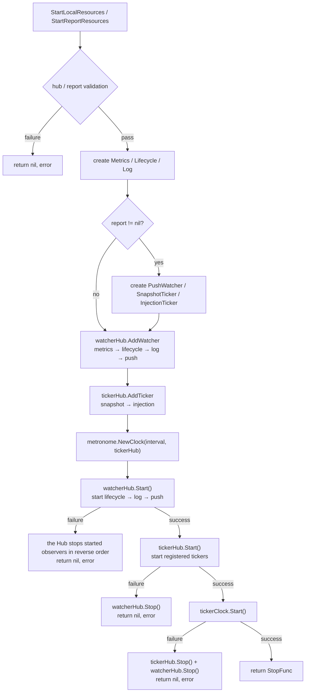
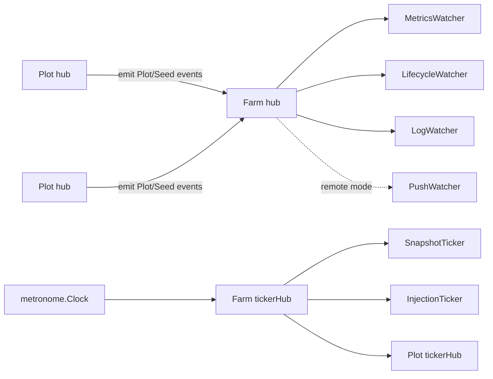

# pkg/assembly/assembly.go

> 📅 Last Updated: 2026/11/26

`pkg/assembly` is the **runtime resource assembly layer**. It strips "creating observer instances, registering Hubs, and starting/stopping consumption loops and the metronome clock" out of `Plot` / `Farm`: `Plot` and `Farm` themselves only hold a `scarecrow.Hub` and a `metronome.Hub`, and no longer hold `funnel.Spout`, persistence observer instances, or clocks directly.

This file exposes only 3 public symbols:

| Symbol | Category | Purpose |
|------|------|------|
| `StopFunc` | Type | Resource reclamation function `func() error` |
| `StartLocalResources` | Function | Assembles the observers, metronome Hub, and metronome clock for purely local runs |
| `StartReportResources` | Function | Adds remote pushing and remote injection polling on top of the local resources |

Both share the internal flow `startResources`.

## Purpose

- Creates three kinds of observers at the start of every run: metrics (`scarecrow.MetricsWatcher`), lifecycle (`persist.LifecycleWatcher`), and log (`persist.LogWatcher`).
- In remote reporting mode, additionally creates the push observer `reporter.PushWatcher`, the periodic snapshot `reporter.SnapshotTicker`, and the remote injection `reporter.InjectionTicker`.
- Registers and starts the observers, tickers, and clock in a fixed order; events are dispatched uniformly by `scarecrow.Hub`, and periodic tasks are scheduled uniformly by `metronome.Hub`.
- Returns an idempotent `StopFunc` that, at the end of the run, stops the clock, tickers, and observers in the reverse of the startup order, flushes to disk, and releases file / SQLite / HTTP connections.
- Rolls back already-started resources when startup fails, returning the original error to the caller.

## Core Objects

### `StopFunc`

```go
type StopFunc func() error
```

The reclamation handle returned on success by `StartLocalResources` / `StartReportResources`. Calling it stops the metronome clock, the ticker Hub, and the observer Hub in order and returns the aggregated error; a repeated call returns `nil` directly.

### `StartLocalResources`

```go
func StartLocalResources(
    watcherHub *scarecrow.Hub,
    tickerHub *metronome.Hub,
    logLevel string,
    interval time.Duration,
) (StopFunc, error)
```

Assembles resources for a standalone Plot (`basePlot.Run`) or a local Farm run:

1. creates `MetricsWatcher`, `LifecycleWatcher`, and `LogWatcher`;
2. registers them on `watcherHub` in the order `metrics → lifecycle → log`;
3. creates and starts the metronome clock, with `tickerHub` as the root ticker;
4. returns the `StopFunc`.

`logLevel` is passed to `persist.NewLogWatcher` unchanged: valid values are `TRACE` / `DEBUG` / `SUCCESS` / `INFO` / `WARNING` / `ERROR` / `CRITICAL`; an empty string or an unrecognized level is treated as `INFO`. `interval` is the base period of the metronome clock and must be positive; both `Farm` and `Plot` pass `metronome.DefaultInterval` (1 second).

### `StartReportResources`

```go
func StartReportResources(
    watcherHub *scarecrow.Hub,
    tickerHub *metronome.Hub,
    injectionTarget reporter.InjectionTarget,
    logLevel string,
    interval time.Duration,
    report *reporter.Config,
) (StopFunc, error)
```

Besides the local resources, additionally assembles the remote capabilities:

- `report == nil` → `assembly: report config is nil`;
- `injectionTarget == nil` → `assembly: injection target is nil`;
- creates `*reporter.PushWatcher` from `report.SessionID` / `report.URL` and the same `MetricsWatcher` (`reporter.Config.SessionID` must not be empty; `URL` must be a non-empty http/https address);
- creates `*reporter.SnapshotTicker` with `report.SnapshotPeriod`, using `reporter.DefaultSnapshotPeriod` (1 tick) when the period is `0`;
- creates `*reporter.InjectionTicker` with `report.InjectionPeriod`, using `reporter.DefaultInjectionPeriod` (5 ticks) when the period is `0`, and passing `0` as the pull timeout (which uses `reporter.DefaultPullTimeout`, 3 seconds);
- appends the push observer to the end of the observer list, and registers the snapshot and injection tickers on `tickerHub` in order.

`reporter.InjectionTarget` is an interface with only two methods, which `*farm.Farm` implements directly:

```go
type InjectionTarget interface {
    InjectTasks(tasks map[string][]any) error
    InjectTerminations(nodes []string) error
}
```

The fields of `*reporter.Config` (exported under the `Report` alias in `pkg/api`):

| Field | Type | Meaning |
|------|------|------|
| `URL` | `string` | Base address of the reporting service; a trailing `/` is normalized away; must be http/https |
| `SessionID` | `string` | Session identifier; the assembly entries require it to be non-empty (`Farm` fills it in before running) |
| `SnapshotPeriod` | `int` | Tick period of state snapshots; `0` uses the default 1 |
| `InjectionPeriod` | `int` | Tick period of injection polling; `0` uses the default 5 |

Data flow in remote mode:

| Component | Trigger | Behavior |
|------|------|------|
| `PushWatcher` | `FarmStartEvent` | Pushes the graph metadata to `/api/push_graph_meta` |
| `PushWatcher` | `SeedWitherEvent` | Pushes the single failed task to `/api/push_error` |
| `PushWatcher` | `FarmEndEvent` | First pushes a final-state snapshot to `/api/push_snapshot`, then pushes the session shutdown to `/api/shutdown_session` |
| `SnapshotTicker` | every `SnapshotPeriod` ticks | Reads the whole-graph state from `MetricsView.GetPlots()` and hands it to `PushWatcher.PushSnapshot` |
| `InjectionTicker` | every `InjectionPeriod` ticks | `GET /api/pull_injection?session_id=...`, handing the returned tasks / terminations to `InjectionTarget` |

### Internal flow `startResources`

```go
func startResources(
    watcherHub *scarecrow.Hub,
    tickerHub *metronome.Hub,
    injectionTarget reporter.InjectionTarget,
    logLevel string,
    interval time.Duration,
    report *reporter.Config,
) (StopFunc, error)
```

The complete steps:

1. `watcherHub == nil` → `assembly: watcher hub is nil`; `tickerHub == nil` → `assembly: ticker hub is nil`;
2. creates `scarecrow.NewMetricsWatcher()`, `persist.NewLifecycleWatcher()`, and `persist.NewLogWatcher(metricsWatcher, logLevel)`;
3. when `report != nil`, creates `PushWatcher`, `SnapshotTicker`, and `InjectionTicker`, and adds `PushWatcher` to the observer list;
4. calls `watcherHub.AddWatcher(...)` in order: `metrics → lifecycle → log → push`;
5. calls `tickerHub.AddTicker(...)` in order: `snapshotTicker → injectionTicker`;
6. `metronome.NewClock(interval, tickerHub)`;
7. `watcherHub.Start()`: starts the observers implementing `scarecrow.Lifecycle` in registration order, i.e. `lifecycle → log → push` (the metrics observer has no lifecycle and is skipped);
8. `tickerHub.Start()`: starts the tickers implementing `metronome.Lifecycle` in registration order. Among the tickers registered by this package only `InjectionTicker` implements that interface (`SnapshotTicker` only has `OnTick` / `TickPeriod`); in the Farm scenario the ticker Hub also has the ticker Hub of every Plot pre-registered, and they are started recursively by `Hub.Start` too;
9. `tickerClock.Start()`: starts the background metronome goroutine, driving `tickerHub` starting from tick 1;
10. returns the `stop` closure.

> The key to the startup order is **register first, then start everything at once**: all observers and tickers enter the Hub first, and are then started by the Hub's `Start` in registration order. In this way, when startup fails the Hub itself rolls back the started items in reverse order, and the assembly layer only needs to roll back the outer clock and ticker Hub.

Differences between local and remote observers:

| Observer | Constructor | Has a consumption loop | Registered on the Hub | Needs `Start` |
|--------|------|:--------------:|:----------:|:------------:|
| `*scarecrow.MetricsWatcher` | `scarecrow.NewMetricsWatcher()` | No (pure in-memory aggregation) | Yes | No |
| `*persist.LifecycleWatcher` | `persist.NewLifecycleWatcher()` | Yes (`funnel.Spout`, buffer 100, timeout 1s) | Yes | Yes (called by `watcherHub.Start`) |
| `*persist.LogWatcher` | `persist.NewLogWatcher(metrics, logLevel)` | Yes (same as above) | Yes | Yes (called by `watcherHub.Start`) |
| `*reporter.PushWatcher` | `reporter.NewPushWatcher(...)` | Yes (`funnel.Spout`, buffer 64, Stop timeout 3s; enqueue timeout 500ms) | Yes (remote mode only) | Yes (called by `watcherHub.Start`) |

### Stop timing

`StopFunc` uses a `stopped` boolean internally for idempotency protection, in a fixed order:

```text
StopFunc()
  ├─ stopped already true → return nil directly
  ├─ tickerClock.Stop()     // stop the metronome goroutine; wait at most 5s
  ├─ tickerHub.Stop()       // stop tickers in reverse order (InjectionTicker.Stop)
  └─ watcherHub.Stop()      // stop observers in reverse order (push → log → lifecycle)
```

- The stop order is the reverse of the startup order, ensuring that no new periodic task enters before the log/persistence channels are closed.
- After closing the queue, each `Spout.Stop` waits at most its own timeout for draining: 1 second for lifecycle / log, 3 seconds for push; it then calls the handler's `AfterStop` to close the file / SQLite / HTTP connection. `StopFunc` therefore also takes on the **flush** responsibility.
- Error aggregation: the first error is stored directly; subsequent errors are appended with `fmt.Errorf("%w; %w", ...)`, and the final error text joins the parts with `; `. If the first call returns an error, `stopped` has already been set to true, so **a further call does not retry** but returns `nil` directly.
- The idempotency guard is a plain boolean, not `sync.Once`, so **concurrent calls to `StopFunc` race**; it should be called only by a single goroutine after the run ends.
- Calling a `nil` `StopFunc` panics; a failed startup returns `(nil, err)`, so the caller must check the error first.

## Key Flow

### Startup and registration timing



Key points:

- **Registration order is dispatch order**: `scarecrow.Hub` forwards events synchronously in registration order, so the event processing order is fixed as `metrics → lifecycle → log → push`. Metrics are updated first, so that when the log writes the `PlotEnd` summary it can read the final counts of this run.
- **Metrics are registered first**: `MetricsWatcher` has no `Start` step, but it must enter the Hub before the log observer.
- **The metronome clock starts last**: the clock is created and started only after all tickers are registered, avoiding a lost first tick or a tick hitting a half-initialized state.

### Failure rollback

| Failure point | Returned error | Cleanup performed | Hub leftovers |
|--------|----------|--------------|----------|
| `watcherHub == nil` / `tickerHub == nil` | `assembly: watcher hub is nil` / `assembly: ticker hub is nil` | None | None |
| `report == nil` / `injectionTarget == nil` | `assembly: report config is nil` / `assembly: injection target is nil` | None | None |
| reporter construction fails | `reporter: ...` returned unchanged | None | None (not registered yet) |
| `AddWatcher` fails | the Hub error returned unchanged | None | Previously registered observers stay in the Hub, but none of them is started |
| `AddTicker` fails | the Hub error returned unchanged | None | The registered observers and tickers all stay in the Hub, but none of them is started |
| `NewClock` fails | `metronome: interval must be positive, got ...` | None | Observers and tickers are registered but not started |
| `watcherHub.Start()` fails | `scarecrow: start %T: %w` (possibly merging rollback errors) | The Hub stops, in reverse order, the observers started this time and becomes non-restartable | The observers remain in the list but are stopped |
| `tickerHub.Start()` fails | `metronome: start %T: %w` | `watcherHub.Stop()`; `tickerHub.Start` has already stopped the started tickers in reverse order internally | Observers are stopped, tickers remain in the list |
| `tickerClock.Start()` fails | `metronome: ...` (currently `Clock.Start` always returns `nil`, so this branch is defensive code) | `tickerHub.Stop()` + `watcherHub.Stop()` | All stay in the Hub but are stopped |

> Rollback can only "stop" registered resources; it **cannot unregister observers from `scarecrow.Hub`** (the Hub has no removal interface). Although `metronome.Hub` provides `RemoveTicker`, this package does not use it either. In normal usage the Hub is created anew for each run (`newBasePlot` / `NewFarm` each create their own), so leftovers do not accumulate across runs; but calling the assembly entries repeatedly on the same Hub stacks observers.

> Validation order: `StartReportResources` validates `report` / `injectionTarget` first and then enters `startResources` to validate the two Hubs; `StartLocalResources` enters `startResources` directly to validate the Hubs.

A `LifecycleWatcher.Start()` failure usually comes from failing to create the `lifecycles/<date>/` directory or failing to open SQLite; a `LogWatcher.Start()` failure usually comes from failing to create the `logs/` directory or failing to open the log file (both are relative to the **process working directory**).

## Important Details

### Relationship with Plot / Farm

Neither entry is a regular API for business code to call by hand; they are internal assembly points of the runtime framework:

| Caller | Code location | Behavior |
|--------|----------|------|
| `basePlot.Run(seeds, logLevel)` | `pkg/plot/plot.go` | `StartLocalResources(p.watcherHub, p.tickerHub, logLevel, metronome.DefaultInterval)`; on failure it **returns silently** (`Run` has no return value); on success `defer stop()`, then `StartAsync` → `Seed` every seed → `Seal` → `WaitAsync` |
| `Farm.start(logLevel, report, prepare)` | `pkg/farm/farm.go` | uses `StartLocalResources` when `report == nil`, otherwise `StartReportResources(..., f, ...)`; on failure it returns the error to `Farm.Run` / `Farm.Start`; on success `defer stop()`, then emits `FarmStartEvent`, registers `f.watcherHub` into every Plot's Hub, calls `StartAsync` on all Plots, runs `prepare`, and finally `WaitAsync` on each |

Therefore:

- **standalone**: observers are registered on the Plot's own Hub, and events are dispatched directly by `basePlot`;
- **Farm mode**: observers are registered on the Farm's Hub, and `Farm.start` attaches the Farm Hub to every Plot's Hub as an observer via `plot.AddWatcher(f.watcherHub)`, so Plot events are forwarded through the nested Hub to the Farm-level observers. `scarecrow.Find` searches nested Hubs recursively, so `Harvest` can find the `LifecycleWatcher` registered on the Farm Hub from the Plot's Hub.
- **Farm metronome**: `Farm.start` first registers the ticker Hub of every Plot on the Farm's ticker Hub (`injectTickerHubs`), and then the clock created by this package drives the whole metronome tree.



### Observing assembled resources

Observers are not exposed through return values; after a run they are usually retrieved from the Hub:

```go
lifecycle, ok := scarecrow.Find[*persist.LifecycleWatcher](hub)
if !ok {
    // 未装配或已被替换
    return
}
dbPath := lifecycle.DBPath() // Start 之前为空字符串；Start 后指向本次运行的 .sqlite3
records, err := persist.LoadLifecycleStatusesFromPath(dbPath, "plot-name")
```

In remote mode you can likewise check whether the tickers were assembled successfully:

```go
snapshot, ok := metronome.Find[*reporter.SnapshotTicker](tickerHub)
injection, ok := metronome.Find[*reporter.InjectionTicker](tickerHub)
_, _ = snapshot, injection
```

`lifecycle.DBPath()` reads `SQLitePath` from the handler directly; that field is only assigned in `LifecycleRecordHandler.BeforeStart` (i.e. `Start`). There is no corresponding query interface for the log file path; it is fixed at `logs/grow_log(<YYYY-MM-DD>).log` under the working directory.

### Hub registration constraints

- `scarecrow.Hub.AddWatcher` rejects `nil` observers and performs ring detection on `*Hub`;
- `metronome.Hub.AddTicker` rejects `nil` tickers, duplicate registrations, invalid tick periods, and Hub rings;
- events / ticks are both dispatched synchronously in registration order; an error / panic returned by a single observer or ticker is caught by its Hub and handed to the error handler, without interrupting the remaining items.

## Usage Examples

### Local run: driving a Hub on its own

```go
package main

import (
    "fmt"
    "time"

    "github.com/Mr-xiaotian/CelestialGrow/pkg/assembly"
    "github.com/Mr-xiaotian/CelestialGrow/pkg/metronome"
    "github.com/Mr-xiaotian/CelestialGrow/pkg/persist"
    "github.com/Mr-xiaotian/CelestialGrow/pkg/scarecrow"
)

func main() {
    hub := scarecrow.NewHub(scarecrow.WithErrorHandler(func(err error) {
        fmt.Println("watcher error:", err)
    }))
    tickerHub, err := metronome.NewHub(metronome.WithErrorHandler(func(err error) {
        fmt.Println("ticker error:", err)
    }))
    if err != nil {
        panic(err)
    }

    stop, err := assembly.StartLocalResources(hub, tickerHub, "DEBUG", metronome.DefaultInterval)
    if err != nil {
        panic(err)
    }
    defer stop() // 保证刷盘与句柄回收

    // 模拟一次种子输入事件；真实场景由 Plot/Farm 的 emit 产生。
    if err := hub.OnEvent(scarecrow.SeedInputEvent{
        Plot:     "demo",
        Seed:     42,
        SeedRepr: "42",
        SeedID:   1,
        Time:     time.Now(),
    }); err != nil {
        panic(err)
    }

    // 重复调用安全：stopped 保护只执行一次回收。
    _ = stop()
    _ = stop()

    lifecycle, ok := scarecrow.Find[*persist.LifecycleWatcher](hub)
    if !ok {
        panic("lifecycle watcher is not registered")
    }

    records, err := persist.LoadLifecycleStatusesFromPath(lifecycle.DBPath(), "demo")
    if err != nil {
        panic(err)
    }
    for _, record := range records {
        fmt.Printf("plot=%s status=%s seed=%s\n", record.Plot, record.Status, record.SeedJSON)
    }
}
```

After running, `logs/grow_log(<date>).log` and `lifecycles/<date>/grow_lifecycle(<time>).sqlite3` are created in the working directory.

### Remote mode: assembling reporting and injection

```go
package main

import (
    "fmt"
    "time"

    "github.com/Mr-xiaotian/CelestialGrow/pkg/assembly"
    "github.com/Mr-xiaotian/CelestialGrow/pkg/metronome"
    "github.com/Mr-xiaotian/CelestialGrow/pkg/reporter"
    "github.com/Mr-xiaotian/CelestialGrow/pkg/scarecrow"
)

// injector 演示最小注入目标；实际运行时通常直接传 *farm.Farm。
type injector struct{}

func (injector) InjectTasks(map[string][]any) error { return nil }
func (injector) InjectTerminations([]string) error  { return nil }

func main() {
    hub := scarecrow.NewHub()
    tickerHub, err := metronome.NewHub()
    if err != nil {
        panic(err)
    }

    stop, err := assembly.StartReportResources(
        hub,
        tickerHub,
        injector{},
        "INFO",
        metronome.DefaultInterval,
        &reporter.Config{
            URL:             "http://127.0.0.1:8000",
            SessionID:       "demo@1",
            SnapshotPeriod:  2,
            InjectionPeriod: 5,
        },
    )
    if err != nil {
        panic(err)
    }
    defer stop()

    // 启动事件会触发一次图元信息推送（POST /api/push_graph_meta）。
    if err := hub.OnEvent(scarecrow.FarmStartEvent{
        Farm:        "demo",
        Plots:       []string{"root"},
        Edges:       map[string][]string{"root": {}},
        SourcePlots: []string{"root"},
        StartTime:   time.Now(),
    }); err != nil {
        panic(err)
    }

    if _, ok := metronome.Find[*reporter.SnapshotTicker](tickerHub); !ok {
        panic("snapshot ticker is not registered")
    }
    fmt.Println("report resources started")
}
```

### Using it indirectly through Plot / Farm

Business code does not need to call this package directly:

```go
package main

import (
    "fmt"

    "github.com/Mr-xiaotian/CelestialGrow/pkg/farm"
    "github.com/Mr-xiaotian/CelestialGrow/pkg/plot"
)

func double(seed int) (int, error) { return seed * 2, nil }

func main() {
    // standalone：内部会调用 StartLocalResources 并 defer stop。
    p := plot.NewSinglePlot("double", double)
    p.Run([]int{1, 2, 3}, "INFO")

    // Farm：内部会按 report 选择 StartLocalResources / StartReportResources 并 defer stop。
    f := farm.NewFarm("demo")
    if err := f.AddPlot(plot.NewSinglePlot("double", double)); err != nil {
        panic(err)
    }
    if err := f.Run(map[string][]any{"double": {1, 2, 3}}, "INFO", nil); err != nil {
        panic(err)
    }

    fmt.Println("done")
}
```

> `basePlot.Run` and `Farm.Run` / `Farm.Start` all stop the assembled resources before returning, so the logs and SQLite are already flushed by the time the caller gets the result.

## Notes

- **`StopFunc` must be called**: the `Spout` queue is buffered; failing to reclaim loses the queued log / lifecycle / push records, and leaks file, SQLite, and HTTP connections. On startup failure `nil` is returned, so do not call it.
- **`StopFunc` must be called after the production side has stopped**: `Spout.Stop` closes the queue channel; if any goroutine still `Send`s to the queue, it panics (`send on closed channel`). Both `Plot.Run` and `Farm.start` arrange `defer stop()` to fire after all `WaitAsync` calls complete, precisely to guarantee this.
- **`StopFunc` is idempotent but not reusable**: the internal observers and clock are already closed, so the return value cannot be handed to a new run; call the assembly entry again when you need to run once more. The error returned by the first `Stop` is not retried by a second call.
- **Repeated assembly on the same Hub stacks observers**: `scarecrow.Hub` has no unregister interface, so running the same Plot / Farm repeatedly makes log and lifecycle records be written repeatedly; reusing the same `tickerHub` may make assembly fail because of duplicate ticker registration.
- **Assembly failure may leave registered resources behind**: early failures do not remove the already-registered observers / tickers; see "Failure rollback" above.
- **Log levels are case-sensitive**: only uppercase enum values are recognized; a lowercase `debug` is treated as an unknown level and falls back to `INFO`.
- **Output paths are relative to the working directory**: `logs/` and `lifecycles/` are created based on the process's current working directory, not the binary's directory; different working directories write to different locations.
- **Remote mode requires complete configuration**: reporter construction fails when `SessionID` is empty or `URL` is not http/https; `Farm` only fills in an empty `SessionID` and does not validate/fill `URL`.
