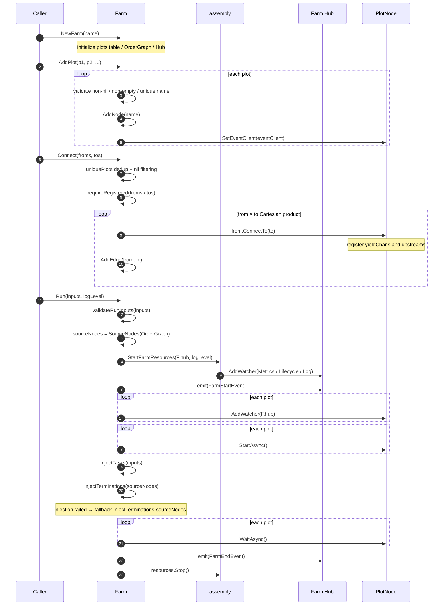
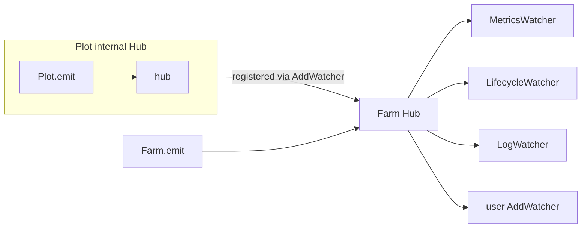

# pkg/farm/farm.go

> 📅 Last Updated: 2026/11/13

## Purpose

The `farm` package is CelestialGrow's "graph-level" scheduler. `farm.go` provides the `Farm` type, which organizes multiple `plot.PlotNode` nodes into a static directed graph and handles:

- node registration and name uniqueness validation
- group-to-group (hyper-edge) style fully connected edge creation
- Farm-level watcher registration, receiving both Farm events and all Plot events through a **hierarchical Hub**
- runtime resource assembly (`assembly.StartFarmResources` uniformly creates / starts / reclaims log and lifecycle watchers)
- rendering the graph structure before running (`getStructureList` → `RenderStructureList`) into `FarmStartEvent`
- source node detection (`SourceNodes`), initial seed injection, termination signal injection, and waiting for exit

`Farm` only manages the orchestration layer and does not care about a Plot's generic seed / fruit types — this is erased by the `plot.PlotNode` interface. The graph algorithms themselves live in `graph.go` and structure rendering in `render.go` in the same directory; see [`graph.md`](./graph.md) and [`render.md`](./render.md) for details.

## Core Objects

### The `Farm` struct

```go
type Farm struct {
    name        string
    plots       map[string]plot.PlotNode
    sourceNodes []string
    *OrderGraph

    eventClient runtime.EventClient
    hub         *scarecrow.Hub
}
```

| Field | Purpose |
| --- | --- |
| `name` | The Farm name, written into `FarmStartEvent` / `FarmEndEvent` and logs |
| `plots` | The node table indexed by plot name, used for registration validation and lookup |
| `sourceNodes` | The "source node representatives" computed once when `Run` / `Start` begins, one per Source SCC |
| `*OrderGraph` | The embedded directed graph recording the edges between plots, used for topology and SCC analysis |
| `eventClient` | The shared runtime event client, injected into each plot through `AddPlot` |
| `hub` | The Farm-level watcher Hub; it is also the nested Hub registered into each Plot |

> `Farm` no longer holds spout / inlet / persist watchers. All runtime resources are assembled by `pkg/assembly`, and Farm exposes only one Hub.

### The `PlotNode` interface contract

`Farm` is decoupled from concrete nodes through the `plot.PlotNode` interface. That interface is defined in `pkg/plot/plot.go`, and `Farm` actually calls the following methods:

| Method | Purpose |
| --- | --- |
| `GetName() string` | Unique identifier and edge matching |
| `GetState() int32` | Reads the node state (`0=idle` / `1=running` / `2=done`) |
| `GetSeedChanAny() any` | Exposes `seedChan` as `any`, for upstream `ConnectTo` to type-assert |
| `ConnectTo(next PlotNode) error` | Validates type compatibility, registers the downstream yield channel and the upstream name; returns an error on type mismatch |
| `AddUpstream(name string)` | Called by upstream `ConnectTo`, registers the upstream name for seal aggregation |
| `AddWatcher(listener scarecrow.Watcher) error` | Registers a watcher; Farm registers its Farm Hub here at startup |
| `SetEventClient(runtime.EventClient)` | Injects the same event client uniformly during `AddPlot` |
| `StartAsync()` / `WaitAsync()` | Asynchronous lifecycle control |
| `SeedAny(seed any) error` | Injects an initial seed (called once per seed by `InjectTasks`) |
| `Seal()` | Injects an external termination signal (called by `InjectTerminations`) |

## Public Symbols

| Symbol | Signature | Purpose |
| --- | --- | --- |
| `NewFarm` | `func NewFarm(name string) *Farm` | Constructs a Farm: initializes the plot table, an empty graph, a local event client and an empty Hub |
| `PlotCount` | `func (f *Farm) PlotCount() int` | Returns the number of registered plots |
| `HasPlot` | `func (f *Farm) HasPlot(name string) bool` | Reports whether the named plot is registered |
| `GetPlot` | `func (f *Farm) GetPlot(name string) (plot.PlotNode, bool)` | Gets a plot by name; `ok` indicates whether it exists |
| `AddPlot` | `func (f *Farm) AddPlot(plots ...plot.PlotNode) error` | Registers one or more plots, requiring non-nil, non-empty and unique names |
| `Connect` | `func (f *Farm) Connect(fromPlots, toPlots []plot.PlotNode) error` | Creates Cartesian-product style connections between the source group and the target group |
| `AddWatcher` | `func (f *Farm) AddWatcher(watcher scarecrow.Watcher) error` | Registers a Farm-level watcher (receives both Farm and Plot events) |
| `Run` | `func (f *Farm) Run(inputs map[string][]any, logLevel string) error` | Runs synchronously: start → inject seeds → seal sources → wait for exit |
| `Start` | `func (f *Farm) Start(logLevel string) error` | Runs synchronously without any injection, driven externally |
| `InjectTasks` | `func (f *Farm) InjectTasks(tasks map[string][]any) error` | Injects seeds into the given Plots; may be called at runtime |
| `InjectTerminations` | `func (f *Farm) InjectTerminations(nodes []string) error` | Injects termination signals into the given Plots; may be called at runtime |

### Semantic differences between `Run` / `Start` / `Inject*`

| Method | Starts Plots | Injects seeds | Injects termination signals | Blocks | Typical scenario |
| --- | :---: | :---: | :---: | :---: | --- |
| `Run(inputs, logLevel)` | ✅ | ✅ `inputs` | ✅ `sourceNodes` | Yes | One-shot batch processing |
| `Start(logLevel)` | ✅ | ❌ | ❌ | Yes | External driving (e.g. reporter, interactive injection) |
| `InjectTasks(tasks)` | ❌ | ✅ `tasks` | ❌ | No | Appending seeds at runtime |
| `InjectTerminations(nodes)` | ❌ | ❌ | ✅ `nodes` | No | Terminating the given Plots at runtime |

- `Run` = `validateRunInputs` + `start(logLevel, prepare)`, where `prepare` executes `InjectTasks(inputs)` and then `InjectTerminations(f.sourceNodes)`.
- `Start` performs no input validation and calls `start(logLevel, nil)` directly; **`Start` will not return if no external termination signal is ever injected**.
- `InjectTasks` / `InjectTerminations` only operate on registered Plots; they do not trigger resource assembly and do not change `sourceNodes`.

> The log level is no longer decided by `NewFarm`: `logLevel` is a parameter of every run (`Run` / `Start`), and an empty string is treated as `INFO`.

## Key Flows

### The full `AddPlot → Connect → Run` chain



### Internal `start` flow (shared by `Run` / `Start`)

1. Records `startTime`.
2. `assembly.StartFarmResources(f.hub, logLevel)` assembles the runtime resources: it creates `MetricsWatcher`, `LifecycleWatcher` and `LogWatcher`, and registers them into the Farm Hub after startup. On failure it returns immediately, before any Plot has been started.
3. `defer resources.Stop()`: stops and flushes when the run ends.
4. Emits `scarecrow.FarmStartEvent`, containing `Farm`, `IsDAG`, `Plots`, `Edges`, `SourcePlots`, `Structure`, `StartTime`.
5. `defer` emits `scarecrow.FarmEndEvent` (`Elapsed` is `time.Since(startTime)`).
6. For each plot, calls `plot.AddWatcher(f.hub)` — **the Farm Hub is registered into every Plot as a nested Hub**.
7. For each plot, calls `StartAsync()`.
8. Calls `prepare()` (the injection logic for `Run`, `nil` for `Start`).
9. If `prepare` returns an error, still performs one `InjectTerminations(f.sourceNodes)` as a fallback (ignoring its error), so the graph does not wait forever for a termination signal that will never arrive.
10. For each plot, calls `WaitAsync()`, and returns `prepareErr` after all of them have exited.

> `start` returns only assembly errors or injection errors; cultivation failures inside a Plot enter the watcher system as `SeedWitherEvent` and will not make `Run` / `Start` return an error.

### Hierarchical Hub dispatch



- Plot events (`PlotStart`, `SeedRipen`, etc.) are dispatched by the Plot's own Hub to registered watchers; the Farm Hub is one of them, so they continue to propagate upward.
- Farm events (`FarmStartEvent` / `FarmEndEvent`) go directly into the Farm Hub and are **not** dispatched down to Plots.
- `scarecrow.Find` can look up watchers along nested Hubs; this is exactly how `plot.Harvest()` finds `LifecycleWatcher` on the Plot Hub → Farm Hub chain.
- The copy-on-write semantics of `Hub` allow watchers to be appended at runtime, but only for subsequent events; registering the same Hub twice causes duplicate dispatch.

### Computing `sourceNodes`

`Run` and `Start` both execute `f.sourceNodes = SourceNodes(f.OrderGraph)` before starting:

1. `TarjanSCC` computes the strongly connected components;
2. computes the Source SCCs with in-degree 0 in the condensation graph (`SourceSCCs`);
3. takes `scc[0]` of each Source SCC as its representative node (`SourceNodes`).

This way, even if a source lies inside a strongly connected cycle, only one representative node receives the termination signal, avoiding duplicate seals. Isolated nodes (added by `AddPlot` but never connected) also become Source SCCs, so they receive termination signals too.

## Error Scenarios

### `AddPlot`

- Any plot is `nil` → `plot is nil`
- The name is empty → `plot name cannot be empty`
- The name is duplicated → `plot %q already exists`

The first error is returned immediately; plots already added successfully are **not rolled back**.

### `Connect`

- `fromPlots` is empty after deduplication → `from plots cannot be empty`
- `toPlots` is empty after deduplication → `to plots cannot be empty`
- Any plot is `nil` or unregistered → `plot is nil` / `plot %q is not registered in farm`
- The type assertion in `from.ConnectTo(to)` fails → passes through `plot %q yield type is incompatible with plot %q seed type`

> ⚠️ **Partial failure is not undone**: once the inner loop fails, `Connect` returns immediately and connections already established (`yieldChans`, `upstreams`, graph edges) are kept. On a later `Connect`, duplicate edges are ignored at the graph level, but the mappings inside Plots keep the old state.

### `AddWatcher`

- `watcher` is `nil` → `scarecrow: cannot add nil listener`
- Would create a Hub cycle → `scarecrow: cyclic hub registration rejected: ...` / `scarecrow: cannot add a hub to itself`

### `Run`

| Stage | Error source | Description |
| --- | --- | --- |
| Validation | `validateRunInputs` | An unregistered plot appears in `inputs` → `plot %q is not registered in farm`; at this point **no Plot has been started** |
| Assembly | `assembly.StartFarmResources` | Hub is nil, watcher startup fails, etc.; Plots have not been started yet |
| Registration | `plot.AddWatcher(f.hub)` | Hub cycle or nil watcher; returns before `StartAsync` |
| Injection | `InjectTasks` | Unregistered plot, `SeedAny` type assertion failure (`plot %q seed type mismatch: got %T`) |
| Injection | `InjectTerminations` | Unregistered plot |
| Wait | `WaitAsync` | Does not return an error |

### `InjectTasks`

- First runs `validateRunInputs` on all keys: if any target is unregistered → returns an error and **injects no seed at all**.
- Then calls `SeedAny` for each seed in map iteration order; if one seed has a mismatched type, it returns immediately and seeds already injected **cannot be withdrawn**.

### `InjectTerminations`

- First validates that all names are registered; if any is unregistered → returns an error and **injects no termination signal at all**.
- After validation passes, calls `Seal()` one by one to inject external termination signals (`Source == "__input__"`), with strong termination semantics: it no longer waits for upstream seals that have not yet arrived.
- After a termination signal is injected into a Plot, any seed later injected into it will not be processed.

## Important Details

### Group-to-group Cartesian product

`Connect(froms, tos)` first applies `uniquePlots` (deduplication + `nil` filtering) to both sides, then creates `len(froms) × len(tos)` edges:

```go
farm.Connect([]plot.PlotNode{root}, []plot.PlotNode{midA, midB})
// 等价于 root → midA 与 root → midB 两条独立边
```

Edges are created only between the source group and the target group; nodes inside the same group are not connected to each other.

### Termination fallback on injection failure

In `start`, after `prepare()` fails, `InjectTerminations(f.sourceNodes)` is still called:

- avoiding `WaitAsync` blocking forever on a graph that has no termination signal;
- the fallback error is explicitly ignored (`_ =`), and the returned value is still the original `prepareErr`;
- the fallback only terminates `sourceNodes`; downstream nodes exit through the normal propagation path after receiving the seal signal.

### Events and logs

- `Farm` emits only two events: `FarmStartEvent` and `FarmEndEvent`, defined in `pkg/scarecrow/event.go`.
- The `Structure` field comes from `getStructureList()`, i.e. `RenderStructureList(f.Nodes(), f.OutEdges(), f.sourceNodes)`.
- `persist.LogWatcher` outputs the structure line by line when consuming `FarmStartEvent`, and outputs the elapsed time when consuming `FarmEndEvent`.
- `Farm` itself does not write to the database; lifecycle and log persistence are all handled by the watchers registered by `assembly`.

### Collaboration with `pkg/runtime`

`eventClient` is injected during `AddPlot`, and all plots share the same event ID namespace, guaranteeing that the cross-plot seed → fruit → seal event chain is traceable.

### Concurrency control

- `Run` / `Start` are **synchronous** calls: they call `StartAsync` in turn and then wait for all plots to exit through `WaitAsync`.
- `StartAsync` uses `sync.WaitGroup.Go` (the Go 1.25 style) internally to start each plot's `sprout` scheduler.
- `InjectTasks` / `InjectTerminations` are designed to be called by other goroutines while `Start` is blocking; the `plots` table of `Farm` itself is not locked, so **the registration / connection phase must not be concurrent with the running phase**.

## Usage Examples

### Batch processing: `Run`

```go
package main

import (
    "fmt"

    "github.com/Mr-xiaotian/CelestialGrow/pkg/farm"
    "github.com/Mr-xiaotian/CelestialGrow/pkg/plot"
)

func main() {
    double := plot.NewSinglePlot("double", func(seed int) (int, error) {
        return seed * 2, nil
    }, plot.WithTenders(2))

    format := plot.NewSinglePlot("format", func(seed int) (string, error) {
        return fmt.Sprintf("result=%d", seed), nil
    })

    f := farm.NewFarm("demo_farm")
    if err := f.AddPlot(double, format); err != nil {
        panic(err)
    }
    if err := f.Connect([]plot.PlotNode{double}, []plot.PlotNode{format}); err != nil {
        panic(err)
    }

    if err := f.Run(map[string][]any{
        "double": {1, 2, 3, 4},
    }, "INFO"); err != nil {
        panic(err)
    }
}
```

### Externally driven: `Start` + `InjectTasks` / `InjectTerminations`

```go
package main

import (
    "fmt"

    "github.com/Mr-xiaotian/CelestialGrow/pkg/farm"
    "github.com/Mr-xiaotian/CelestialGrow/pkg/plot"
    "github.com/Mr-xiaotian/CelestialGrow/pkg/scarecrow"
)

func main() {
    root := plot.NewSinglePlot("root", func(seed int) (int, error) {
        return seed * 2, nil
    }, plot.WithTenders(2), plot.WithChanSize(8))

    f := farm.NewFarm("external_driven")
    if err := f.AddPlot(root); err != nil {
        panic(err)
    }

    if err := f.AddWatcher(scarecrow.WatcherFunc(func(event scarecrow.Event) error {
        switch ev := event.(type) {
        case scarecrow.PlotStartEvent:
            fmt.Println("plot started:", ev.Plot)
        case scarecrow.FarmEndEvent:
            fmt.Println("farm done in", ev.Elapsed)
        }
        return nil
    })); err != nil {
        panic(err)
    }

    go func() {
        for i := 0; i < 3; i++ {
            if err := f.InjectTasks(map[string][]any{"root": {i}}); err != nil {
                panic(err)
            }
        }
        if err := f.InjectTerminations([]string{"root"}); err != nil {
            panic(err)
        }
    }()

    if err := f.Start("INFO"); err != nil {
        panic(err)
    }
}
```

> `Start` blocks until all Plots exit; you must ensure that some external goroutine (or signal handling logic) eventually calls `InjectTerminations`, otherwise the call will never return.

### Reading results after the run ends

```go
records, err := root.Harvest()
if err != nil {
    panic(err)
}
for _, record := range records {
    fmt.Println(record.Status) // e.g. ripen
}
```

`Harvest` relies on the Farm Hub already being registered into the Plot Hub, so that it can find `LifecycleWatcher` along the nested Hubs.

## Notes

- **Not re-entrant**: the same `Farm` instance does not support concurrent or repeated `Run` / `Start`. Each `start` registers the Farm Hub into every Plot again, causing duplicate event dispatch; the Plot `state` also stays at `done`.
- **Injection order**: `InjectTasks` relies on `plots[name]` being registered. Do not modify the registry before runtime injection.
- **Termination is irreversible**: after `Seal()` the Plot's `sprout` no longer consumes seeds; `InjectTasks` does not report an error, but seeds will only linger in `seedChan`, and once the buffer is full the call blocks.
- **Graph vs. node set**: nodes in `OrderGraph` may be auto-completed by `AddEdge`, but on the normal path `AddPlot` has registered all nodes; `sourceNodes` uses the graph view rather than the `plots` view.
- **Log level**: for `logLevel` values see the level table in `pkg/persist`; unknown values are treated as `INFO`.
- **Test coverage**: `farm_connect_test.go`, `farm_start_test.go`, `farm_structure_test.go`, `farm_route_test.go`, `farm_split_test.go`, `farm_inject_test.go`, `farm_harvest_test.go`, `graph_test.go`, and `render_test.go` cover registration / connection, the linear `Run` flow, non-trivial topologies, routing / splitting, external injection, `Harvest`, graph algorithms and structure rendering.
