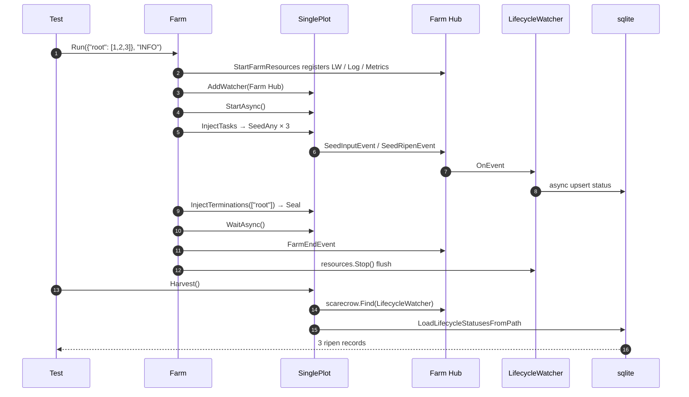

# pkg/farm/farm_harvest_test.go

> 📅 Last Updated: 2026/11/13

## Purpose

`farm_harvest_test.go`, as `package farm_test`, covers the cross-package collaboration chain of "can a Plot read its own lifecycle snapshot after the Farm run ends":

- The `LifecycleWatcher` assembled by the Farm-level `assembly` is registered on the **Farm Hub**;
- the Farm Hub is registered into each Plot's Hub inside `start`;
- a Plot emits `SeedInputEvent` / `SeedRipenEvent` at runtime, which travel through the nested Hub to the `LifecycleWatcher` and are written to sqlite asynchronously;
- after `Run` returns, `resources.Stop()` flushes, and then `root.Harvest()` follows the nested Hub to find the watcher and read the database.

Therefore this test does not verify a single getter, but the result of **Hub hierarchy + persistence + resource reclamation** working together.

## Test Cases

| Test function | What it verifies |
| --- | --- |
| `TestFarmRunHarvest` | After a single-Plot Farm processes 3 seeds with `Run(..., "INFO")`, `root.Harvest()` returns 3 records and every record has `Status == "ripen"` |

## Test Focus

### 1. The complete default path of `Run`

```go
root := plot.NewSinglePlot("root", func(seed int) (int, error) {
    return seed * 2, nil
}, plot.WithTenders(2))

farm := farm.NewFarm("farm_harvest")
farm.AddPlot(root)
farm.Run(map[string][]any{"root": {1, 2, 3}}, "INFO")
```

`root` is the only node, so `sourceNodes == ["root"]`: `Run` injects 3 seeds and seals automatically, with no manual termination needed in the test.

### 2. Nested Hub lookup

`Harvest` internally uses `scarecrow.Find[*persist.LifecycleWatcher](p.hub)`. That lookup first checks the Plot's direct watchers, then recurses into nested Hubs — and the Farm Hub is attached exactly through `plot.AddWatcher(f.hub)`. If that hierarchical registration is missing, `Harvest` returns `plot %q lifecycle watcher is not registered` and the test fails immediately.

### 3. State snapshots instead of raw events

`LifecycleWatcher` writes `SeedInputEvent` as a `seed` record and promotes `SeedRipenEvent` to a `ripen` record. `LifecycleStatusRecord.Status` is the final status string, so asserting `"ripen"` simultaneously covers:

- the status promotion from seed → ripen;
- that the database write path of fields such as `FruitJSON` does not break the primary key;
- that records are filtered by `plot` name (`LoadLifecycleStatusesFromPath(dbPath, p.name)`).

### 4. Resource flush timing

In `Run`, `defer resources.Stop()` stops the spout and closes sqlite. `Harvest` is called after `Run` returns, so it can read all 3 records, indirectly verifying the flush semantics of `Stop`.



## Key Assertions

| Assertion | Meaning |
| --- | --- |
| `err != nil` means failure | The error of `Harvest` covers two preconditions: "watcher not registered" and "database not ready" |
| `len(records) == 3` | Each of the 3 inputs produces exactly one status snapshot |
| Every `record.Status == "ripen"` | The success path always goes through `SeedRipenEvent`, never misjudged as wither / prune |

> The strict equality between the record count and the input count also implicitly verifies the upsert semantics of "only one row is kept per `InputEventID`".

## Related Source

- `pkg/farm/farm.go`: `Run` / `start` / `InjectTasks` / `InjectTerminations`
- `pkg/farm/farm.go`: `AddWatcher` (the public entry point of the Farm Hub)
- `pkg/assembly/assembly.go`: `StartFarmResources` / `Resources.Stop`
- `pkg/plot/plot.go`: `Harvest` / `AddWatcher` / `emit`
- `pkg/persist/lifecycle.go`: `LifecycleWatcher` (`seed` → `ripen` status promotion)
- `pkg/persist/sqlite.go`: `LifecycleStatusRecord` / `LoadLifecycleStatusesFromPath`
- `pkg/scarecrow/hub.go`: `Find` (penetrates nested Hubs)

## How to Run

```bash
go test ./pkg/farm/ -run 'TestFarmRunHarvest' -v
```

## Notes

- This test really creates and writes a lifecycle sqlite; the assertions depend only on count and status, not on the database path.
- `Harvest` can only be called after the run ends: during the run `DBPath` is already ready, but the queued records have not been flushed yet, so the count may be too low.
- If the hierarchical Hub registration is later removed from `Farm` (e.g. reverting to holding persist watchers directly), this test will be the first to fail.
