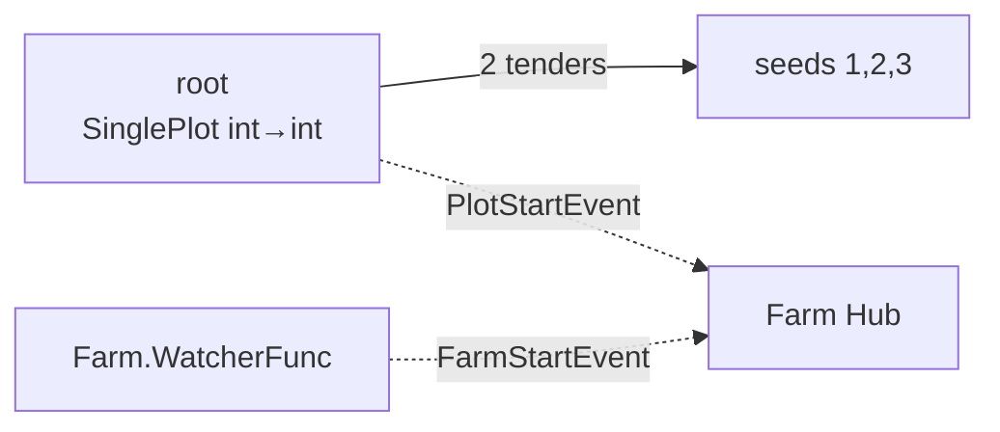
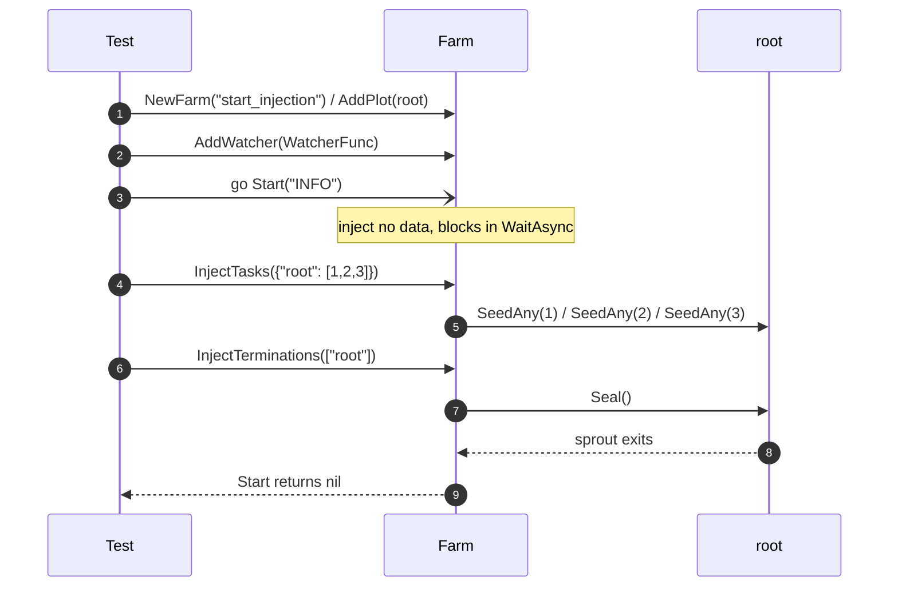

# pkg/farm/farm_inject_test.go

> 📅 Last Updated: 2026/11/13

## Purpose

`farm_inject_test.go`, as `package farm_test`, covers the **externally driven mode** of `Farm`:

- `Start(logLevel)` itself injects neither seeds nor termination signals;
- while `Start` is blocking, the caller can dynamically control the task flow through `InjectTasks` / `InjectTerminations`;
- the Farm-level watcher (`Farm.AddWatcher`) receives both Farm events and Plot events.

This is the core regression test for the capabilities added when `Farm.Run` was split (`Start` / `InjectTasks` / `InjectTerminations`).

## Test Cases

| Test function | What it verifies |
| --- | --- |
| `TestFarmStartWithInjection` | `Start` does not inject automatically; 3 seeds injected at runtime are all processed; `FarmStartEvent` and one `PlotStartEvent` are both observed by the Farm-level watcher; `Start` returns normally after the termination signal |

## Topology Under Test



There is only one `root`: `NewSinglePlot("root", ..., plot.WithTenders(2), plot.WithChanSize(8))`, which acts as both source and sink, so attention stays on injection semantics and event dispatch.

## Key Flows



## Key Details

### 1. `Start` does not inject

`Start` only computes `sourceNodes` and calls `start(logLevel, nil)`; when `prepare` is `nil`, neither `InjectTasks` nor `InjectTerminations` is triggered. The test must inject first, otherwise `Start` never returns.

### 2. Timing of runtime injection

`InjectTasks` is called immediately after `Start`'s goroutine starts:

- the Plot's `seedChan` has a `WithChanSize(8)` buffer, so writes do not block even if `StartAsync` has not been scheduled yet;
- `InjectTerminations` is called after the seeds, and `sprout` processes the 3 queued seeds first in FIFO order before exiting;
- `errCh` has a buffer of 1, so that the goroutine does not block forever once `Start` returns and the test has ended.

> If `WithChanSize` were set to 0, the scheduling order of injection and `StartAsync` would become an additional implicit dependency, reducing test stability.

### 3. Hierarchical dispatch of Farm-level watchers

`AddWatcher` registers into the Farm Hub; inside `start` the Farm Hub is in turn registered into the Hub of `root`. Therefore the same watcher receives:

| Event | Source | Assertion |
| --- | --- | --- |
| `FarmStartEvent` | `Farm.emit` (Farm Hub) | `farmStarted == true` |
| `PlotStartEvent` | `root.notifyStart` → root Hub → Farm Hub | `plotStarts == 1` |

A `PlotStartEvent` count of 1 also shows that the Farm Hub was registered only once, with no duplicate dispatch.

### 4. Concurrency safety

Watcher callbacks may be triggered by different goroutines (the Farm startup goroutine and the Plot's `StartAsync` goroutine), so the test protects `seeds` / `farmStarted` / `plotStarts` with a `sync.Mutex`; the final assertions read them under the lock.

### 5. Only the number of seeds is checked

The cultivator of `root` appends received seeds to `seeds`, and the test asserts `len(seeds) == 3`:

- verifying that "the injected seeds are really consumed by `sprout`/`tend`" instead of lingering in the channel;
- without constraining the processing order, because the 2 tenders run concurrently.

## Related Source

- `pkg/farm/farm.go`: `Start` / `start` / `InjectTasks` / `InjectTerminations` / `AddWatcher`
- `pkg/assembly/assembly.go`: `StartFarmResources` (`Start` assembles resources as well)
- `pkg/plot/plot.go`: `StartAsync` / `SeedAny` / `Seal` / `AddWatcher` / `notifyStart`
- `pkg/scarecrow/watcher.go`: `Watcher` / `WatcherFunc`
- `pkg/scarecrow/event.go`: `FarmStartEvent` / `PlotStartEvent`

## How to Run

```bash
go test ./pkg/farm/ -run 'TestFarmStartWithInjection' -v
```

## Notes

- In this case `Start` runs in a separate goroutine and the main goroutine performs the injection; calling the injection before `Start` would also work (the channel is buffered), but would no longer cover the "runtime injection" semantics.
- Errors from `Start` are conveyed through `errCh`; do not end the main goroutine with `t.Fatal`, otherwise the blocked `Start` goroutine leaks.
- If `Start` ever becomes auto-injecting, the `farmStarted` / `seeds` assertions will not fail, but the semantics of "no return without a termination signal" changes, and this test must be updated accordingly.
