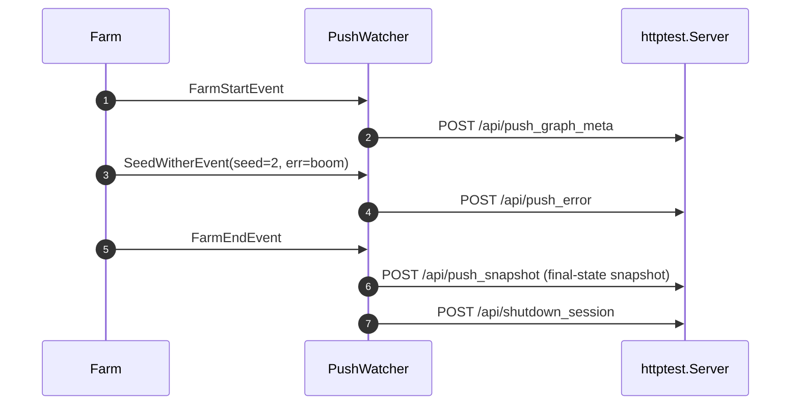

# pkg/farm/farm_report_test.go

> 📅 Last Updated: 2026/11/26

## Purpose

`farm_report_test.go`, as `package farm_test`, covers the **remote reporting mode** of `Farm`, verifying that when `Run` receives a non-nil `*reporter.Config`:

- `assembly.StartReportResources` assembles `PushWatcher`, `SnapshotTicker`, and `InjectionTicker`;
- `FarmStartEvent` is translated into graph metadata and pushed to `/api/push_graph_meta`;
- the `SeedWitherEvent` produced by a failed cultivation is pushed to `/api/push_error`;
- `FarmEndEvent` first pushes a supplementary final-state snapshot to `/api/push_snapshot`, then pushes the session shutdown to `/api/shutdown_session`;
- an empty `SessionID` is generated automatically by `normalizeReport`.

The test starts a real HTTP server with `net/http/httptest` and records the path and JSON body of every request, making it a black-box regression of the whole "Farm → assembly → reporter" chain.

## Test Cases

| Test function | What it verifies |
| --- | --- |
| `TestFarmRunWithReportPushesGraphErrorSnapshotAndShutdown` | A single-Plot Farm explicitly passes `SessionID: "farm@1"`; after the run all four reporting endpoints are hit, and the graph metadata, error, and shutdown payload fields are correct |
| `TestFarmRunGeneratesSessionID` | A `reporter.Config` without `SessionID` is passed; the `session_id` in `/api/push_graph_meta` starts with `"auto_session@"` |

## Key Flows

### 1. Case topology and failure injection

```go
root := plot.NewSinglePlot("root", func(seed int) (int, error) {
    if seed == 2 {
        return 0, errors.New("boom")
    }
    return seed * 2, nil
}, plot.WithTenders(2))

f := farm.NewFarm("report_farm")
f.AddPlot(root)
f.Run(map[string][]any{"root": {1, 2, 3}}, "INFO", &reporter.Config{
    URL:       server.URL,
    SessionID: "farm@1",
})
```

`root` is both the source and the sink, and seed `2` throws `boom`, so one `SeedWitherEvent` is produced. `Run` does not set `SnapshotPeriod` / `InjectionPeriod`, so they work with the default periods of the `reporter` package.

### 2. Causal order of the requests

The test does not assert order, but following the order in which events are produced, the causal chain of the four requests is:



`SnapshotTicker` may also insert extra `/api/push_snapshot` requests when the run takes longer; this case runs quickly, so the test only requires that this endpoint appears at least once.

### 3. Graph metadata fields

```json
{
  "session_id": "farm@1",
  "graph": "report_farm",
  "node_meta": {
    "root": {
      "class_name": "SinglePlot",
      "execution_mode": "thread",
      "max_workers": 2
    }
  }
}
```

- `graph` comes from `FarmStartEvent.Farm`;
- `node_meta` comes from the `GetMeta()` of each Plot aggregated by `Farm.getNodeMeta()`;
- `NodeMeta.MaxWorkers` equals the tender count set by `plot.WithTenders(2)`;
- after JSON deserialization numbers are `float64`, so the test asserts `max_workers == float64(2)`.

### 4. Error and shutdown payloads

| Endpoint | Field | Asserted value | Source |
| --- | --- | --- | --- |
| `/api/push_error` | `node` | `"root"` | `SeedWitherEvent.Plot` |
| `/api/push_error` | `error_message` | `"boom"` | the `%v` of `SeedWitherEvent.Err` |
| `/api/shutdown_session` | `session_id` | `"farm@1"` | the session identifier in the config |

`/api/push_error` also contains the `event_id`, `task_json`, `error_type`, and `ts` fields; this test only checks the node name and the error text.

## Boundaries and Assertion Focus

- **Only the set of endpoints is checked**: the test uses `slices.Contains` to confirm that all four paths exist, without constraining the request count or order; periodic snapshots or retries may produce extra requests.
- **Injection pulling is not checked**: `StartReportResources` also assembles `InjectionTicker`, but this file has no assertion on `/api/pull_injection` requests; the injection behavior is covered by `pkg/reporter/inject_test.go`.
- **Session identifier is passed through as-is**: an explicit `SessionID` is never rewritten, and all reporting records share the same value.
- **Auto-generation rule**: when `SessionID` is empty, `normalizeReport` generates `fmt.Sprintf("%s@%d", f.name, time.Now().UnixNano())`, so the test only asserts the `auto_session@` prefix, not the complete value.
- **Failures do not block the main flow**: HTTP failures of `PushWatcher` are only logged and never make `Run` return an error; the server in this test always returns `200 OK`, ensuring the reporting path runs through completely.
- **StopFunc flush**: before `Run` returns the resources are stopped; `PushWatcher.Stop` closes the inlet and waits for the background spout to finish consuming, so reading the request records after `Run` returns is stable.
- **Helper functions**: `findReport` takes the first record by path and calls `t.Fatalf` directly when it is missing; `capturedReport` keeps a copy of `path` and the body, preventing the shared slice from being overwritten by later requests.

## Related Source

- `pkg/farm/farm.go`: `Run` / `start` / `normalizeReport` / `getNodeMeta`
- `pkg/assembly/assembly.go`: `StartReportResources` (assembling `PushWatcher` / `SnapshotTicker` / `InjectionTicker`)
- `pkg/reporter/push.go`: `PushWatcher.OnEvent` (mapping `FarmStartEvent` / `SeedWitherEvent` / `FarmEndEvent` to endpoints)
- `pkg/reporter/config.go`: `Config`
- `pkg/plot/plot.go`: `GetMeta` / `NodeMeta` of `SinglePlot`
- `pkg/scarecrow/event.go`: `FarmStartEvent` / `FarmEndEvent` / `SeedWitherEvent`

## How to Run

```bash
go test ./pkg/farm/ -run 'TestFarmRunWithReport|TestFarmRunGeneratesSessionID' -v
```

## Notes

- This test does not access the external network; `httptest.Server` listens on a random local port, and `server.URL` is used directly as `reporter.Config.URL`.
- The test really assembles the tick clock and the background push spout, but the period is very short and the resources are stopped when `Run` ends, so no goroutine is left behind.
- If `report` were changed to `nil`, none of the four endpoints would receive a request and `findReport` would fail immediately; this is exactly the regression point of the two assembly branches (local vs. reporting).
