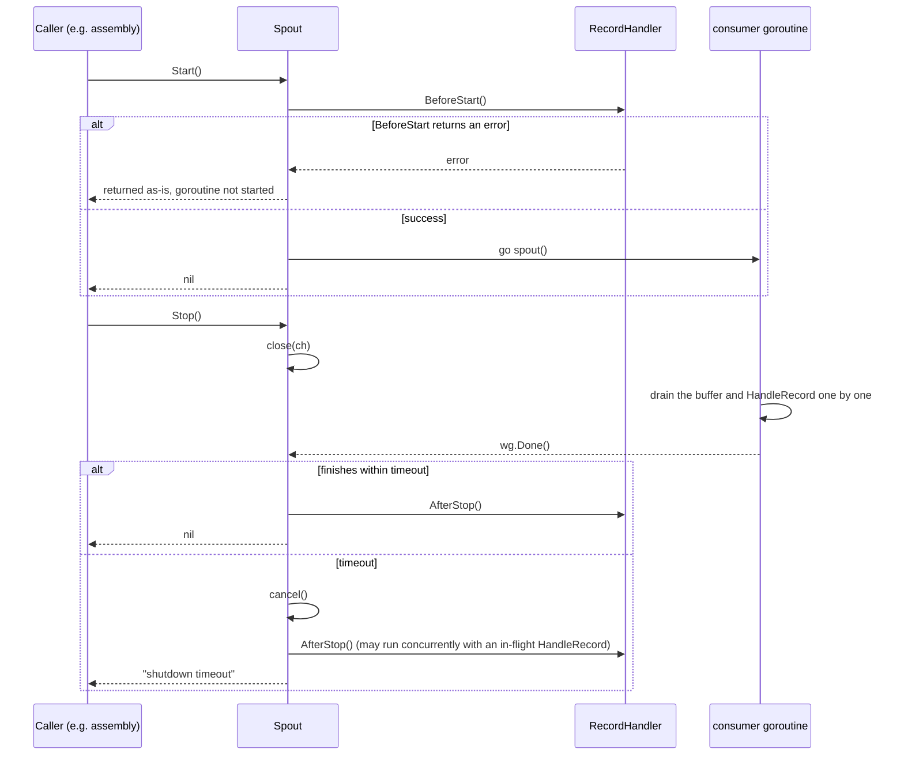
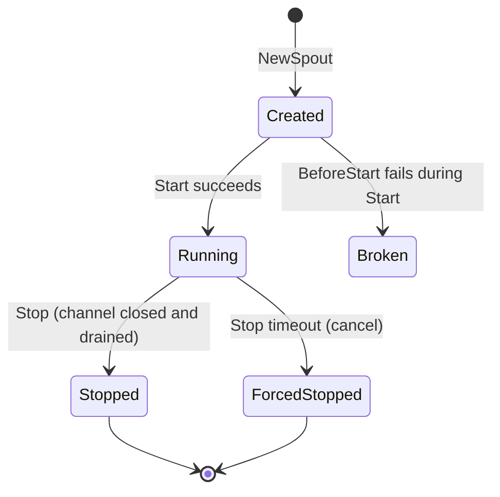

# pkg/funnel/spout.go

> 📅 Last Updated: 2026/11/13

`pkg/funnel/spout.go` defines the `Spout[T]` generic abstraction - the **consumer side** (reader) in CelestialGrow's asynchronous consumption infrastructure. It holds a buffered Go channel, continuously reads records in a background goroutine and hands them to a `RecordHandler[T]` for processing; at the same time it makes the resource lifecycle explicit through the three-stage `BeforeStart` / `HandleRecord` / `AfterStop` interface.

> **Note on naming**: although `Spout` intuitively sounds like an "outlet", in this package it is the **consumer side**. `Spout` continuously "spouts" records from the internal channel to the handler, while the accompanying `Inlet` is the producer side that "pours" records in.

## Purpose

- Continuously read records from a buffered channel in a background goroutine.
- Inject "business processing" through the `RecordHandler[T]` interface, making it reusable across different persistence backends (file / SQLite).
- Provide two-stage shutdown: first `close(ch)` to trigger a graceful exit (and drain the buffer); if it does not finish within the timeout, `cancel()` makes the consumer goroutine exit after the current `HandleRecord` returns, guaranteeing that callers never wait forever.

## Core Objects

### `type RecordHandler[T any]` (interface)

```go
type RecordHandler[T any] interface {
    BeforeStart() error
    HandleRecord(record T) error
    AfterStop() error
}
```

| Method | When it is called | Typical use |
|------|-----------|----------|
| `BeforeStart() error` | Inside `Spout.Start`, **before** the consumer goroutine starts, called synchronously | Open files, establish database connections, initialize buffers |
| `HandleRecord(record T) error` | Every time the consumer goroutine reads a record | Serialization / writing of a single record |
| `AfterStop() error` | The finalization phase of `Spout.Stop`, called **whether or not it timed out** | Close files, `fsync`, release connections |

The `error` values returned by the three methods are treated differently: an error from `BeforeStart` is returned as-is by `Start`; an error from `HandleRecord` is **silently discarded** by `spout()`; an error from `AfterStop` is **silently discarded** by `Stop()` (`Stop` only returns the shutdown timeout error). So do not put critical failures solely into return values inside a handler.

### `type Spout[T any]`

```go
type Spout[T any] struct {
    ch      chan T               // 内部缓冲通道，对外通过 GetQueue 暴露只写句柄
    wg      sync.WaitGroup       // 跟踪消费 goroutine
    timeout time.Duration        // Stop 时优雅关闭的最大等待时间
    ctx     context.Context      // 内部 ctx，被 Stop 在超时时 cancel
    cancel  context.CancelFunc
    handler RecordHandler[T]     // 注入的处理器
}
```

- **Generic parameter `T`**: the type of a single record. For example, `persist.LogWatcher` internally uses `*funnel.Spout[persist.LogRecord]`.
- All fields are unexported; construction and lifecycle management are only possible through public methods.

### Construction: `NewSpout[T any]`

```go
func NewSpout[T any](handler RecordHandler[T], bufferSize int, timeout time.Duration) *Spout[T]
```

- `handler`: must implement `RecordHandler[T]`; all of its methods are invoked serially by the **same** consumer goroutine.
- `bufferSize`: the capacity of the internal `make(chan T, bufferSize)`. `0` creates an unbuffered channel (legal, but `Send` faces backpressure immediately); a **negative** value makes `make` panic - the current implementation performs no validation.
- `timeout`: the maximum wait for graceful shutdown in the `Stop` phase. `0` means the "forced cancel" branch is taken almost immediately (`time.After(0)` is immediately readable).

### Public Methods

| Method | Signature | Purpose |
|------|------|------|
| `GetQueue` | `func (s *Spout[T]) GetQueue() chan<- T` | Returns the write-only handle for `Inlet` to bind to |
| `Start` | `func (s *Spout[T]) Start() error` | Calls `handler.BeforeStart` + starts the consumer goroutine |
| `Stop` | `func (s *Spout[T]) Stop() error` | First `close(ch)` to drain and exit gracefully; on timeout `cancel()` forces exit, and finally `handler.AfterStop()` |
| `Handler` | `func (s *Spout[T]) Handler() RecordHandler[T]` | Returns the currently injected handler, handy for debugging or test assertions |

> `Spout` does not provide a synchronous "take one" method; records are pulled from the channel automatically only by the background goroutine, and only "start/stop + queue entry" is exposed externally.

#### `GetQueue() chan<- T`

- Each call returns the same `chan T` (the compiler derives the write-only type from the bidirectional channel).
- Callers usually do `funnel.NewInlet[T](spout.GetQueue(), timeout)`.
- **Do not** write to or close this channel elsewhere - ownership belongs to `Spout`.

#### `Start() error`

1. Calls `s.handler.BeforeStart()` synchronously; if it returns a non-`nil` error, the goroutine is **not** started and that error is returned directly.
2. `s.wg.Add(1)` followed by `go s.spout()`.
3. Returns immediately on success (non-blocking); when `BeforeStart` fails, resources may already be partially opened and `Start` does not roll them back, so the caller must decide whether compensating cleanup is needed.

#### `Stop() error`

```text
Stop()
  ├─ close(s.ch)                      // 触发 spout() 在 <-s.ch 处排空后返回
  ├─ 等待 wg.Wait() done 通道，最多 timeout
  │     ├─ 正常 done        → err = nil
  │     └─ timeout 触发     → s.cancel()，err = errors.New("shutdown timeout")
  └─ 无论是否超时，都执行 s.handler.AfterStop()          // 返回值被丢弃
```

Key points:

- `close(s.ch)` is **required** before the `ok=false` branch of `<-s.ch` can be hit, letting `spout()` return gracefully.
- Closing the channel **loses no records**: the receiver drains the remaining buffered records in FIFO order (each time `ok=true`) before receiving `ok=false`, so on the normal path the queue is already drained when `Stop` returns.
- The timeout path **does lose records**: once `ctx` is cancelled, the consumer goroutine exits right after the current `HandleRecord` returns, and records still buffered and unprocessed are dropped.
- The internal `ctx` is `cancel()`ed only on **timeout** and is never triggered on the normal path; this is a design choice to avoid killing a handler that is still processing.
- `AfterStop` is called on **all** exit paths (even if `Start` never succeeded), ensuring resources are not leaked.
- The returned `error` is non-`nil` only in the timeout case, so callers can use it to decide whether an alert is needed.

#### `Handler() RecordHandler[T]`

- Returns the handler injected at construction time (a copy of the interface value). Can be used to report handler state at runtime, for unit-test assertions, and so on.
- `persist.LifecycleWatcher.DBPath()` reads `SQLitePath` precisely by asserting `s.spout.Handler().(*persist.LifecycleRecordHandler)`.
- Read-only; it **cannot** be used to replace the handler: the `handler` field is unexported and there is no setter, so modifying this copy does not affect the instance held internally by `Spout`.

### Internal Method `spout()` (unexported)

The consumption loop:

```go
for {
    select {
    case record, ok := <-s.ch:
        if !ok { return }                    // 通道关闭：优雅退出
        s.handler.HandleRecord(record)       // 返回值被丢弃
    case <-s.ctx.Done():
        return                              // Stop 超时：强制退出
    }
}
```

- It is the goroutine entry started by `Start`; `wg.Done()` in a `defer` guarantees the counter reaches zero.
- Serial processing: a single goroutine calls `HandleRecord` in order, so the handler needs no locking for "multiple records arriving concurrently".
- Two exit paths: `ok=false` (the channel was closed by `Stop` and already drained) or `ctx.Done()` (`Stop` timed out and forced exit).
- `select` picks randomly when both paths are ready, so one more ready record may still be processed at the moment the timeout cancels.

## Key Flows

### Start/Stop Timeline



### State Transitions



`Broken`, `Stopped`, and `ForcedStopped` are all **not reusable**: `ch` is already closed or the handler has already had `AfterStop` called.

## Call Relationships with persist / assembly

```text
persist.LogWatcher / LifecycleWatcher ──持有──▶ funnel.Inlet[T] ──Send(T)──┐
                                                                          ▼
                                                        chan T（Spout 内部缓冲通道，容量 100）
                                                                          │
                                              GetQueue() 把同一个 chan T 暴露给 Inlet
                                                                          ▼
funnel.Spout[T]（单后台 goroutine）──HandleRecord(T)──▶ persist.LogRecordHandler / LifecycleRecordHandler
```

- `persist.LogRecordHandler` / `persist.LifecycleRecordHandler` both implement `RecordHandler[T]`:
  - `BeforeStart`: creates the `logs/` directory and opens a date-named log file / creates the `lifecycles/<date>/` directory and opens SQLite.
  - `HandleRecord`: formats into a single line of text and appends it to the file / writes the event by `Kind` (`seed` / `ripen` / `wither` / `prune`) and updates the state.
  - `AfterStop`: closes the log file / closes the SQLite connection.
- `persist.LogWatcher` / `LifecycleWatcher` build the `Spout` with `funnel.NewSpout(handler, 100, time.Second)` in the unexported `newLogWatcher` / `newLifecycleWatcher`, then build the matching `Inlet` with `funnel.NewInlet(spout.GetQueue(), time.Second)`.
- `pkg/assembly` manages the lifecycle uniformly: `StartPlotResources` / `StartFarmResources` create the two watchers, calling **`lifecycle.Start()` first and then `log.Start()`**, and then register them on `*scarecrow.Hub`; `Resources.Stop` (guarded by `sync.Once`) stops in reverse order, `log.Stop()` first and then `lifecycle.Stop()`.
- `Plot` / `Farm` only hold `Hub`, do not hold `Spout` directly, and have no interfaces such as `BindInlet` / `StartSpouts` / `StopSpouts` - channel creation and binding are encapsulated in the watcher constructors of `persist`.

## Collaboration with Inlet (inlet ← spout)

```go
// 片段：T 为记录类型，handler 为调用方实现的 funnel.RecordHandler[T]
// 1. Spout 持有通道，并注入具体 handler
spout := funnel.NewSpout[T](handler, 100, time.Second)

// 2. 启动消费循环（内部先调 handler.BeforeStart）
if err := spout.Start(); err != nil {
    return err
}

// 3. Inlet 绑定到 Spout 暴露的只写句柄
inlet := funnel.NewInlet[T](spout.GetQueue(), time.Second)

// 4. 上游只需调 inlet.Send(...)；通道满了会等 1s，超时返回错误
```

Timing guarantees:

1. **`Start` first, then construct `Inlet`**: data sent before the consumption loop starts only piles up in the buffer (limited capacity), and once the buffer is full every `Send` times out.
2. **Stop writing first, then stop reading**: the recommended order is "upstream stops calling `Send` → `inlet.Close()` → `spout.Stop()`". `Spout.Stop` calls `close(ch)` internally, after which any `Send` hitting the write branch panics (`send on closed channel`).
3. `inlet.Close()` only cancels `ctx`; it **cannot** stop a `Send` that has already entered `select` from hitting the write branch and panicking, it only guarantees that "a blocked `Send` returns `context.Canceled` quickly".

## Usage Example

A minimal `Spout` + `Inlet` combination (companion to `inlet.md`):

```go
package main

import (
    "fmt"
    "time"

    "github.com/Mr-xiaotian/CelestialGrow/pkg/funnel"
)

type PrintHandler struct {
    cnt int
}

func (p *PrintHandler) BeforeStart() error       { fmt.Println("spout start"); return nil }
func (p *PrintHandler) HandleRecord(r int) error { p.cnt++; return nil }
func (p *PrintHandler) AfterStop() error         { fmt.Println("spout stop, total:", p.cnt); return nil }

func main() {
    handler := &PrintHandler{}

    spout := funnel.NewSpout[int](handler, 16, time.Second)
    if err := spout.Start(); err != nil {
        panic(err)
    }

    inlet := funnel.NewInlet[int](spout.GetQueue(), 200*time.Millisecond)
    for i := 0; i < 100; i++ {
        _ = inlet.Send(i) // 队列满时最多等 200ms，失败即丢弃本条
    }

    inlet.Close() // 先停写入
    if err := spout.Stop(); err != nil {
        fmt.Println("shutdown timeout:", err)
    }
}
```

`HandleRecord` is called only by a single goroutine, so the `cnt++` in the example needs no locking.

## Notes

- `Spout` consumes **serially on a single goroutine**; `HandleRecord` should not perform time-consuming operations (such as synchronous network requests), or it becomes the bottleneck of the whole pipeline. If parallel processing is needed, dispatch again inside `HandleRecord`.
- On the timeout path, `AfterStop` may run **concurrently** with a `HandleRecord` that is still executing (for example `WriteString` on one side and `Close` on the other). A slow handler should guarantee "no writes after close" itself, or set `timeout` large enough for the normal path to finish.
- `bufferSize` and `timeout` are the key tuning points:
  - The larger `bufferSize` is, the more burst traffic can be absorbed, but the higher the memory usage and the more records must be drained during a graceful shutdown.
  - The larger `timeout` is, the more "gentle" the shutdown, but process exit is forced to wait longer.
- Errors from `RecordHandler.HandleRecord` and `AfterStop` are both ignored; **do not** put critical error state only into return values. If failures must be observable, record them inside the handler (the handlers in `persist` currently pass them through return values, but callers cannot see them).
- **`Start` is not repeatable**: calling it twice runs `BeforeStart` twice (possibly opening files twice) and starts two consumer goroutines that race on the same channel, with `HandleRecord` possibly executing concurrently.
- **`Stop` is not idempotent**: `ch` is already closed, so calling `Stop` again panics (`close of closed channel`). `pkg/assembly` wraps it in `sync.Once` to guarantee a single stop.
- `Stop` can be called before `Start`: it closes the channel, passes `wg.Wait()` immediately, and then calls `AfterStop`, so a handler's `AfterStop` must tolerate the state where `BeforeStart` never ran.
- The reference returned by `Handler()` is read-only; externally modifying its internal state is allowed (for example, querying the number of written records), but replacing the whole handler has no effect.
