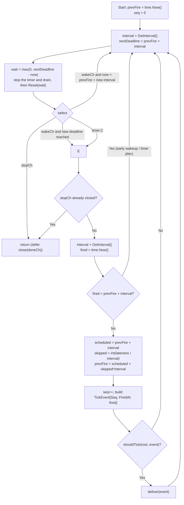
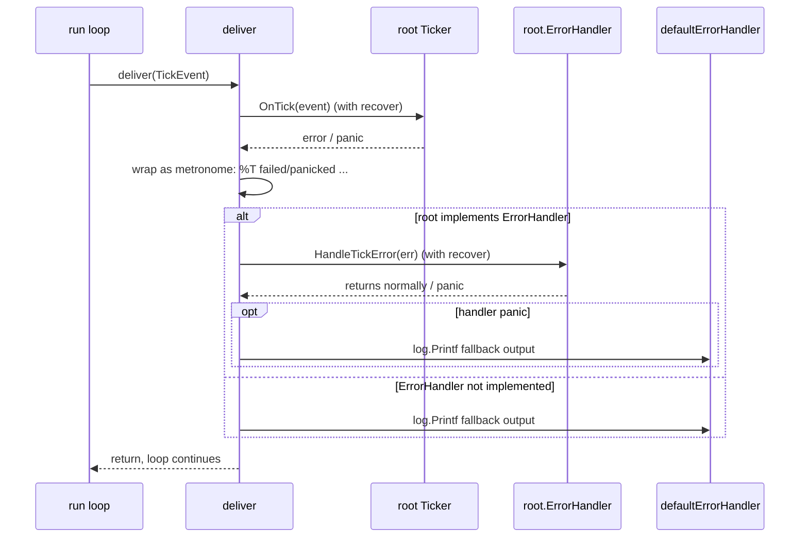

# pkg/metronome/clock.go

> 📅 Last Updated: 2026/11/26

`pkg/metronome/clock.go` implements the **single source of time** of the tick tree, `Clock`: it drives the root `Ticker` at a fixed period in a dedicated goroutine, anchors the scheduled fire instant on the monotonic clock, and adopts a "skip missed beats, never catch up" policy so that long-running processing cannot trigger a tick storm. Errors / panics from the root ticker are handed to its own `ErrorHandler`, and when that handler panics too the clock degrades to `log` output, so it never silently stalls because of a single failed tick.

## Purpose

- Provides the periodic `TickEvent` source and is the only driver above the `Hub` tree (a `Hub` never ticks by itself).
- Exposes the project-wide default base period (1 second) through `DefaultInterval`; `pkg/assembly`, `pkg/farm`, `pkg/plot` and others all pass it as the default `interval`.
- Supports runtime speed changes through `SetInterval` and immediately wakes the waiting loop so the new period takes effect on the **next beat**.
- Isolates failures of the root ticker inside `deliver`, keeping the background loop running.

## Core Objects

### Constants

```go
const (
    DefaultInterval = time.Second // 默认基准周期
    joinTimeout     = 5 * time.Second
)
```

| Name | Exported | Semantics |
|------|:----:|------|
| `DefaultInterval` | ✅ | Default tick period, `1s`. It is passed explicitly by the caller to `NewClock`; `NewClock` itself does not apply the default. |
| `joinTimeout` | ❌ | Upper bound for `Stop` waiting on the background goroutine to exit, `5s`. After the timeout it returns an error, but the goroutine may still be running. |

### `type Clock`

```go
type Clock struct {
    root Ticker

    mu       sync.RWMutex // 保护 interval
    interval time.Duration

    stateMu sync.Mutex   // 保护运行状态与三个 channel
    running bool
    stopCh  chan struct{}
    doneCh  chan struct{}
    wakeCh  chan struct{} // 容量 1，用于 SetInterval 唤醒
}
```

- `root`: the root ticker, usually a `*Hub`. It cannot be replaced after construction.
- `mu` and `stateMu` are **separate**: reading or writing the period does not block the start/stop decision, so `SetInterval` can take only `mu` to change the value and then briefly take `stateMu` to fetch `wakeCh`.
- `stopCh` / `doneCh` / `wakeCh` are recreated on every `Start`, so the clock can be started again after being stopped.
- `wakeCh` has capacity 1 and sends use `select + default`, so several consecutive period changes never pile up wakeup signals.

### Construction: `NewClock(interval time.Duration, root Ticker) (*Clock, error)`

| Error case | Returned |
|---------|------|
| `root == nil` | `metronome: root ticker is nil` |
| `interval <= 0` | `metronome: interval must be positive, got %s` (`%s` is the string form of a `time.Duration`, such as `0s` or `-1ms`) |

Construction only validates and assigns; it does **not** start a goroutine and does **not** call `root.Start()`.

### Public Methods

| Method | Signature | Purpose |
|------|------|------|
| `Start` | `func (c *Clock) Start() error` | Starts the background tick goroutine; returns `nil` directly when already running |
| `Stop` | `func (c *Clock) Stop() error` | Signals the loop to exit and waits for it to finish, for at most `5s` |
| `IsRunning` | `func (c *Clock) IsRunning() bool` | Returns the `running` flag |
| `GetInterval` | `func (c *Clock) GetInterval() time.Duration` | Reads the current period |
| `SetInterval` | `func (c *Clock) SetInterval(interval time.Duration) error` | Changes the period, taking effect from the next beat |

#### `Start() error`

1. Take `stateMu`; if `running` is true, return `nil` directly (**idempotent**).
2. Create new `stopCh`, `doneCh` and a capacity-1 `wakeCh`, then set `running = true`.
3. `go c.run(...)` and return `nil` immediately.

`Start` currently has no failure path and always returns `nil`; the `error` in the signature is kept for consistency with the `Lifecycle` interface. Stopping and starting again yields a brand-new goroutine and a `Seq` that counts from 1 again.

#### `Stop() error`

1. Take `stateMu`; if not running, return `nil` directly (**idempotent**).
2. Grab `stopCh` / `doneCh`, **set `running` to `false` first**, then release the lock.
3. `close(stopCh)`, then pick one of `doneCh` and `time.After(joinTimeout)`:
   - the goroutine exits normally (`run`'s `defer close(doneCh)`): returns `nil`;
   - more than `5s` pass: returns `metronome: clock goroutine did not terminate within 5s`.

> **What the timeout really means**: `run` only checks `stopCh` at the top of the loop and inside `select`; once it enters `deliver` (that is, the root ticker's `OnTick`) it cannot be interrupted. If some ticker blocks for more than 5 seconds, `Stop` times out and returns an error, while `running` is already `false` — at that point `IsRunning()` reports "stopped", but the goroutine is still alive and will exit on its own after returning.

#### `IsRunning() bool`

It reads the `running` flag only and does not probe whether the goroutine is really alive. It therefore answers "am I in the state of having been started and not yet `Stop`ped", not "is the goroutine running".

#### `GetInterval() / SetInterval(interval time.Duration) error`

- `GetInterval` takes `mu.RLock` and returns the value; it can be called from any goroutine.
- `SetInterval` first validates `interval > 0`, otherwise it returns `metronome: interval must be positive, got %s`; once valid it changes the value, then takes `stateMu` to check whether the clock is running, and if it is, performs one non-blocking send on `wakeCh`.
- When not running it only changes the value without waking anything (the next `Start` naturally uses the new value).
- Why the wakeup matters: the loop may be `select`ing on a long timer armed for the **old period**; without a wakeup it would wait until the old deadline before recomputing, delaying the change by up to one old period. `TestClockSetIntervalTakesEffectOnNextTick` verifies exactly this (200ms → 10ms, requiring the first beat within 120ms).

## Key Flows

### Main loop `run`



Key points:

1. **Stop the timer before `Reset`**: `if !timer.Stop() { select { case <-timer.C: default: } }` clears a possibly already-arrived old firing, avoiding "the previous timer fires this beat early".
2. **Check `stopCh` twice**: once inside `select`, and once more non-blocking after `select` but before the actual fire, narrowing the window where "the clock is already `Stop`ped yet delivers one extra beat" (it cannot be removed completely: if `stopCh` closes after the check, that beat is still delivered).
3. **Early wakeups do not fire**: when `fired.Before(prevFire.Add(interval))` is true it simply `continue`s, preventing timer jitter or a premature `wakeCh` wakeup from "shortening the period".

### Anchoring and "skip missed beats, never catch up"

The grid is determined by `prevFire` (the **scheduled** fire instant of the previous beat) and `interval`, not by `fired` (the actual fire instant):

| Situation | Computation | Result |
|------|------|------|
| On time | `fired ≈ scheduled = prevFire + interval` | `lateness ≈ 0`, `skipped = 0`, `prevFire = scheduled`, the grid does not drift |
| Slightly late (< 1 period) | `lateness = fired - scheduled ∈ (0, interval)` | `skipped = 0`, `prevFire = scheduled`, the next beat is still on the original grid, so the gap is compressed |
| Clearly late (≥ 1 period) | e.g. `interval = 10ms`, `scheduled = T+10ms`, `fired = T+35ms` | `lateness = 25ms`, `skipped = 2`, `prevFire = T+30ms`, next deadline `T+40ms` |

This yields a few well-defined properties:

- **No replay**: skipped beats do **not** each call `OnTick` and do not consume a new `Seq`. In the example above the two beats at `T+20ms` and `T+30ms` never appear as separate events.
- **At most one immediate re-fire**: if one `OnTick` takes 55ms (`interval = 10ms`), then after it returns `wait` is negative and clamped to 0, so the loop fires **one beat** right away (`PrevFire` aligns to `T+60ms`) and then continues at `T+70ms`, `T+80ms`; there is no burst of five consecutive ticks.
- **The grid does not drift over time**: because `prevFire` is always advanced from `scheduled` (not `fired`), the long-term average frequency is still governed by `interval` and errors do not accumulate.
- **The grid spacing is always `interval`**: the gap between two actual fires may be slightly smaller than `interval` (the previous beat was late while the next one stays on the original grid), but it never shrinks because of an early wakeup.

> The motivation is written in the doc-string of `Clock`: better to skip than to bunch up catch-up beats after slow processing, otherwise downstream consumers (especially network reporting or injection tickers) would face a request storm.

### Changing the period at runtime

The effect of `SetInterval` shows up on the next loop iteration:

- The new deadline is `prevFire + new interval`, that is, the grid is re-laid from the **scheduled instant of the previous beat** as the new anchor, not from "the instant the period was changed".
- If the new period is very short and the new deadline has already passed, the `wakeCh` branch condition does not hold and the loop fires a beat immediately (effectively "the next beat arriving early"), then continues on the new grid.
- If the new period is very long, the condition holds after the `wakeCh` wakeup, the loop `continue`s and re-arms the timer with the new duration — this is exactly the point of "not having to wait for the old timer to expire".
- If the period change happens while `OnTick` is executing, the wakeup token stays in the capacity-1 `wakeCh` and is consumed as soon as `OnTick` returns, so it is not lost.

### Root ticker invocation and error isolation `deliver`



- A panic from `OnTick` is converted by `recover` into `metronome: %T panicked on tick %d: %v`;
- An error returned by `OnTick` is wrapped as `metronome: %T failed on tick %d: %w` (`%w` is kept, so `errors.Is` can see through it);
- If the root ticker implements `ErrorHandler`, the error goes to `HandleTickError`; **when the handler itself panics** it is no longer re-thrown upward, but rather `defaultErrorHandler(fmt.Errorf("metronome: %T error handler panicked: %v", ...))` is called;
- Without an `ErrorHandler` it calls `defaultErrorHandler(err)` directly, i.e. `log.Printf("metronome: %v", err)` (written to standard error).

> `Clock` only recognizes the `ErrorHandler` of the **root ticker**. When the root is a `*Hub`, errors of child tickers are absorbed by the `Hub` itself and `Hub.OnTick` always returns `nil`, so this fallback path of the clock is rarely reached in normal assembly.

## Usage Example

### Minimal runnable clock (Hub as root)

```go
package main

import (
    "fmt"
    "time"

    "github.com/Mr-xiaotian/CelestialGrow/pkg/metronome"
)

type printer struct{}

func (p *printer) OnTick(event metronome.TickEvent) error {
    fmt.Printf("seq=%d at=%s\n", event.Seq, event.FiredAt.Format(time.RFC3339Nano))
    return nil
}

func main() {
    hub, err := metronome.NewHub()
    if err != nil {
        panic(err)
    }
    if err := hub.AddTicker(&printer{}); err != nil {
        panic(err)
    }

    clock, err := metronome.NewClock(metronome.DefaultInterval, hub)
    if err != nil {
        panic(err)
    }

    // 先启动 Hub 的生命周期，再启动时钟；Clock 不会替你调用 hub.Start()。
    if err := hub.Start(); err != nil {
        panic(err)
    }
    if err := clock.Start(); err != nil {
        panic(err)
    }

    time.Sleep(3500 * time.Millisecond)

    // 提速到 200ms/拍，下一拍起生效。
    if err := clock.SetInterval(200 * time.Millisecond); err != nil {
        panic(err)
    }
    time.Sleep(time.Second)

    // 先停时钟（不再产生节拍），再停 Hub 的生命周期。
    if err := clock.Stop(); err != nil {
        panic(err)
    }
    if err := hub.Stop(); err != nil {
        panic(err)
    }
}
```

### Handling root ticker failures

```go
type resilientRoot struct {
    handler func(error)
}

func (r *resilientRoot) OnTick(metronome.TickEvent) error {
    return fmt.Errorf("network unavailable")
}

// 实现 ErrorHandler：Clock 会优先调用它，而不是打印默认日志。
func (r *resilientRoot) HandleTickError(err error) {
    r.handler(err)
}

func run() error {
    root := &resilientRoot{handler: func(err error) { fmt.Println("handled:", err) }}
    clock, err := metronome.NewClock(metronome.DefaultInterval, root)
    if err != nil {
        return err
    }
    return clock.Start() // 每拍失败都会被 handle，时钟继续运行
}
```

## Notes

- **`OnTick` is synchronous**: the root ticker (usually the whole `Hub` tree) runs serially on the clock goroutine, so any slow ticker delays later beats and may make `Stop` time out.
- **`Stop` does not kill the goroutine after a timeout**: Go cannot interrupt a running function; a timeout only means "it can no longer be awaited". `OnTick` should carry its own timeout / cancellation mechanism by design.
- **`Start` after `Stop` resets `Seq`**: the new goroutine starts from `seq = 0` and the first beat is still `1`.
- **`Start`/`Stop` are not designed for concurrent collisions**: `Stop` calls `close(stopCh)` only after releasing `stateMu`; if another goroutine calls `Start` at that moment and replaces the channels, `Stop` closes the old `stopCh` and waits on the old `doneCh`, leaving the new loop unaffected — the result may be "`Stop` returned `nil` while the clock is still running". The lifecycle should be driven serially by a single owner (which is what `pkg/assembly` does).
- **The clock does not manage the root ticker's lifecycle**: neither `NewClock` nor `Start` calls `root.Start()`. When the root is a `*Hub` you must call `hub.Start()` (which starts the child tickers) before `clock.Start()`, and stop them in the reverse order.
- **The smaller `interval` is, the more likely `Stop` waits for an in-flight beat**, but the 5-second margin is usually enough; what is really dangerous is a blocking `OnTick`.
- **`FiredAt` takes part in scheduling with its monotonic component**, so a system time change causes no jump; what is shown in logs, however, is wall-clock time.
