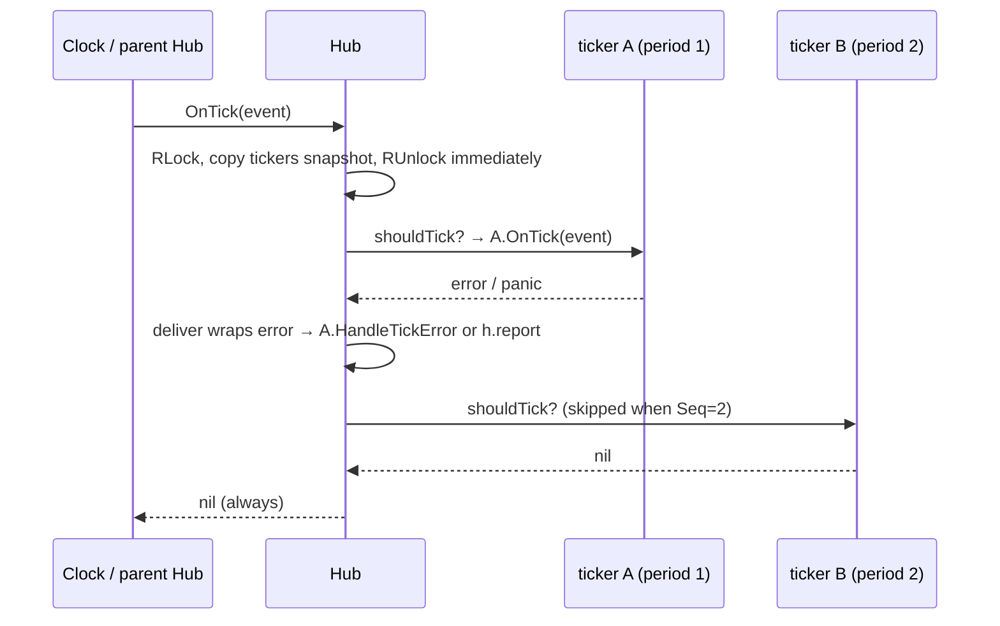
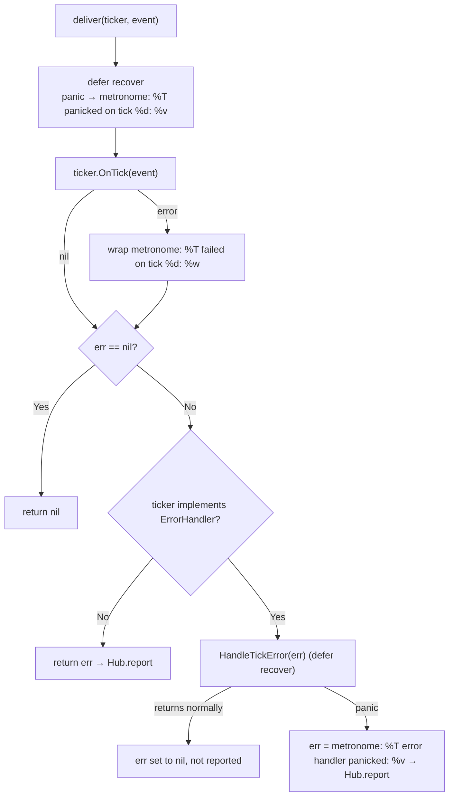
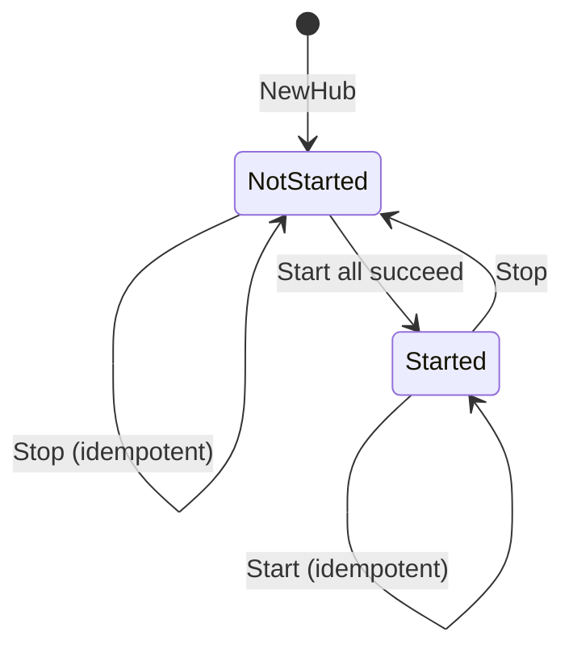

# pkg/metronome/hub.go

> 📅 Last Updated: 2026/11/26

`pkg/metronome/hub.go` implements the tick dispatch center `Hub`. `Hub` is itself a `Ticker` (`OnTick`) as well as a `Periodic` (`TickPeriod`) and a `Lifecycle` (`Start`/`Stop`), so the same implementation can act as the root receiver of a `Clock` and also be attached as a child node inside another `Hub` tree, forming **hierarchical dispatch**. Each tick is filtered by the child ticker's `TickPeriod` and then forwarded **synchronously in registration order**; an individual ticker's error / panic is isolated and handed to its own `ErrorHandler`, or otherwise to the `Hub`'s default error handler, and never interrupts the remaining tickers.

## Purpose

- **Fan-out**: distributes the upstream `TickEvent` to all matching child tickers while preserving strict registration order.
- **Filtering**: performs whole-beat filtering by `Periodic.TickPeriod()`; tickers that do not implement `Periodic` are treated as period 1.
- **Isolation**: confines each child ticker's failure to itself, so `OnTick` always returns `nil`.
- **Lifecycle orchestration**: `Start`s child items that implement `Lifecycle` in registration order and `Stop`s them in reverse order, supporting runtime add/remove.
- **Structure queries**: `Contains` checks direct children, and the generic `Find[T]` locates the first ticker of the given type anywhere in the Hub tree (`pkg/assembly` uses it to confirm whether `*reporter.SnapshotTicker` / `*reporter.InjectionTicker` have been assembled).

## Core Objects

### `type HubOption` and option functions

```go
type HubOption func(*Hub) error

func WithErrorHandler(handler func(error)) HubOption
func WithTickPeriod(period int) HubOption
```

| Option | Purpose | Failure case |
|------|------|---------|
| `WithErrorHandler(handler)` | Sets the `Hub`'s default error handler, used when "a ticker does not implement `ErrorHandler`" or when "`HandleTickError` itself panics". Passing `nil` is equivalent to not setting it (falling back to default logging). | Never fails |
| `WithTickPeriod(period)` | Sets the `Hub`'s own tick period when it acts as a **child ticker**, default `1`. | `period < 1` → `metronome: tick period must be positive, got %d`, and `NewHub` returns that error directly |

Options are applied in the order given to `NewHub`; if any of them returns an error the whole construction fails and returns `nil, err`.

### `type Hub`

```go
type Hub struct {
    mu      sync.RWMutex // 保护 tickers 与 period
    tickers []Ticker     // 注册顺序，分发顺序即此顺序

    lifecycleMu sync.Mutex // 串行化 Start/Stop/AddTicker/RemoveTicker
    started     bool

    period  int
    onError func(error)
}
```

- `tickers` is an **ordered slice**; `OnTick` depends on that order, and `Find` also relies on it for stable lookups.
- `lifecycleMu` is only taken by lifecycle-related methods, while `OnTick` does not take it — the two can run in parallel, at the price of "an already-removed ticker may still receive one in-flight beat" (see below).
- `period` is the `Hub`'s own period when acting as a child ticker; `TickPeriod()` defensively corrects values `< 1` to 1, even though construction/setting already validates them.

### Construction: `NewHub(opts ...HubOption) (*Hub, error)`

- Defaults are `period = 1` and `onError = nil`.
- With no arguments it always succeeds; with an illegal value such as `WithTickPeriod(0)` it returns that option's error.

### Public Methods

| Method | Signature | Purpose |
|------|------|------|
| `TickPeriod` | `func (h *Hub) TickPeriod() int` | Returns its own period as a child ticker; returns 1 when `< 1` |
| `SetTickPeriod` | `func (h *Hub) SetTickPeriod(period int) error` | Changes its own period at runtime |
| `AddTicker` | `func (h *Hub) AddTicker(ticker Ticker) error` | Registers a child ticker |
| `RemoveTicker` | `func (h *Hub) RemoveTicker(ticker Ticker) error` | Unregisters a child ticker |
| `Contains` | `func (h *Hub) Contains(ticker Ticker) bool` | Whether it is a **direct** child |
| `Start` | `func (h *Hub) Start() error` | Starts child items implementing `Lifecycle` in registration order |
| `Stop` | `func (h *Hub) Stop() error` | Stops child items implementing `Lifecycle` in reverse order |
| `OnTick` | `func (h *Hub) OnTick(event TickEvent) error` | Dispatches the tick, always returns `nil` |

### Generic query: `Find[T Ticker]`

```go
func Find[T Ticker](hub *Hub) (T, bool)
```

- The type parameter `T` must satisfy `Ticker`; it can be a concrete type (such as `*reporter.SnapshotTicker`) or an interface (such as `metronome.Lifecycle`).
- It returns `(zero, false)` when `hub == nil` or when nothing in the whole tree matches.
- Internally it uses a `map[*Hub]struct{}` to remember visited Hubs, so even an abnormal cycle in the structure does not cause infinite recursion.

## Key Flows

### Tick dispatch `OnTick`



1. **Snapshot**: under `mu.RLock` it does `append([]Ticker(nil), h.tickers...)`, and the following iteration is entirely based on the snapshot. Therefore `AddTicker`/`RemoveTicker` during dispatch do not change the collection iterated in this round.
2. **Registration order**: `for _, ticker := range tickers`, called serially and never concurrently. The next ticker is only called after the previous one finishes, so the order can be asserted stably in tests (`TestHubFansOutInRegistrationOrder` expects `a, b, c`).
3. **Period filtering**: `shouldTick(ticker, event)` → `(event.Seq-1)%period == 0`; a `period < 1` is treated as a miss.
4. **Error isolation**: when `h.deliver` returns non-nil, it calls `h.report(err)` and then continues with the next ticker.
5. **The return value is always `nil`**: a child ticker's failure does not bubble up through the parent Hub, and the parent Hub does not report it again — each error is handled exactly once, at its **direct parent**.

### Invoking a single ticker and collapsing errors `deliver`



- When there is an `ErrorHandler` and handling succeeds, `err` is explicitly set to `nil` and the `Hub`'s default handler is **not** triggered (`TestHubUsesTickerErrorHandlerBeforeDefaultReporter` asserts that `reported` stays empty).
- When there is an `ErrorHandler` but it panics, the panic is converted into an error and reported onward — the safety net for "a bug in the handler itself must not swallow a tick failure".

### Default error handling `report`

```go
func (h *Hub) report(err error) {
    handler := h.onError
    if handler == nil {
        handler = defaultErrorHandler
    }
    defer func() {
        if recovered := recover(); recovered != nil {
            defaultErrorHandler(fmt.Errorf("metronome: error handler panicked: %v", recovered))
        }
    }()
    handler(err)
}
```

- When `h.onError` is `nil` it uses `defaultErrorHandler`: `log.Printf("metronome: %v", err)`, written to standard error.
- When `h.onError` itself panics it degrades to default logging, and `OnTick` keeps processing subsequent tickers (`TestHubSurvivesDefaultErrorHandlerPanic` verifies that healthy tickers are still called).
- Since `deliver` has already wrapped the error as `metronome: ...`, the default log shows a doubled prefix `metronome: metronome: ...` — that is the actual output of the current implementation and does not affect semantics.

### Lifecycle: Start / Stop



- **`Start`**: takes `lifecycleMu`; if already `started` it returns `nil` directly; it copies a snapshot of `tickers` and iterates in registration order, skipping items that do not implement `Lifecycle` and calling `Start()` on each.
  - When one item fails it stops immediately: it calls `stopReversed` on the successfully started items (reverse `Stop`), and returns `errors.Join(startErr, stopErr)` (when the rollback also fails) or just `startErr`; `started` **stays `false`**, allowing a retry after fixing.
  - Only when everything succeeds is `started = true` set.
- **`Stop`**: takes `lifecycleMu`; returns `nil` if not `started`; it copies the snapshot, **sets `started = false` first**, then collects all `Lifecycle` children and calls `stopReversed`, joining all stop errors with `errors.Join` (a first failure does not skip the rest).

Details of `stopReversed`: it iterates from the end to the front, wraps each error as `metronome: stop %T: %w`, and finally `errors.Join`s them into one error (with multiple errors, `Error()` joins them with newlines while `errors.Is` can still match each one).

### Runtime Add / Remove

| Scenario | Behavior |
|------|------|
| `AddTicker` while the Hub is not started | Only registers, does not call `Start` |
| `AddTicker` while the Hub is started | If the ticker implements `Lifecycle`, **`Start` first, then register**; if `Start` fails it returns `metronome: start %T: %w` and **does not register**, and it does not automatically roll back that ticker's internal state |
| `RemoveTicker` while the Hub is not started | Removes it from the slice directly, does not call `Stop` |
| `RemoveTicker` while the Hub is started | **Removes first, then `Stop`**; if `Stop` fails it still stays removed and returns `metronome: stop %T: %w` |

The "start before registering / remove before stopping" order guarantees: a new ticker does not receive ticks in a half-initialized state, and a removed ticker no longer receives ticks through a **newly created** snapshot.

> Exception: `OnTick` has already copied its snapshot **before** the removal, so the round currently being dispatched may still deliver one more beat to a ticker that "was just removed and is being `Stop`ped". The isolation between lifecycle and dispatch is "best effort", not a strict barrier.

### Cycle detection and duplicate registration

The validation order of `AddTicker`: `nil` → period validity → `rejectCycle` → deduplication → registration.

```mermaid
flowchart LR
    A[AddTicker] --> B{ticker == nil?}
    B -->|Yes| E1[cannot add nil ticker]
    B -->|No| C{ensureTickPeriod}
    C -->|fails| E2[tick period must be positive]
    C -->|passes| D{is *Hub?}
    D -->|No| F[skip cycle detection]
    D -->|Yes| G{candidate == h?}
    G -->|Yes| E3[cannot add a hub to itself]
    G -->|No| H[DFS over child Hubs from candidate]
    H --> I{h found?}
    I -->|Yes| E4[cyclic hub registration rejected]
    I -->|No| F
    F --> J{already sameTicker?}
    J -->|Yes| E5[ticker already registered]
    J -->|No| K[register (Start first when running)]
```

- **Self cycle**: `a.AddTicker(a)` → `metronome: cannot add a hub to itself`.
- **Indirect cycle**: after `a.AddTicker(b)` succeeds, `b.AddTicker(a)` → `metronome: cyclic hub registration rejected: target hub already contains this hub` (`TestHubRejectsCyclicRegistration`).
- **Deduplication uses `sameTicker`**:

  ```go
  leftType := reflect.TypeOf(left)
  rightType := reflect.TypeOf(right)
  if leftType == nil || rightType == nil || leftType != rightType { return false }
  if !leftType.Comparable() { return false }
  return left == right
  ```

  - Different dynamic types → never equal;
  - Non-comparable types (such as `TickerFunc`, or value types containing slice/map fields) → **no deduplication**, so they can be registered repeatedly;
  - Comparable types → compared with `==`, i.e. pointer structs are equal by **instance address** (`TestHubRejectsDuplicateRegistration` verifies this with the same `*periodProbe`).

### Lookup semantics of `Contains` and `Find`

- `Contains(ticker)`: checks **direct** children only, also through `sameTicker`. A `Hub` therefore does not report whether a "grandchild" exists, and `TickerFunc` always returns `false`.
- `Find[T](hub)`: depth-first, level by level —
  1. first look at **all direct children** of the current Hub for type `T` (in registration order, taking the first match);
  2. then recurse into child `*Hub`s in registration order.
  
  This gives "nearest first": if a parent Hub registers both `childHub` and `tickerX`, and both match `T`, `tickerX` is returned first even if `childHub` comes earlier in registration order. `Find` never matches the `hub` passed in itself (it only checks its children and subtrees).

## Important Details

### Error message overview

| Trigger point | Error text |
|--------|---------|
| `AddTicker(nil)` | `metronome: cannot add nil ticker` |
| Invalid period (`AddTicker` / `NewHub` / `SetTickPeriod`) | `metronome: tick period must be positive, got %d` |
| Self-registration | `metronome: cannot add a hub to itself` |
| Indirect cycle | `metronome: cyclic hub registration rejected: target hub already contains this hub` |
| Duplicate registration | `metronome: ticker already registered` |
| Runtime `AddTicker` start failure | `metronome: start %T: %w` |
| `RemoveTicker(nil)` | `metronome: cannot remove nil ticker` |
| Removing an unregistered item | `metronome: ticker is not registered` |
| Runtime `RemoveTicker` stop failure | `metronome: stop %T: %w` |
| `OnTick` panic | `metronome: %T panicked on tick %d: %v` |
| `OnTick` returning an error | `metronome: %T failed on tick %d: %w` |
| A ticker's `HandleTickError` panic | `metronome: %T error handler panicked: %v` |
| `Hub.onError` panic | Default log output `metronome: metronome: error handler panicked: %v` (the inner error already carries a prefix and `log.Printf` adds another layer) |

### Concurrency and locks

- `mu` (a `RWMutex`) protects `tickers` and `period`. `OnTick`/`Find`/`Contains`/`TickPeriod` take only the read lock and finish the snapshot copy inside the lock, and they **never call any ticker while holding the lock** — so a ticker that calls back into `hub.AddTicker` / `hub.Contains` inside `OnTick` does not deadlock itself.
- `lifecycleMu` serializes `Start`/`Stop`/`AddTicker`/`RemoveTicker`, preventing "start and stop crossing" and "starting the same child twice".
- While holding `lifecycleMu`, `Start`/`Stop` still briefly take `mu` to read/write `tickers`, so the lock order is always `lifecycleMu → mu`; `OnTick` takes only `mu` and never takes them in reverse, so there is no deadlock cycle.
- `OnTick` and lifecycle changes may run concurrently: the `Hub` does not guarantee that "a stopped ticker never receives another tick" (see the in-flight snapshot above).

### Responsibility boundary with `Clock`

- `Hub` **does not produce ticks itself**: `OnTick` must be called by a `Clock` (or a parent `Hub`). Tests call `hub.OnTick(TickEvent{Seq: 1})` directly by hand, which is a legitimate usage in a clock-less scenario.
- `Clock` **does not call** `Start`/`Stop` of the root `Hub`. The standard order is `hub.Start()` → `clock.Start()`, and when stopping `clock.Stop()` → `hub.Stop()` (`startResources` in `pkg/assembly` follows this pattern).
- Because `Hub` implements `Lifecycle`, registering a child `Hub` into an **already started** parent Hub automatically calls `child.Start()`; when the parent Hub `Stop`s it stops child Hubs in reverse order, recursively stopping the whole subtree.

### Relationship between `Periodic` and `TickPeriod`

A `Hub`'s own `TickPeriod()` is only read by a parent Hub/Clock when it acts as a **child ticker**; it does not affect the filtering logic it applies to its own children (filtering only looks at child tickers' periods). `WithTickPeriod(2)` means "this subtree receives a tick only every other beat", and the `Seq` seen inside the subtree is `1, 3, 5, ...` (because the `Seq` passed in by the parent layer is not renumbered).

## Usage Example

### Hierarchical Hub + period filtering + custom error handling

```go
package main

import (
    "errors"
    "fmt"
    "time"

    "github.com/Mr-xiaotian/CelestialGrow/pkg/metronome"
)

type counter struct {
    name   string
    period int
    n      int
}

func (c *counter) TickPeriod() int { return c.period }

func (c *counter) OnTick(event metronome.TickEvent) error {
    c.n++
    fmt.Printf("[%s] seq=%d 第 %d 次执行\n", c.name, event.Seq, c.n)
    return nil
}

type faulty struct{}

func (faulty) OnTick(metronome.TickEvent) error { return errors.New("boom") }

func main() {
    // 子 Hub：每 3 拍才从父 Hub 收到一次节拍。
    child, err := metronome.NewHub(metronome.WithTickPeriod(3))
    if err != nil {
        panic(err)
    }
    if err := child.AddTicker(&counter{name: "child-odd", period: 2}); err != nil {
        panic(err)
    }

    parent, err := metronome.NewHub(metronome.WithErrorHandler(func(err error) {
        fmt.Println("hub 默认处理器:", err)
    }))
    if err != nil {
        panic(err)
    }

    // 注册顺序即分发顺序。
    for _, t := range []metronome.Ticker{
        &counter{name: "fast", period: 1},
        faulty{},
        &counter{name: "slow", period: 4},
        child,
    } {
        if err := parent.AddTicker(t); err != nil {
            panic(err)
        }
    }

    // 启动生命周期（child 会被递归启动），再由 Clock 驱动。
    if err := parent.Start(); err != nil {
        panic(err)
    }
    clock, err := metronome.NewClock(100*time.Millisecond, parent)
    if err != nil {
        panic(err)
    }
    if err := clock.Start(); err != nil {
        panic(err)
    }

    time.Sleep(time.Second)

    if err := clock.Stop(); err != nil {
        panic(err)
    }
    if err := parent.Stop(); err != nil {
        panic(err)
    }

    // 泛型查找：确认某类型是否已装配。
    if c, ok := metronome.Find[*counter](parent); ok {
        fmt.Println("找到 counter:", c.name)
    }
}
```

### Runtime add and remove

```go
hub, _ := metronome.NewHub()
if err := hub.Start(); err != nil { // 先启动空 Hub
    panic(err)
}

t := &counter{name: "late", period: 1}
if err := hub.AddTicker(t); err != nil { // 已启动 → 立即 Start（若实现 Lifecycle）
    panic(err)
}

// 摘除后立即 Stop（若实现 Lifecycle）；此后的新一轮节拍不再包含它。
if err := hub.RemoveTicker(t); err != nil {
    panic(err)
}
_ = hub.Stop()
```

## Notes

- **Dispatch is synchronous and serial**: any blocking ticker delays the following tickers of the same round and may make `Clock.Stop` time out after 5 seconds. A ticker that needs parallel work should enqueue it or hand it to a goroutine itself.
- **`OnTick` always returns `nil`**: do not try to detect downstream failures from the return value of `hub.OnTick`; use `WithErrorHandler` or make the ticker implement `ErrorHandler`.
- **`Find` returns only the first match**, with "nearest first"; for multiple instances of the same type you need to traverse yourself or use `Contains` plus an explicit reference.
- **`TickerFunc` can be neither deduplicated nor reliably identified by `Contains`/`Find`**: `sameTicker` returns `false` directly for non-comparable types; use pointer structs when you need deduplication semantics.
- **Registration order is a contract**: the `Start` order, the `OnTick` dispatch order and the reverse `Stop` order all depend on the slice order; a runtime `RemoveTicker` shifts later elements forward but does not change the relative order of the remaining elements.
- **`started` stays `false` after a failed `Start`**, and items that were rolled back should not be `Stop`ped individually; after fixing the problem you can simply retry `Start`.
- **A failed `Stop` in `RemoveTicker` does not put the ticker back**: the error only means "stopping reported an error", the registration relationship has already changed, and the caller decides whether to retry stopping or re-register.
- **The default error handler writes to standard error**: `log.Printf("metronome: %v", err)`; for long-running processes with frequent errors it is advisable to provide an explicit `WithErrorHandler` for rate limiting / aggregation.
