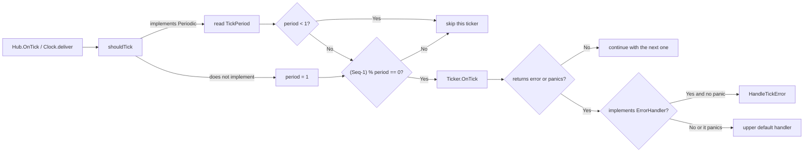

# pkg/metronome/ticker.go

> 📅 Last Updated: 2026/11/26

`pkg/metronome/ticker.go` defines the minimal contract of the tick system: the **receiver** `Ticker`, plus three optional capability interfaces `Lifecycle`, `ErrorHandler` and `Periodic`. `Clock` and `Hub` depend only on these interfaces, so business code just implements `OnTick` to plug in, and fills in lifecycle, error handling and period filtering as needed.

## Purpose

- `Ticker`: the only method any type must implement to receive ticks.
- `Lifecycle`: lets `Hub` manage the start/stop of child resources uniformly (`Start` in order, `Stop` in reverse).
- `ErrorHandler`: lets a ticker digest errors itself instead of letting them bubble up to the Hub's default handler.
- `Periodic`: declares "fire once every N beats", filtered by the upper layer before dispatch.
- `TickerFunc`: adapts an ordinary function into a `Ticker`, saving the need to define a struct for one-off logic.

## Core Objects

### `type Ticker interface`

```go
type Ticker interface {
    OnTick(event TickEvent) error
}
```

- It is only called when `shouldTick` decides a hit (when `Periodic` is not implemented, the period is treated as 1, i.e. a hit on every beat).
- The returned `error` is captured by the upper `Hub` or `Clock` and handed to the error handler, and **does not interrupt the remaining tickers**.
- `OnTick` runs **synchronously** on the dispatching side (the background goroutine of `Clock` or the call stack of the parent `Hub`), so a slow ticker slows down the whole tick chain.

### `type Lifecycle interface`

```go
type Lifecycle interface {
    Start() error
    Stop() error
}
```

`Hub` recognizes this interface among registered items: `Start` is called in registration order and `Stop` in reverse order. **Tickers that do not implement it only take part in tick dispatch**; `Hub` performs no start/stop action on them.

> `Hub` itself implements `Start`/`Stop` and therefore also satisfies `Lifecycle` — this is exactly why a nested Hub can be started/stopped recursively by its parent Hub.

### `type ErrorHandler interface`

```go
type ErrorHandler interface {
    HandleTickError(err error)
}
```

When `OnTick` returns an error or panics, `Hub`/`Clock` **prefer** calling this hook and pass in the already wrapped error (of the form `metronome: *T failed on tick 7: ...`). Only in the following cases does it degrade to the upper layer's default handler:

- the ticker does not implement `ErrorHandler`;
- `HandleTickError` itself panics.

### `type Periodic interface`

```go
type Periodic interface {
    TickPeriod() int
}
```

- The return value must be a positive integer: `1` means fire every beat, `2` means fire once every two beats.
- `Hub`/`Clock` **re-read the value before every dispatch**, so implementations can change the period at runtime.
- `AddTicker` validates it once at registration (an illegal value returns an error directly), but if `TickPeriod()` returns `< 1` at runtime, `shouldTick` silently skips that ticker (no error, no firing).

### `type TickerFunc`

```go
type TickerFunc func(event TickEvent) error

func (f TickerFunc) OnTick(event TickEvent) error
```

- Adapter: `OnTick` calls the wrapped function directly and passes its return value through.
- The function type is **not comparable**, so the `Hub`'s deduplication logic (`sameTicker`) never treats two `TickerFunc`s as the same instance — **the same `TickerFunc` value can be registered multiple times**, and each registration receives ticks. The test `TestHubFansOutInRegistrationOrder` uses exactly this to register three `TickerFunc`s.
- A `nil` `TickerFunc` can be put into an interface (the interface itself is non-nil), but calling `OnTick` panics; the `recover` in `Clock`/`Hub` turns it into an error instead of crashing the process.

### Unexported helpers (behavioral contract)

| Function | Behavior |
|------|------|
| `ensureTickPeriod(period int) error` | Returns `metronome: tick period must be positive, got %d` when `period < 1`. |
| `tickPeriod(ticker Ticker) int` | Returns the value of `TickPeriod()` when `Periodic` is implemented, otherwise `1`. |
| `shouldTick(ticker Ticker, event TickEvent) bool` | Returns `false` when `period < 1`; otherwise returns `(event.Seq-1)%period == 0`. |

## Key Flows



## Important Details

- **Interfaces are implicit**: a ticker does not need to declare "I implement some interface"; matching the method set is enough for a `type assertion` to recognize it. A typical combination freely mixes the four capabilities, e.g. "implements both `Periodic` and `Lifecycle`".
- **Period filtering uses `(Seq-1) % period`**: `Seq` starts at 1, so `period = 2` hits `1, 3, 5, ...` (odd beats) rather than `2, 4, 6, ...`. This is a very easy boundary to get wrong.
- **The period is validated at registration and read at dispatch**: `AddTicker` validates the `TickPeriod()` "at the moment of registration"; if the implementation later changes it to `0`, registration does not fail, but that ticker is silently skipped forever.
- **Error handlers only receive the "wrapped error"**: `errors.Is` / `errors.As` can still see through the `%w` wrapping to the original error, which is exactly what `TestHubIsolatesTickerError` asserts.
- **`HandleTickError` has no return value**: it cannot "report again" to the upper layer; the only way to fall back to the Hub default handler is to panic (which is then converted by `recover` into an error handed to `Hub.report`).

## Usage Example

### Minimal ticker + period + lifecycle

```go
package main

import (
    "fmt"
    "time"

    "github.com/Mr-xiaotian/CelestialGrow/pkg/metronome"
)

// Sampler 每 5 拍采样一次，并演示生命周期的接入方式。
type Sampler struct {
    name   string
    closed bool
}

func (s *Sampler) TickPeriod() int { return 5 } // 实现 Periodic

func (s *Sampler) Start() error { // 实现 Lifecycle
    fmt.Println(s.name, "started")
    return nil
}

func (s *Sampler) Stop() error {
    s.closed = true
    fmt.Println(s.name, "stopped")
    return nil
}

func (s *Sampler) OnTick(event metronome.TickEvent) error { // 实现 Ticker
    fmt.Println(s.name, "sample at seq", event.Seq, event.FiredAt.Format(time.RFC3339))
    return nil
}

// 可选：自行处理错误，避免落到 Hub 的默认日志。
func (s *Sampler) HandleTickError(err error) { // 实现 ErrorHandler
    fmt.Println(s.name, "tick error:", err)
}
```

### Writing one-off logic with `TickerFunc`

```go
hub, err := metronome.NewHub()
if err != nil {
    panic(err)
}

ticks := 0
if err := hub.AddTicker(metronome.TickerFunc(func(event metronome.TickEvent) error {
    ticks++
    fmt.Println("tick", event.Seq)
    return nil
})); err != nil {
    panic(err)
}
```

`TickerFunc` has no `TickPeriod()`, so it fires on every beat as period 1; it also does not implement `Lifecycle`, so `Hub.Start`/`Stop` do nothing to it.

## Notes

- **Split interfaces rather than one big interface**: implementing only `OnTick` already makes a valid ticker; do not implement idle `Start`/`Stop` just to "look complete" — once `Lifecycle` is implemented, `Hub` really calls them when starting/stopping, and a failure also interrupts the `Hub` start/stop flow.
- **`OnTick` must be fast**: it runs on the clock goroutine (or the parent ticker's call stack), so blocking directly delays later beats and may make `Clock.Stop` time out after 5 seconds and return an error.
- **Do not shrink the `Periodic` return value to 0 dynamically**: `shouldTick` silently skips it, which shows up as "the ticker mysteriously stops firing".
- **`TickerFunc` cannot be deduplicated**: when you need the semantics of "the same instance is registered only once", use a pointer struct instead of a function adapter.
- **`ErrorHandler` is not a universal safety net**: when it panics itself, `Hub` degrades to default logging and `Clock` degrades to default logging too — both layers have `recover`, but the error message gains an extra "error handler panicked" wrapping.
