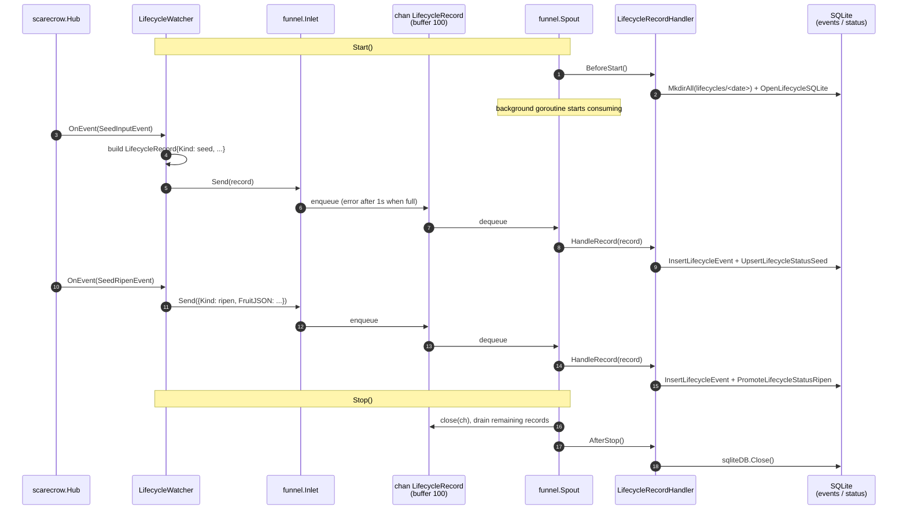

# pkg/persist/lifecycle.go

> 📅 Last Updated: 2026/11/13

## Purpose

`pkg/persist/lifecycle.go` translates the runtime events of `pkg/scarecrow` into **lifecycle records** and writes them into SQLite asynchronously:

- `LifecycleWatcher`, which implements `scarecrow.Watcher`, is responsible for the "event → `LifecycleRecord`" conversion and delivery;
- `LifecycleRecordHandler` implements `funnel.RecordHandler[LifecycleRecord]` and is responsible for the "record → SQLite" persistence;
- The two are connected by `funnel.Spout` / `funnel.Inlet`: `Spout` consumes serially in a background goroutine, and `Inlet` provides concurrency-safe delivery.

Every seed is expressed in the database by two kinds of data: `events` (the event body plus `event_parents` parent edges) and `status` (the latest status snapshot keyed by `input_event_id`). This file writes no SQL itself; table creation and all CRUD are implemented in [`sqlite.md`](./sqlite.md).

> This file depends only on `pkg/funnel` and `pkg/scarecrow` and does not reference `pkg/runtime` directly; event IDs are carried by the event structs (`SeedID` / `FruitID` / `WeedID` / `PruneID`) and are persisted as-is by the persistence layer.

## Core Objects

### `LifecycleRecord` — queue payload

```go
type LifecycleRecord struct {
    Kind           string
    InputEventID   int
    CurrentEventID int
    ParentIDs      []int
    PlotName       string
    SeedJSON       string
    FruitJSON      string
    WitherType     string
    WitherMessage  string
    TS             float64
}
```

| Field | Meaning |
|------|------|
| `Kind` | Operation type, one of the package-private constants `lifecycleSeed` / `lifecycleRipen` / `lifecycleWither` / `lifecyclePrune` (i.e. `seed` / `ripen` / `wither` / `prune`); it is also persisted as `events.event_type` |
| `InputEventID` | Event ID of this seed (the input), corresponding to `status.input_event_id` |
| `CurrentEventID` | Event ID produced this time, corresponding to `events.event_id` and `status.current_event_id`; for `seed` it equals `InputEventID` |
| `ParentIDs` | List of parent event IDs, written as `event_parents` edges; it is `nil` for an externally injected seed |
| `PlotName` | Name of the Plot the event belongs to, written to `events.plot` and `status.plot` |
| `SeedJSON` | Seed payload JSON, filled only for `seed` records |
| `FruitJSON` | Fruit JSON, filled only for `ripen` records |
| `WitherType` | Wither error type, filled only for `wither` records (`fmt.Sprintf("%T", err)`) |
| `WitherMessage` | Wither error text, filled only for `wither` records (`fmt.Sprintf("%v", err)`) |
| `TS` | Event time (Unix seconds, floating point, millisecond precision), converted from the event's `Time` field |

### `LifecycleRecordHandler` — consumer side

```go
type LifecycleRecordHandler struct {
    SQLitePath string
    sqliteDB   *sql.DB
}
```

It implements `funnel.RecordHandler[LifecycleRecord]`:

| Method | Trigger | Behavior |
|------|----------|------|
| `BeforeStart() error` | Inside `Spout.Start()`, before the consume loop starts | Creates `lifecycles/<YYYY-MM-DD>/` (permission `0755`), builds the `grow_lifecycle(<HH-MM-SS.mmm>).sqlite3` path, calls `OpenLifecycleSQLite` to open the database and create the tables; the path is stored in `SQLitePath` and the handle in `sqliteDB` |
| `HandleRecord(record LifecycleRecord) error` | Each record dequeued | First validates `sqliteDB != nil`, then writes the event first by `Kind` and afterwards writes or promotes the status snapshot |
| `AfterStop() error` | `Spout.Stop()` teardown | Closes `sqliteDB` and sets it to nil; returns `nil` directly when the handle was already nil |

> `SQLitePath` is a public field and still keeps the last opened path after `AfterStop`; offline reads are done through `LoadLifecycleStatusesFromPath` (see [`sqlite.md`](./sqlite.md)), and `LifecycleRecordHandler` itself no longer provides query methods.

### `LifecycleWatcher` — event watcher

```go
type LifecycleWatcher struct {
    spout *funnel.Spout[LifecycleRecord]
    inlet *funnel.Inlet[LifecycleRecord]
}
```

| Method | Behavior |
|------|------|
| `NewLifecycleWatcher() *LifecycleWatcher` | Constructs with the default `LifecycleRecordHandler`: `funnel.NewSpout(handler, 100, time.Second)` + `funnel.NewInlet(spout.GetQueue(), time.Second)` |
| `Start() error` | Delegates to `spout.Start()`: triggers `BeforeStart` to create the directory and open the database, and starts the background consume goroutine |
| `Stop() error` | Delegates to `spout.Stop()`: closes the channel, waits for the queue to drain (at most 1s), and finally `AfterStop` closes the database; returns `shutdown timeout` on timeout |
| `DBPath() string` | Returns the underlying handler's `SQLitePath`; an empty string while the consume loop has not been `Start`ed |
| `OnEvent(event scarecrow.Event) error` | Builds a `LifecycleRecord` by event type and `inlet.Send`s it; events it does not care about return `nil` directly |

> `newLifecycleWatcher(handler funnel.RecordHandler[LifecycleRecord])` is a package-private constructor; tests use it to inject a capturing handler. In that case `DBPath()` returns an empty string because the handler is not a `*LifecycleRecordHandler`.

## Event Mapping

`OnEvent` handles only the 4 seed result event types and ignores all others:

| `scarecrow` event | `Kind` | `InputEventID` | `CurrentEventID` | `ParentIDs` | Payload |
|------------------|--------|----------------|------------------|-------------|------|
| `SeedInputEvent` | `seed` | `SeedID` | `SeedID` | `ev.Parents` | `SeedJSON = toLifecycleJSON(ev.Seed)` |
| `SeedRipenEvent` | `ripen` | `SeedID` | `FruitID` | `[]int{ev.SeedID}` | `FruitJSON = toLifecycleJSON(ev.Fruit)` |
| `SeedWitherEvent` | `wither` | `SeedID` | `WeedID` | `[]int{ev.SeedID}` | `WitherType = %T(ev.Err)`, `WitherMessage = %v(ev.Err)` |
| `SeedPruneEvent` | `prune` | `SeedID` | `PruneID` | `[]int{ev.SeedID}` | none |

Events explicitly ignored (`return nil`, not persisted): `FarmStartEvent`, `FarmEndEvent`, `PlotStartEvent`, `PlotEndEvent`, `SeedReplantEvent`, `SealInputEvent`, `SealMergeEvent`. Event types cannot be added outside the package (`scarecrow.Event`'s `isEvent()` is a private method), so the fallback branch outside the switch is never actually reached.

Timestamps are uniformly produced by `unixSeconds(ev.Time)`:

```go
func unixSeconds(t time.Time) float64 {
    return float64(t.UnixMilli()) / 1000
}
```

Therefore `TS` is accurate to the millisecond and matches the event occurrence time, unaffected by queue backlog.

## Key Flows



### `HandleRecord`'s Kind routing

```go
func (l *LifecycleRecordHandler) HandleRecord(record LifecycleRecord) error {
    if l.sqliteDB == nil {
        return fmt.Errorf("生命周期 sqlite 未初始化")
    }

    switch record.Kind {
    case lifecycleSeed:
        if err := InsertLifecycleEvent(l.sqliteDB, record.CurrentEventID, record.Kind, record.PlotName, record.TS, record.ParentIDs); err != nil {
            return err
        }
        return UpsertLifecycleStatusSeed(l.sqliteDB, record.InputEventID, record.SeedJSON, record.PlotName, record.TS)
    // ripen / wither / prune are analogous: InsertLifecycleEvent first, then PromoteLifecycleStatusXxx
    default:
        return fmt.Errorf("unsupported lifecycle operation: %s", record.Kind)
    }
}
```

Key points:

- All four `Kind` values write `events` first (including the `event_parents` parent edges) and write `status` only after success; when the event write fails the status is not changed, keeping the two consistent.
- `ripen` / `wither` / `prune` are promoted through `UPDATE status ... WHERE input_event_id = ?`, so the corresponding `seed` record must already be persisted (`UPDATE` matching no row does not report an error, see [`sqlite.md`](./sqlite.md)).
- When `kind` is invalid it returns `unsupported lifecycle operation: <kind>`; when `sqliteDB == nil` it returns `生命周期 sqlite 未初始化`.
- All errors are returned upward as-is and discarded by the `Spout` consume loop (`Spout` does not check the return value of `HandleRecord`); to observe write failures you can only rely on the SQLite file itself or on logs.

### DB path and directories

```text
lifecycles/<YYYY-MM-DD>/grow_lifecycle(<HH-MM-SS.mmm>).sqlite3
```

- The date `2006-01-02` and the time `15-04-05.000` each take `time.Now()` once in `BeforeStart`; multiple starts on the same day produce multiple files.
- The directory permission is `0755`; the file is created automatically by `sql.Open("sqlite", "file:...")`, and `BeforeStart` does not create it explicitly.
- `os.MkdirAll` failure → `创建生命周期目录失败: %w`; open failure → `打开生命周期 sqlite 失败: %w`.
- A failed `Start` leaves no running consume loop behind; `assembly` registers the watcher with the Hub only after `Start` succeeds.

### `toLifecycleJSON` fallback

```go
func toLifecycleJSON(value any) string {
    data, err := json.Marshal(value)
    if err == nil {
        return string(data)
    }
    lifecycle, lifecycleErr := json.Marshal(fmt.Sprintf("%+v", value))
    if lifecycleErr == nil {
        return string(lifecycle)
    }
    return `"marshal_error"`
}
```

It prefers `json.Marshal`; on failure it degrades to the JSON string of `fmt.Sprintf("%+v", value)`; if that fails too it hardcodes `"marshal_error"`. The return value is always valid JSON text, so `status.seed_json` never holds `NULL`.

## Public Symbol List

| Symbol | Kind | Purpose |
|------|------|------|
| `LifecycleRecord` | Type | Queue payload (`Kind` + event fields + status fields) |
| `LifecycleRecordHandler` | Type | `funnel.RecordHandler[LifecycleRecord]` implementation responsible for persistence |
| `(*LifecycleRecordHandler).BeforeStart` | Method | Creates the directory, opens the database, creates the tables |
| `(*LifecycleRecordHandler).HandleRecord` | Method | Writes the event by `Kind` and advances the status |
| `(*LifecycleRecordHandler).AfterStop` | Method | Closes the database handle |
| `LifecycleWatcher` | Type | `scarecrow.Watcher` implementation, event → record |
| `NewLifecycleWatcher` | Function | Creates the watcher (default handler, buffer 100, timeout 1s) |
| `(*LifecycleWatcher).Start` | Method | Starts the consume loop and opens the database |
| `(*LifecycleWatcher).Stop` | Method | Stops the consume loop, flushes and closes the database |
| `(*LifecycleWatcher).DBPath` | Method | Returns the SQLite path of this run |
| `(*LifecycleWatcher).OnEvent` | Method | Event translation and delivery |

> `lifecycleSeed` / `lifecycleRipen` / `lifecycleWither` / `lifecyclePrune`, `newLifecycleWatcher`, `unixSeconds` and `toLifecycleJSON` are all package-private symbols.

## Usage Example

Using `scarecrow.Hub` as the dispatch center, start the watcher, send events, and read offline through `DBPath()` at the end:

```go
package main

import (
    "errors"
    "fmt"
    "time"

    "github.com/Mr-xiaotian/CelestialGrow/pkg/persist"
    "github.com/Mr-xiaotian/CelestialGrow/pkg/scarecrow"
)

func main() {
    hub := scarecrow.NewHub()
    watcher := persist.NewLifecycleWatcher()
    if err := hub.AddWatcher(watcher); err != nil {
        panic(err)
    }
    if err := watcher.Start(); err != nil {
        panic(err)
    }

    now := time.Now()
    events := []scarecrow.Event{
        scarecrow.SeedInputEvent{Plot: "stage_a", Seed: 1, SeedID: 1, Time: now},
        scarecrow.SeedRipenEvent{Plot: "stage_a", Seed: 1, Fruit: 2, SeedID: 1, FruitID: 2, Time: now},
        scarecrow.SeedInputEvent{Plot: "stage_a", Seed: 2, SeedID: 3, Time: now},
        scarecrow.SeedWitherEvent{Plot: "stage_a", Seed: 2, Err: errors.New("boom"), SeedID: 3, WeedID: 4, Time: now},
    }
    for _, event := range events {
        if err := hub.OnEvent(event); err != nil {
            panic(err)
        }
    }

    if err := watcher.Stop(); err != nil {
        panic(err)
    }

    // After Stop, SQLitePath is retained and can be queried offline
    dbPath := watcher.DBPath()
    statuses, err := persist.LoadLifecycleStatusesFromPath(dbPath, "stage_a")
    if err != nil {
        panic(err)
    }
    for _, status := range statuses {
        fmt.Println(status.InputEventID, status.CurrentEventID, status.Status, status.WitherMessage)
    }
}
```

After running, the `status` table of `lifecycles/<date>/grow_lifecycle(<time>).sqlite3` contains two rows: `1 2 ripen` and `3 4 wither boom`.

## Notes

- **`Start` must come before receiving events**: only `BeforeStart` initializes `sqliteDB`, otherwise `HandleRecord` returns `生命周期 sqlite 未初始化`; that error is discarded by `Spout` and shows up as "events silently lost".
- **`OnEvent` blocks the caller**: delivery uses a buffer channel of capacity 100 with a 1s timeout; when the queue is full `OnEvent` returns `inlet send timeout after 1s`, and `Hub` hands it to the `ErrorHandler`. The watcher should not do heavy work inside `OnEvent`.
- **The flush semantics of `Spout.Stop`**: it first `close(ch)` so the consume loop drains the remaining records; if draining does not finish within 1s it cancels the context and returns `shutdown timeout`, and afterwards the database is closed whether or not it timed out. So call `Stop` right after high-frequency writes instead of relying on process exit.
- **`DBPath()` only works for the default handler**: `DBPath` obtains `*LifecycleRecordHandler.SQLitePath` through a type assertion and returns an empty string when a custom handler (such as in tests) is injected; callers should treat the empty string as "the database is unavailable".
- **The handle is nil after `AfterStop` but the path is kept**: therefore `DBPath()` still returns a path after `Stop`, which supports offline queries with `LoadLifecycleStatusesFromPath` (`Plot.Harvest` is implemented this way).
- **Status promotion depends on the seed being persisted first**: `Promote*` is an `UPDATE`, and a missing target row affects 0 rows without error; upstream must guarantee that `SeedInputEvent` is delivered before the corresponding `Ripen` / `Wither` / `Prune` event.
- **Error information is in `fmt.Sprintf` form**: `WitherType` / `WitherMessage` take `%T` / `%v` respectively, so a wrapped error loses its error chain and only the outermost text is kept.
- **The timestamp comes from the event**: `TS` is computed from `ev.Time` (millisecond precision) and is unrelated to `time.Now()`, so replaying events reproduces the timeline of the original run.
