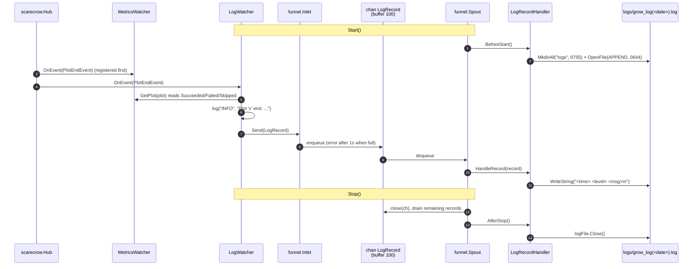

# pkg/persist/log.go

> 📅 Last Updated: 2026/11/13

## Purpose

`pkg/persist/log.go` translates the runtime events of `pkg/scarecrow` into text logs and appends them to a file asynchronously:

- `LogWatcher` implements `scarecrow.Watcher` and performs the "event → `LogRecord`" mapping and level filtering inside `OnEvent`;
- `LogRecordHandler` implements `funnel.RecordHandler[LogRecord]` and formats records into one line of text written to `logs/grow_log(YYYY-MM-DD).log`;
- The two are connected by `funnel.Spout` / `funnel.Inlet`; writing happens in a background goroutine, and the business execution path only pays one enqueue cost.

`LogWatcher` also holds a `*scarecrow.MetricsWatcher`: the ripened / withered / pruned counts of `PlotEndEvent` are read directly from the metrics snapshot instead of being counted on its own.

> Lifecycle persistence is described in [`lifecycle.md`](./lifecycle.md) / [`sqlite.md`](./sqlite.md); it shares the Inlet/Spout abstraction with logging but does not share channels or files. Both are created, registered with the `scarecrow.Hub` and started uniformly by `pkg/assembly`.

## Core Objects

### `LogRecord` — queue payload

```go
type LogRecord struct {
    FormatTime string
    Level      string
    Message    string
}
```

| Field | Description |
|------|------|
| `FormatTime` | Event time formatting result (`2006-01-02 15:04:05`), generated by `log` from the time carried by the event before delivery |
| `Level` | One of `TRACE` / `DEBUG` / `SUCCESS` / `INFO` / `WARNING` / `ERROR` / `CRITICAL` |
| `Message` | Already rendered text (without time and level) |

### `LogRecordHandler` — consumer side

```go
type LogRecordHandler struct {
    LogPath string
    logFile *os.File
}
```

It implements `funnel.RecordHandler[LogRecord]`:

| Method | Trigger | Behavior |
|------|----------|------|
| `BeforeStart() error` | Inside `Spout.Start()`, before the consume loop starts | Creates `logs/` (permission `0755`), opens `logs/grow_log(<YYYY-MM-DD>).log` with `O_CREATE \| O_WRONLY \| O_APPEND` and permission `0644`, and stores the path in `LogPath` |
| `HandleRecord(record LogRecord) error` | Each record dequeued | Joins one line with `fmt.Sprintf("%s %s %s\n", FormatTime, Level, Message)` and calls `WriteString` |
| `AfterStop() error` | `Spout.Stop()` teardown | Closes `logFile` (without setting it to nil) |

The error texts are `创建日志目录失败: %w`, `打开日志文件失败: %w`, `写入日志文件失败: %w` and `关闭日志文件失败: %w` respectively.

### `LogWatcher` — event watcher

```go
type LogWatcher struct {
    spout    *funnel.Spout[LogRecord]
    inlet    *funnel.Inlet[LogRecord]
    metrics  *scarecrow.MetricsWatcher
    minLevel int
}
```

| Method | Behavior |
|------|------|
| `NewLogWatcher(metrics *scarecrow.MetricsWatcher, level string) *LogWatcher` | Constructs with the default `LogRecordHandler`; `level` is converted into `minLevel` through `levelOrder`, an unknown level falls back to `INFO`; buffer 100, enqueue timeout 1s |
| `Start() error` | Delegates to `spout.Start()`: triggers `BeforeStart` to create the directory and open the file, and starts the background consume goroutine |
| `Stop() error` | Delegates to `spout.Stop()`: closes the channel, drains the queue (at most 1s), and finally `AfterStop` closes the file; returns `shutdown timeout` on timeout |
| `OnEvent(event scarecrow.Event) error` | Calls `log(level, message, at)` by event type; events it does not care about return `nil` directly |

> `newLogWatcher(handler funnel.RecordHandler[LogRecord], metrics *scarecrow.MetricsWatcher, level string)` is a package-private constructor; tests use it to inject a capturing handler.

### Level table `levelOrder`

```go
var levelOrder = map[string]int{
    "TRACE":    0,
    "DEBUG":    1,
    "SUCCESS":  2,
    "INFO":     3,
    "WARNING":  4,
    "ERROR":    5,
    "CRITICAL": 6,
}
```

The smaller the number, the lower the priority. Before enqueuing, `log` checks `levelOrder[level] < minLevel` and, when true, **silently drops** the record and returns `nil`. Therefore `NewLogWatcher(metrics, "WARNING")` only lets `WARNING` / `ERROR` / `CRITICAL` through.

## Event to Text Mapping

| Event | Level | Text template (`%.2fs` is the elapsed seconds) |
|------|------|-------------------------------|
| `FarmStartEvent` | `INFO` | First outputs `Farm '<farm>' start. Structure:`, then outputs each item of `ev.Structure` line by line |
| `FarmEndEvent` | `INFO` | `Farm '<farm>' end. Use <elapsed>s.` |
| `PlotStartEvent` | `INFO` | `Plot '<plot>' start with <tenders> tenders.` |
| `PlotEndEvent` | `INFO` | `Plot '<plot>' end. Use <elapsed>s. <ripened> ripened, <withered> withered, <pruned> pruned.` |
| `SeedInputEvent` | `DEBUG` | `In '<plot>', Seed <seedRepr> input. [<seedID>*]` |
| `SeedRipenEvent` | `SUCCESS` | `In '<plot>', Seed <seedRepr> ripened. Fruit is <fruitRepr>. Use <elapsed>s. [<seedID>-><fruitID>*]` |
| `SeedWitherEvent` | `ERROR` | `In '<plot>', Seed <seedRepr> withered: <err>. Use <elapsed>s. [<seedID>-><weedID>*]` |
| `SeedPruneEvent` | `INFO` | `In '<plot>', Seed <seedRepr> pruned. Use <elapsed>s. [<seedID>-><pruneID>*]` |
| `SeedReplantEvent` | `WARNING` | `In '<plot>', Seed <seedRepr> attempt <n> withered: <err>. Replanting. [<seedID>*]` |
| `SealInputEvent` / `SealMergeEvent` | — | Ignored, no log produced |

Key points:

- The `PlotEndEvent` counts come from `metrics.GetPlot(ev.Plot)`, taking `PlotMetrics.Succeeded` / `Failed` / `Skipped`. When `metrics == nil` or the Plot is not registered, zero values are returned and the log shows `0 ripened, 0 withered, 0 pruned`; the `ok` result of `GetPlot` is ignored.
- `FarmStartEvent` is the only mapping that produces multiple lines: it outputs the header line first, then outputs line by line in `Structure` order; a failure delivering any line returns the error immediately.
- The time comes from the fields carried by the event (`StartTime` / `EndTime` / `Time`), not from `time.Now()` at write time, so replaying events reproduces the original timeline.
- The signature of `log` is `log(level, message string, at time.Time) error`: it returns `nil` when the filter matches, otherwise it returns the error of `inlet.Send` (`inlet send timeout after 1s` when the queue is full for 1s).

## Key Flows



### File layout and append semantics

```text
logs/
└── grow_log(2026-11-13).log
```

- The file name only contains the date (`time.Now().Format("2006-01-02")`), so multiple runs on the same day and writes from multiple processes all append to the same file.
- There is no rotation logic: crossing a date naturally produces a new file, and the old file stays for external archiving.
- `HandleRecord` writes a whole line with a single `WriteString`; `Spout` calls it serially from a single goroutine, so interleaving within a line does not happen under normal use.

### Asynchrony and flushing

- `OnEvent` only does mapping, filtering and enqueuing; the actual `WriteString` runs in the `Spout` background goroutine.
- `Stop` first does `close(ch)`, and the consume loop exits after reading the remaining records in the buffer; if the queue is not drained within 1s, `Spout` cancels the context and returns `shutdown timeout`.
- Whether or not it times out, `AfterStop` is executed and closes the file handle, so after `Stop` returns the logs are on disk and the handle is released.
- `pkg/assembly.Resources.Stop` stops logging first and then the lifecycle watcher, ensuring both queues are flushed when the run ends.

## Public Symbol List

| Symbol | Kind | Purpose |
|------|------|------|
| `LogRecord` | Type | Queue payload |
| `LogRecordHandler` | Type | `funnel.RecordHandler[LogRecord]` implementation responsible for writing the file |
| `LogWatcher` | Type | `scarecrow.Watcher` implementation responsible for event translation and level filtering |
| `NewLogWatcher` | Function | Creates the watcher (default handler, buffer 100, timeout 1s) |
| `(*LogWatcher).Start` | Method | Starts the consume loop and opens the log file |
| `(*LogWatcher).Stop` | Method | Stops the consume loop, flushes and closes the file |
| `(*LogWatcher).OnEvent` | Method | Event translation and delivery |

> `levelOrder`, `newLogWatcher` and `(*LogWatcher).log` are package-private symbols.

## Usage Example

```go
package main

import (
    "errors"
    "time"

    "github.com/Mr-xiaotian/CelestialGrow/pkg/persist"
    "github.com/Mr-xiaotian/CelestialGrow/pkg/scarecrow"
)

func main() {
    hub := scarecrow.NewHub()
    metrics := scarecrow.NewMetricsWatcher()
    watcher := persist.NewLogWatcher(metrics, "DEBUG")

    // 指标观察者需先注册，PlotEnd 时才能读到完整计数
    if err := hub.AddWatcher(metrics); err != nil {
        panic(err)
    }
    if err := hub.AddWatcher(watcher); err != nil {
        panic(err)
    }
    if err := watcher.Start(); err != nil {
        panic(err)
    }

    now := time.Now()
    events := []scarecrow.Event{
        scarecrow.FarmStartEvent{Farm: "demo", Structure: []string{"harvester -> packager"}, StartTime: now},
        scarecrow.PlotStartEvent{Plot: "harvester", Tenders: 2, StartTime: now},
        scarecrow.SeedInputEvent{Plot: "harvester", Seed: 1, SeedRepr: "1", SeedID: 1, Time: now},
        scarecrow.SeedRipenEvent{Plot: "harvester", Seed: 1, SeedRepr: "1", Fruit: 2, FruitRepr: "2", SeedID: 1, FruitID: 2, Elapsed: 120 * time.Millisecond, Time: now},
        scarecrow.SeedInputEvent{Plot: "harvester", Seed: 3, SeedRepr: "3", SeedID: 3, Time: now},
        scarecrow.SeedWitherEvent{Plot: "harvester", Seed: 3, SeedRepr: "3", Err: errors.New("boom"), SeedID: 3, WeedID: 4, Elapsed: 400 * time.Millisecond, Time: now},
        scarecrow.PlotEndEvent{Plot: "harvester", EndTime: now, Elapsed: 1230 * time.Millisecond},
        scarecrow.FarmEndEvent{Farm: "demo", EndTime: now, Elapsed: 1400 * time.Millisecond},
    }
    for _, event := range events {
        if err := hub.OnEvent(event); err != nil {
            panic(err)
        }
    }

    if err := watcher.Stop(); err != nil {
        panic(err)
    }
}
```

Content appended to `logs/grow_log(<date>).log`:

```text
2026-11-13 10:00:00 INFO Farm 'demo' start. Structure:
2026-11-13 10:00:00 INFO harvester -> packager
2026-11-13 10:00:00 INFO Plot 'harvester' start with 2 tenders.
2026-11-13 10:00:00 DEBUG In 'harvester', Seed 1 input. [1*]
2026-11-13 10:00:00 SUCCESS In 'harvester', Seed 1 ripened. Fruit is 2. Use 0.12s. [1->2*]
2026-11-13 10:00:00 DEBUG In 'harvester', Seed 3 input. [3*]
2026-11-13 10:00:00 ERROR In 'harvester', Seed 3 withered: boom. Use 0.40s. [3->4*]
2026-11-13 10:00:00 INFO Plot 'harvester' end. Use 1.23s. 1 ripened, 1 withered, 0 pruned.
2026-11-13 10:00:00 INFO Farm 'demo' end. Use 1.40s.
```

## Notes

- **Filtering happens on the watcher side, before enqueuing**: events below `minLevel` never enter the channel and produce no error; therefore the default `INFO` drops `SeedInputEvent` (`DEBUG`).
- **Unknown levels fall back to `INFO`**: `NewLogWatcher(metrics, "VERBOSE")` does not error, and `minLevel = levelOrder["INFO"]`. However, `log` internally looks up `levelOrder[level]` directly, so an unregistered level takes the zero value `0` and is silently dropped when `minLevel > 0` — internal code should only use the 7 valid level names.
- **`PlotEndEvent` depends on the metrics watcher**: when `metrics` is `nil` or the Plot is not yet registered, all counts are 0; `pkg/assembly` guarantees that `MetricsWatcher` is registered with the same Hub before `LogWatcher`, so the counts are already up to date when `PlotEndEvent` arrives.
- **`OnEvent` blocks the caller**: queue capacity 100, timeout 1s; when the queue is full it returns `inlet send timeout after 1s`, which `Hub` hands to the `ErrorHandler` without interrupting other watchers.
- **`FormatTime` comes from the event time**: it is generated by `at.Format("2006-01-02 15:04:05")`; if the event time is the zero value, the log shows `0001-01-01 00:00:00`.
- **The file is appended per day with no rotation**: all runs on the same day share one file; size-based splitting must be implemented outside this file.
- **`AfterStop` does not nil `logFile`**: it only closes the handle, and `LogPath` is still kept for troubleshooting; a repeated `Stop` closes the channel twice and panics, so it should only be called uniformly by `assembly.Resources.Stop` (which has an internal `sync.Once`).
- **Error propagation**: errors from `BeforeStart` / `HandleRecord` / `AfterStop` are returned through `Start` / `Stop`; errors from `HandleRecord` are discarded inside `Spout` and do not flow back to the `OnEvent` caller.
