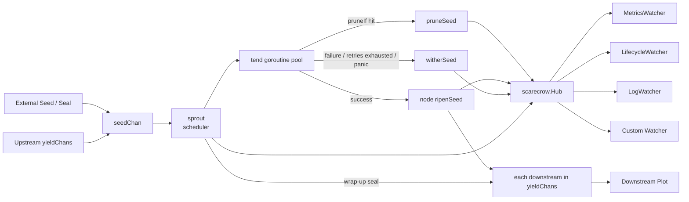
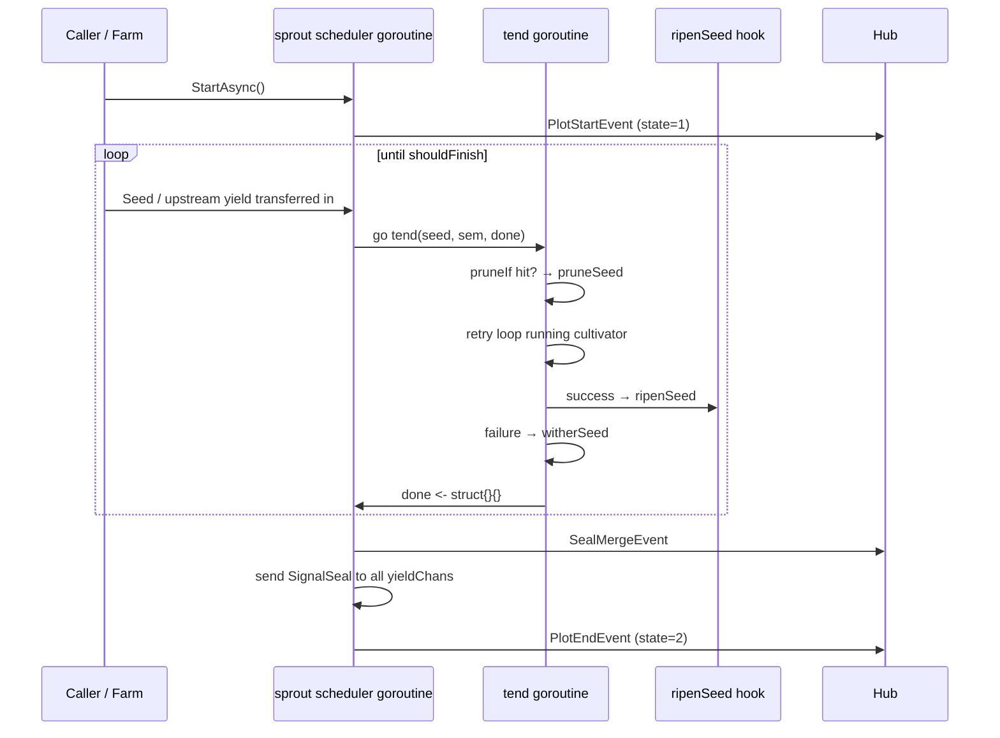

# pkg/plot/plot.go

> 📅 Last Updated: 2026/11/13

`plot.go` is the **shared runtime skeleton** of `pkg/plot`, and also carries the package documentation. It defines two things:

1. The `PlotNode` interface—after erasing generics, it lets `pkg/farm` uniformly hold nodes with different seed/fruit types;
2. The `basePlot[S, F, Y]` generic struct—the base type embedded by `SinglePlot`, `SplitPlot`, and `RoutePlot`.

`basePlot` carries almost all common responsibilities: upstream/downstream connections, concurrent scheduling (`sprout` + `tend`), pruning and retries, seal merging, metrics reading, event emission, standalone batch runs, and result export. The only difference between nodes is expressed by the `ripenSeed` hook injected at construction time, so each of the three node kinds only needs to implement a single `ripenSeed` method.

## Role

- Defines the `PlotNode` interface as the contract between `Farm` and a plot.
- Provides the shared `basePlot` skeleton so that `SinglePlot` / `SplitPlot` / `RoutePlot` do not each reimplement scheduling, retries, and result handling.
- Decouples "seed type", "result type", and "downstream yield type" through three generic parameters, so the same skeleton can support the three success semantics: broadcast (`SinglePlot`), split (`SplitPlot`), and routing (`RoutePlot`).
- Emits runtime information with an "event + watcher" model: metrics, lifecycle, and logs are all dispatched by the `Hub` in `pkg/scarecrow`, and `basePlot` itself holds no persistence resources.

## Core Objects

### The `PlotNode` interface

```go
type PlotNode interface {
	GetName() string
	GetState() int32
	GetSeedChanAny() any

	ConnectTo(next PlotNode) error
	AddUpstream(name string)
	AddWatcher(listener scarecrow.Watcher) error
	SetEventClient(eventClient runtime.EventClient)

	StartAsync()
	WaitAsync()
	SeedAny(seed any) error
	Seal()
}
```

| Method | Purpose |
|------|------|
| `GetName()` | Returns the plot name (must be unique within a `Farm`) |
| `GetState()` | Returns the state: `0=idle`, `1=running`, `2=done` |
| `GetSeedChanAny()` | Exposes `seedChan` as `any` so that the upstream's `ConnectTo` can perform a type assertion |
| `ConnectTo(next)` | Establishes the "this node's yield → downstream seed" connection and validates the types |
| `AddUpstream(name)` | Called by the **upstream** during `ConnectTo` to register the name of this node's upstream, used for seal aggregation |
| `AddWatcher(listener)` | Registers a watcher with the node's internal `Hub`; registering twice results in receiving events twice |
| `SetEventClient(eventClient)` | Injects the event ID allocator (`Farm` injects the same client uniformly) |
| `StartAsync()` / `WaitAsync()` | Starts the scheduler asynchronously / blocks until the background goroutine exits |
| `SeedAny(seed)` | Sows a single seed as `any`; used by `Farm` to inject initial tasks |
| `Seal()` | Sends the external termination signal |

> The interface has **no** `AddObserver`, `BindInlet`, `StartSpouts`, or any counter read/write method: watchers are uniformly `scarecrow.Watcher`, persistence resources are assembled by `pkg/assembly`, and metrics are rebuilt from the event stream.

### The `basePlot[S, F, Y]` struct

```go
type basePlot[S any, F any, Y any] struct {
	name       string
	cultivator func(S) (F, error)
	ripenSeed  func(seedPayload runtime.Payload[S], fruit F, startTime time.Time)
	plotOptions

	seedChan   chan runtime.Payload[S]
	yieldChans map[string]chan runtime.Payload[Y]
	upstreams  map[string]struct{}

	eventClient runtime.EventClient
	hub         *scarecrow.Hub

	ctx    context.Context
	cancel context.CancelFunc
	wg     sync.WaitGroup
	state  atomic.Int32 // 0=idle, 1=running, 2=done
}
```

| Generic Parameter | Meaning |
|---------|------|
| `S` | Seed input type, i.e. the parameter type of `cultivator` |
| `F` | The **result** type of this node, i.e. the return type of `cultivator` (different for the three node kinds) |
| `Y` | The yield type output downstream; must match the `S` of the downstream node |

| Field | Meaning |
|------|------|
| `name` | plot name |
| `cultivator` | cultivation function, returns this node's result type `F` |
| `ripenSeed` | success hook, injected by the concrete node; its signature is fixed as `(seedPayload, fruit F, startTime)` |
| `plotOptions` | embedded optional configuration (concurrency, buffer, retry policy, prune predicate), see `option.md` |
| `seedChan` | seed input channel, capacity = `WithChanSize`; shared by data and control signals (`SignalSeal`) |
| `yieldChans` | `downstream plot name → that downstream's seed channel`, populated by `ConnectTo` |
| `upstreams` | set of registered upstream plot names, used to decide whether seals have all arrived |
| `eventClient` | in-process event ID allocator, defaults to `runtime.NewLocalEventClient()` |
| `hub` | this node's event dispatch center, defaults to `scarecrow.NewHub()`; watchers are registered by `AddWatcher` |
| `ctx` / `cancel` | derived from `context.WithCancel(context.Background())`, used for internal forced wrap-up |
| `wg` | joins the background goroutines started by `StartAsync` |
| `state` | state atomic variable (0/1/2) |

### Generic Instantiation of the Three Node Kinds

| Node | Underlying `basePlot` | Result Type | Downstream Yield Type `Y` |
|------|----------------|---------|--------------------|
| `SinglePlot[S, F]` | `basePlot[S, F, F]` | `F` | `F` |
| `SplitPlot[S, F]` | `basePlot[S, []F, F]` | `[]F` | `F` |
| `RoutePlot[S, Y]` | `basePlot[S, map[string]Y, Y]` | `map[string]Y` | `Y` |

> `ConnectTo` checks with a type assertion whether "the upstream's `Y`" and "the downstream's `S`" match, so `SinglePlot[S, F]` can only connect to a downstream node with `S == F`; otherwise the connection immediately returns a type-incompatibility error.

### Construction (unexported)

```go
func newBasePlot[S any, F any, Y any](
	name string,
	cultivator func(S) (F, error),
	ripenSeed func(seedPayload runtime.Payload[S], fruit F, startTime time.Time),
	opts ...Option,
) *basePlot[S, F, Y]
```

Called only by `NewSinglePlot` / `NewSplitPlot` / `NewRoutePlot` in the same package. Steps:

1. Take `defaultOptions()` and apply `opts` in order;
2. Derive `ctx` / `cancel` from `context.WithCancel(context.Background())`;
3. Allocate `seedChan` (capacity `chanSize`) and empty `yieldChans` / `upstreams`;
4. Initialize `eventClient = runtime.NewLocalEventClient()` and `hub = scarecrow.NewHub()`.

## Metrics Reading

`basePlot` no longer carries counters of its own; metrics are rebuilt from the event stream: `pkg/assembly` registers `*scarecrow.MetricsWatcher` with the plot's `hub` during the run, and `basePlot` locates it via `scarecrow.Find` in the hub (including nested hubs) when reading.

```go
func (p *basePlot[S, F, Y]) currentMetrics() (scarecrow.PlotMetrics, bool) {
	metrics, ok := scarecrow.Find[*scarecrow.MetricsWatcher](p.hub)
	if !ok {
		return scarecrow.PlotMetrics{}, false
	}
	return metrics.GetPlot(p.name)
}
```

| Method | Data Source (`PlotMetrics`) | Description |
|------|--------------------------|------|
| `GetSeedNum() int` | `InputTotal` | Total inputs = external injections + deliveries from each upstream |
| `GetFruitNum() int` | `Succeeded` | Ripened (success) count |
| `GetWeedNum() int` | `Failed` | Withered (failure) count |
| `GetPruneNum() int` | `Skipped` | Pruned (skipped) count |
| `GetCompleted() int` | `Processed` | Processed count = ripened + withered + pruned |
| `IsFinish() bool` | `Processed == InputTotal` | All input seeds have produced a result |

> When no metrics watcher is assembled (for example, `StartAsync` is called directly without going through `Run` / without registering `MetricsWatcher`): count methods return `0`, and `IsFinish()` returns `false`. These methods read the **current snapshot**, so under concurrency the fields are not a strictly consistent view of the same instant.

## Event Emission

`basePlot` synchronously dispatches events to all watchers on the `hub` through `emit`; errors or panics returned by watchers are consumed by the `Hub`'s error handler and do not affect the execution path:

```go
func (p *basePlot[S, F, Y]) emit(event scarecrow.Event) {
	_ = p.hub.OnEvent(event)
}
```

| Event | Trigger Point | Key Fields |
|------|--------|---------|
| `PlotStartEvent` | `notifyStart` | `Plot`, `Tenders`, `StartTime` |
| `PlotEndEvent` | `notifyFinish` | `Plot`, `EndTime`, `Elapsed` |
| `SeedInputEvent` | `Seed` (empty `From`); concrete node's `ripenSeed` (`From` is the upstream name) | `Seed`, `SeedRepr`, `SeedID`, `Parents` |
| `SeedRipenEvent` | concrete node's `ripenSeed` | `Fruit`, `FruitRepr`, `SeedID`, `FruitID` |
| `SeedWitherEvent` | `witherSeed` | `Err`, `SeedID`, `WeedID` |
| `SeedPruneEvent` | `pruneSeed` | `SeedID`, `PruneID` |
| `SeedReplantEvent` | `tend` retry loop | `Err`, `Attempt`, `SeedID` |
| `SealInputEvent` | `Seal` | `SealID` |
| `SealMergeEvent` | `sprout` wrap-up | `ParentIDs`, `SealID` |

> Lifecycle and logs are no longer written to the database directly by `basePlot`: `LifecycleWatcher` / `LogWatcher` in `pkg/persist` subscribe to these events as ordinary `Watcher`s, and `pkg/assembly.StartPlotResources` creates and registers them. Event IDs are still allocated by `eventClient.Emit(...)`: `seed` / `fruit` / `weed` / `prune` / `seal`.

## Key Flows

### Data Flow



### Startup and Wrap-Up



- `StartAsync` starts exactly one goroutine (`sprout`), and its exit is joined by `wg`;
- `sprout` limits concurrency with a `sem` semaphore of capacity `numTenders`: when full, `sem <- struct{}{}` blocks, creating backpressure on the scheduling side;
- Each seed spawns one `tend` goroutine, and the `inFlight` count is incremented and decremented through the `done` channel;
- Before returning, `tend` always does `<-sem` (releasing the token) and `done <- struct{}{}`.

### The `sprout` Main Loop

```go
sem := make(chan struct{}, p.numTenders)
done := make(chan struct{}, p.numTenders)
sealedFrom := make(map[string]int, len(p.upstreams))

ctxCancel := false
inputClosed := false
inFlight := 0
shouldFinish := func() bool {
	return ctxCancel || (inputClosed && inFlight == 0)
}
```

The three `select` branches:

| Branch | Behavior |
|------|------|
| `seed := <-p.seedChan` | If `Signal == SignalSeal` → `inputClosed = p.markSealed(seed.Source, seed.EventID, sealedFrom)`; otherwise acquire the semaphore, `inFlight++`, `go p.tend(...)` |
| `<-done` | `inFlight--` |
| `<-p.ctx.Done()` | `ctxCancel = true` (internal cancellation, forced wrap-up) |

When `shouldFinish()` becomes true it wraps up: it collects the seal event IDs recorded in `sealedFrom` into `parentIDs`, allocates `sealID` via `eventClient.Emit("seal", parentIDs)`, emits `SealMergeEvent`, then sends `Payload[Y]{Signal: SignalSeal, Source: p.name, EventID: sealID}` to **all** `yieldChans`, and finally returns.

> The wrap-up broadcast is **blocking**: if a downstream has stopped consuming and its `seedChan` buffer is full, the upstream gets stuck at the `sprout` wrap-up.

### Input Closing and Seal Propagation

The decision order in `markSealed(source string, sealID int, sealedFrom map[string]int) bool`:

| Condition | Result |
|------|------|
| `source == sourceInput` (external `Seal()`) | Records it in `sealedFrom` and **returns `true` immediately**—forced termination, no longer waiting for other upstreams |
| `source == ""` | Returns `false`, ignored |
| `source` is not in `p.upstreams` (unregistered upstream) | Returns `false`, ignored |
| Other registered upstreams | Records it in `sealedFrom` and returns `len(sealedFrom) == len(p.upstreams)` |

That is: seals from ordinary upstreams must **all** arrive before the input is considered closed, whereas a single external `Seal()` closes it on its own. For the sentinel value of a seal, see `constant.md`.

### The Success Path Is Injected by the `ripenSeed` Hook

`basePlot` itself does not care how a successful result is transformed and forwarded; it only calls the injected hook:

```go
ripenSeed func(seedPayload runtime.Payload[S], fruit F, startTime time.Time)
```

| Node | Injected `ripenSeed` Behavior |
|------|------------------------|
| `SinglePlot[S, F]` | One fruit → one yield to every downstream (broadcast) |
| `SplitPlot[S, F]` | Each element of `[]F` → one yield to every downstream |
| `RoutePlot[S, Y]` | `map[string]Y` → targeted delivery by key, skipping unconnected targets |

### Prune Path `pruneSeed`

`tend` evaluates the prune predicate before entering the retry loop:

```go
if p.pruneIf != nil && p.pruneIf(seed) {
	p.pruneSeed(seedPayload, startTime)
	return
}
```

`pruneSeed` is a "direct termination":

1. `eventClient.Emit("prune", []int{seedID})` allocates `pruneID`;
2. Emits `SeedPruneEvent` (parent event `seedID`), and the lifecycle watcher records a `prune` row accordingly;
3. Does **not** call `cultivator`, **not** enter the retry loop, and **not** forward to any downstream.

> Pruning happens **before** the `cultivator`, so a pruned seed is neither cultivated nor failed; it is treated as a "pre-determined skip". It still counts toward the completed count (`Processed` includes prunes), ensuring progress does not stall.

### Failure Path `witherSeed`

1. `eventClient.Emit("weed", []int{seedID})` allocates `weedID`;
2. Emits `SeedWitherEvent` (parent event `seedID`, including `Err` and `Elapsed`);
3. Does **not** forward to any downstream.

### Retry Loop `tend`

```go
for attempt := 1; attempt <= p.maxRetries+1; attempt++ {
	fruit, err = p.cultivator(seed)
	if err == nil {
		break
	}
	if !p.retryIf(err) {
		break
	}
	if attempt <= p.maxRetries {
		p.emit(scarecrow.SeedReplantEvent{ /* Attempt: attempt, Err: err, SeedID: seedID */ })
	}
	time.Sleep(p.retryDelay(attempt))
}
```

| Scenario | Behavior |
|------|------|
| `pruneIf` hit | Does not call `cultivator`; goes straight to `pruneSeed` and returns |
| `cultivator` returns `nil` | Breaks immediately and enters `ripenSeed` |
| Returns an err and `retryIf(err) == false` | Breaks immediately and enters `witherSeed` (no further retries) |
| `attempt <= maxRetries` | Emits `SeedReplantEvent` (including the 1-based `Attempt`), then `Sleep(retryDelay(attempt))` |
| Still failing on the last attempt (`attempt == maxRetries+1`) | Does not emit `SeedReplantEvent`, but still executes `Sleep(retryDelay(maxRetries+1))` once |
| `cultivator` panics | Caught by `defer recover` and turned into a `cultivator panic: %v` error that goes through `witherSeed` (no further retries) |

> The `startTime` passed on the panic path is `time.Now()`, so `SeedWitherEvent.Elapsed` is close to 0 and does not represent the real cultivation duration.

### Input and Asynchronous Execution

| Method | Behavior |
|------|------|
| `Seed(seed S)` | Allocates the seed event ID (no parent event), emits `SeedInputEvent` (empty `From`), then posts `Payload[S]{Value: seed, EventID: seedID}` to `seedChan` |
| `SeedAny(seed any) error` | Type-asserts to `S`; on failure returns `plot %q seed type mismatch: got %T`; on success forwards to `Seed` |
| `Seal()` | Allocates the seal event ID, emits `SealInputEvent`, and posts `Payload[S]{Signal: SignalSeal, Source: sourceInput, EventID: sealID}` to `seedChan`, triggering the **forced termination** semantics |
| `StartAsync()` | Starts exactly one background goroutine through `p.wg.Go`: `notifyStart` (state=1) → the `sprout` main loop → `notifyFinish` (state=2) |
| `WaitAsync()` | `p.wg.Wait()`, blocking until the background goroutine exits |

> Both `Seed` / `Seal` **write to the channel synchronously**: if the `seedChan` buffer is full and no tender is consuming, the caller blocks.

### Standalone Execution `Run`

```go
func (p *basePlot[S, F, Y]) Run(seeds []S, logLevel string)
```

The one-stop entry point for standalone mode (blocking):

1. `assembly.StartPlotResources(p.hub, logLevel)` assembles the metrics, lifecycle, and log watchers; on failure it **returns immediately** (no error returned, no output);
2. `defer resources.Stop()` guarantees a flush and resource reclamation on exit;
3. `StartAsync()`;
4. Injects `seeds` one by one via `Seed(seed)`;
5. `Seal()` declares that there is no more external input;
6. `WaitAsync()` blocks until everything finishes.

> `logLevel` is the minimum level for this run's logs; an empty string is treated as `INFO` (interpreted by `pkg/persist.NewLogWatcher`). Calling `Run` repeatedly on the same plot registers watchers repeatedly, which is misuse.

### Result Export `Harvest`

```go
func (p *basePlot[S, F, Y]) Harvest() ([]persist.LifecycleStatusRecord, error)
```

At call time it looks up `*persist.LifecycleWatcher` in the hub (including nested hubs), reads its `DBPath()`, then uses `persist.LoadLifecycleStatusesFromPath(dbPath, p.name)` to query the status snapshot offline. Therefore:

- It can be queried right after the run, without storing the database path on the plot;
- Lifecycle watcher not registered → returns `plot %q lifecycle watcher is not registered`;
- Watcher registered but database not yet ready (empty `DBPath()`) → returns `plot %q lifecycle database is not ready`.

> Key fields of the returned `persist.LifecycleStatusRecord`: `Status` (`ripen` / `wither` / `prune`), `SeedJSON`, `FruitJSON`, `WitherType`, `WitherMessage`.

## Usage Examples

### Standalone Mode

```go
package main

import (
	"fmt"

	"github.com/Mr-xiaotian/CelestialGrow/pkg/plot"
)

func main() {
	p := plot.NewSinglePlot("double",
		func(seed int) (int, error) { return seed * 2, nil },
		plot.WithTenders(4),
	)

	p.Run([]int{1, 2, 3, 4, 5}, "INFO")

	records, err := p.Harvest()
	if err != nil {
		panic(err)
	}
	for _, r := range records {
		fmt.Println(r.SeedJSON, r.Status, r.FruitJSON)
	}
}
```

### Subscribing to Events

```go
package main

import (
	"fmt"

	"github.com/Mr-xiaotian/CelestialGrow/pkg/plot"
	"github.com/Mr-xiaotian/CelestialGrow/pkg/scarecrow"
)

func main() {
	p := plot.NewSinglePlot("double", func(seed int) (int, error) { return seed * 2, nil })

	if err := p.AddWatcher(scarecrow.WatcherFunc(func(event scarecrow.Event) error {
		switch ev := event.(type) {
		case scarecrow.SeedRipenEvent:
			fmt.Printf("[%s] %s -> %s (%s)\n", ev.Plot, ev.SeedRepr, ev.FruitRepr, ev.Elapsed)
		case scarecrow.SeedWitherEvent:
			fmt.Printf("[%s] %s wither: %v\n", ev.Plot, ev.SeedRepr, ev.Err)
		}
		return nil
	})); err != nil {
		panic(err)
	}

	p.Run([]int{1, 2, 3}, "INFO")
}
```

### Farm Mode

Farm mode does not call `Run` / `Seed` / `Seal` directly; instead it hands nodes to `pkg/farm` as `plot.PlotNode`:

```go
package main

import (
	"fmt"

	"github.com/Mr-xiaotian/CelestialGrow/pkg/farm"
	"github.com/Mr-xiaotian/CelestialGrow/pkg/plot"
)

func main() {
	double := plot.NewSinglePlot("double", func(seed int) (int, error) {
		return seed * 2, nil
	}, plot.WithTenders(2))

	addOne := plot.NewSinglePlot("addOne", func(seed int) (int, error) {
		return seed + 1, nil
	}, plot.WithTenders(2))

	f := farm.NewFarm("demo")
	if err := f.AddPlot(double, addOne); err != nil {
		panic(err)
	}
	if err := f.Connect([]plot.PlotNode{double}, []plot.PlotNode{addOne}); err != nil {
		panic(err)
	}
	if err := f.Run(map[string][]any{"double": {1, 2, 3}}, "INFO"); err != nil {
		panic(err)
	}

	fmt.Println("done")
}
```

At this point runtime resources are assembled uniformly by `Farm.Run`, and nodes are only responsible for producing events.

## Test Focus

The behavior of `basePlot` is covered by `plot_harvest_test.go` (result snapshots), `plot_prune_test.go` (pruning semantics), and `plot_retry_test.go` (retry semantics); for case-by-case explanations see the corresponding test documents.

## Notes

- The default concurrency and channel buffer are both `runtime.NumCPU()`; I/O-intensive workloads can tune them with `WithTenders` / `WithChanSize` (see `option.md`).
- `Run` is a **blocking** call; it returns only after all seeds have been processed. It has no return value, and returns silently when assembly fails.
- When the upstream `Y` and the downstream `S` types do not match, `ConnectTo` returns an error immediately rather than panicking; it is recommended to check the error after `Farm.AddPlot` / `Farm.Connect`.
- `ctx` / `cancel` are currently created only in `newBasePlot` and watched by `sprout`; `cancel` has no exposed call site and is a reserved internal termination channel.
- `AddUpstream` should only be called during graph construction (`ConnectTo`); modifying `upstreams` at runtime races with `sprout`'s reads.
- An external `Seal()` has **forced termination** semantics: once it arrives, the node wraps up immediately even if some upstreams have not sent their seal.
- All metrics come from `MetricsWatcher`, so a non-zero count can only be read after a metrics watcher **must** be assembled during the run (standalone does this through `Run`, Farm through `Farm.Run`).
