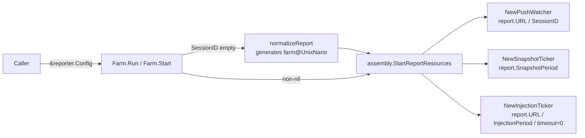

# pkg/reporter/config.go

> 📅 Last Updated: 2026/11/26

`pkg/reporter/config.go` defines `Config`, the minimal configuration carrier required for remote reporting to run. It is pure data by itself: no validation, no methods; the real legality checks happen in the three constructors `NewPushWatcher`, `NewSnapshotTicker`, and `NewInjectionTicker`.

## Purpose

- Package "reporting service address + session identifier + two tick periods" and pass it to `Farm.Run` / `Farm.Start`.
- Serve as the `Report` type exposed by `pkg/api` (`type Report = reporter.Config`, a **type alias** rather than a new type), so callers do not need to import `pkg/reporter` directly.
- Be read by `pkg/assembly.StartReportResources` to construct the push watcher, the snapshot ticker, and the injection ticker respectively.

A `report` argument of `nil` means **local run**: `Farm` goes through `assembly.StartLocalResources` and neither pushes nor pulls injections. Therefore `Config` is also the switch for "whether remote reporting is enabled".

## Core objects

### `type Config`

```go
type Config struct {
    URL             string // 上报服务基础地址
    SessionID       string // 上报会话标识；为空时由运行入口生成
    SnapshotPeriod  int    // 状态快照节拍周期
    InjectionPeriod int    // 注入拉取节拍周期
}
```

| Field | Type | Semantics of `0` | Actual consumer |
|------|------|-----------|-----------|
| `URL` | `string` | **Invalid**: `normalizeBaseURL` returns `reporter: base url is empty` | `NewPushWatcher`, `NewInjectionTicker` |
| `SessionID` | `string` | **Generated by the entry point**: `Farm.normalizeReport` generates `<farmName>@<UnixNano>` | `session_id` of the push payload, query parameter of the injection request |
| `SnapshotPeriod` | `int` | Uses `DefaultSnapshotPeriod` (`1`, i.e. every tick) | `NewSnapshotTicker` |
| `InjectionPeriod` | `int` | Uses `DefaultInjectionPeriod` (`5`) | `NewInjectionTicker` |

All fields are exported, so `Config` can be constructed directly with a literal; there is no constructor, no default-filling method, and no `Validate`.

### Period unit is "ticks", not seconds

`SnapshotPeriod` / `InjectionPeriod` are tick counts in the `metronome.Periodic` sense: `1` means trigger on every tick, `2` means trigger once every two ticks (`(Seq-1)%period == 0`). The actual wall-clock interval = number of ticks × clock base period. When assembling, `Farm` always passes `metronome.DefaultInterval` (`1s`), so the defaults can be roughly read as "a snapshot every 1 second, an injection pull every 5 seconds"; if the caller changes the interval of `metronome.Clock` to 200ms themselves, the same configuration becomes 200ms / 1s.

A negative period raises an error in the constructor (`snapshot period must be positive` / `injection period must be positive`); only `0` means "use the default".

## Key flow



1. `Farm.Run` / `Farm.Start` first call `normalizeReport`: only when `report != nil` and `SessionID` is empty after trimming, the configuration is **copied** and filled with `<farmName>@<time.Now().UnixNano()>`; the original object is not modified.
2. `assembly` uses the same `Config` to construct three components. `NewInjectionTicker` is given `0` for `timeout`, i.e. it adopts `DefaultPullTimeout` (3 seconds).
3. If any constructor returns an error, `assembly` returns the error immediately and `Farm` aborts this run accordingly (it does not degrade into a silent local run).

## Usage examples

### Batch processing + remote reporting

```go
package main

import (
    "fmt"

    "github.com/Mr-xiaotian/CelestialGrow/pkg/farm"
    "github.com/Mr-xiaotian/CelestialGrow/pkg/plot"
    "github.com/Mr-xiaotian/CelestialGrow/pkg/reporter"
)

func main() {
    double := plot.NewSinglePlot("double", func(seed int) (int, error) {
        return seed * 2, nil
    })
    format := plot.NewSinglePlot("format", func(seed int) (string, error) {
        return fmt.Sprintf("result=%d", seed), nil
    })

    f := farm.NewFarm("demo")
    if err := f.AddPlot(double, format); err != nil {
        panic(err)
    }
    if err := f.Connect([]plot.PlotNode{double}, []plot.PlotNode{format}); err != nil {
        panic(err)
    }

    report := &reporter.Config{
        URL:             "http://127.0.0.1:5005",
        SessionID:       "demo@manual", // 留空则由 Farm 生成 demo@<UnixNano>
        SnapshotPeriod:  2,             // 每 2 拍推一次状态
        InjectionPeriod: 5,             // 每 5 拍拉一次注入
    }
    if err := f.Run(map[string][]any{"double": {1, 2, 3}}, "INFO", report); err != nil {
        panic(err)
    }
}
```

### External driving + remote injection

`Start` does not inject initial tasks or termination signals, so it is suitable for being driven by the reporter's `/api/pull_injection`; `SessionID` must be given explicitly (or left empty for `Farm` to generate it), otherwise `NewPushWatcher` fails with `session id is empty`.

```go
package main

import (
    "github.com/Mr-xiaotian/CelestialGrow/pkg/farm"
    "github.com/Mr-xiaotian/CelestialGrow/pkg/plot"
    "github.com/Mr-xiaotian/CelestialGrow/pkg/reporter"
)

func main() {
    root := plot.NewSinglePlot("root", func(seed int) (int, error) { return seed, nil })
    f := farm.NewFarm("external")
    if err := f.AddPlot(root); err != nil {
        panic(err)
    }

    // 阻塞直到远程注入终止信号（或服务端下发 shutdown）。
    if err := f.Start("INFO", &reporter.Config{
        URL:             "http://127.0.0.1:5005",
        InjectionPeriod: 1,
    }); err != nil {
        panic(err)
    }
}
```

## Notes

- **`URL` is not validated when constructing `Config`**: errors surface only at the `Farm` startup stage. `URL` accepts only `http` / `https`, and a trailing `/` is stripped; an address with a path (e.g. `http://host/api`) passes validation, but subsequent endpoints are built by **string concatenation**, producing double-prefix addresses such as `http://host/api/api/push_snapshot`.
- **`SessionID` is the server-side unique key**: when empty, `Farm` generates one with `UnixNano`, ensuring different runs do not overwrite each other; if you specify it manually and two runs reuse the same value, the server-side states will interfere with each other.
- **The defaults of `SnapshotPeriod` and `InjectionPeriod` differ** (1 vs 5): snapshots are high-volume but cheap (enqueue only), while an injection pull is a synchronous HTTP request, so the default is sparser.
- **`Config` contains no timeouts**: the push HTTP timeout (`DefaultPushTimeout`), per-enqueue timeout (`DefaultSendTimeout`), and injection pull timeout (`DefaultPullTimeout`) are all package-level constants; there is currently no configuration entry.
- **Concurrency safety**: `Config` is a read-only data carrier; `Farm.normalizeReport` copies the struct when `SessionID` is empty, so a caller reusing the same `Config` afterwards will not mix up sessions.
