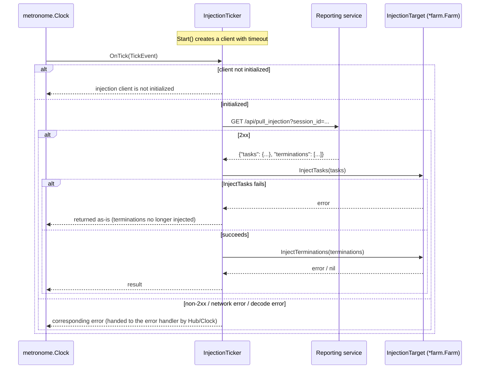

# pkg/reporter/inject.go

> 📅 Last Updated: 2026/11/26

`pkg/reporter/inject.go` implements **remote injection pulling**: on each tick it sends `GET /api/pull_injection` to the server and hands the `tasks` and `terminations` from the response to a local target (usually `*farm.Farm`). It is the only entry point for the "server → local graph" direction, complementing the "local graph → server" direction of `push.go`.

## Purpose

- Inject remotely delivered tasks into the specified Plots, and hand the list of Plots that need terminating to the target.
- Own a `*http.Client` with a timeout: `Start` creates it, `Stop` closes idle connections.
- Register into `metronome.Hub` as a `metronome.Ticker` + `metronome.Lifecycle`, driven by the unified tick clock.

## Core objects

### Constants

```go
const (
    DefaultInjectionPeriod = 5               // 默认 5 拍拉取一次
    DefaultPullTimeout     = 3 * time.Second // 单次拉取的 HTTP 超时
)
```

### `type InjectionTarget` (interface)

```go
type InjectionTarget interface {
    InjectTasks(tasks map[string][]any) error
    InjectTerminations(nodes []string) error
}
```

| Method | Semantics | Typical implementation |
|------|------|----------|
| `InjectTasks(map[string][]any) error` | Injects `Plot name -> seed list` into the corresponding Plots; the target must verify the Plots are registered | `farm.Farm.InjectTasks` |
| `InjectTerminations([]string) error` | Notifies these Plots to stop accepting new seeds and exit after finishing in-flight data | `farm.Farm.InjectTerminations` |

`pkg/assembly.StartReportResources` passes `*farm.Farm` in directly (via the interface parameter `injectionTarget`); these two methods of `Farm` can be called safely at runtime.

### `type injectionPayload` (unexported)

```go
type injectionPayload struct {
    Tasks        map[string][]any `json:"tasks"`
    Terminations []string         `json:"terminations"`
}
```

The JSON shape returned by the server: `{"tasks": {"root": [1, "x"]}, "terminations": ["leaf"]}`. Because decoding goes into `any`, numbers all become `float64` (e.g. `1` becomes `1.0`), and downstream must perform type assertions itself.

### `type InjectionTicker`

```go
type InjectionTicker struct {
    baseURL   string
    sessionID string
    target    InjectionTarget
    period    int
    timeout   time.Duration
    client    *http.Client
}
```

All fields are unexported; the lifecycle of `client` is bound to `Start` / `Stop`.

### Construction: `NewInjectionTicker`

```go
func NewInjectionTicker(
    baseURL string,
    sessionID string,
    target InjectionTarget,
    period int,
    timeout time.Duration,
) (*InjectionTicker, error)
```

Validation runs in a **fixed order**, and the first hit wins:

| Order | Condition | Returned error |
|:----:|------|---------|
| 1 | `target == nil` | `reporter: injection target is nil` |
| 2 | `strings.TrimSpace(sessionID) == ""` | `reporter: session id is empty` |
| 3 | `period == 0` → replaced with `5`; then `period < 1` | `reporter: injection period must be positive, got %d` |
| 4 | `timeout == 0` → replaced with `3s`; then `timeout < 0` | `reporter: pull timeout must be non-negative, got %s` |
| 5 | `normalizeBaseURL(baseURL)` fails | `base url is empty` / `invalid base url %q` / `base url must use http or https, got %q` |

Therefore "empty URL + empty SessionID" reports the SessionID error first; the default replacement of `period` / `timeout` happens before validation, so `-1` is not replaced with the default.

- `baseURL` is normalized via `normalizeBaseURL`: leading and trailing whitespace is trimmed, **all** trailing `/` are removed, and the scheme must be `http`/`https` with a non-empty host.
- `timeout` does not mean "0 means no timeout", but "0 means use the default 3 seconds"; for a longer/shorter value you must pass a positive number explicitly.

### Methods

| Method | Signature | Role |
|------|------|------|
| `TickPeriod` | `func (t *InjectionTicker) TickPeriod() int` | Returns the effective tick period (defaults already filled) |
| `Start` | `func (t *InjectionTicker) Start() error` | Creates the HTTP client; always returns `nil` |
| `Stop` | `func (t *InjectionTicker) Stop() error` | Closes idle connections and nils the client; always returns `nil` |
| `OnTick` | `func (t *InjectionTicker) OnTick(event metronome.TickEvent) error` | Pulls injections once and hands them to the target |

#### Re-entrancy of `Start` / `Stop`

- `Start` only creates when `client == nil`; repeated calls do not replace an existing client.
- `Stop` closes idle connections and then sets `client` to `nil`, so **after `Stop`, `OnTick` reports `reporter: injection client is not initialized`**; `Start` must be called again to continue.
- Both return `nil`, so the return value cannot be used to tell whether any action actually ran.

#### Execution details of `OnTick`

1. `client == nil` → returns an error directly and **makes no network request** (this guarantees "calling OnTick before Start reports an error").
2. Endpoint concatenation: `baseURL + "/api/pull_injection?session_id=" + url.QueryEscape(sessionID)`. Characters such as `@` are escaped to `%40`, and after `Query().Get("session_id")` decodes it on the server side the value is still the original one.
3. `client.Get` fails → `reporter: pull injection: %w` (the underlying `url.Error` is preserved, so `errors.Is` / `errors.As` work).
4. `StatusCode/100 != 2` → `reporter: pull injection failed: <Status>` (e.g. `500 Internal Server Error`). **The response body is not read**.
5. JSON decoding fails → `reporter: decode injection payload: %w`; only the **first** JSON value is decoded, trailing content is ignored, and the response body has no size limit.
6. Missing or `null` `tasks` / `terminations` are normalized to an empty `map` / empty slice, so the target always receives non-`nil` values.
7. `InjectTasks` is called **first**; `InjectTerminations` only after it succeeds. The error returned by the target is **returned as-is**, without wrapping or retrying; if `InjectTasks` fails, the termination list is not injected in that tick.
8. `event` (`TickEvent`) is completely unused; the trigger timing is determined solely by `metronome`.

| Error source | Error text | `errors.Is/As` possible |
|----------|----------|----------------------|
| Not `Start`ed | `reporter: injection client is not initialized` | — |
| Network/timeout | `reporter: pull injection: <underlying error>` | ✅ (`%w`) |
| Non-2xx | `reporter: pull injection failed: <Status>` | — |
| Decode failure | `reporter: decode injection payload: <err>` | ✅ (`%w`) |
| Target injection failure | The original error returned by the target | ✅ (not wrapped) |

## Key flow



`metronome.Hub.OnTick` catches the error returned by `OnTick` and hands it to the error handler, **without interrupting other tickers**; therefore a single failed pull does not stall the ticks.

## Usage examples

### Driving a single pull manually

```go
package main

import (
    "fmt"

    "github.com/Mr-xiaotian/CelestialGrow/pkg/metronome"
    "github.com/Mr-xiaotian/CelestialGrow/pkg/reporter"
)

// demoTarget 演示注入目标的最小实现。
type demoTarget struct{}

func (demoTarget) InjectTasks(tasks map[string][]any) error {
    fmt.Println("tasks:", tasks) // 数字已是 float64
    return nil
}

func (demoTarget) InjectTerminations(nodes []string) error {
    fmt.Println("terminations:", nodes)
    return nil
}

func main() {
    ticker, err := reporter.NewInjectionTicker(
        "http://127.0.0.1:5005/", // 尾部 / 会被规范化去掉
        "demo@1",
        demoTarget{},
        0, // 使用 DefaultInjectionPeriod（5）
        0, // 使用 DefaultPullTimeout（3s）
    )
    if err != nil {
        panic(err)
    }
    fmt.Println("period:", ticker.TickPeriod())

    if err := ticker.Start(); err != nil {
        panic(err)
    }
    defer func() { _ = ticker.Stop() }()

    if err := ticker.OnTick(metronome.TickEvent{Seq: 1}); err != nil {
        fmt.Println("pull failed:", err)
    }
}
```

### Registering with the tick clock

```go
package main

import (
    "fmt"
    "time"

    "github.com/Mr-xiaotian/CelestialGrow/pkg/metronome"
    "github.com/Mr-xiaotian/CelestialGrow/pkg/reporter"
)

type demoTarget struct{}

func (demoTarget) InjectTasks(tasks map[string][]any) error    { return nil }
func (demoTarget) InjectTerminations(nodes []string) error     { return nil }

func main() {
    ticker, err := reporter.NewInjectionTicker(
        "http://127.0.0.1:5005",
        "demo@1",
        demoTarget{},
        1, // 每拍拉取
        time.Second,
    )
    if err != nil {
        panic(err)
    }

    hub, err := metronome.NewHub()
    if err != nil {
        panic(err)
    }
    if err := hub.AddTicker(ticker); err != nil { // 校验周期、拒绝重复注册
        panic(err)
    }

    clock, err := metronome.NewClock(time.Second, hub)
    if err != nil {
        panic(err)
    }
    if err := hub.Start(); err != nil { // 按注册顺序调用 InjectionTicker.Start
        panic(err)
    }
    if err := clock.Start(); err != nil {
        panic(err)
    }

    time.Sleep(2500 * time.Millisecond) // 供观察两拍

    _ = clock.Stop() // 先停时钟，避免 Stop 与 OnTick 并发
    if err := hub.Stop(); err != nil { // 反向调用 InjectionTicker.Stop
        fmt.Println(err)
    }
}
```

## Notes

- **Synchronous network IO occupies the tick goroutine**: `OnTick` runs synchronously in the single scheduling goroutine of `metronome.Clock`, and a single call blocks for at most `timeout`. Tickers queued after it in the same tick are delayed; if blocking exceeds one base period, `Clock` **skips the missed ticks instead of catching up** (see `pkg/metronome/clock.go`). With the default 3-second timeout, an unresponsive server slows down the snapshot ticks.
- **No retry, no backoff**: failures are only reported to the Hub's error handler via error. If retries are needed, implement them at a higher layer or on the server side, to avoid piling up requests inside the ticker.
- **Response content is not validated**: whether the keys of `tasks` are known Plots and whether the values are acceptable to the target is entirely up to `InjectionTarget`; `Farm.InjectTasks` fails entirely when any target Plot does not exist.
- **`OnTick` and `Stop` must not run concurrently**: `Stop` sets `client` to `nil` directly, which races with `OnTick` reading `t.client`. The normal usage is "stop the clock first, then stop the Hub", and the `StopFunc` of `pkg/assembly` follows exactly the order `Clock.Stop → tickerHub.Stop`.
- **`Stop` does not cancel in-flight requests**: `CloseIdleConnections` only affects idle connections; a `Get` already executing still runs until timeout or completion.
- **Redirects and 3xx**: `http.Client` follows up to 10 redirects by default, and the final status code participates in the 2xx decision; redirect targets are not constrained by `normalizeBaseURL`.
- **TLS/proxy**: uses a cloned `http.DefaultTransport` (`newHTTPClient`), so environment settings such as `HTTP_PROXY` / `HTTPS_PROXY` are inherited; each ticker holds its own Transport, and `Stop` only closes its own idle connections.
