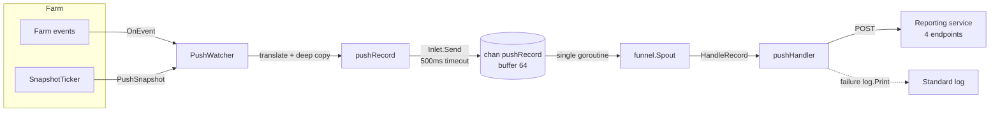
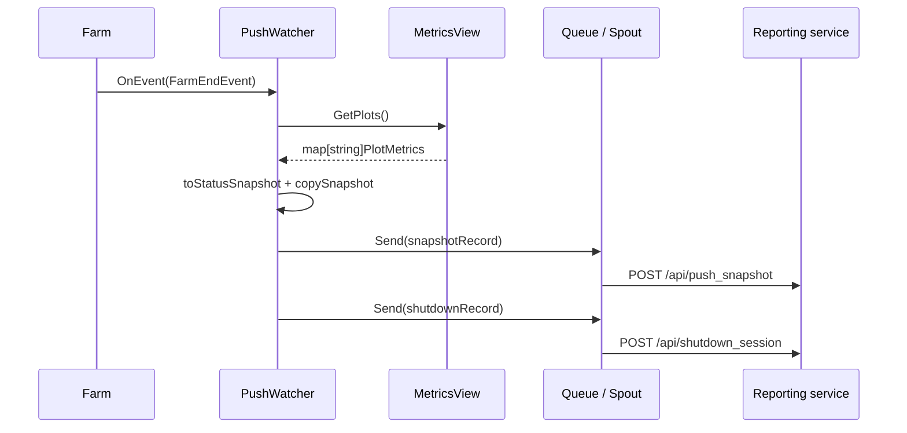

# pkg/reporter/push.go

> 📅 Last Updated: 2026/11/26

`pkg/reporter/push.go` handles pushing in the "local graph → reporting service" direction: it translates Farm events and periodic snapshots into 4 kinds of JSON records, which go through the asynchronous queue of `funnel.Inlet` + `funnel.Spout` and are POSTed one by one to the 4 server endpoints by a background goroutine.

> Sync/async boundary: `OnEvent` and `PushSnapshot` **only enqueue** (blocking at most `DefaultSendTimeout`); all real network IO happens in the single consumer goroutine of `Spout`. A slow server therefore does not block the Farm's event dispatch thread, but it does create backpressure in the form of queue buildup.

## Purpose

- Event translation: `FarmStartEvent` → graph metadata, `SeedWitherEvent` → error record, `FarmEndEvent` → final-state snapshot + session shutdown.
- Periodic snapshots: receive the `map[string]NodeStatus` sent by `SnapshotTicker`, add the session identifier and timestamp, and push it.
- Network isolation: a single failed push only writes a standard log entry, **does not interrupt the consumer loop**, and does not bubble up to the Farm.

## Core objects

### Constants

```go
const (
    DefaultPushBufferSize = 64                      // 队列缓冲条数
    DefaultPushTimeout    = 3 * time.Second         // HTTP 超时 + Spout 优雅关闭超时
    DefaultSendTimeout    = 500 * time.Millisecond  // Inlet.Send 单次入队超时

    defaultGraphMode = "grow"                       // 固定图模式
)
```

`DefaultPushTimeout` has a **dual role**: it serves both as `http.Client.Timeout` and as the shutdown wait limit of `funnel.NewSpout`.

### `type pushRecord` (sealed interface)

```go
type pushRecord interface {
    isPushRecord()
}
```

`isPushRecord` is unexported, so it cannot be implemented outside the package; thus the `type switch` in `pushHandler.handle` can be considered to cover all record types; unknown types go to `default` and return `reporter: unsupported push record %T`.

### The 4 record types and their JSON contracts

#### `graphMetaRecord` → `POST /api/push_graph_meta`

| Field | JSON key | Source |
|------|---------|------|
| `SessionID` | `session_id` | `PushWatcher.sessionID` |
| `Graph` | `graph` | `FarmStartEvent.Farm` |
| `GraphMode` | `graph_mode` | Fixed `"grow"` |
| `StartTime` | `start_time` | Unix float seconds of `FarmStartEvent.StartTime` |
| `IsDAG` | `is_dag` | `FarmStartEvent.IsDAG` |
| `Nodes` | `nodes` | A copy of `FarmStartEvent.Plots` |
| `Edges` | `edges` | Deep copy of `FarmStartEvent.Edges`; nodes without outgoing edges are encoded as `[]` |
| `SourceNodes` | `source_nodes` | A copy of `FarmStartEvent.SourcePlots` |
| `NodeMeta` | `node_meta` | A copy of `FarmStartEvent.NodeMeta` (`class_name` / `execution_mode` / `max_workers`) |

`FarmStartEvent.Structure` (pre-rendered structure lines) is **not reported**; the web side renders the topology itself.

#### `snapshotRecord` → `POST /api/push_snapshot`

| Field | JSON key | Description |
|------|---------|------|
| `SessionID` | `session_id` | Session identifier |
| `Timestamp` | `timestamp` | Snapshot time (Unix float seconds); periodic snapshots use `time.Now()`, the Farm-end snapshot uses `FarmEndEvent.EndTime` |
| `Snapshot` | `snapshot` | `map[string]NodeStatus`, see [`snapshot.md`](./snapshot.md) for details |

#### `taskFailRecord` → `POST /api/push_error`

| Field | JSON key | Source |
|------|---------|------|
| `SessionID` | `session_id` | Session identifier |
| `EventID` | `event_id` | **`SeedWitherEvent.WeedID`** (the wither event ID, not `SeedID`) |
| `Node` | `node` | `SeedWitherEvent.Plot` |
| `Task` | `task_json` | `toJSONValue(SeedWitherEvent.Seed)`; degrades to a readable string when it cannot be serialized |
| `ErrorType` | `error_type` | `fmt.Sprintf("%T", Err)`, e.g. `*errors.errorString` |
| `ErrorMessage` | `error_message` | `fmt.Sprintf("%v", Err)` |
| `Timestamp` | `ts` | Unix float seconds of `SeedWitherEvent.Time` |

> `taskFailRecord` has no `result_json` field: locally only the failed task and error text are reported, without any result placeholder.

#### `shutdownRecord` → `POST /api/shutdown_session`

| Field | JSON key | Description |
|------|---------|------|
| `SessionID` | `session_id` | Session identifier; the server takes the session offline based on it |

### `type pushHandler` (unexported)

```go
type pushHandler struct {
    baseURL string
    timeout time.Duration
    client  *http.Client
}
```

Implements the three-piece set of `funnel.RecordHandler[pushRecord]`:

| Method | Behavior |
|------|------|
| `BeforeStart()` | `h.client = newHTTPClient(h.timeout)`, always returns `nil` |
| `HandleRecord(record)` | Calls `handle`; **on error it only does `log.Print`, then returns `nil`** |
| `AfterStop()` | `CloseIdleConnections()` and nils the client, always returns `nil` |

`HandleRecord` always returning `nil` is a key design decision: `funnel.Spout` itself discards the handler's return value, and swallowing errors proactively avoids the misunderstanding that "errors look propagatable but actually are not"; failure observability relies entirely on the standard log.

#### Endpoint dispatch and `post`

| Record type | Endpoint |
|----------|------|
| `graphMetaRecord` | `/api/push_graph_meta` |
| `snapshotRecord` | `/api/push_snapshot` |
| `taskFailRecord` | `/api/push_error` |
| `shutdownRecord` | `/api/shutdown_session` |

Steps of `post(path, payload any)`:

1. `client == nil` → `reporter: push client is not initialized`. On the normal path `Spout.Start` calls `BeforeStart` to build the client before consuming, so this is a defensive branch (e.g. when the handler is reused directly without `Spout`).
2. `json.Marshal(payload)` fails → `reporter: marshal <path> payload: %w`.
3. `POST baseURL+path` with `Content-Type: application/json`.
4. Transport-layer error → `reporter: push <path>: %w`.
5. Non-2xx:
   - Use `io.LimitReader(res.Body, 512)` to read at most **512 bytes** of the response body;
   - Then use `io.Copy(io.Discard, res.Body)` to drain the rest so the connection can be reused;
   - If the trimmed response body is non-empty, the error is `reporter: push <path> failed: <Status>: <body>`, otherwise `reporter: push <path> failed: <Status>`.
6. On 2xx it returns `nil` directly without parsing the response body.

### `type PushWatcher`

```go
type PushWatcher struct {
    sessionID   string
    metricsView MetricsView
    spout       *funnel.Spout[pushRecord]
    inlet       *funnel.Inlet[pushRecord]
}
```

- Implements `scarecrow.Watcher` (`OnEvent`), `SnapshotSink` (`PushSnapshot`), and `metronome.Lifecycle` (`Start` / `Stop`).
- `metricsView` is only used to push an extra final-state snapshot on `FarmEndEvent`.

#### Construction: `NewPushWatcher`

```go
func NewPushWatcher(sessionID string, baseURL string, metricsView MetricsView) (*PushWatcher, error)
```

Validation order:

| Order | Condition | Error |
|:----:|------|------|
| 1 | `strings.TrimSpace(sessionID) == ""` | `reporter: session id is empty` |
| 2 | `metricsView == nil` | `reporter: metrics view is nil` |
| 3 | `normalizeBaseURL(baseURL)` fails | `reporter: base url is empty` / `invalid base url %q` / `must use http or https` |

Fixed assembly after success:

```go
handler := &pushHandler{baseURL: baseURL, timeout: DefaultPushTimeout}
spout := funnel.NewSpout(handler, DefaultPushBufferSize, DefaultPushTimeout) // 缓冲 64，关闭等待 3s
inlet := funnel.NewInlet(spout.GetQueue(), DefaultSendTimeout)              // 入队超时 500ms
```

Neither the push timeout nor the queue capacity is a constructor parameter, so they cannot be adjusted per session.

#### Methods and behavior

| Method | Signature | Behavior |
|------|------|------|
| `Start` | `func (w *PushWatcher) Start() error` | Delegates to `spout.Start()`: first `BeforeStart` builds the client, then the consumer goroutine starts |
| `Stop` | `func (w *PushWatcher) Stop() error` | First `inlet.Close()` to make blocked sends return early, then `spout.Stop()`; a returned `shutdown timeout` means draining timed out |
| `OnEvent` | `func (w *PushWatcher) OnEvent(event scarecrow.Event) error` | Event translation + enqueue; only errors from `Inlet.Send` are propagated |
| `PushSnapshot` | `func (w *PushWatcher) PushSnapshot(snapshot map[string]NodeStatus) error` | Enqueues one snapshot with `time.Now()` as the timestamp |
| `pushSnapshotAt` | `(snapshot, ts time.Time) error` (unexported) | Deep-copies the snapshot then enqueues it, shared by `PushSnapshot` and FarmEnd |

##### Event mapping of `OnEvent`

| Event | Record produced | Remarks |
|------|-----------|------|
| `scarecrow.FarmStartEvent` | `graphMetaRecord` | `Plots`/`SourcePlots` copied with `append([]string{}, ...)`; `Edges` via `copyEdges`; `NodeMeta` via `copyNodeMeta` |
| `scarecrow.SeedWitherEvent` | `taskFailRecord` | `EventID = WeedID`; when `Err` is `nil` you get `error_type="<nil>"` and `error_message="<nil>"` |
| `scarecrow.FarmEndEvent` | `snapshotRecord` + `shutdownRecord` | First projects the **final-state snapshot** with `metricsView.GetPlots()` and enqueues it with `EndTime`, then enqueues shutdown only after that succeeds |
| Other events | None | Returns `nil`, nothing enqueued |

Ordering guarantee for FarmEnd: the two records enter the same FIFO queue and are sent serially by the **same** consumer goroutine, so the server always receives the final-state snapshot before the session shutdown. If the final snapshot fails to enqueue (the queue is still full after 500ms), `OnEvent` returns that error directly and **shutdown is not sent**.

##### Draining semantics of `Stop`

1. `inlet.Close()` cancels the internal context so that a blocking `Send` returns `context.Canceled` as soon as possible; it does not close the channel.
2. `spout.Stop()` closes the channel and drains the buffer, waiting at most `DefaultPushTimeout` (3s).
3. No timeout: returns `nil`, and every enqueued record has been attempted.
4. Timeout: the consumer goroutine is canceled, the remaining records in the buffer are dropped, and `shutdown timeout` is returned; `AfterStop` still runs afterwards to close idle connections.

## Key flow

### Asynchronous path from event to network



### Push order when the Farm ends



## Usage example

```go
package main

import (
    "fmt"

    "github.com/Mr-xiaotian/CelestialGrow/pkg/reporter"
    "github.com/Mr-xiaotian/CelestialGrow/pkg/scarecrow"
)

// emptyMetrics 演示 MetricsView 的最小实现。
type emptyMetrics struct{}

func (emptyMetrics) GetPlots() map[string]scarecrow.PlotMetrics {
    return map[string]scarecrow.PlotMetrics{}
}

func main() {
    watcher, err := reporter.NewPushWatcher("demo@1", "http://127.0.0.1:5005/", emptyMetrics{})
    if err != nil {
        panic(err)
    }
    if err := watcher.Start(); err != nil { // 内部创建 HTTP client 并启动消费 goroutine
        panic(err)
    }

    // 入队，立即返回；网络请求在后台 goroutine 中执行。
    if err := watcher.OnEvent(scarecrow.FarmStartEvent{
        Farm:        "demo",
        IsDAG:       true,
        Plots:       []string{"root"},
        Edges:       map[string][]string{"root": {}},
        SourcePlots: []string{"root"},
    }); err != nil {
        fmt.Println("enqueue failed:", err)
    }

    // 也可直接推一次快照（通常由 SnapshotTicker 调用）。
    if err := watcher.PushSnapshot(map[string]reporter.NodeStatus{
        "root": {Status: 1, TasksInput: 3, TasksProcessed: 2, TasksPending: 1},
    }); err != nil {
        fmt.Println("enqueue failed:", err)
    }

    // 排空队列并关闭连接；超过 3s 会返回 shutdown timeout。
    if err := watcher.Stop(); err != nil {
        fmt.Println("stop:", err)
    }
}
```

When combined with `SnapshotTicker`, the usual form is `NewSnapshotTicker(metricsView, watcher, period)`, letting the ticker only do the projection while the watcher owns the network.

## Notes

- **Single failures only log**: `HandleRecord` swallows all errors, and its return value is always `nil`; a failed push neither fails the Farm run nor gets retried. Logging goes through the standard `log` package (stderr by default) and no custom logger can be injected.
- **Lossy queue**: buffer of 64 records, and `Inlet.Send` waits at most 500ms. When the server stays unavailable, bursty snapshots/error records are dropped (`Send` returns `inlet send timeout after 500ms`). `Farm.emit` ignores watcher errors, so the Farm side is unaware.
- **Calling `OnEvent` / `PushSnapshot` before `Start` does not error immediately**: records pile up in the buffer first (up to 64), and only when the queue is full do they time out after 500ms. If `Start` is never called, these records are never sent.
- **Writing after `Stop` is prohibited**: `spout.Stop` has already closed the channel, so a later `OnEvent`/`PushSnapshot` may panic (`send on closed channel`). `Stop` is **not idempotent**: a second call panics due to the duplicate `close`, and the `StopFunc` of `pkg/assembly` uses a boolean idempotency guard so that sequential calls stop only once (concurrent calls are not safe). Repeated `Start` calls also do not error, but they re-run `BeforeStart` and start a **second** consumer goroutine competing with the first over the same channel, so they should likewise be avoided.
- **Ordering is globally FIFO**: all records within a session share one queue and one consumer goroutine, so requests are strictly serial and ordering is stable; the cost is that a single slow request (up to 3s) blocks all subsequent records.
- **Copy scope at enqueue time**: graph metadata copies the slices and the adjacency list, and snapshots are copied via `copySnapshot` for each node and its counter dictionary; `taskFailRecord.Task` is still the result of `toJSONValue(Seed)` and **does not deep-copy** `Seed` itself, so the caller should not modify the seed object after the event is emitted.
- **`graph_mode` is fixed to `"grow"`**: the current implementation accepts no configuration, so `GraphMeta.graph_mode` in celestialflow-web is always `grow`.
- **The final-state snapshot is sourced from `MetricsView`**: `FarmEndEvent` itself carries no metrics; if `metricsView` has not yet received `PlotEndEvent`, the corresponding node in the snapshot may still be `running` (this depends on the Hub's dispatch order: FarmEnd is emitted after all Plots exit, so normally the metrics are already updated).
- **Only the first 512 bytes of a non-2xx response body are kept**: this avoids large responses consuming memory/log space and still gives a diagnosable summary of the server error; the remaining bytes are discarded to reuse the connection.
- **Redirects**: `http.Client` follows redirects by default, and a `POST` may be rewritten to `GET` on 301/302/303; if the server returns such status codes, confirm the semantics yourself.
