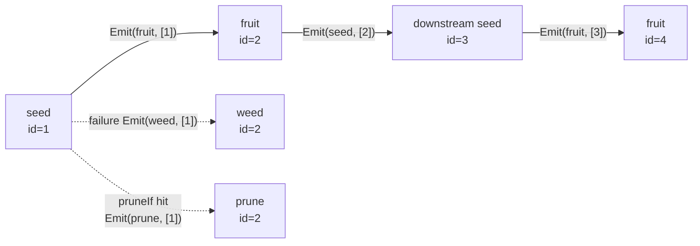
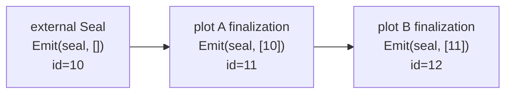
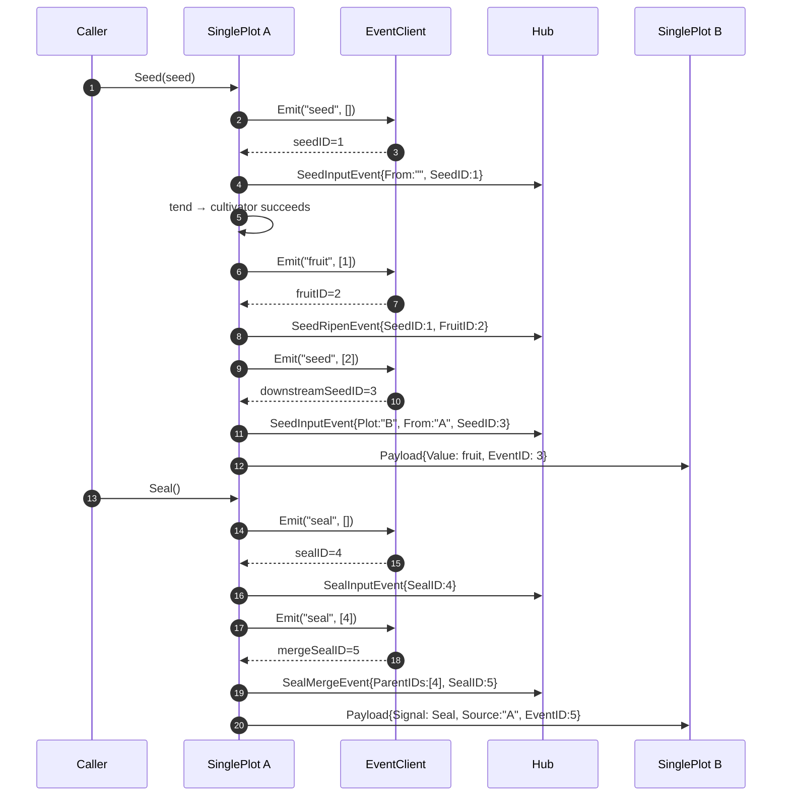
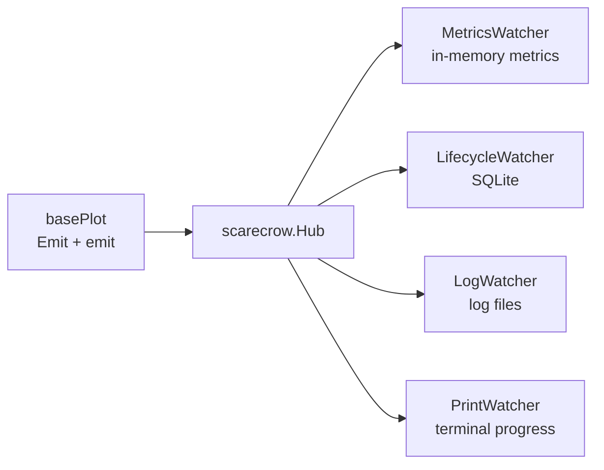

# pkg/runtime/event.go

> 📅 Last Updated: 2026/11/13

`event.go` defines the runtime's **event ID allocation abstraction**: the `EventClient` interface has exactly one method, `Emit(type_ string, parents []int) int`, and the default implementation `LocalEventClient` uses a mutex to maintain an in-process monotonically increasing counter. `basePlot` in `pkg/plot` obtains IDs through its `eventClient` field and writes them at the same moment into the event structs of `pkg/scarecrow` (`SeedInputEvent.SeedID`, `SeedRipenEvent.FruitID`, `SeedWitherEvent.WeedID`, and so on), where metrics, logs, and lifecycle watchers consume them.

> Note the distinction between two "event" concepts: the `EventClient` in this file only allocates **integer IDs**; what observers actually consume is the sealed `Event` struct defined in `pkg/scarecrow/event.go`, see [`../scarecrow/event.md`](../scarecrow/event.md).

## Purpose

- Defines the minimal contract of the **event ID allocator**, `EventClient`, decoupling "how IDs are generated" from the plot scheduling logic.
- Provides the in-process, concurrency-safe default implementation `LocalEventClient`.
- Ensures key points such as `Seed` / `Seal` / `witherSeed` / `pruneSeed` / `ripenSeed` / `sprout` finalization all obtain a monotonically increasing integer ID, and uses `parents` to chain the causal relationship "seed → fruit → downstream seed → …".
- These IDs travel with the event structs into `scarecrow.Hub` and are ultimately written by `persist.LifecycleWatcher` into the `events` / `event_parents` tables of SQLite.

> This package has **only** four exported symbols: `EventClient`, `LocalEventClient`, `NewLocalEventClient`, and `(*LocalEventClient).Emit`; there is no `EventKind` enum and no `Event` struct. Event kinds (`"seed"` / `"fruit"` / `"weed"` / `"prune"` / `"seal"`) are passed as string literals by `pkg/plot` to the `type_` parameter of `Emit`.

## Core Objects

### The `EventClient` Interface

The minimal emit capability of an event client. The runtime package requires only one thing from it - **allocate an event ID**.

```go
type EventClient interface {
	Emit(type_ string, parents []int) int
}
```

| Method | Purpose |
|------|------|
| `Emit(type_ string, parents []int) int` | Declares an event of type `type_` whose direct parent event IDs are `parents`, and returns the event ID allocated for it |

> In the `LocalEventClient` implementation, `type_` and `parents` **only participate in the signature contract**: the default implementation neither persists `type_` nor stores `parents`; it only returns an incrementing local ID. The business meaning of both is interpreted by the caller (`pkg/plot`) and passed to observers along with `scarecrow.Event`. This design allows the default implementation to be replaced in the future by a distributed ID generator without changing plot code.

### The `LocalEventClient` Struct

The in-process event ID allocator. `newBasePlot` creates and uses it by default when constructing each plot; `Farm` creates one in `NewFarm` and injects it into all registered plots.

```go
type LocalEventClient struct {
	mu     sync.Mutex
	nextID int
}
```

| Field | Type | Meaning |
|------|------|------|
| `mu` | `sync.Mutex` | The mutex protecting `nextID`, keeping `Emit` atomic under concurrent calls |
| `nextID` | `int` | The allocated event ID; the zero value means nothing has been allocated yet, so the first `Emit` returns `1` |

### Construction and Emission

```go
func NewLocalEventClient() EventClient

func (e *LocalEventClient) Emit(type_ string, parents []int) int
```

| Function | Behavior |
|------|------|
| `NewLocalEventClient()` | Returns an `EventClient` interface value that internally holds a zero-value `*LocalEventClient` (`nextID = 0`) |
| `Emit(type_, parents)` | Locks, performs `nextID++`, returns the new `nextID`, and unlocks. Concurrency-safe and monotonically increasing on the same instance |

```go
c := runtime.NewLocalEventClient()
id1 := c.Emit("seed", []int{})      // 1
id2 := c.Emit("fruit", []int{id1})  // 2
```

> `LocalEventClient` keeps no history - it is only responsible for "allocating IDs", and IDs already allocated cannot be queried through it. When you need to trace the event chain, rely on the watchers to pass IDs and `parents` into `pkg/persist`.

## Exported Symbols Overview

| Symbol | Type | Description |
|------|------|------|
| `EventClient` | `interface` | The minimal contract for event ID allocation |
| `LocalEventClient` | `struct` (exported) | The in-process, concurrency-safe default implementation |
| `NewLocalEventClient` | `func() EventClient` | Constructor; returns an interface value |
| `(*LocalEventClient).Emit` | `func(string, []int) int` | Allocates and returns a new ID |

## Actual Call Sites of ID Allocation

`basePlot`'s common path lives in `pkg/plot/plot.go`, while the success paths are split by node type across `pkg/plot/plot_single.go`, `plot_split.go`, and `plot_route.go`. Every call site uses the current plot's `p.eventClient`; `Farm` itself never calls `Emit`.

| Triggering Method | File / Type | `type_` | `parents` | The `scarecrow.Event` emitted afterwards |
|---------|----------------|---------|-----------|------------------------------|
| `Seed` | `plot.go` / `basePlot` | `"seed"` | `[]int{}` | `SeedInputEvent` (`From` empty, `Parents` empty) |
| `Seal` | `plot.go` / `basePlot` | `"seal"` | `[]int{}` | `SealInputEvent` |
| `witherSeed` | `plot.go` / `basePlot` | `"weed"` | `[]int{seedID}` | `SeedWitherEvent` (`WeedID`) |
| `pruneSeed` | `plot.go` / `basePlot` | `"prune"` | `[]int{seedID}` | `SeedPruneEvent` (`PruneID`) |
| `ripenSeed` | `plot_single.go` / `SinglePlot` | `"fruit"` | `[]int{seedID}` | `SeedRipenEvent` (`FruitID`) |
| `ripenSeed` | same as above, per downstream | `"seed"` | `[]int{fruitID}` | `SeedInputEvent` (`Plot` is the downstream name, `From` is this node's name, `Parents = []int{fruitID}`) |
| `ripenSeed` | `plot_split.go` / `SplitPlot` | `"fruit"` (once) | `[]int{seedID}` | `SeedRipenEvent` |
| `ripenSeed` | same as above, per downstream × per fruit | `"seed"` | `[]int{fruitID}` | `SeedInputEvent` (one per produced item) |
| `ripenSeed` | `plot_route.go` / `RoutePlot` | `"fruit"` (once) | `[]int{seedID}` | `SeedRipenEvent` |
| `ripenSeed` | same as above, per matched route | `"seed"` | `[]int{fruitID}` | `SeedInputEvent` (unconnected targets are skipped) |
| `sprout` finalization | `plot.go` / `basePlot` | `"seal"` | all collected seal IDs | `SealMergeEvent` (`ParentIDs`) |

Additional notes:

- `witherSeed` covers three failure paths at once: `cultivator` returns an error, `retryIf` refuses the retry, and a panic caught by `recover` in `tend` (wrapped as `cultivator panic: …`).
- `pruneSeed` is triggered when `pruneIf` matches in `tend` before `cultivator` is invoked; it produces no fruit and forwards nothing downstream.
- `SeedInputEvent` is emitted by the **delivering side**: the upstream `ripenSeed` emits it before writing `Payload` into the downstream channel, filling the `Plot` field with the downstream name and `From` with this node's name. When the downstream `sprout` reads a normal `Payload`, it does not emit another input event.
- The `parents` used by `sprout` at finalization come from values of the `sealedFrom` map, so the **order is unstable**; `event_parents` in SQLite only records edges and does not depend on order.

## Causal Chain

The following example uses a single `LocalEventClient` instance and a single chain (IDs are allocated consecutively starting from 1):



`fruit` → multiple downstream `seed`s forms a fan-out (`SplitPlot`'s multiple fruits and `RoutePlot`'s multiple targets both work this way); `weed` / `prune` are the end of a chain and produce nothing further. The seal chain instead propagates along "upstream merged seal → downstream":



(In the diagram, A is a source plot without upstreams; if A has other upstreams, the `parents` of the merged seal will contain all collected seal IDs.)

### Event Timeline of a Complete Run



> The diagram omits the waiting: `sprout` emits the merged seal (`SealMergeEvent`) only after `inputClosed` is true and all in-flight seeds have reported back through `done`, so a seal is always broadcast downstream only after every seed received by this node has been fully processed.

## Relationship with Watchers and Persistence

The ID itself carries no business information; persistence is entirely the watchers' job:

- `scarecrow.MetricsWatcher` maintains input / ripen / wither / prune counts and the upstream-downstream source distribution from event fields, and does not read event IDs.
- `persist.LifecycleWatcher` translates the four kinds of seed events into `persist.LifecycleRecord`, then writes them into `events` + `event_parents` via `InsertLifecycleEvent`, and updates the `status` table.
- `persist.LogWatcher` outputs readable logs; `scarecrow.PrintWatcher` prints progress. Neither of them persists anything.
- `MetricsWatcher` / `LifecycleWatcher` / `LogWatcher` are registered on the Hub automatically by `pkg/assembly` during `Run` / `Start`; `PrintWatcher` must be attached manually by the caller through `AddWatcher`.



The correspondence between `type_` and the persisted values is as follows (`LifecycleRecord`'s `Kind` constants are defined in `pkg/persist/lifecycle.go`):

| `Emit`'s `type_` | Event | `LifecycleRecord.Kind` | `events.event_type` | `status.status` |
|-------------------|------|------------------------|---------------------|-----------------|
| `"seed"` | `SeedInputEvent` | `"seed"` | `"seed"` | `"seed"` |
| `"fruit"` | `SeedRipenEvent` | `"ripen"` | `"ripen"` | `"ripen"` |
| `"weed"` | `SeedWitherEvent` | `"wither"` | `"wither"` | `"wither"` |
| `"prune"` | `SeedPruneEvent` | `"prune"` | `"prune"` | `"prune"` |
| `"seal"` | `SealInputEvent` / `SealMergeEvent` | (produces no record) | — | — |

> Naming layers: `Emit`'s `type_` uses botanical metaphors (`fruit` / `weed`), while `LifecycleRecord.Kind` and the persisted values use state semantics (`ripen` / `wither`). `LifecycleRecord.ParentIDs` comes from event fields: seed input uses `SeedInputEvent.Parents`, and ripen / wither / prune each use `[]int{SeedID}`.

## Usage Examples

### Replacing the Default Implementation

To replace the local auto-incrementing ID with a snowflake ID, a UUID hash, or an external service allocator, implement `EventClient` and inject it via `SetEventClient`:

```go
package main

import (
	"fmt"
	"sync/atomic"

	"github.com/Mr-xiaotian/CelestialGrow/pkg/farm"
	"github.com/Mr-xiaotian/CelestialGrow/pkg/plot"
)

// offsetClient 在本地自增序列上叠加固定偏移，便于和外部 ID 空间区分。
type offsetClient struct {
	base int
	next atomic.Int64
}

func (c *offsetClient) Emit(type_ string, parents []int) int {
	// type_ 与 parents 由调用方解释；此处只负责分配唯一 ID。
	return c.base + int(c.next.Add(1))
}

func main() {
	double := plot.NewSinglePlot("double", func(seed int) (int, error) {
		return seed * 2, nil
	})
	format := plot.NewSinglePlot("format", func(seed int) (string, error) {
		return fmt.Sprintf("result=%d", seed), nil
	})

	f := farm.NewFarm("demo_farm")
	if err := f.AddPlot(double, format); err != nil {
		panic(err)
	}
	if err := f.Connect([]plot.PlotNode{double}, []plot.PlotNode{format}); err != nil {
		panic(err)
	}

	client := &offsetClient{base: 1000}
	double.SetEventClient(client) // 覆盖 AddPlot 注入的默认 client
	format.SetEventClient(client) // 同一条链路必须共用同一实例

	if err := f.Run(map[string][]any{"double": {1, 2, 3}}, "INFO"); err != nil {
		panic(err)
	}
}
```

> The `type_` / `parents` parameters of `Emit` must appear in the signature. Even if a custom implementation does not read them, they cannot be omitted, otherwise `runtime.EventClient` cannot be implemented.

### Wrapping the Default Implementation for Statistics

`LocalEventClient` provides no query methods such as `Len()` / `Current()`; if you need to observe how many IDs have been allocated, wrap it from the outside:

```go
package main

import (
	"sync/atomic"

	"github.com/Mr-xiaotian/CelestialGrow/pkg/runtime"
)

type countedClient struct {
	inner runtime.EventClient
	n     atomic.Int64
}

func (c *countedClient) Emit(type_ string, parents []int) int {
	id := c.inner.Emit(type_, parents)
	c.n.Add(1)
	return id
}
```

## Important Details

- **Concurrency safety**: `LocalEventClient.Emit` serializes `nextID++` with a `sync.Mutex`, so the IDs returned by concurrent calls from multiple goroutines remain unique and monotonically increasing.
- **Allocate only, never store**: the only mutable state is `nextID` together with the `mu` that protects it; `type_`, `parents`, and timestamps never enter the allocator.
- **IDs start at 1**: the zero value is `nextID == 0`, so the first `Emit` returns 1; therefore a `Payload` that never explicitly set `EventID` carries the zero value `0` in that field.
- **Shared within a Farm**: `farm.NewFarm` creates one `LocalEventClient`, and `Farm.AddPlot` calls `SetEventClient(f.eventClient)` on every plot, so all plots in the same Farm share one namespace and no ID is reused across plot chains.
- **Standalone plots are on their own**: when several plots are connected manually without a Farm, each plot's `newBasePlot` creates its own `LocalEventClient`, so IDs of different plots may collide; when wiring manually, inject the same instance into all nodes explicitly.
- **seal is not persisted**: `LifecycleWatcher` ignores `SealInputEvent` / `SealMergeEvent`, so seal IDs are never written to SQLite; they only travel through the in-memory `sealedFrom` aggregation, the `SealMergeEvent` fields, and the downstream `Payload`.
- **`parents` are direct parent events**: not all ancestors on the causal path, so each edge in SQLite connects only one level.

## Notes

- Do not mix two `LocalEventClient` instances when a shared namespace is required - the same logical task would receive two sets of IDs and the edge relationships in `event_parents` would break.
- The zero value of `LocalEventClient` is usable, but for external construction prefer `NewLocalEventClient()`, so that you get an `EventClient` interface value and can replace the implementation later without friction.
- When adding a new kind of business event, changing the `type_` literal is not enough: `scarecrow.Event` is a closed set, so you must also update `pkg/scarecrow/event.go` as well as the `type switch` in `MetricsWatcher` / `LifecycleWatcher` / `LogWatcher` / `PrintWatcher`, otherwise the new event is silently ignored.
- Watchers run on the sending goroutine and execute synchronously; `Hub` provides no asynchronous queue. Do not perform blocking operations inside `OnEvent`, otherwise the plot scheduling path will be slowed down.
