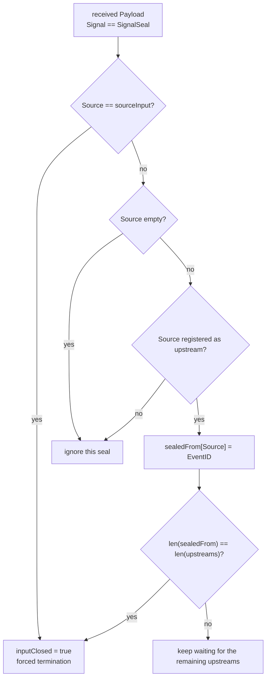

# pkg/runtime/type.go

> 📅 Last Updated: 2026/11/13

`type.go` defines the runtime base types shared across packages: the unified data carrier of a pipeline stage `Payload[V]`, the control signal constants `SignalNone` / `SignalSeal`, and the "seed-fruit" pairing type `Karma[S, F]`. `Payload` is the element type of the inter-node data channels (`seedChan` / `yieldChans`) in `pkg/plot`; `Karma` is currently only a reserved extension point and is not used in the main runtime flow.

## Purpose

- Puts **data** (seed, yield) and **control signals** (seal) into the same generic type, so that connecting plots needs only a single `chan runtime.Payload[X]`.
- Uses the two constants `SignalNone` / `SignalSeal` so that the data flow and the control flow share one channel and the receiver dispatches by `Signal`.
- Uses `Source` to identify where a seal comes from, so `basePlot.markSealed` can decide between "wait for all upstreams" and "external forced termination".
- Provides the `Karma` "seed-fruit" pairing type, leaving room for a possible "look back" interface needed by upper layers.

> `pkg/runtime` does not contain task models such as `Task` / `TaskResult` / `TaskStatus`; all runtime information is propagated outward through the event structs of `pkg/scarecrow`, and persistence is done by the watchers of `pkg/persist` (see [`event.md`](./event.md)).

## Core Objects

### Control Signal Constants

```go
const (
	SignalNone = iota // 正常数据
	SignalSeal        // 终止信号，通知下游不再有新数据
)
```

| Constant | Value | Semantics |
|------|----|------|
| `SignalNone` | `0` | This `Payload` carries normal data (seed or yield) |
| `SignalSeal` | `1` | This `Payload` is a termination signal, telling the downstream that "this plot will no longer produce new data" |

Design points:

- Use the **same `chan Payload[V]`** to carry both data and control flow, avoiding an extra channel for control signals.
- When `Signal == SignalSeal`, `Value` is **not read**; the decision relies on `Signal` and `Source` alone.
- When the downstream `sprout` reads `SignalSeal`, it calls `markSealed`, and `Source` decides whether this is a forced termination or a wait for upstream aggregation; see "Seal Aggregation and `markSealed`" below.

### The `Payload[V]` Struct

```go
type Payload[V any] struct {
	// Signal与Seed通用
	Signal  int
	EventID int

	// Signal使用
	Source string

	// Seed使用
	Value V
}
```

| Field | Type | Purpose | Semantics under `SignalSeal` |
|------|------|------|--------------------------|
| `Signal` | `int` | `SignalNone` (normal data) or `SignalSeal` (termination signal) | Always `SignalSeal` |
| `EventID` | `int` | The event ID allocated by `EventClient.Emit` (see [`event.md`](./event.md)) | The seal event ID (used in memory only, never persisted) |
| `Source` | `string` | Source of the signal: `sourceInput` for external termination, the upstream plot name for internal propagation; normal data does not set this field | Which plot the seal comes from (or `sourceInput`) |
| `Value` | `V` | The actual data (seed or yield) | **Not used**; zero value |

> The meaning of a field is determined by `Signal`:
> - `Signal == SignalNone`: `Value` is valid data and `EventID` is the event ID of that data; in the current implementation `Source` stays at the zero value `""`.
> - `Signal == SignalSeal`: `Value` is meaningless; `Source` is used by the downstream `markSealed` to determine the origin.

### The `Karma[S, F]` Struct

```go
type Karma[S any, F any] struct {
	Seed  S
	Fruit F
}
```

| Field | Type | Meaning |
|------|------|------|
| `Seed` | `S` | The original input of one seed |
| `Fruit` | `F` | The fruit this seed produces after cultivation |

> `Karma` is currently **not used by `pkg/plot` or any other package**; `pkg/runtime` exposes it as a reserved extension point (for example: also storing `Seed` on failure for a replayable cache; or returning `[]Karma` from `Harvest`). Please avoid depending on it in production paths.

## Exported Symbols Overview

| Symbol | Type | Purpose |
|------|------|------|
| `SignalNone` | `const int` | A `Payload.Signal` value: normal data |
| `SignalSeal` | `const int` | A `Payload.Signal` value: termination signal |
| `Payload[V any]` | `struct` | The unified data carrier of a pipeline stage, carrying both data and control signals |
| `Karma[S any, F any]` | `struct` | Seed-fruit pairing (reserved extension point) |

Generic parameter semantics:

| Parameter | Appears in | Meaning |
|------|---------|------|
| `V` | `Payload[V]` | The data type carried by this pipeline stage; `seedChan` uses `S` and `yieldChans` use `Y` |
| `S` | `Karma[S, F]` | Seed type |
| `F` | `Karma[S, F]` | Fruit type |

## Cross-Package Usage Conventions

`Payload[V]` is the element type of the inter-node data channels in `pkg/plot` (channel definitions are in `pkg/plot/plot.go`):

| Channel | Element Type | Write point | Read point |
|------|----------|--------|--------|
| `basePlot.seedChan` | `chan runtime.Payload[S]` | `basePlot.Seed`, `basePlot.Seal`, the upstream plot's `yieldChans` | The current plot's `sprout` |
| `basePlot.yieldChans[name]` | `chan runtime.Payload[Y]` | The current plot's `ripenSeed`, `sprout` finalization | The downstream plot's `seedChan` |

Four construction sites (all in `pkg/plot`):

| Construction site | Code | `Signal` | `Source` | `Value` |
|--------|------|----------|----------|---------|
| `basePlot.Seed` | `runtime.Payload[S]{Value: seed, EventID: seedID}` | `SignalNone` (zero value, not set explicitly) | `""` (not set) | seed |
| `basePlot.Seal` | `runtime.Payload[S]{Signal: runtime.SignalSeal, Source: sourceInput, EventID: sealID}` | `SignalSeal` | `"__input__"` | zero value |
| `ripenSeed` forwarding downstream | `runtime.Payload[Y]{Value: yield, EventID: downstreamSeedID}` | `SignalNone` (zero value) | `""` (not set) | fruit / single yield |
| `sprout` finalization broadcast | `runtime.Payload[Y]{Signal: runtime.SignalSeal, Source: p.name, EventID: sealID}` | `SignalSeal` | The current plot name | zero value |

> `sourceInput` is an unexported constant in `pkg/plot/constant.go` with the literal `"__input__"`. External packages can neither reference it nor hard-code that string; to decide "was this an external termination", reason from the behavior of `Seal()`. See [`../plot/constant.md`](../plot/constant.md).

> `ConnectTo` performs the type assertion `next.GetSeedChanAny().(chan runtime.Payload[Y])`, so the `Payload` element types of upstream and downstream must match. This is also where the hard constraint "do not split data and signals into two types" comes from.

### Downstream Does Not Re-Emit an Input Event

Before writing into the downstream channel, the upstream `ripenSeed` has already emitted `scarecrow.SeedInputEvent` through its own Hub (`Plot` is the downstream name, `From` is this node's name, `Parents` is `[]int{fruitID}`). After the downstream `sprout` reads a normal `Payload`, it only schedules cultivation and does not emit an input event. Therefore every input seen by the metrics and lifecycle watchers corresponds to exactly one event.

## Seal Aggregation and `markSealed`

When `basePlot.sprout` receives `SignalSeal` in its `select`, it calls `markSealed(source, sealID, sealedFrom)` and uses the return value to **directly overwrite** `inputClosed`:

```go
func (p *basePlot[S, F, Y]) markSealed(source string, sealID int, sealedFrom map[string]int) bool {
	if source == sourceInput {
		sealedFrom[sourceInput] = sealID
		return true
	}
	if source == "" {
		return false
	}
	if _, ok := p.upstreams[source]; !ok {
		return false
	}
	sealedFrom[source] = sealID
	return len(sealedFrom) == len(p.upstreams)
}
```



Semantics of each branch:

| `Source` | Behavior | Whether input closes immediately |
|----------|------|------------------|
| `sourceInput` (`"__input__"`) | Recorded into `sealedFrom[sourceInput]` | **Yes**: the input closes as soon as this seal arrives, without waiting for upstream seals that have not arrived |
| `""` | Ignored outright | No |
| A name not registered in `upstreams` | Ignored outright | No |
| A registered upstream name | Records `sealedFrom[Source] = EventID` | Closes when the number of collected sources equals the number of upstreams |
| The same upstream sends a seal twice | Overwrites the same key, so it is not counted twice | Depends on whether all remaining upstreams have already arrived |

`upstreams` is registered by the upstream calling `AddUpstream(p.name)` during `ConnectTo` and never changes after the connection is established; therefore, in the current implementation, a plot without upstreams can only be closed by an external `Seal()`.

> `inputClosed` is not a sticky flag that "locks once true" - every seal received overwrites it with the return value of `markSealed`. A seal produced by an external `Seal()` makes that `markSealed` call return `true`, but if seeds are still in flight (`inFlight > 0`) at that moment, `sprout` keeps receiving later seals, and a seal from an upstream may set it back to `false`. The final exit still depends on `shouldFinish()` holding in the next round (`inputClosed && inFlight == 0`).

### Finalization and Seal Events

At the start of every loop iteration, `sprout` checks:

```go
shouldFinish := func() bool {
	return ctxCancel || (inputClosed && inFlight == 0)
}
```

Here `ctxCancel` comes from `p.ctx.Done()` (the current `basePlot` stores a `cancel` but has no call site, so effectively only the second half applies), and `inFlight` is the number of seeds that have entered `tend` but have not yet reported back through `done`. Once the condition holds:

1. Collect `parentIDs` from the values of `sealedFrom` and call `p.eventClient.Emit("seal", parentIDs)`;
2. Emit `scarecrow.SealMergeEvent{Plot, ParentIDs, SealID, Time}`;
3. Send `Payload[Y]{Signal: SignalSeal, Source: p.name, EventID: sealID}` to **all** `yieldChans`, then `return`.

> `parentIDs` comes from iterating a map, so its **order is unstable**; it may contain the seal ID of `sourceInput` plus the IDs of some upstream seals received before closing. Seal events are not written to SQLite; `LifecycleWatcher` ignores `SealInputEvent` / `SealMergeEvent`.

## Usage Examples

### Distinguishing Data / Signals on `seedChan`

```go
package main

import (
	"context"

	"github.com/Mr-xiaotian/CelestialGrow/pkg/runtime"
)

func consume[S any](
	ctx context.Context,
	ch <-chan runtime.Payload[S],
	handle func(seed S, eventID int),
	handleSeal func(source string, sealID int),
) {
	for {
		select {
		case p := <-ch:
			switch p.Signal {
			case runtime.SignalNone:
				handle(p.Value, p.EventID)
			case runtime.SignalSeal:
				handleSeal(p.Source, p.EventID)
			}
		case <-ctx.Done():
			return
		}
	}
}
```

### Constructing a Yield Payload to Send Downstream

```go
package main

import "github.com/Mr-xiaotian/CelestialGrow/pkg/runtime"

func forward[Y any](
	client runtime.EventClient,
	fruitID int,
	yield Y,
	ch chan<- runtime.Payload[Y],
) {
	downstreamSeedID := client.Emit("seed", []int{fruitID})
	ch <- runtime.Payload[Y]{Value: yield, EventID: downstreamSeedID}
}
```

### Constructing and Broadcasting a Seal Payload

```go
package main

import "github.com/Mr-xiaotian/CelestialGrow/pkg/runtime"

func broadcastSeal[Y any](
	client runtime.EventClient,
	name string,
	parentIDs []int,
	chans map[string]chan runtime.Payload[Y],
) {
	sealID := client.Emit("seal", parentIDs)
	payload := runtime.Payload[Y]{
		Signal:  runtime.SignalSeal,
		Source:  name, // 外部终止时由 pkg/plot 填 sourceInput
		EventID: sealID,
	}
	for _, ch := range chans {
		ch <- payload
	}
}
```

### Caching "Seed-Fruit" Pairs with `Karma` (Placeholder Usage)

```go
k := runtime.Karma[S, F]{Seed: seed, Fruit: fruit}
// 业务侧可以把它放进自己管理的回放缓存里
_ = k
```

## Important Details

- **The zero value means "normal data"**: the zero value of `Signal` is `SignalNone`, so a `Payload{}` that does not set the `Signal` field automatically represents normal data. `Seed` / `ripenSeed` only set `Value` / `EventID` and never set `Signal` explicitly.
- **Union semantics**: `Signal` / `Source` / `Value` are used differently depending on the value of `Signal`; do not assume all fields are meaningful.
- **`Source` serves seal only**: in the current `pkg/plot` implementation, the `Source` of normal data is always `""`; upstream delivery information is recorded in `SeedInputEvent.From`, not in `Payload.Source`.
- **seal is broadcast only along `yieldChans`**: `sprout` sends once to every connected downstream at finalization; plots that are not connected receive nothing.
- **Forced termination is affected by in-flight seeds**: an external `Seal()` makes that `markSealed` call return `true` immediately, but `inputClosed` is reassigned on every seal received; if in-flight seeds have not finished and a later seal does not satisfy the aggregation condition, the closed state may be overwritten. The final exit is determined by `shouldFinish()` (`inputClosed && inFlight == 0`).
- **`EventID` is decided by the allocator**: `Payload` is only a carrier and does not verify ID uniqueness; when wiring manually you must ensure the whole chain shares one `runtime.EventClient`.

## Notes

- Do not split `Payload` into multiple types that "can only hold data / can only hold signals" - the design of this framework is "the same pipeline carries both data and control flow", and splitting the types would break the type assertion in `ConnectTo`.
- Do not use `Payload.Value` when `Signal == SignalSeal`; its content is the zero value of `V` and its semantics are undefined.
- Once the `Source` of a seal is wrong (for example, internal propagation mistakenly fills in `sourceInput`, or an unregistered upstream name is used), the downstream will either **finish early** or **never see the close**; custom plot logic should reuse the `Seal` / `sprout` implementation of `basePlot` instead of hand-writing seals.
- `Karma` is currently not used in the main plot flow; it is introduced as a reserved extension point, so avoid depending on it in production paths.
- If you need to observe runtime metrics, use `scarecrow.MetricsWatcher` (which rebuilds counts from the event stream) instead of attaching counters or state fields to `Payload`.
