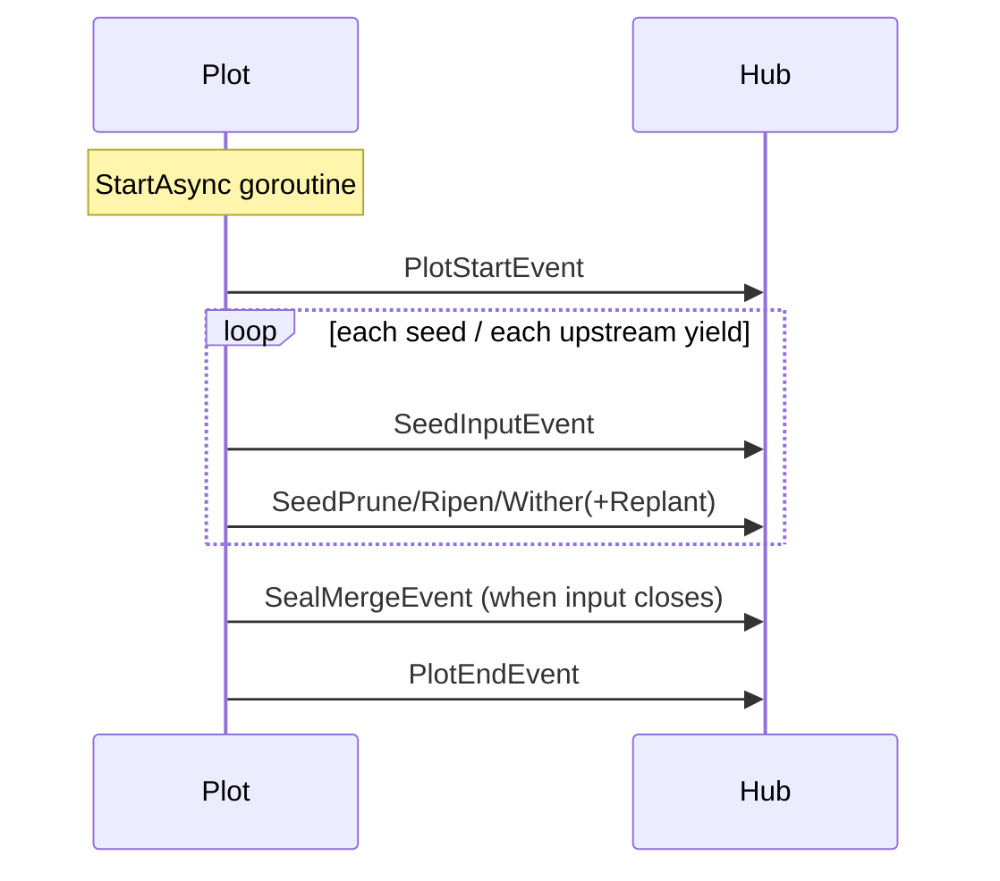

# pkg/scarecrow/event.go

> 📅 Last Updated: 2026/11/13

## Purpose

`pkg/scarecrow/event.go` defines the **closed set** of runtime events: an event interface `Event` with a single unexported method `isEvent()`, plus 11 concrete event structs. `pkg/plot` and `pkg/farm` emit these struct values at the key moments of lifecycle, seed entry/exit, and termination signals; observers (`MetricsWatcher`, `PrintWatcher`, `persist.LogWatcher`, `persist.LifecycleWatcher`, etc.) consume them via `type switch`.

This file only defines data and contains no dispatch logic—see [`hub.md`](./hub.md) for dispatch, [`watcher.md`](./watcher.md) for the receiver contract, and [`metrics.md`](./metrics.md) for metric reconstruction.

## Core Objects

### The `Event` Interface

```go
type Event interface {
    isEvent()
}
```

- The method is unexported, so **no event type can be added outside the package**; every `type switch` can therefore be certain it covers all events. The cost is that adding an event requires changing this package and updating every consumer.
- Events are passed **by value** (`Hub.OnEvent(event Event)`); the dynamic type of the interface is always a struct value from the table below, never a pointer.

### Event Overview

| Event | Semantics | Producer (source location) |
|------|------|--------------------|
| `FarmStartEvent` | Farm starts | `farm.Farm.start`, before seeds are injected |
| `FarmEndEvent` | Farm ends | `defer` in `farm.Farm.start`, after all Plots have exited |
| `PlotStartEvent` | Plot enters `running` | `basePlot.notifyStart` (inside the `StartAsync` goroutine, before `sprout`) |
| `PlotEndEvent` | Plot enters `done` | `basePlot.notifyFinish` (after `sprout` returns, same goroutine) |
| `SeedInputEvent` | A seed enters a Plot | `basePlot.Seed` (external injection) or upstream `ripenSeed` (delivery) |
| `SeedRipenEvent` | Cultivation succeeded | `ripenSeed` |
| `SeedWitherEvent` | Cultivation failed | `witherSeed` (including the path where a `cultivator` panic is `recover`ed) |
| `SeedPruneEvent` | `PruneIf` hit, cultivation skipped | `pruneSeed` |
| `SeedReplantEvent` | One attempt failed and another is about to start | the retry loop in `tend` |
| `SealInputEvent` | An external termination signal enters the Plot | `basePlot.Seal` |
| `SealMergeEvent` | Input closed, termination signal broadcast | before `sprout` exits |

### Farm Events

```go
type FarmStartEvent struct {
    Farm        string              // Farm 名称
    IsDAG       bool                // 是否为有向无环图
    Plots       []string            // Plot 名称列表
    Edges       map[string][]string // 出边邻接表
    SourcePlots []string            // 源 Plot 名称列表
    Structure   []string            // 预先渲染的结构行
    StartTime   time.Time           // 启动时间
}

type FarmEndEvent struct {
    Farm    string        // Farm 名称
    EndTime time.Time     // 结束时间
    Elapsed time.Duration // 运行耗时
}
```

| Field | Description |
|------|------|
| `Plots` / `Edges` / `SourcePlots` | Snapshot taken from `Farm.Nodes()`, `Farm.OutEdges()`, `SourceNodes(OrderGraph)` |
| `Structure` | Graph structure text lines pre-rendered by `Farm.getStructureList()`, printed directly by logs/terminal so observers need not reimplement rendering |
| `IsDAG` | Result of `IsDAG(OrderGraph)`; structure rendering has different semantics under a non-DAG topology |

### Plot Events

```go
type PlotStartEvent struct {
    Plot      string
    Tenders   int
    StartTime time.Time
}

type PlotEndEvent struct {
    Plot    string
    EndTime time.Time
    Elapsed time.Duration
}
```

| Field | Description |
|------|------|
| `Tenders` | Number of concurrent processing goroutines for this Plot (`numTenders`); not the number actually running concurrently |
| `StartTime` / `EndTime` | The producer calls `time.Now()`; `MetricsWatcher` stores them directly in the snapshot |
| `Elapsed` | `time.Since(startTime)`, where `startTime` is taken when the `StartAsync` goroutine starts, so it includes `notifyStart` and the whole `sprout` |

`PlotStartEvent` is emitted after `state.Store(1)` and `PlotEndEvent` after `state.Store(2)`, so an observer's `GetState()` already agrees with the new state when the event arrives. Events only guarantee that within a Plot "start precedes end"; they do not guarantee relative order against other Plots.

### Seed Events

```go
type SeedInputEvent struct {
    Plot     string
    From     string
    Seed     any
    SeedRepr string
    SeedID   int
    Parents  []int
    Time     time.Time
}

type SeedRipenEvent struct {
    Plot      string
    Seed      any
    SeedRepr  string
    Fruit     any
    FruitRepr string
    Elapsed   time.Duration
    SeedID    int
    FruitID   int
    Time      time.Time
}

type SeedWitherEvent struct {
    Plot     string
    Seed     any
    SeedRepr string
    Err      error
    Elapsed  time.Duration
    SeedID   int
    WeedID   int
    Time     time.Time
}

type SeedPruneEvent struct {
    Plot     string
    Seed     any
    SeedRepr string
    Elapsed  time.Duration
    SeedID   int
    PruneID  int
    Time     time.Time
}

type SeedReplantEvent struct {
    Plot     string
    Seed     any
    SeedRepr string
    Err      error
    Attempt  int
    SeedID   int
    Time     time.Time
}
```

| Field | Description |
|------|------|
| `Plot` | Name of the Plot this event belongs to. In `SeedInputEvent` it denotes the **receiving** Plot |
| `From` | Upstream Plot name; **an empty string means direct external injection** (`Plot.Seed` / `Farm.InjectTasks`), non-empty means delivery from upstream |
| `Seed` / `Fruit` | Raw data (`any`), kept whole so observers can extract business fields themselves |
| `SeedRepr` / `FruitRepr` | Readable representation produced by the producer with `fmt.Sprintf("%+v", ...)`; beyond 50 / 25 runes the head and tail are kept with `...` in between (`trunc` in `pkg/plot/helper.go`), so they are **not guaranteed to be complete** |
| `SeedID` | Event ID assigned when this seed entered the current Plot; `SeedID` in `SeedRipenEvent` / `SeedWitherEvent` / `SeedPruneEvent` / `SeedReplantEvent` points back to the corresponding `SeedInputEvent` |
| `FruitID` / `WeedID` / `PruneID` | Generated by `runtime.EventClient.Emit("fruit")` / `"weed"` / `"prune"` respectively, and differ from `SeedID` |
| `Parents` | Parent event IDs of the input seed. Not set for external injection (`nil`); `[]int{FruitID}` for upstream delivery (the ID of that upstream ripening event) |
| `Attempt` | Number of failures that triggered a retry, **starting at 1**; at most `maxRetries` entries |
| `Err` | The final error that caused withering, or the error that caused this retry; in `SeedWitherEvent` it may be a wrapped error from a `cultivator panic` |
| `Elapsed` | Cultivation/decision duration, measured from `startTime` taken inside `tend`; **includes** the `retryDelay` waits in the retry loop, but **excludes** time spent queued in `seedChan` and waiting for a concurrency token |

### Seal Events

```go
type SealInputEvent struct {
    Plot   string
    SealID int
    Time   time.Time
}

type SealMergeEvent struct {
    Plot      string
    ParentIDs []int
    SealID    int
    Time      time.Time
}
```

| Field | Description |
|------|------|
| `SealInputEvent.SealID` | Event ID of the external termination signal; it travels through `seedChan` as the payload of `SignalSeal` with `Source=sourceInput` |
| `SealMergeEvent.ParentIDs` | Set of termination signal IDs taking part in the merge: the received external signal IDs plus each upstream termination signal ID |
| `SealMergeEvent.SealID` | Newly generated event ID after merging, later broadcast to all downstream nodes with `SignalSeal` |

> External termination signals have **strong termination semantics**: after `Seal` the Plot no longer waits for remaining upstream seals. `ParentIDs` may therefore contain only some of the upstream IDs.

## Key Flows

```mermaid
flowchart LR
    IN[SeedInputEvent<br/>From empty=external injection<br/>SeedID=1] --> TEND{tend<br/>PruneIf?}
    TEND -->|hit| PRUNE[SeedPruneEvent<br/>PruneID]
    TEND -->|failed and retryIf hit| REPLANT[SeedReplantEvent<br/>Attempt=1..maxRetries]
    REPLANT --> TEND
    TEND -->|cultivator succeeded| RIPEN[SeedRipenEvent<br/>FruitID]
    TEND -->|final failure| WITHER[SeedWitherEvent<br/>WeedID]
    RIPEN -->|Forward to downstream| DOWN[SeedInputEvent<br/>From=upstream<br/>Parents=[FruitID]]
```

The overall ordering inside one Plot is orchestrated by the `StartAsync` goroutine:



The Farm-level order is `FarmStartEvent` → events of each Plot → `FarmEndEvent`. Farm-level observers only see all Plot events if the Farm registers its own Hub into every Plot's Hub (see `pkg/farm/farm.go`).

## Important Details

- **The event interface is closed**: no `type switch` will ever meet an "unknown event"; when adding an event type you must also update the branches in `MetricsWatcher`, `PrintWatcher`, `persist.LogWatcher`, and `persist.LifecycleWatcher`, otherwise it silently falls into the default branch.
- **Slices and maps are read-only**: `Plots`, `Edges`, `Structure`, `Parents`, and `ParentIDs` are underlying data held by the producer; passing events by value only copies the header. Observers **must not modify** them; `MetricsWatcher` rebuilds the `map` in its snapshot exactly to avoid leaking internal state.
- **`SeedReplantEvent` does not change completion counts**: it is an intermediate "will try again" state; whether the retry succeeded is expressed by the final `SeedRipenEvent` / `SeedWitherEvent`.
- **Failure events always come with a result**: the `recover` in `tend` turns a panic into a `SeedWitherEvent`, so inputs = ripened + withered + pruned + unfinished, and no seed is silently lost.
- **Time fields are not monotonic**: multiple `tend` goroutines run concurrently, so `Time` does not strictly match event arrival order; explicit ordering constraints exist only between `PlotStartEvent` / `PlotEndEvent` and between `FarmStartEvent` / `FarmEndEvent`.

## Usage Examples

A custom observer counting by event type:

```go
package main

import (
    "fmt"

    "github.com/Mr-xiaotian/CelestialGrow/pkg/scarecrow"
)

// eventCounter 统计 Plot 级输入与结果数量。
type eventCounter struct {
    inputs   map[string]int
    ripened  map[string]int
    withered map[string]int
}

func (c *eventCounter) OnEvent(event scarecrow.Event) error {
    switch ev := event.(type) {
    case scarecrow.SeedInputEvent:
        c.inputs[ev.Plot]++
    case scarecrow.SeedRipenEvent:
        c.ripened[ev.Plot]++
    case scarecrow.SeedWitherEvent:
        c.withered[ev.Plot]++
    }
    return nil
}

func main() {
    hub := scarecrow.NewHub(scarecrow.WithErrorHandler(func(err error) {
        fmt.Println("watcher failed:", err)
    }))

    counter := &eventCounter{
        inputs:   map[string]int{},
        ripened:  map[string]int{},
        withered: map[string]int{},
    }
    if err := hub.AddWatcher(counter); err != nil {
        panic(err)
    }

    _ = hub.OnEvent(scarecrow.SeedInputEvent{Plot: "harvester", Seed: 1, SeedID: 1})
    _ = hub.OnEvent(scarecrow.SeedRipenEvent{Plot: "harvester", Seed: 1, SeedID: 1, FruitID: 2})

    fmt.Println(counter.inputs["harvester"], counter.ripened["harvester"]) // 1 1
}
```

Attaching the observer to a real Plot. Register **before** `StartAsync` to be guaranteed to receive `PlotStartEvent`; registering before `Seed` is enough to receive at least the events of that seed:

```go
package main

import (
    "fmt"

    "github.com/Mr-xiaotian/CelestialGrow/pkg/plot"
    "github.com/Mr-xiaotian/CelestialGrow/pkg/scarecrow"
)

type Seed struct{ ID int }
type Fruit struct{ ID int }

func cultivate(s Seed) (Fruit, error) { return Fruit{ID: s.ID}, nil }

func main() {
    p := plot.NewSinglePlot[Seed, Fruit]("harvester", cultivate)

    if err := p.AddWatcher(scarecrow.WatcherFunc(func(event scarecrow.Event) error {
        if ripen, ok := event.(scarecrow.SeedRipenEvent); ok {
            fmt.Println("ripened:", ripen.FruitRepr)
        }
        return nil
    })); err != nil {
        panic(err)
    }

    p.StartAsync()
    p.Seed(Seed{ID: 1})
    p.Seal()
    p.WaitAsync()
}
```

## Notes

- Do not rely on `SeedRepr` / `FruitRepr` for business decisions: beyond 50 / 25 runes they are elided as "keep head and tail, `...` in the middle", so they are display-only.
- Events are sent by value, but do not assume a deep copy: `Seed` / `Fruit` are `any`, so if they hold pointers or `map`s, observer modifications affect the producer.
- An empty `SeedInputEvent.From` is the only reliable way to detect "external injection": `Parents` is merely lineage information and is not guaranteed to agree with `From` when `Event`s are built by hand (tests, replay).
- Events are **dispatched synchronously**: observer time is charged directly to the producer's path, and a long block slows down Plot/Farm execution.
