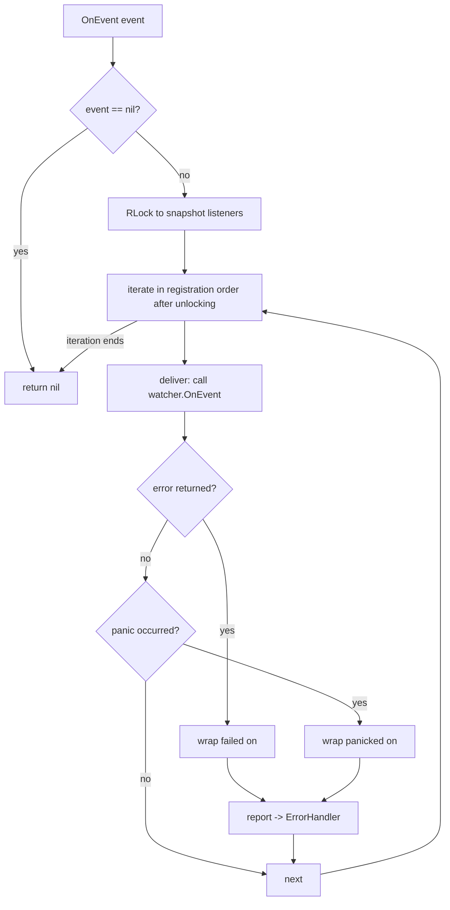
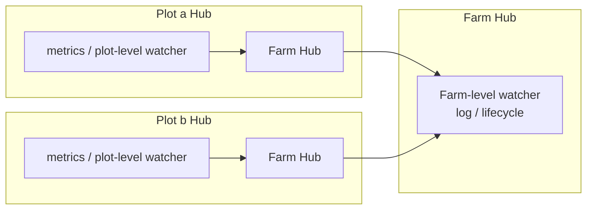

# pkg/scarecrow/hub.go

> 📅 Last Updated: 2026/11/13

## Purpose

`pkg/scarecrow/hub.go` implements the event dispatch center `Hub`: it fans out `Event` to all `Watcher`s **synchronously** in registration order, and isolates each observer's `error` and `panic`, reporting them to a configurable `ErrorHandler`. `Hub` itself implements `Watcher`, so it can be registered into another `Hub` to form hierarchical dispatch (Plot Hub → Farm Hub), and the generic function `Find` can search a hierarchy for an observer by type.

## Core Objects

### `HubOption` and `WithErrorHandler`

```go
type HubOption func(*Hub)

func WithErrorHandler(handler func(error)) HubOption
```

| Option | Description |
|------|------|
| `WithErrorHandler(handler)` | Sets the handler used when an observer fails or panics. Passing `nil` is equivalent to not setting one, falling back to `defaultErrorHandler` |

### `Hub`

```go
type Hub struct {
    mu        sync.RWMutex
    listeners []Watcher
    onError   func(error)
}
```

| Field | Description |
|------|------|
| `mu` | RWMutex guarding `listeners`: writes (`AddWatcher`) take the write lock, dispatch only takes the read lock while taking a snapshot |
| `listeners` | Observer list, kept in registration order; duplicates are allowed |
| `onError` | Error handler; `nil` in a zero-value Hub, in which case `report` degrades to the default output |

### Constructor and Default Handler

| Symbol | Signature | Behavior |
|------|------|------|
| `NewHub` | `func NewHub(opts ...HubOption) *Hub` | Applies the options in order; fills in `defaultErrorHandler` when `onError` is still `nil` |
| `defaultErrorHandler` (unexported) | `func(err error)` | `log.Printf("scarecrow: %v", err)`, landing on standard error by default |

### `AddWatcher`

```go
func (h *Hub) AddWatcher(listener Watcher) error
```

| Error | Trigger |
|------|----------|
| `scarecrow: cannot add nil listener` | `listener == nil` (the interface value itself is nil) |
| `scarecrow: cannot add a hub to itself` | Registering a Hub into itself |
| `scarecrow: cyclic hub registration rejected: target hub already contains this hub` | The target Hub's nested hierarchy already contains the current Hub, so registering would create a cycle |

- **Duplicate registration** of the same instance is allowed; each dispatch calls it once more.
- Cycle detection (`rejectCycle`) runs **before locking**: it walks the candidate Hub depth first and rejects as soon as it meets the current Hub; a `seen` set prevents traversal from running forever on abnormal topologies.

### `OnEvent`

```go
func (h *Hub) OnEvent(event Event) error
```

- When `event == nil` it returns `nil` directly and calls no observer.
- Takes one snapshot of `listeners` under the read lock, then iterates **outside the lock**, so a watcher can safely register another watcher from inside.
- A single observer's error or panic is wrapped by `deliver` and handed to `report`; the remaining observers continue.
- **Always returns `nil`**: observer failures are consumed by the error handler and never flow back into the execution path (so `plot.emit` / `farm.emit` may ignore the return value).

### `Find`

```go
func Find[T Watcher](hub *Hub) (T, bool)
```

The generic parameter `T` is the target observer type (an interface or a concrete type such as `*MetricsWatcher`).

| Rule | Description |
|------|------|
| Search scope | `hub` and its nested Hubs (`Hub` itself is also a `Watcher`) |
| Priority | Matches **direct** observers first (in registration order), then recurses into nested Hubs |
| Not found | Returns the zero value of `T` and `false` |
| `hub == nil` | Returns the zero value and `false` immediately |
| Defense | Records visited Hubs in a `seen` set, preventing infinite recursion on abnormal topologies |

### `deliver` / `report` (unexported)

| Function | Behavior |
|------|------|
| `deliver` | `defer recover()`; wraps an observer's returned error as `scarecrow: %T failed on %T: %w` and a panic as `scarecrow: %T panicked on %T: %v` |
| `report` | Reads `h.onError`; uses `defaultErrorHandler` when it is `nil`; if the handler itself panics, uses `defaultErrorHandler` again to print `scarecrow: error handler panicked: %v` |

## Key Flows

### Dispatch



### Nested Topologies (actual project usage)



`Farm.start` registers the Farm Hub into every Plot Hub via `plot.AddWatcher(f.hub)`, so Farm-level watchers receive events from all Plots in that Farm; starting from a Plot Hub, `Find` can also walk up to a `MetricsWatcher` registered at Farm level (`basePlot.currentMetrics` relies on exactly this path).

## Important Details

- **Copy-on-write semantics**: `AddWatcher` does `append` inside the write lock, which can only replace the underlying array and never rewrites already published elements; `OnEvent` takes one slice snapshot under the read lock and iterates outside it. A snapshot taken during concurrent appends is therefore still complete, and iteration needs no lock.
- **Snapshot boundary**: a watcher registered after dispatch has started does not receive the current event, only later ones (the comment on `Farm.AddWatcher` also stresses "only later events are delivered").
- **Registration order is call order**: within one level, calls are strictly serial in `AddWatcher` order; a blocking watcher delays every later watcher.
- **Known race in cycle detection**: detection completes before locking, so the extreme concurrent case of two Hubs registering each other at the same time can still slip past it; the source comment explicitly says "building the Hub topology concurrently at runtime is not recommended". The `seen` inside `Find` is a fallback for abnormal topologies.
- **Zero value is usable**: `var h Hub` can call `AddWatcher` / `OnEvent` directly; when `onError` is `nil`, `report` automatically falls back to the default handler.
- **The error handler is protected as well**: `report` wraps the handler call in `recover`, so a panicking handler cannot break `OnEvent`'s promise of "always returns nil".

## Usage Examples

### Basic Dispatch and Error Isolation

```go
package main

import (
    "errors"
    "fmt"

    "github.com/Mr-xiaotian/CelestialGrow/pkg/scarecrow"
)

func main() {
    hub := scarecrow.NewHub(scarecrow.WithErrorHandler(func(err error) {
        fmt.Println("reported:", err)
    }))

    _ = hub.AddWatcher(scarecrow.WatcherFunc(func(scarecrow.Event) error {
        return errors.New("boom")
    }))
    _ = hub.AddWatcher(scarecrow.WatcherFunc(func(scarecrow.Event) error {
        fmt.Println("healthy watcher still runs")
        return nil
    }))

    // OnEvent 永远返回 nil，故障通过 ErrorHandler 上报。
    fmt.Println(hub.OnEvent(scarecrow.PlotStartEvent{Plot: "harvester"}))
    // reported: scarecrow: scarecrow.WatcherFunc failed on scarecrow.PlotStartEvent: boom
    // healthy watcher still runs
    // <nil>
}
```

### Nested Hubs and `Find`

```go
package main

import (
    "fmt"

    "github.com/Mr-xiaotian/CelestialGrow/pkg/scarecrow"
)

func main() {
    metrics := scarecrow.NewMetricsWatcher()

    farmHub := scarecrow.NewHub()
    _ = farmHub.AddWatcher(metrics)

    plotHub := scarecrow.NewHub()
    _ = plotHub.AddWatcher(farmHub) // 把 Farm Hub 嵌套进 Plot Hub

    _ = plotHub.OnEvent(scarecrow.PlotStartEvent{Plot: "harvester", Tenders: 2})
    _ = plotHub.OnEvent(scarecrow.SeedInputEvent{Plot: "harvester", SeedID: 1})

    found, ok := scarecrow.Find[*scarecrow.MetricsWatcher](plotHub)
    if !ok {
        panic("metrics watcher not found")
    }
    snapshot, _ := found.GetPlot("harvester")
    fmt.Println(snapshot.Status, snapshot.InputTotal) // running 1
}
```

### Rejecting Cycles

```go
package main

import (
    "fmt"

    "github.com/Mr-xiaotian/CelestialGrow/pkg/scarecrow"
)

func main() {
    a, b := scarecrow.NewHub(), scarecrow.NewHub()
    _ = a.AddWatcher(b)

    if err := b.AddWatcher(a); err != nil {
        // scarecrow: cyclic hub registration rejected: target hub already contains this hub
        fmt.Println(err)
    }
}
```

## Notes

- Cycle detection is not a safety guarantee for concurrently built topologies; build the Hub hierarchy once during startup.
- `Find` returns only the **first** match; with several instances of the same type the outcome depends on registration order and level (direct matches first).
- `WithErrorHandler(nil)` does not disable error reporting, it falls back to the default `log.Printf` output; pass an empty function `func(error) {}` if you want silence.
- The default handler uses the standard library `log`, whose target can be redirected globally via `log.SetOutput` (tests commonly use `io.Discard`).
- `Hub` dispatches synchronously, so watcher time adds directly to the event production path; make slow watchers asynchronous yourself (see [`watcher.md`](./watcher.md)).
