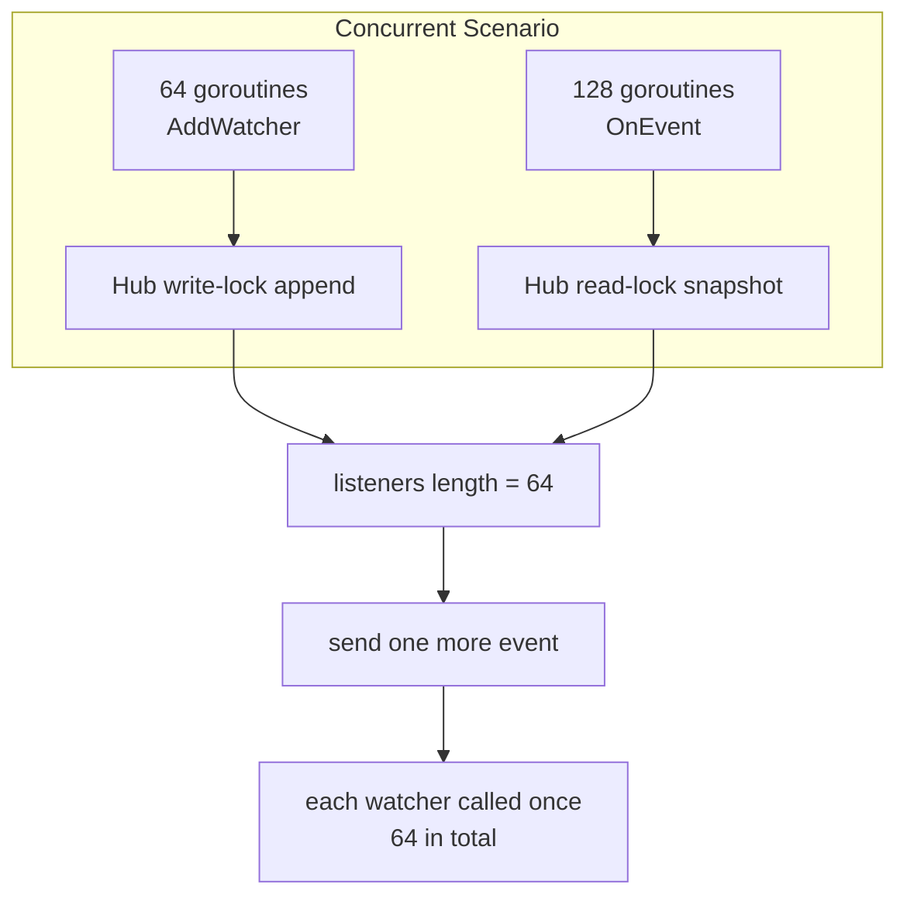

# pkg/scarecrow/hub_test.go

> 📅 Last Updated: 2026/11/13

## Purpose

`pkg/scarecrow/hub_test.go` is the behavioral contract test for `Hub`: it covers **dispatch order, registration rules, error and panic isolation, nested topologies, `Find` search priority, and concurrent registration/dispatch**. These are the executable evidence for each semantic in [`hub.md`](./hub.md).

## Test Distribution

| Group | Test | Behavior verified |
|------|------|-----------|
| Dispatch | `TestHubFansOutInRegistrationOrder` | Three watchers are called as `a, b, c` in registration order (a mutex guards the collected slice) |
| Dispatch | `TestHubAllowsDuplicateRegistration` | The same instance registered twice is called twice for a single event |
| Dispatch | `TestHubWithoutWatchers` | Dispatch on an empty Hub returns `nil` and does not panic |
| Dispatch | `TestHubIgnoresNilEvent` | `OnEvent(nil)` returns `nil` and calls **no** watcher |
| Registration | `TestHubRejectsNilWatcher` | `AddWatcher(nil)` returns an error |
| Registration | `TestHubNestsChildHub` | After a parent Hub registers a child Hub, parent events reach the child Hub's watchers, exactly once |
| Registration | `TestHubRejectsCyclicRegistration` | Self-registration is rejected; after `a→b`, `b→a` is rejected |
| Error isolation | `TestHubIsolatesWatcherError` | A failing watcher does not affect later watchers; the error is reported exactly once, `errors.Is` sees through the wrapping, and the text carries `scarecrow` context |
| Error isolation | `TestHubRecoversWatcherPanic` | A watcher's `panic("kaboom")` is recovered, the report text contains `kaboom`, and later watchers still run |
| Error isolation | `TestHubSurvivesErrorHandlerPanic` | A panicking `ErrorHandler` does not interrupt dispatch (`log` output is redirected to `io.Discard`) |
| Error isolation | `TestZeroValueHubIsUsable` | `&Hub{}` can register and dispatch without calling `NewHub`, falling back to the default error handler |
| Search | `TestFindFindsDirectWatcher` | `Find[*markerWatcher]` hits a direct instance |
| Search | `TestFindSearchesNestedHub` | Hits an instance inside a nested child Hub |
| Search | `TestFindPrefersDirectWatcher` | A direct watcher takes priority over an instance of the same type inside a nested Hub |
| Search | `TestFindMissingWatcher` | Both an empty Hub and a `nil` Hub return `false` |
| Concurrency | `TestHubConcurrentAddAndEmit` | After 64 concurrent registrations + 128 concurrent dispatches no registration is lost; one more dispatch calls all 64 watchers |

## Key Flows



`TestHubConcurrentAddAndEmit` counts calls with `atomic.Int64` and waits for all goroutines with `sync.WaitGroup`; afterwards it reads `hub.listeners` directly (same-package test) to confirm the registration count, then clears the counter with `calls.Store(0)` and dispatches one more event serially, asserting the call count equals the watcher count. This step is the key check of **snapshot integrity**: dispatch during concurrent registration may see different subsets of watchers, but the final state must contain every registered entry.

## Important Details

- **Error assertions are two-layered**: they require both `errors.Is(reported[0], boom)` (showing the `%w` wrapping preserved the error chain) and `strings.Contains(..., "scarecrow")` (showing errors carry context instead of being passed through verbatim).
- **Panic assertions check a substring only**: `Hub.deliver` formats the panic value with `%v`, so the test asserts that the report text contains `kaboom` rather than comparing the full format.
- **Log redirection**: `TestHubSurvivesErrorHandlerPanic` and `TestZeroValueHubIsUsable` temporarily call `log.SetOutput(io.Discard)` and restore it in `defer`, so the default handler does not write noise into test output.
- **`markerWatcher` is an in-package test type**: it implements only `OnEvent`, and exists to verify that the generic `Find` can search for a "concrete pointer type" (not merely an interface type).
- **Order assertions use `slices.Equal`**: `TestHubFansOutInRegistrationOrder` collects the call order into `[]string` and compares it whole, which exposes out-of-order calls better than per-item assertions.
- **The `seen` deduplication branch is not directly covered**: `rejectCycle` hits the `seen` dedup on diamond topologies (the same Hub reachable through several paths), and the `seen` in `Find` guards against abnormal topologies; the current tests cover only self-loops and chain nesting, not diamond topologies.

## Running

```bash
# 全量（推荐带竞态检测）
go test ./pkg/scarecrow -race -v

# 只跑 Hub 与 Find
go test ./pkg/scarecrow -race -run 'TestHub|TestFind|TestZeroValueHub' -v
```

## Notes

- The concurrency test asserts **eventual consistency**, not intermediate timing: it does not guarantee that one event reaches every watcher, only that no registration is lost and the final dispatch is complete.
- The test accesses the private fields `hub.listeners` and `hub.mu` directly, so it must run inside the same package (`package scarecrow`); moving it to an external test package would lose that ability.
- If error wording changes, the `strings.Contains` assertions in `hub_test.go` must follow (they currently depend only on the `scarecrow` prefix and the panic value itself).
- The cross-Hub concurrent race in cycle detection is not covered by tests (the source comment already declares that usage unsupported); before adding such a test, first decide whether the implementation should be tightened.
