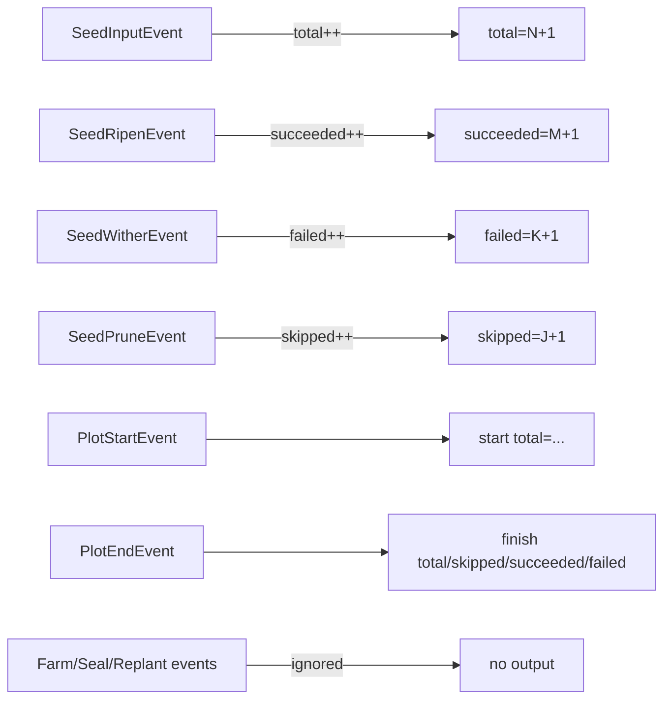

# pkg/scarecrow/print.go

> 📅 Last Updated: 2026/11/13

## Purpose

`pkg/scarecrow/print.go` provides a lightweight terminal progress observer, `PrintWatcher`: it prints seed input, ripening, withering, pruning, and Plot start/end events to standard output, which helps with local debugging and demos. It **maintains its own counts** instead of depending on `MetricsWatcher`, so it can be attached to any Plot's or Farm's Hub on its own.

## Core Objects

### `PrintWatcher`

```go
type PrintWatcher struct {
    mu        sync.Mutex
    name      string
    out       io.Writer
    total     int
    succeeded int
    failed    int
    skipped   int
}
```

| Field | Description |
|------|------|
| `mu` | Mutex guarding all count fields and the output call; events may come from several goroutines, so counting and printing must be serialized as a unit |
| `name` | Output prefix, of the form `[harvester] ...` |
| `out` | Output target; fixed to `os.Stdout` by `NewPrintWatcher` |
| `total` | Number of `SeedInputEvent`s received (external injection and upstream delivery alike) |
| `succeeded` / `failed` / `skipped` | Count of ripened, withered, and pruned events respectively |

### Constructor

| Symbol | Signature | Behavior |
|------|------|------|
| `NewPrintWatcher` | `func NewPrintWatcher(name string) *PrintWatcher` | Writes to `os.Stdout`, with `name` as the prefix |
| `newPrintWatcher` (unexported) | `func newPrintWatcher(out io.Writer, name string) *PrintWatcher` | Specifies the output target, used by in-package tests with a `bytes.Buffer` to capture output |

### Printing Contract of `OnEvent`

Each event prints one line in the format `[<name>] <content>\n`:

| Event | Count change | Output |
|------|----------|------|
| `PlotStartEvent` | none | `start total=<total>` |
| `PlotEndEvent` | none | `finish total=<total>, skipped=<skipped>, succeeded=<succeeded>, failed=<failed>` |
| `SeedInputEvent` | `total++` | `total=<total>(+1)` |
| `SeedRipenEvent` | `succeeded++` | `succeeded=<succeeded>(+1), total=<total>` |
| `SeedWitherEvent` | `failed++` | `failed=<failed>(+1), total=<total>` |
| `SeedPruneEvent` | `skipped++` | `skipped=<skipped>(+1), total=<total>` |
| `FarmStartEvent` / `FarmEndEvent` / `SeedReplantEvent` / `SealInputEvent` / `SealMergeEvent` | none | **no output** |

`total` counts only `SeedInputEvent`, not ripened/withered/pruned events; the difference between `total` and `succeeded + failed + skipped` is the number of seeds still being processed.

### `printf` (unexported)

```go
func (p *PrintWatcher) printf(format string, args ...any) {
    _, _ = fmt.Fprintf(p.out, "[%s] %s\n", p.name, fmt.Sprintf(format, args...))
}
```

The caller must hold the lock; write errors are explicitly discarded (a failing terminal write should not affect the main flow).

## Key Flows



## Important Details

- **The counting scope depends on where it is attached**: on a single Plot's Hub it counts only that Plot's events; on a Farm's Hub it counts the accumulated progress of the whole Farm, because the Farm registers its own Hub into every Plot's Hub. Attaching it to both kinds of Hub prints one copy for each.
- **Own counts, no metric reuse**: `PrintWatcher` works even without a registered `MetricsWatcher`; conversely, the presence of `MetricsWatcher` does not affect its output.
- **Node and task progress only**: Farm start/end, retries, and termination signals are all ignored (a source comment notes this matches the behavior of CelestialFlow's `PrintObserver`).
- **Prints the moment an event happens**: printing for `SeedInputEvent` happens before the seed is actually processed, so `total` grows first and `succeeded/failed/skipped` catch up later.
- **Fixed output medium**: the public constructor only writes to `os.Stdout`; `newPrintWatcher` is unexported, so the `io.Writer` cannot be replaced outside the package. To write to a file or buffer, implement your own `Watcher`.
- **Zero value is unusable**: `PrintWatcher{}` has `out == nil`, so any print panics inside `fmt.Fprintf` (an empty `name` merely yields `[] `). Always construct through `NewPrintWatcher` (in-package tests use `newPrintWatcher`).

## Usage Examples

### Attaching to a Single Plot

```go
package main

import (
    "github.com/Mr-xiaotian/CelestialGrow/pkg/plot"
    "github.com/Mr-xiaotian/CelestialGrow/pkg/scarecrow"
)

type Seed struct{ ID int }
type Fruit struct{ ID int }

func cultivate(s Seed) (Fruit, error) { return Fruit{ID: s.ID}, nil }

func main() {
    p := plot.NewSinglePlot[Seed, Fruit]("harvester", cultivate)
    if err := p.AddWatcher(scarecrow.NewPrintWatcher("harvester")); err != nil {
        panic(err)
    }

    p.StartAsync()
    p.Seed(Seed{ID: 1})
    p.Seed(Seed{ID: 2})
    p.Seal()
    p.WaitAsync()
}
```

The output resembles:

```text
[harvester] start total=0
[harvester] total=1(+1)
[harvester] total=2(+1)
[harvester] succeeded=1(+1), total=2
[harvester] succeeded=2(+1), total=2
[harvester] finish total=2, skipped=0, succeeded=2, failed=0
```

> This output is illustrative only and is not a stable contract: `Seed` emits events directly on the caller's goroutine, while `PlotStartEvent` is emitted inside the `StartAsync` goroutine, so the two race. In a real run the `start` line may appear after several `total` lines, with a `total` that is already greater than 0, and result lines may interleave. Judge each line by its own content, and do not rely on the order across lines.

### Attaching to a Farm to Aggregate All Plots

```go
package main

import (
    "github.com/Mr-xiaotian/CelestialGrow/pkg/farm"
    "github.com/Mr-xiaotian/CelestialGrow/pkg/plot"
    "github.com/Mr-xiaotian/CelestialGrow/pkg/scarecrow"
)

type Seed struct{ ID int }
type Fruit struct{ ID int }

func cultivate(s Seed) (Fruit, error) { return Fruit{ID: s.ID}, nil }

func main() {
    p := plot.NewSinglePlot[Seed, Fruit]("harvester", cultivate)

    f := farm.NewFarm("garden")
    if err := f.AddPlot(p); err != nil {
        panic(err)
    }
    if err := f.AddWatcher(scarecrow.NewPrintWatcher("garden")); err != nil {
        panic(err)
    }
    if err := f.Run(map[string][]any{"harvester": {Seed{ID: 1}}}, "INFO"); err != nil {
        panic(err)
    }
}
```

A Farm-level `PrintWatcher` receives events from every Plot, so `total` is the input total of the whole Farm; each `PlotStartEvent` / `PlotEndEvent` line corresponds to one Plot, but the output carries no Plot name (the prefix is only `name`), so in multi-Plot scenarios lines can be told apart only by order and context.

## Notes

- Output is **one line per event**; a high-frequency run (tens of thousands of seeds) noticeably slows the execution path and floods the terminal; use log or metric observers in production.
- Output goes to `os.Stdout` and gets mixed with the application's own standard output; for clean output, redirect the process stdout or implement your own `Watcher`.
- There is no reset interface: counts grow monotonically with the instance, so reusing one instance across runs continues the previous totals.
- Output order is not a reliable source of total event ordering; for exact lineage and order use `pkg/persist` or `MetricsWatcher`.
