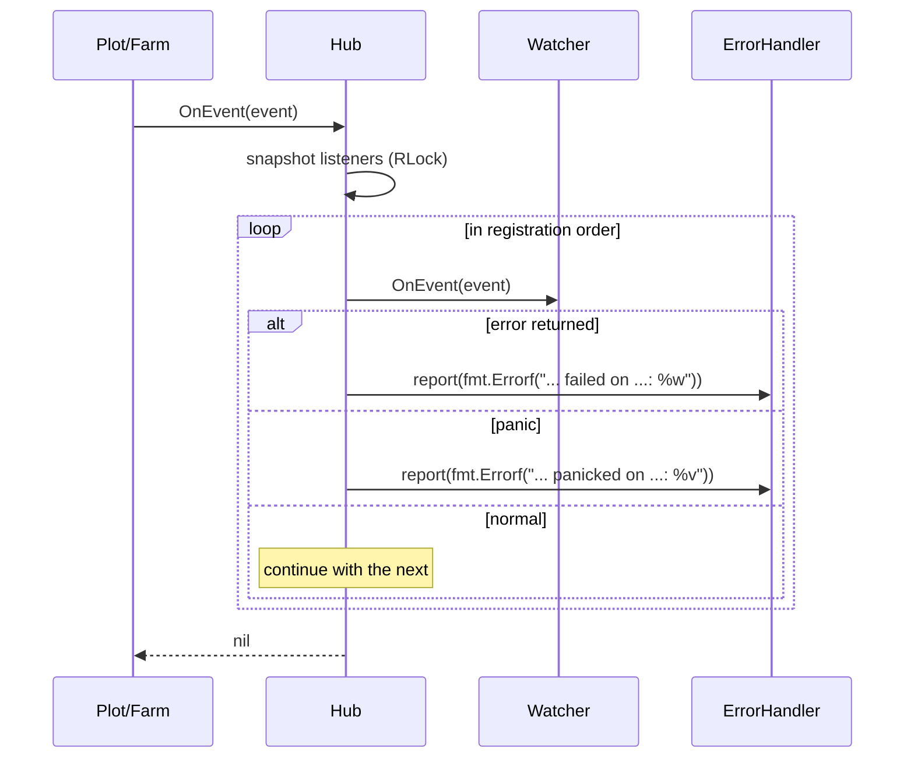

# pkg/scarecrow/watcher.go

> 📅 Last Updated: 2026/11/13

## Purpose

`pkg/scarecrow/watcher.go` is the file entry point of the `scarecrow` package (the file holding the package comment), and it also defines the **receiver contract** for runtime events, `Watcher`, plus the lightweight adapter `WatcherFunc`. `Hub` recognizes only this single interface, so metric collection, log persistence, lifecycle recording, and terminal printing can all be registered and dispatched uniformly.

## Core Objects

### The `Watcher` Interface

```go
type Watcher interface {
    OnEvent(event Event) error
}
```

| Method | Contract |
|------|------|
| `OnEvent(Event) error` | Handles one event. The returned `error` is caught by `Hub` and reported to the `ErrorHandler`; it **never interrupts other Watchers and never flows back into the execution path** (`Hub.OnEvent` always returns `nil`) |

Conventions implementers must follow (explicitly required by the source comment):

1. **Concurrency safety is your responsibility**: events may come from several concurrent goroutines (the `tend` goroutines of several Plots, the Hubs of several Plots), so an implementation must lock or use atomics itself. `MetricsWatcher` / `PrintWatcher` both guard their state with a mutex.
2. **Return quickly**: `Hub` calls `OnEvent` synchronously, so Watcher time is serialized directly onto the execution path. Implementations that need slow I/O (such as `persist.LogWatcher`, `persist.LifecycleWatcher`) should post records onto a `funnel` queue consumed by a background Spout.
3. **Treat events as read-only**: `Event` is passed by value, but the inner slices/maps are shared with the producer and must not be modified.

### `WatcherFunc` Adapter

```go
type WatcherFunc func(event Event) error

func (f WatcherFunc) OnEvent(event Event) error {
    return f(event)
}
```

Adapts an ordinary function into a `Watcher`, the same idiom as `http.HandlerFunc`. Suitable for tests, one-off callbacks, and sample code.

### Implementations in This Package and the Project

| Implementation | Location | Description |
|------|------|------|
| `Hub` | [`hub.md`](./hub.md) | Implements `Watcher` itself, so it can be nested into another Hub |
| `MetricsWatcher` | [`metrics.md`](./metrics.md) | Rebuilds each Plot's metrics from the event stream |
| `PrintWatcher` | [`print.md`](./print.md) | Prints accumulated progress to `os.Stdout` |
| `persist.LogWatcher` | `pkg/persist/log.go` | Persists run logs asynchronously and reads `MetricsWatcher` to complete counts |
| `persist.LifecycleWatcher` | `pkg/persist/lifecycle.go` | Writes seed lineage into SQLite |

## Key Flows



## Important Details

- **The interface is implicit**: any type implementing `OnEvent(Event) error` satisfies `Watcher` without an explicit declaration; `plot.AddWatcher` / `farm.AddWatcher` / `hub.AddWatcher` all accept the interface directly.
- **Error semantics**: a `Watcher`'s `error` is for **reporting** only, not for control flow. Seeing `OnEvent` return `nil` does not mean every Watcher succeeded, only that the dispatch flow itself was not interrupted.
- **When `WatcherFunc` is nil**: `var f WatcherFunc; f.OnEvent(...)` panics because it calls a nil function. When dispatched through `Hub`, the panic is caught by `Hub.deliver` and turned into a `scarecrow: ... panicked on ...` report; a direct call has no protection.
- **Interface values whose type is nil**: `hub.AddWatcher(nil)` is rejected, but `var p *PrintWatcher; hub.AddWatcher(p)` passes a **non-nil interface** (non-empty dynamic type, nil value), so registration succeeds and the call operates on a nil receiver and panics, which the `Hub` catches and reports as well. If you need "optional registration", check the pointer for nil explicitly.

## Usage Examples

### One-off Callback with `WatcherFunc`

```go
package main

import (
    "fmt"

    "github.com/Mr-xiaotian/CelestialGrow/pkg/scarecrow"
)

func main() {
    hub := scarecrow.NewHub()

    err := hub.AddWatcher(scarecrow.WatcherFunc(func(event scarecrow.Event) error {
        fmt.Printf("%T\n", event)
        return nil
    }))
    if err != nil {
        panic(err)
    }

    _ = hub.OnEvent(scarecrow.PlotStartEvent{Plot: "harvester", Tenders: 4})
    // 输出：scarecrow.PlotStartEvent
}
```

### Implementing a Concurrency-Safe Custom Watcher

```go
package main

import (
    "sync"

    "github.com/Mr-xiaotian/CelestialGrow/pkg/plot"
    "github.com/Mr-xiaotian/CelestialGrow/pkg/scarecrow"
)

// ripenCounter 统计成熟数，可被多个 Plot 协程并发调用。
type ripenCounter struct {
    mu    sync.Mutex
    count int
}

func (c *ripenCounter) OnEvent(event scarecrow.Event) error {
    if _, ok := event.(scarecrow.SeedRipenEvent); !ok {
        return nil
    }
    c.mu.Lock()
    c.count++
    c.mu.Unlock()
    return nil
}

func (c *ripenCounter) Count() int {
    c.mu.Lock()
    defer c.mu.Unlock()
    return c.count
}

type Seed struct{ ID int }
type Fruit struct{ ID int }

func cultivate(s Seed) (Fruit, error) { return Fruit{ID: s.ID}, nil }

func main() {
    counter := &ripenCounter{}

    p := plot.NewSinglePlot[Seed, Fruit]("harvester", cultivate)
    if err := p.AddWatcher(counter); err != nil {
        panic(err)
    }

    p.StartAsync()
    p.Seed(Seed{ID: 1})
    p.Seal()
    p.WaitAsync()

    _ = counter.Count()
}
```

Watchers registered through `Farm.AddWatcher` receive both Farm events and all Plot events (the Farm registers its own Hub into every Plot's Hub).

## Notes

- Do not block for long inside `OnEvent`: it slows down the event producer (a Plot's `tend` goroutine or the Farm's startup/shutdown path).
- Do not treat an `OnEvent` error as a retry signal: `Hub` does not redeliver events, it only reports the error.
- `Watcher` has no "unregister" method; once registered it keeps receiving events until the run ends, and registering the same instance twice delivers events twice.
- To search registered Watchers by type (for example, to obtain a `MetricsWatcher` and read counts), use `scarecrow.Find[T](hub)`, see [`hub.md`](./hub.md).
