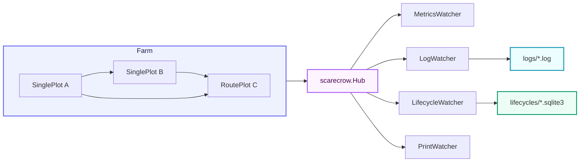

# CelestialGrow

> 📅 最終更新日: 2026/11/13

<p align="center">
  
  
  
</p>

**CelestialGrow** は、`Plot` / `Farm` モデルに基づく軽量で組み合わせ可能な Go の並行タスクオーケストレーションフレームワークです。

タスク処理を次の 2 つの層に分けています。

- **Plot**：seed を消費し、cultivator を実行し、fruit を生成するジェネリックな並行処理ノードです。生成方法により `SinglePlot[S, F]`（1 入力 1 出力）、`SplitPlot[S, F]`（1 対多）、`RoutePlot[S, Y]`（名前による宛先指定転送）に分かれます
- **Farm**：複数の Plot からなる静的な有向グラフで、登録、接続、起動、および全体のスケジューリングを担当します

実行のオーケストレーションそのものに加えて、CelestialGrow には以下が組み込まれています。

- イベント ID に基づくタスクライフサイクルの追跡
- SQLite に基づく状態スナップショットの永続化
- ファイルに基づく構造化実行ログ
- イベント駆動の可観測性（`pkg/scarecrow` の `Hub`、`MetricsWatcher`、`PrintWatcher`）
- 実行期リソースの組み立て層 `pkg/assembly`
- 統一された公開エントリパッケージ `pkg/api`

Go で「散在する goroutine + channel」よりも構造化された方法でタスクフローを表現したいが、重厚なワークフローシステムを持ち込みたくない場合、CelestialGrow はまさにそのような場面のために用意されています。

## プロジェクト構造（Project Structure）



CelestialGrow の中核となるデータフローは次のように要約できます。

1. 外部から seed を入力する
2. Plot の tender コルーチンが cultivator を並行実行する
3. 成功時は fruit を生成して下流の Plot に転送する
4. 失敗時は weed / wither ライフサイクルを記録する。剪定（prune）述語に該当した場合は prune を記録して育成をスキップする
5. 実行過程の各段階で `scarecrow.Event` を発行し、`Hub` が登録済みの watcher に配信する
6. ログとライフサイクルの watcher がイベントを `logs/` と `lifecycles/` に書き込む

## クイックスタート（Quick Start）

インストール：

```bash
go get github.com/Mr-xiaotian/CelestialGrow@latest
```

統一エントリ `pkg/api` から使い始めることを推奨します。

最小限の `Farm` の例（`demo/demo_farm/main.go` と完全に一致）：

```go
package main

import grow "github.com/Mr-xiaotian/CelestialGrow/pkg/api"

// double 将种子翻倍。
func double(num int) (int, error) {
	return num * 2, nil
}

// addOne 为种子加一。
func addOne(num int) (int, error) {
	return num + 1, nil
}

// main 演示一条 Farm 流水线：root 将种子翻倍后传给 head 加一。
func main() {
	root := grow.NewSinglePlot("root", double, grow.WithTenders(2))
	head := grow.NewSinglePlot("head", addOne, grow.WithTenders(2))

	farm := grow.NewFarm("demo_farm")
	if err := farm.AddPlot(root, head); err != nil {
		panic(err)
	}
	if err := farm.Connect([]grow.PlotNode{root}, []grow.PlotNode{head}); err != nil {
		panic(err)
	}
	if err := farm.Run(map[string][]any{
		"root": {1, 2, 3},
	}, "INFO"); err != nil {
		panic(err)
	}
}
```

実行すると 2 種類の生成物が得られます。

- `logs/grow_log(YYYY-MM-DD).log`：実行ログ
- `lifecycles/YYYY-MM-DD/grow_lifecycle(...).sqlite3`：ライフサイクルイベントと状態スナップショット

単一の `Plot` だけを実行したい場合は、standalone モードも直接利用できます。

```go
package main

import (
	"fmt"

	grow "github.com/Mr-xiaotian/CelestialGrow/pkg/api"
)

func main() {
	plot := grow.NewSinglePlot("double", func(seed int) (int, error) {
		return seed * 2, nil
	}, grow.WithTenders(4))

	plot.Run([]int{1, 2, 3, 4, 5}, "INFO")

	fmt.Printf("seed=%d fruit=%d weed=%d prune=%d\n",
		plot.GetSeedNum(), plot.GetFruitNum(), plot.GetWeedNum(), plot.GetPruneNum())

	records, err := plot.Harvest()
	if err != nil {
		panic(err)
	}
	for _, record := range records {
		fmt.Println(record.SeedJSON, record.Status, record.FruitJSON)
	}
}
```

一部の seed をスキップしたい場合は、育成前に `WithPruneIf` で判定します。述語に該当した seed は prune として記録され、リトライも下流への出力も行われません。

```go
package main

import (
	"fmt"

	grow "github.com/Mr-xiaotian/CelestialGrow/pkg/api"
)

func main() {
	plot := grow.NewSinglePlot("dedup", func(seed int) (int, error) {
		return seed * 2, nil
	},
		grow.WithTenders(3),
		grow.WithPruneIf(func(seed int) bool { return seed%2 == 0 }),
	)

	plot.Run([]int{1, 2, 3, 4, 5}, "INFO")

	fmt.Printf("fruit=%d prune=%d\n", plot.GetFruitNum(), plot.GetPruneNum())
}
```

より多くの組み合わせは [`docs/zh-CN/demo/demo_prune/main.md`](./demo/demo_prune/main.md) を参照してください。ミューテックスで保護した既読集合による並行安全な重複排除を行い、単一 Plot と Farm の 2 つの接続位置を同時に示しています。

## 主な機能（Core Features）

- **ジェネリックな Plot ノード**：`SinglePlot[S, F]`、`SplitPlot[S, F]`、`RoutePlot[S, Y]` が入力 seed 型と出力 fruit 型を明確に表現します
- **型安全な接続**：上流の `Y` と下流の `S` が一致しない場合、`Connect` は直ちにエラーを返します
- **並行育成モデル**：`WithTenders` で並行して育成するコルーチン（tender）の数を制御し、`WithChanSize` でチャネルのバッファを制御します
- **失敗時のリトライ機構**：`WithMaxRetries`、`WithRetryDelay`、`WithRetryIf` をサポートします。cultivator 内の panic は捕捉され、失敗として処理されます
- **剪定機構**：`WithPruneIf` が育成前に指定した seed をスキップします
- **グラフレベルのスケジューリング**：`Farm` がノード登録、エッジ接続、ソースノードの seal、全体の実行を一元的に管理します。`Run` はグラフ全体をブロッキングで実行し、`Start` は制御を呼び出し側に委ねます
- **実行期の注入**：`Farm.InjectTasks` / `Farm.InjectTerminations` により、`Start` のブロッキング中に動的に seed を追加したりノードを終了させたりできます
- **ライフサイクルの永続化**：既定でイベントグラフと状態スナップショットを SQLite に書き込みます
- **可観測性**：`scarecrow.Hub` がイベントを一元配信し、`MetricsWatcher`（指標）、`PrintWatcher`（標準出力の進捗）、および `assembly` が組み立てるログ / ライフサイクル watcher を内蔵します

## パッケージ一覧（Packages）

- `pkg/api`: 公開統一エントリ。`Farm`、`SinglePlot`、`SplitPlot`、`RoutePlot`、`PlotNode` およびすべての設定項目（ジェネリックな `WithPruneIf` を含む）をラップします
- `pkg/farm`: グラフ構造（`OrderGraph`）、ノード登録、ハイパーエッジ接続、構造レンダリング、全体のスケジューリング
- `pkg/plot`: ジェネリックなタスクノード（`SinglePlot`/`SplitPlot`/`RoutePlot`）、共有実行基盤 `basePlot`、並行実行、リトライ、剪定、上流下流へのデータ伝播
- `pkg/scarecrow`: 実行期イベントモデル（`Event` および Farm/Plot/Seed/Seal イベント）、`Watcher` インターフェース、配信センター `Hub`、`MetricsWatcher` 指標、`PrintWatcher` 出力オブザーバー
- `pkg/assembly`: 実行期リソースの組み立て。メトリクス / ライフサイクル / ログオブザーバーを作成して `Hub` に登録し、`Resources.Stop` で一括回収します
- `pkg/persist`: ライフサイクル SQLite と構造化実行ログの watcher、レコードハンドラ、照会インターフェース
- `pkg/funnel`: 汎用的な非同期レコードの生産 / 消費基盤（`Inlet` / `Spout`）
- `pkg/runtime`: `Payload`、イベント ID の割り当て（`EventClient`）、制御信号などの実行期基本型

## 可観測性（Observability）

実行期イベントは `scarecrow.Hub` が一元配信します。指標、ライフサイクル、ログのオブザーバーは `pkg/assembly` が `Run` / `Start` のたびに自動で組み立てます。`PrintWatcher` は自身で登録する必要があり、ローカルデバッグに適しています。

```go
package main

import (
	grow "github.com/Mr-xiaotian/CelestialGrow/pkg/api"
	"github.com/Mr-xiaotian/CelestialGrow/pkg/scarecrow"
)

func main() {
	root := grow.NewSinglePlot("root", func(seed int) (int, error) {
		return seed * 2, nil
	})
	head := grow.NewSinglePlot("head", func(seed int) (int, error) {
		return seed + 1, nil
	})

	farm := grow.NewFarm("demo_farm")
	if err := farm.AddPlot(root, head); err != nil {
		panic(err)
	}
	if err := farm.Connect([]grow.PlotNode{root}, []grow.PlotNode{head}); err != nil {
		panic(err)
	}
	if err := farm.AddWatcher(scarecrow.NewPrintWatcher("farm")); err != nil {
		panic(err)
	}
	if err := farm.Run(map[string][]any{"root": {1, 2, 3}}, "INFO"); err != nil {
		panic(err)
	}
}
```

Farm レベルの watcher は Farm 自身の Hub に登録され、その Hub は各 Plot の Hub にも接続されます。そのため `FarmStartEvent` / `FarmEndEvent` だけでなく、すべての Plot の seed イベントも受信できます。実行終了後も指標と永続化オブザーバーは Hub に残るため、`scarecrow.Find` で取得できます（`SinglePlot.Harvest` はこの仕組みに基づいてライフサイクル SQLite を照会します）。

> `Plot` と `Farm` 自身は `scarecrow.Hub` のみを保持し、spout や永続化オブザーバーのインスタンスを直接保持しません。ログ、ライフサイクルなどの実行期リソースは `pkg/assembly` が一元的に作成、登録、起動、回収します。

## 典型的な使用方法（Typical Usage）

推奨される呼び出し順序は次のとおりです。

1. `api.NewSinglePlot(...)` / `api.NewSplitPlot(...)` / `api.NewRoutePlot(...)` で処理ノードを定義する
2. `api.NewFarm(name)` でスケジューリンググラフを作成する
3. `farm.AddPlot(...)` を呼び出してノードを登録する
4. `farm.Connect(...)` を呼び出して上流下流の関係を構築する
5. （任意）`farm.AddWatcher(...)` を呼び出して `PrintWatcher` などの自作オブザーバーを接続する
6. `farm.Run(inputs, logLevel)` を呼び出して初期入力を注入し実行する

このうち `Farm.Connect` が使用するのは「グループ間の完全接続」というセマンティクスで、ソースグループとターゲットグループの間に直積的な接続を確立します。1 つの seed から複数の下流タスクを派生させたい場合は、`api.NewSplitPlot(...)`（1 対多）または `api.NewRoutePlot(...)`（名前による宛先指定転送）を使用できます。

外部からタスクフローを駆動する必要がある場合は、`Start` / `InjectTasks` / `InjectTerminations` を使用します。

```go
package main

import grow "github.com/Mr-xiaotian/CelestialGrow/pkg/api"

func main() {
	plot := grow.NewSinglePlot("double", func(seed int) (int, error) {
		return seed * 2, nil
	})

	farm := grow.NewFarm("external_driver")
	if err := farm.AddPlot(plot); err != nil {
		panic(err)
	}

	go func() {
		if err := farm.InjectTasks(map[string][]any{"double": {1, 2, 3}}); err != nil {
			panic(err)
		}
		// 没有外部终止信号时 Start 不会返回。
		if err := farm.InjectTerminations([]string{"double"}); err != nil {
			panic(err)
		}
	}()

	if err := farm.Start("INFO"); err != nil {
		panic(err)
	}
}
```

## ファイル構成（File Structure）

```text
pkg/
  api/        # 对外统一入口
  assembly/   # 运行期资源装配
  farm/       # 图结构与调度
  funnel/     # 通用异步消费基础设施
  persist/    # 日志与生命周期持久化
  plot/       # 泛型并发节点
  runtime/    # 事件、信号与运行时载体
  scarecrow/  # 事件模型、分发 Hub 与观察者

demo/
  demo_farm/  # 最小 Farm 流水线
  demo_prune/ # prune 去重（单 Plot 与 Farm）
```

## 動作環境（Requirements）

現在のモジュール宣言：

- `go 1.25.5`
- `toolchain go1.26.2`

主要な依存関係は次のとおりです。

| 依存関係 | 説明 |
| --- | --- |
| `modernc.org/sqlite` | 純 Go の SQLite ドライバ。ライフサイクルの永続化に使用します |

## 開発（Development）

```bash
go mod tidy
go test ./pkg/...
```

`pkg/**/*.go` を変更した場合は、対応するパッケージの関連テストを実行し、今回の変更が影響する範囲の振る舞いを優先的に検証することを推奨します。

## ドキュメント索引（Documentation Index）

本リポジトリの詳細な中国語ドキュメントは、`pkg/<name>/<file>.go` → `docs/zh-CN/pkg/<name>/<file>.md` というミラー方式で構成されています。現在生成済みの中国語サブドキュメントは次のとおりです。

### pkg/api

- [`docs/zh-CN/pkg/api/api.md`](./pkg/api/api.md) — 公開統一エントリパッケージ

### pkg/assembly

- [`docs/zh-CN/pkg/assembly/assembly.md`](./pkg/assembly/assembly.md) — 実行期リソースの組み立て（`StartPlotResources` / `StartFarmResources` / `Resources.Stop`）
- [`docs/zh-CN/pkg/assembly/assembly_test.md`](./pkg/assembly/assembly_test.md) — リソース組み立てテストのポイント

### pkg/farm

- [`docs/zh-CN/pkg/farm/farm.md`](./pkg/farm/farm.md) — Farm スケジューラ
- [`docs/zh-CN/pkg/farm/graph.md`](./pkg/farm/graph.md) — トポロジグラフ（OrderGraph）
- [`docs/zh-CN/pkg/farm/render.md`](./pkg/farm/render.md) — グラフ構造のテキストレンダリング（RenderStructureList）
- [`docs/zh-CN/pkg/farm/farm_structure_test.md`](./pkg/farm/farm_structure_test.md) — Farm 構造テストのポイント
- [`docs/zh-CN/pkg/farm/farm_connect_test.md`](./pkg/farm/farm_connect_test.md) — Farm Connect テストのポイント
- [`docs/zh-CN/pkg/farm/farm_start_test.md`](./pkg/farm/farm_start_test.md) — Farm Start テストのポイント
- [`docs/zh-CN/pkg/farm/farm_inject_test.md`](./pkg/farm/farm_inject_test.md) — Farm 実行期注入テストのポイント
- [`docs/zh-CN/pkg/farm/farm_harvest_test.md`](./pkg/farm/farm_harvest_test.md) — Farm 実行後のライフサイクル照会テストのポイント
- [`docs/zh-CN/pkg/farm/farm_split_test.md`](./pkg/farm/farm_split_test.md) — Farm SplitPlot エンドツーエンドテストのポイント
- [`docs/zh-CN/pkg/farm/farm_route_test.md`](./pkg/farm/farm_route_test.md) — Farm RoutePlot エンドツーエンドテストのポイント
- [`docs/zh-CN/pkg/farm/graph_test.md`](./pkg/farm/graph_test.md) — OrderGraph テストのポイント
- [`docs/zh-CN/pkg/farm/render_test.md`](./pkg/farm/render_test.md) — グラフ構造レンダリングテストのポイント

### pkg/plot

- [`docs/zh-CN/pkg/plot/plot.md`](./pkg/plot/plot.md) — 共有実行基盤（`basePlot` / `PlotNode`）と standalone 実行
- [`docs/zh-CN/pkg/plot/plot_single.md`](./pkg/plot/plot_single.md) — 1 入力 1 出力ノード（SinglePlot）
- [`docs/zh-CN/pkg/plot/plot_split.md`](./pkg/plot/plot_split.md) — 1 対多ノード（SplitPlot）
- [`docs/zh-CN/pkg/plot/plot_route.md`](./pkg/plot/plot_route.md) — 宛先指定転送ノード（RoutePlot）
- [`docs/zh-CN/pkg/plot/option.md`](./pkg/plot/option.md) — Plot のオプション設定（Option）
- [`docs/zh-CN/pkg/plot/constant.md`](./pkg/plot/constant.md) — Plot の定数と信号の定義
- [`docs/zh-CN/pkg/plot/helper.md`](./pkg/plot/helper.md) — Plot の内部ヘルパー関数
- [`docs/zh-CN/pkg/plot/plot_harvest_test.md`](./pkg/plot/plot_harvest_test.md) — Plot Harvest テストのポイント
- [`docs/zh-CN/pkg/plot/plot_prune_test.md`](./pkg/plot/plot_prune_test.md) — Plot 剪定機構テストのポイント
- [`docs/zh-CN/pkg/plot/plot_retry_test.md`](./pkg/plot/plot_retry_test.md) — Plot リトライテストのポイント
- [`docs/zh-CN/pkg/plot/plot_split_test.md`](./pkg/plot/plot_split_test.md) — SplitPlot テストのポイント
- [`docs/zh-CN/pkg/plot/plot_route_test.md`](./pkg/plot/plot_route_test.md) — RoutePlot テストのポイント

### pkg/scarecrow

- [`docs/zh-CN/pkg/scarecrow/event.md`](./pkg/scarecrow/event.md) — 実行期イベントの定義
- [`docs/zh-CN/pkg/scarecrow/watcher.md`](./pkg/scarecrow/watcher.md) — Watcher インターフェースと関数アダプタ
- [`docs/zh-CN/pkg/scarecrow/hub.md`](./pkg/scarecrow/hub.md) — イベント配信センター Hub
- [`docs/zh-CN/pkg/scarecrow/metrics.md`](./pkg/scarecrow/metrics.md) — 指標オブザーバー（MetricsWatcher）
- [`docs/zh-CN/pkg/scarecrow/print.md`](./pkg/scarecrow/print.md) — 標準出力進捗オブザーバー（PrintWatcher）
- [`docs/zh-CN/pkg/scarecrow/event_test.md`](./pkg/scarecrow/event_test.md) — イベント定義テストのポイント
- [`docs/zh-CN/pkg/scarecrow/hub_test.md`](./pkg/scarecrow/hub_test.md) — Hub 配信と環検出テストのポイント
- [`docs/zh-CN/pkg/scarecrow/metrics_test.md`](./pkg/scarecrow/metrics_test.md) — 指標再構築テストのポイント
- [`docs/zh-CN/pkg/scarecrow/print_test.md`](./pkg/scarecrow/print_test.md) — 出力オブザーバーテストのポイント

### pkg/persist

- [`docs/zh-CN/pkg/persist/lifecycle.md`](./pkg/persist/lifecycle.md) — ライフサイクルイベント記録
- [`docs/zh-CN/pkg/persist/log.md`](./pkg/persist/log.md) — 構造化実行ログ
- [`docs/zh-CN/pkg/persist/sqlite.md`](./pkg/persist/sqlite.md) — SQLite 状態スナップショット
- [`docs/zh-CN/pkg/persist/lifecycle_test.md`](./pkg/persist/lifecycle_test.md) — ライフサイクル永続化テストのポイント
- [`docs/zh-CN/pkg/persist/log_test.md`](./pkg/persist/log_test.md) — ログ永続化テストのポイント
- [`docs/zh-CN/pkg/persist/sqlite_test.md`](./pkg/persist/sqlite_test.md) — SQLite 永続化テストのポイント

### pkg/funnel

- [`docs/zh-CN/pkg/funnel/inlet.md`](./pkg/funnel/inlet.md) — 汎用 Inlet 消費インターフェース
- [`docs/zh-CN/pkg/funnel/spout.md`](./pkg/funnel/spout.md) — 汎用 Spout 生産インターフェース

### pkg/runtime

- [`docs/zh-CN/pkg/runtime/event.md`](./pkg/runtime/event.md) — イベント ID の割り当てと流れ
- [`docs/zh-CN/pkg/runtime/type.md`](./pkg/runtime/type.md) — 実行期の基本型

### demo

- [`docs/zh-CN/demo/demo_farm/main.md`](./demo/demo_farm/main.md) — 最小 Farm サンプルの解説
- [`docs/zh-CN/demo/demo_prune/main.md`](./demo/demo_prune/main.md) — prune 重複排除サンプルの解説
