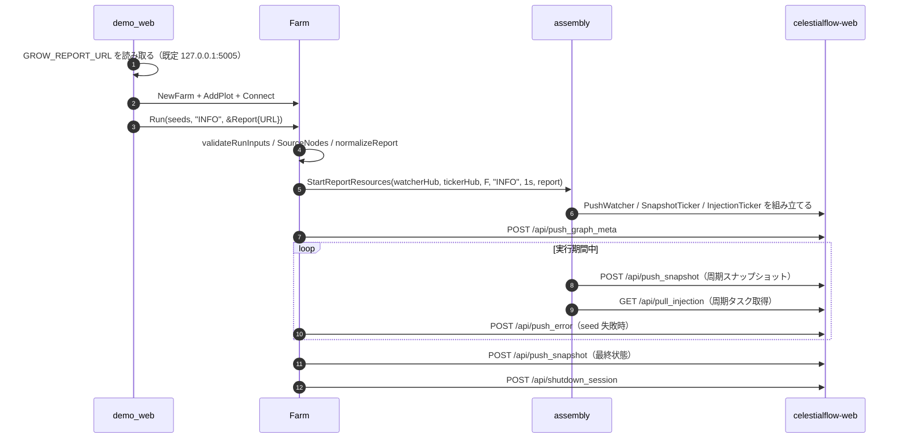

# demo/demo_web/main.go

> 📅 最終更新日: 2026/11/26

## 役割

`demo/demo_web/main.go` は CelestialGrow の**リモート報告サンプル**です。`pkg/api` を使って `SinglePlot`、`SplitPlot`、`RoutePlot` を含む混在グラフを構築し、`Farm.Run` 時に報告設定を渡すことで、グラフ構造、ノード状態、周期スナップショット、タスク失敗、セッション終了を `celestialflow-web` へプッシュします。

ローカル実行のみを行う [`demo_farm`](../demo_farm/main.md) と比べ、本サンプルはさらに次を扱います。

- `grow.Report`（すなわち `reporter.Config`）の使い方と既定の `SessionID` 生成
- 報告モードにおける `pkg/assembly` による `PushWatcher`、`SnapshotTicker`、`InjectionTicker` の組み立て
- `SinglePlot` / `SplitPlot` / `RoutePlot` を混在させたときの fan-out、分割、名前によるルーティング
- 意図的に失敗を発生させ、web ページのエラーパネルで観察できるようにする

## サンプルのトポロジ

```mermaid
flowchart LR
    R[root<br/>int→int<br/>失敗: 5 の倍数] -->|fruit| SP[split<br/>int→[]int]
    SP -->|seed, seed+1| RT[route<br/>int→map[string]int]
    RT -->|偶数| E[even<br/>int→int]
    RT -->|奇数| O[odd<br/>int→int<br/>失敗: 9]

    style R fill:#eef2ff,stroke:#6366f1,stroke-width:2px,color:#1e1b4b
    style SP fill:#f5f3ff,stroke:#8b5cf6,stroke-width:2px
    style RT fill:#ecfeff,stroke:#0891b2,stroke-width:2px
```

- `root`：2 秒遅延します。`seed%5==0` のときエラーを返し、それ以外は 2 倍にします。
- `split`：2 秒遅延します。各 seed を `seed` と `seed+1` に分割します。
- `route`：2 秒遅延します。偶数は `even` へ、奇数は `odd` へルーティングします。
- `even`：2 秒遅延します。seed を半分にします。
- `odd`：2 秒遅延します。seed を 3 倍にし、`9` を受け取ると意図的に失敗します。

すべての Plot は `grow.WithTenders(3)` で 3 つの並行 tender を設定します。入口 seed は `1..12` で、うち `5`、`10` は `root` に拒否され、`9` は `odd` に拒否されるため、web 側では **3 件の失敗レコード** が確認できるはずです。

## 主要な呼び出し

| 呼び出し | 由来 | 役割 |
|------|------|------|
| `grow.NewSinglePlot` / `grow.NewSplitPlot` / `grow.NewRoutePlot` | `pkg/api` → `plot` | 3 種類のノードを作成します。いずれも `grow.PlotNode` を実装しており、同じ Farm 内で混在させられます。 |
| `grow.NewFarm("demo_web")` | `pkg/api` → `farm.NewFarm` | スケジューリンググラフを作成し、内部でイベントクライアント、オブザーバー Hub、節拍 Hub を初期化します。 |
| `farm.AddPlot(root, split, route, even, odd)` | `pkg/farm` | すべてのノードを登録します。名前は一意でなければなりません。 |
| `farm.Connect(...)` | `pkg/farm` | グループ間の完全接続を行い、上流の fruit 型と下流の seed 型を検証します。 |
| `farm.Run(inputs, "INFO", &grow.Report{URL: reportURL})` | `pkg/farm` | 同期的に実行し、リモート報告を有効にします。`SessionID` が空の場合は自動生成されます。 |
| `os.Getenv("GROW_REPORT_URL")` | 標準ライブラリ | 既定の報告先アドレスを上書きします。 |

### 報告設定

```go
type Config struct {
    URL             string // 上报服务基础地址
    SessionID       string // 上报会话标识；为空时由运行入口生成
    SnapshotPeriod  int    // 状态快照节拍周期
    InjectionPeriod int    // 注入拉取节拍周期
}
```

サンプルでは `URL` のみを設定します。

- `SessionID` は `Farm.normalizeReport` が生成し、形式は `demo_web@<UnixNano>` です。
- `SnapshotPeriod` / `InjectionPeriod` は 0 で、`pkg/reporter` の既定周期を使用します。
- 節拍の基準周期は `pkg/assembly` から `metronome.DefaultInterval`（1 秒）として渡されます。

## 実行方法

1. 先に `celestialflow-web` を起動します（既定で `http://127.0.0.1:5005` を待ち受けます）。このプロジェクトは本リポジトリと同じ階層の `..\celestialflow-web` にあり、その README に従って起動してください。
2. 本サンプルに**コマンドライン引数はありません**。設定できるのは環境変数 `GROW_REPORT_URL` のみです。CelestialGrow プロジェクトのルートディレクトリで実行します。

```bash
go run ./demo/demo_web
```

別のアドレスに接続する場合：

```bash
GROW_REPORT_URL=http://192.168.1.10:5005 go run ./demo/demo_web
```

PowerShell での同等の書き方：

```powershell
$env:GROW_REPORT_URL = "http://192.168.1.10:5005"
go run ./demo/demo_web
```

起動後、ターミナルにはまず次が出力されます。

```text
上报地址: http://127.0.0.1:5005
请先启动 celestialflow-web，并打开对应页面查看实时状态。
```

実行終了後は次が出力されます。

```text
运行结束：web 端会话已标记为结束，历史快照与错误仍可查看。
```

## 主要なフロー



- `/api/push_graph_meta` は `FarmStartEvent` 時に 1 回だけ送信され、ノード、エッジ、ソースノード、`node_meta` を含みます。
- `/api/push_snapshot` は `SnapshotTicker` が周期ごとに送信し、`FarmEndEvent` 時には最終状態スナップショットも追加送信されます。
- `/api/push_error` は `SeedWitherEvent` によってトリガーされ、サンプルでは `root` の `5` / `10` と `odd` の `9` に対応します。
- `/api/shutdown_session` は `FarmEndEvent` の最終状態スナップショットの後に送信され、セッション終了をマークします。セッション履歴は引き続き閲覧できます。
- `/api/pull_injection` は `InjectionTicker` が周期的に要求し、web 側で投入された `tasks` / `terminations` を `Farm.InjectTasks` / `Farm.InjectTerminations` に戻します。

## 完全なソースコード

以下のコードは `demo/demo_web/main.go` のソースと一致します。

```go
package main

import (
	"fmt"
	"os"
	"time"

	grow "github.com/Mr-xiaotian/CelestialGrow/pkg/api"
)

// defaultReportURL 是 celestialflow-web 的默认监听地址。
const defaultReportURL = "http://127.0.0.1:5005"

// rootCultivator 将种子翻倍；部分种子会失败，用于在 web 端展示错误面板。
func rootCultivator(seed int) (int, error) {
	time.Sleep(2 * time.Second)
	if seed%5 == 0 {
		return 0, fmt.Errorf("root 拒绝处理 5 的倍数: %d", seed)
	}
	return seed * 2, nil
}

// splitter 将一颗种子拆成相邻的两个下游任务。
func splitter(seed int) ([]int, error) {
	time.Sleep(2 * time.Second)
	return []int{seed, seed + 1}, nil
}

// router 按奇偶把种子定向到 even / odd 两个下游节点。
func router(seed int) (map[string]int, error) {
	time.Sleep(2 * time.Second)
	if seed%2 == 0 {
		return map[string]int{"even": seed}, nil
	}
	return map[string]int{"odd": seed}, nil
}

// evenCultivator 处理偶数种子。
func evenCultivator(seed int) (int, error) {
	time.Sleep(2 * time.Second)
	return seed / 2, nil
}

// oddCultivator 处理奇数种子；遇到 9 时失败，用于展示叶子节点的错误上报。
func oddCultivator(seed int) (int, error) {
	time.Sleep(2 * time.Second)
	if seed == 9 {
		return 0, fmt.Errorf("odd 节点遇到 9，故意失败")
	}
	return seed * 3, nil
}

// main 演示把 Farm 运行状态上报到 celestialflow-web。
//
// 请先启动 web 服务（默认 http://127.0.0.1:5005），再运行本示例。运行期间可在
// web 页面看到图结构、节点状态、周期快照与失败任务；结束后会话保留并可继续查看。
// 上报地址可通过环境变量 GROW_REPORT_URL 覆盖。
func main() {
	reportURL := os.Getenv("GROW_REPORT_URL")
	if reportURL == "" {
		reportURL = defaultReportURL
	}

	root := grow.NewSinglePlot("root", rootCultivator, grow.WithTenders(3))
	split := grow.NewSplitPlot("split", splitter, grow.WithTenders(3))
	route := grow.NewRoutePlot("route", router, grow.WithTenders(3))
	even := grow.NewSinglePlot("even", evenCultivator, grow.WithTenders(3))
	odd := grow.NewSinglePlot("odd", oddCultivator, grow.WithTenders(3))

	farm := grow.NewFarm("demo_web")
	if err := farm.AddPlot(root, split, route, even, odd); err != nil {
		panic(err)
	}
	if err := farm.Connect([]grow.PlotNode{root}, []grow.PlotNode{split}); err != nil {
		panic(err)
	}
	if err := farm.Connect([]grow.PlotNode{split}, []grow.PlotNode{route}); err != nil {
		panic(err)
	}
	if err := farm.Connect([]grow.PlotNode{route}, []grow.PlotNode{even, odd}); err != nil {
		panic(err)
	}

	fmt.Printf("上报地址: %s\n", reportURL)
	fmt.Println("请先启动 celestialflow-web，并打开对应页面查看实时状态。")

	if err := farm.Run(map[string][]any{
		"root": {1, 2, 3, 4, 5, 6, 7, 8, 9, 10, 11, 12},
	}, "INFO", &grow.Report{URL: reportURL}); err != nil {
		panic(err)
	}

	fmt.Println("运行结束：web 端会话已标记为结束，历史快照与错误仍可查看。")
}
```

## 注意事項

1. **web サービスは必須ではありません**：`PushWatcher` の HTTP 失敗はログに書かれるだけで、`Run` がエラーを返すことはありません。web が起動していなくてもサンプルは最後まで実行され、ページにデータが表示されないだけです。ローカルの `logs/` と `lifecycles/` の生成物は通常どおり作成されます。
2. **URL は正当でなければなりません**：`report.URL` は `http://` または `https://` のアドレスである必要があり、末尾の `/` は正規化されます。不正なアドレスでは `StartReportResources` がエラーを返し、`Run` は Plot 起動前に失敗します。
3. **セッション識別子**：サンプルでは `SessionID` を設定していないため、実行ごとに新しい `demo_web@<UnixNano>` が生成されます。web 側でセッション名を固定したい場合は明示的に渡してください。
4. **ルーティング先の名前**：`RoutePlot` のルーティングテーブルの key は、接続済みの下流 Plot 名（`even` / `odd`）と一致している必要があります。未接続または未登録の key は黙ってスキップされます。
5. **所要時間**：各ノードは 1 つの seed を処理するたびに `Sleep(2s)` し、各段は直列に依存するため、12 個の seed のデモは通常 30 秒以上かかります。これは web ページが中間状態を表示するための時間を確保するためです。
6. **意図的な失敗**：`root` の `5` / `10` と `odd` の `9` は `SeedWitherEvent` に入り、エラーのみが報告され、下流へは転送されません。残りの seed は正常に完了します。
7. **同期的にブロックする**：`Farm.Run` はすべての Plot が終了し報告リソースが停止するまでブロックしてから戻ります。`Run` が戻る前に web サービスを停止しないでください。停止すると最終状態スナップショットとシャットダウン要求のプッシュに失敗する可能性があります。
