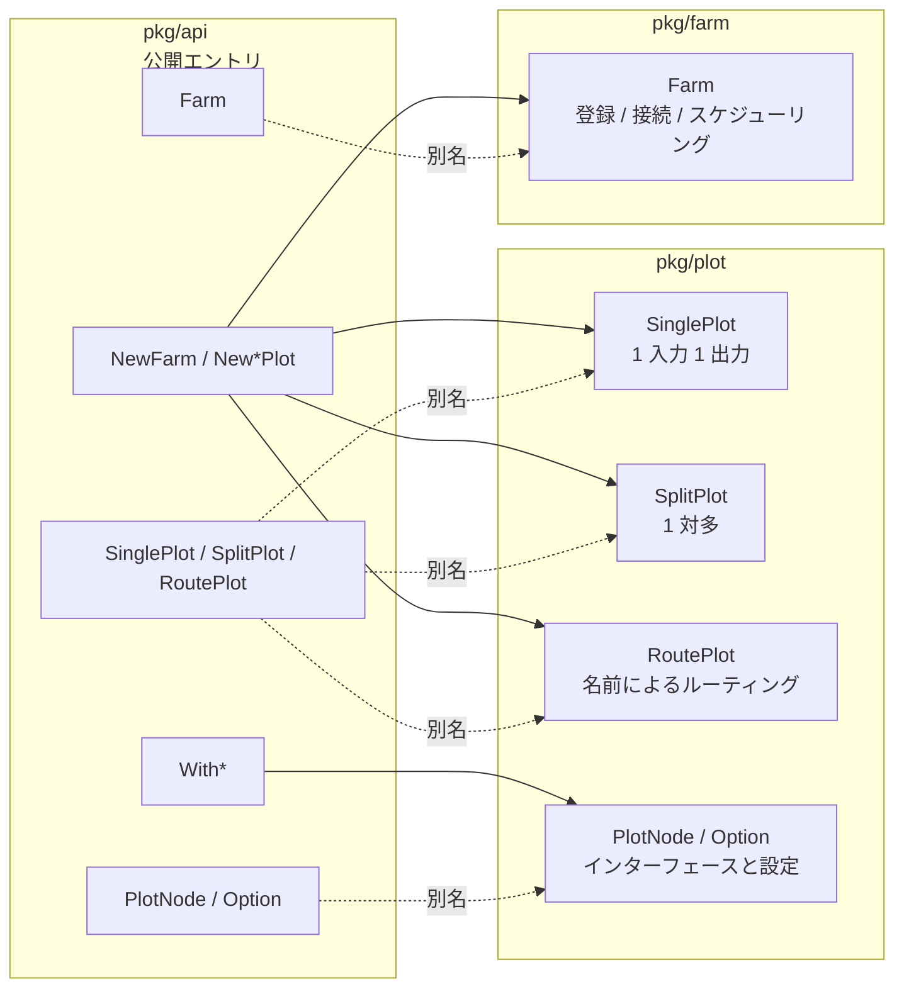
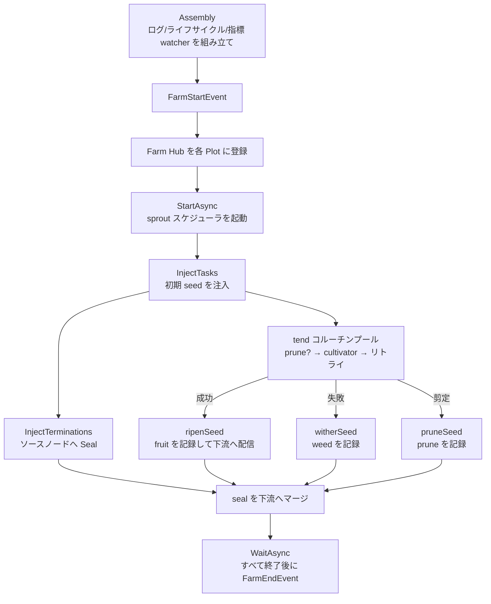

# pkg/api/api.go

> 📅 最終更新日: 2026/11/13

## 役割

`pkg/api` は CelestialGrow の**公開統一エントリパッケージ**です。新しい実装を一切導入せず、下位パッケージの主要な型とよく使う設定を 3 つの形式で再公開します。

1. **型エイリアス**（`type X = pkg.Y`）：`Farm`、`SinglePlot`、`SplitPlot`、`RoutePlot`、`PlotNode`、`Option`；
2. **コンストラクタの薄いラッパー**：`NewFarm`、`NewSinglePlot`、`NewSplitPlot`、`NewRoutePlot`；
3. **設定項目**：パッケージレベルの変数 `WithTenders`、`WithChanSize`、`WithMaxRetries`、`WithRetryDelay`、`WithRetryIf`、およびジェネリック関数 `WithPruneIf`。

下位の依存は 2 つのパッケージだけです。

| 下位パッケージ | 提供内容 |
|--------|----------|
| `pkg/farm` | `Farm`：ノード登録、ハイパーエッジ的な接続、全体のスケジューリングと外部注入 |
| `pkg/plot` | `SinglePlot` / `SplitPlot` / `RoutePlot` / `PlotNode` / `Option` とその設定関数 |

> 実行期のイベント観測機能（進捗出力、指標統計など）は `pkg/scarecrow` が提供し、`AddWatcher` を通じて注入します。`pkg/api` はいかなるオブザーバーコンストラクタも提供しません。進捗を出力する必要がある場合は `scarecrow.NewPrintWatcher` または独自の `scarecrow.Watcher` を使用してください。

エクスポート項目はすべてエイリアス、関数値、または 1 層のパススルーラッパーであるため、本パッケージの振る舞いの契約は完全に下位パッケージによって決まります。本ドキュメントでは「エクスポートシンボル一覧 + 型パラメータのセマンティクス + 既定値 + エラーシナリオ」に焦点を当てます。

## エクスポートシンボル一覧

| シンボル | 分類 | 参照先 | 説明 |
|------|------|------|------|
| `Farm` | 型エイリアス | `farm.Farm` | 複数のノードからなる静的な有向グラフで、ノード登録、接続、スケジューリングと外部注入を担当します。 |
| `SinglePlot[S, F]` | ジェネリック型エイリアス | `plot.SinglePlot[S, F]` | 1 入力 1 出力ノード。seed を 1 つ正常に処理するごとに、**各**下流へ **1 つ**の `F` を転送します。 |
| `SplitPlot[S, F]` | ジェネリック型エイリアス | `plot.SplitPlot[S, F]` | 分割ノード。処理関数は `[]F` を返し、**各要素**を独立した yield としてそれぞれの下流へ送信します。 |
| `RoutePlot[S, Y]` | ジェネリック型エイリアス | `plot.RoutePlot[S, Y]` | ルーティングノード。処理関数は `map[string]Y` を返し、`key` は宛先となる下流の名前、`value` はその下流にのみ送信されます。 |
| `PlotNode` | 型エイリアス | `plot.PlotNode` | ジェネリックパラメータを消去した統一ノードインターフェースで、`Farm` はこれを使って型の異なるノードを保持します。 |
| `Option` | 型エイリアス | `plot.Option` | ノードのオプション設定で、実体は `func(*plotOptions)` です。`plotOptions` が非公開のため、パッケージ外では `Option` を**独自定義できません**。 |
| `NewFarm(name string) *Farm` | コンストラクタ | `farm.NewFarm` | Farm を作成します（同時に内部のイベント Hub も作成します）。 |
| `NewSinglePlot[S, F](name string, cultivator func(S) (F, error), opts ...Option) *SinglePlot[S, F]` | コンストラクタ | `plot.NewSinglePlot` | 1 入力 1 出力ノードを作成します。 |
| `NewSplitPlot[S, F](name string, splitter func(S) ([]F, error), opts ...Option) *SplitPlot[S, F]` | コンストラクタ | `plot.NewSplitPlot` | 分割ノードを作成します。 |
| `NewRoutePlot[S, Y](name string, cultivator func(S) (map[string]Y, error), opts ...Option) *RoutePlot[S, Y]` | コンストラクタ | `plot.NewRoutePlot` | ルーティングノードを作成します。 |
| `WithTenders(n int) Option` | パッケージレベル変数 | `plot.WithTenders` | 並行 tender 数。 |
| `WithChanSize(n int) Option` | パッケージレベル変数 | `plot.WithChanSize` | seed チャネルのバッファサイズ。 |
| `WithMaxRetries(n int) Option` | パッケージレベル変数 | `plot.WithMaxRetries` | 最大リトライ回数（初回実行は含みません）。 |
| `WithRetryDelay(fn func(int) time.Duration) Option` | パッケージレベル変数 | クロージャでラップした `plot.WithRetryDelay` | リトライ間隔の戦略。 |
| `WithRetryIf(fn func(error) bool) Option` | パッケージレベル変数 | `plot.WithRetryIf` | エラーフィルタ。`true` を返したエラーだけがリトライされます。 |
| `WithPruneIf[S any](fn func(S) bool) Option` | ジェネリック関数 | `plot.WithPruneIf` | 剪定述語。該当すると育成せず、直接 prune として終結します。 |

> 型エイリアス（`type X = Y`）は、`pkg/api` でこれらの型を使用することが下位パッケージを直接使用するのと**完全に等価**であることを意味し、メソッドセットもそのまま継承されます。下位パッケージでメソッドが追加 / 変更されると、直ちに本パッケージへ反映されます。

## 下位パッケージとの対応



## ジェネリックパラメータのセマンティクス

3 種類のノードは同じ規約を共有します。**上流の産出型は下流の seed 型と等しくなければなりません**。接続時に実行期の型アサーションで検証されます。

| 型 | ジェネリックパラメータ | 処理関数のシグネチャ | 成功時の産出 |
|------|----------|--------------|--------------|
| `SinglePlot[S, F]` | `S`：入力 seed 型；`F`：fruit 型 | `func(S) (F, error)` | 接続済みの各下流へそれぞれ 1 つの `F` を送信します。本ノードは 1 つの fruit として記録されます。 |
| `SplitPlot[S, F]` | `S`：入力 seed 型；`F`：分割後の要素型 | `func(S) ([]F, error)` | 接続済みの各下流へそれぞれ `len(fruits)` 個の `F` を送信します。seed 全体は依然として 1 つの fruit として記録されます。 |
| `RoutePlot[S, Y]` | `S`：入力 seed 型；`Y`：下流 yield 型 | `func(S) (map[string]Y, error)` | `map` 内で該当し、かつ接続済みの下流にのみ対応する `Y` を送信します。本ノードは 1 つの fruit として記録されます。 |

> 下流ノードの `S` は、上流の `F`（`SplitPlot` の要素型）または `Y`（`RoutePlot` の値型）と一致しなければなりません。一致しない場合、`Farm.Connect` は型非互換エラーを返します。コンパイル時にノード間のジェネリクスは検査できないため、この検証は接続時に行われます。

## Farm のよく使うメソッド

`Farm` は `pkg/farm` が実装しており、エイリアスを通じてすべて使用できます。

| メソッド | 説明 |
|------|------|
| `AddPlot(plots ...PlotNode) error` | 1 つ以上のノードを登録します。名前は空にできず、Farm 内で一意でなければなりません。登録後、ノードは Farm のイベントクライアントを共有します。 |
| `Connect(fromPlots, toPlots []PlotNode) error` | 2 つのノードグループ間に**完全接続**（直積）を確立し、1 本ずつ上流の `ConnectTo` を呼び出して型検証を行います。 |
| `AddWatcher(watcher scarecrow.Watcher) error` | Farm レベルの watcher を登録します。Farm イベントとすべての Plot イベントを同時に受信できます（Farm Hub は子 Hub として各 Plot に登録されます）。 |
| `Run(inputs map[string][]any, logLevel string) error` | 同期実行：まず `inputs` を検証し、すべてのノードを起動してから、初期 seed を注入し、**ソースノード**へ終了信号を送信し、最後にすべての終了を待ちます。`logLevel` が空の場合は `INFO` として扱います。 |
| `Start(logLevel string) error` | 組み立てと起動のみを行い、seed / 終了信号は一切注入しません。すべてのノードが終了するまでブロックします。外部駆動のシナリオに適しています。終了信号を注入する者がいない場合、`Start` は戻りません。 |
| `InjectTasks(tasks map[string][]any) error` | 指定したノードへ seed を注入します。`Start`/`Run` の実行中に呼び出せます。 |
| `InjectTerminations(nodes []string) error` | 指定したノードへ終了信号を注入します。あるノードを終了させた後にそのノードへ seed を播いても処理されません。 |
| `PlotCount() int` | 登録済みノード数。 |
| `HasPlot(name string) bool` | 指定した名前が登録済みかどうか。 |
| `GetPlot(name string) (PlotNode, bool)` | 名前でノードを取得します。見つからない場合 `ok` は `false` です。 |

`Run` と `Start` の違い：

| シナリオ | `Run` を使う | `Start` を使う |
|------|----------|-----------|
| データが起動前に既知 | ✅ 1 回の呼び出しで完了 | 可能だが、自身で注入する必要がある |
| 実行中に継続的にタスクを投入（ストリーミング / 外部駆動） | ❌ 直ちに封口される | ✅ `InjectTasks` / `InjectTerminations` と組み合わせる |
| 戻るタイミング | すべてのノードが処理を終えて終了した後 | すべての終了信号を受信し、処理が終わった後 |

## Plot のよく使うメソッド

`SinglePlot` / `SplitPlot` / `RoutePlot` は同じ `basePlot` メソッド群を共有します（ジェネリックなシグネチャは前述）。

| メソッド | 説明 |
|------|------|
| `AddWatcher(watcher scarecrow.Watcher) error` | ノードレベルの watcher を登録します。重複登録するとイベントを重複して受信します。`Run`/`StartAsync` の前に呼び出す必要があります。 |
| `Run(seeds []S, logLevel string)` | standalone モード：ログ / ライフサイクル / 指標リソースを組み立て、ノードを起動し、seed を播いて封口し、終了を待ちます。**戻り値はありません**。 |
| `Harvest() ([]persist.LifecycleStatusRecord, error)` | このノードで永続化済みの seed 状態スナップショットを読み取ります。standalone の `Run` または `Farm.Run/Start` の終了後に呼び出せます。 |
| `GetSeedNum() int` | 入力総数（外部注入 + 上流からの投入）。 |
| `GetFruitNum() int` | 成功数（成熟）。 |
| `GetWeedNum() int` | 失敗数（枯死）。 |
| `GetPruneNum() int` | 剪定数（スキップ）。 |
| `GetCompleted() int` | 完了数＝成熟 + 枯死 + 剪定。 |
| `IsFinish() bool` | 入力されたすべての seed が結果を出したかどうか（`Processed == InputTotal`）。 |
| `GetName() string` | ノード名。 |
| `GetState() int32` | 状態：`0` = idle、`1` = running、`2` = done。 |
| `Seed(seed S)` | seed を 1 つ播きます（`seedChan` へ同期的に書き込み、バッファが満杯になるとブロックします）。 |
| `Seal()` | 「外部入力の終了」信号を送信します。上流を持つノードに対しては**強制終了**であり、残りの上流を待ちません。 |
| `SeedAny(seed any) error` | `any` として seed を播き、内部で `S` にアサートします。 |
| `StartAsync()` / `WaitAsync()` | 非同期起動 / 終了待機。Farm 内部で使用され、standalone では通常 `Run` を使えば十分です。 |

> **指標メソッドは `MetricsWatcher` に依存します**：`assembly` が `Run` / `Start` を組み立てる際に `scarecrow.MetricsWatcher` を自動登録します。そのため `Run` の前にこれらの getter を呼び出すと `0` を返し（`IsFinish` は `false`）、実行終了後は最後の統計結果が保持されます。`Harvest` も同様にライフサイクルオブザーバーに依存します。

## PlotNode インターフェースの契約

`PlotNode` は `Farm` がノードを管理する際に使用する統一インターフェースです（実装は `pkg/plot/plot.go` の `basePlot`）。

| メソッド | 役割 |
|------|------|
| `GetName() string` | ノード名を返します。一意性の検証と接続時のアドレス解決に使用します。 |
| `GetState() int32` | 状態を返します：`0` = idle、`1` = running、`2` = done。 |
| `GetSeedChanAny() any` | seed チャネルを `any` として返し、`ConnectTo` が型アサーションを行うために使用します。 |
| `ConnectTo(next PlotNode) error` | 本ノードの産出を下流の入力に接続します。上流下流の型が互換でない場合はエラーを返します。 |
| `AddUpstream(name string)` | 上流の名前を登録します（上流が `ConnectTo` 内で呼び出します）。seal の集約に使用します。 |
| `AddWatcher(listener scarecrow.Watcher) error` | オブザーバーを登録します。 |
| `SetEventClient(eventClient runtime.EventClient)` | イベントクライアントを注入します。`Farm.AddPlot` はすべてのノードに Farm のクライアントを共有させます。 |
| `StartAsync()` | スケジューラを非同期に起動します。 |
| `WaitAsync()` | バックグラウンドのコルーチンが終了するのを待機します。 |
| `SeedAny(seed any) error` | `any` として seed を 1 つ播き、内部で型アサーションを行います。 |
| `Seal()` | 「外部入力の終了」信号を送信します。 |

典型的な実装は `basePlot` を埋め込んだ 3 つのノードです：`*plot.SinglePlot[S, F]`、`*plot.SplitPlot[S, F]`、`*plot.RoutePlot[S, Y]`。

## 主要な関数

### `NewFarm(name string) *Farm`

`Farm` を作成して返します。

- `name`：Farm の名前で、ログの識別と `FarmStartEvent` / `FarmEndEvent` に使用します。
- error は返しません。作成後すぐに `AddPlot` / `Connect` / `Run` を実行できます。
- Farm 自身のログレベルはここでは設定せず、`Run(inputs, logLevel)` / `Start(logLevel)` のときに渡します。

### `NewSinglePlot[S any, F any](name string, cultivator func(S) (F, error), opts ...Option) *SinglePlot[S, F]`

1 入力 1 出力ノードを作成します。

- `name`：ノード名。同一 Farm 内で一意でなければなりません。
- `cultivator`：処理関数。error を返した場合は `WithMaxRetries` / `WithRetryDelay` / `WithRetryIf` の戦略に従ってリトライし、リトライを使い切ると weed として記録されます。
- 成功時は `F` を接続済みの各下流へ転送し、1 つの seed は 1 つの fruit としてのみ計上されます。
- error は返しません。

### `NewSplitPlot[S any, F any](name string, splitter func(S) ([]F, error), opts ...Option) *SplitPlot[S, F]`

分割ノードを作成します。`splitter` は 1 つの seed を `[]F` にマッピングします。成功後、seed 全体は 1 つの fruit として記録されますが、接続済みの**各**下流へそれぞれ `len(fruits)` 個の yield を送信します（`nil` / 空スライスの場合は産出しません）。

### `NewRoutePlot[S any, Y any](name string, cultivator func(S) (map[string]Y, error), opts ...Option) *RoutePlot[S, Y]`

ルーティングノードを作成します。`cultivator` が返すルーティングテーブルでは、`key` が宛先となる下流の名前、`value` がその下流へ送る yield です。異なる下流は異なる yield を受け取ることができ、ルーティングされていない下流は一切データを受け取りません。ルーティングテーブルに存在しても接続されていない下流はスキップされ、他のルーティング項目には影響しません。

## 設定関数

`WithPruneIf` がジェネリック関数である以外、残りの `With*` はすべて**パッケージレベル変数**（関数値）で、下位へ直接転送されます。`WithRetryDelay` は戻り値の型 `Option` を明示するために 1 層のクロージャで包んでおり、外部から見た振る舞いは変わりません。

```go
package main

import (
    "context"
    "errors"
    "time"

    grow "github.com/Mr-xiaotian/CelestialGrow/pkg/api"
)

func main() {
    p := grow.NewSinglePlot("worker", func(seed int) (int, error) {
        return seed * 2, nil
    },
        grow.WithTenders(4),
        grow.WithChanSize(16),
        grow.WithMaxRetries(3),
        grow.WithRetryDelay(func(attempt int) time.Duration {
            return time.Duration(attempt) * 100 * time.Millisecond
        }),
        grow.WithRetryIf(func(err error) bool { return !errors.Is(err, context.Canceled) }),
        grow.WithPruneIf(func(seed int) bool { return seed < 0 }), // 负数种子直接修剪
    )

    p.Run([]int{1, 2, 3}, "DEBUG")
}
```

| 関数 | 役割 | 既定値 | 備考 |
|------|------|--------|------|
| `WithTenders(n int)` | 並行 tender（世話をするコルーチン）数。 | `runtime.NumCPU()` | 単一ノードの並行度を決定します。 |
| `WithChanSize(n int)` | seed チャネル `seedChan` のバッファサイズ。 | `runtime.NumCPU()` | バッファが満杯になると上流下流がブロックし、自然なバックプレッシャーが形成されます。`Start` + 注入のシナリオでは十分に大きな値を明示的に設定することを推奨します。 |
| `WithMaxRetries(n int)` | 最大リトライ回数（**初回実行は含みません**）。 | `1` | `WithMaxRetries(2)` は最大 3 回の実行を意味します。 |
| `WithRetryDelay(fn func(attempt int) time.Duration)` | リトライ間隔の戦略。`attempt` は `1` から増加します。 | `func(int) time.Duration { return 0 }`（即時リトライ） | 本パッケージではクロージャで二重にラップしており、引数の型は下位と一致します。 |
| `WithRetryIf(fn func(error) bool)` | エラーフィルタ。`true` を返したエラーだけがリトライをトリガーします。 | `func(error) bool { return true }`（すべてリトライ） | リトライ不可のエラー（`context.Canceled` など）を除外するために使用できます。 |
| `WithPruneIf[S any](fn func(S) bool)` | 剪定述語。各 seed の育成前に評価し、`true` を返すと育成をスキップして直接 prune として終結します。 | `nil`（剪定しない） | ジェネリックパラメータ `S` は述語の引数から推論されます。該当すると `GetPruneNum` と `GetCompleted` に計上され、下流へは産出しません。 |

> 既定値はすべて `pkg/plot/option.go` の `defaultOptions()` に由来します。
>
> **リトライのセマンティクス**（`basePlot.tend`）：最大で `maxRetries + 1` 回実行します。`retryIf(err)` が `false` を返すと直ちに停止します。各リトライの前に `SeedReplantEvent` を発行します。`cultivator` が panic した場合は `recover` で捕捉されて失敗として記録され、エラーテキストは `cultivator panic: ...` になります。
>
> **剪定のセマンティクス**：`pruneIf` は **cultivator の前**に評価され、該当すると `pruneSeed` の経路に入ります。**剪定はリトライより優先され**、下流への産出も行いません。

## 使用例

### 例 1：Farm パイプライン + PrintWatcher

```go
package main

import (
    "fmt"

    grow "github.com/Mr-xiaotian/CelestialGrow/pkg/api"
    "github.com/Mr-xiaotian/CelestialGrow/pkg/scarecrow"
)

// double 将种子翻倍。
func double(seed int) (int, error) { return seed * 2, nil }

// format 把数字格式化为字符串。
func format(seed int) (string, error) { return fmt.Sprintf("result=%d", seed), nil }

func main() {
    doublePlot := grow.NewSinglePlot("double", double, grow.WithTenders(2))
    formatPlot := grow.NewSinglePlot("format", format)

    f := grow.NewFarm("demo_farm")
    if err := f.AddPlot(doublePlot, formatPlot); err != nil {
        panic(err)
    }
    if err := f.Connect(
        []grow.PlotNode{doublePlot},
        []grow.PlotNode{formatPlot},
    ); err != nil {
        panic(err)
    }

    // Farm 级 watcher：同时收到 Farm 事件与所有 Plot 事件。
    if err := f.AddWatcher(scarecrow.NewPrintWatcher("demo_farm")); err != nil {
        panic(err)
    }

    if err := f.Run(map[string][]any{
        "double": {1, 2, 3, 4},
    }, "INFO"); err != nil {
        panic(err)
    }

    fmt.Printf("double: seed=%d fruit=%d\n", doublePlot.GetSeedNum(), doublePlot.GetFruitNum())
    fmt.Printf("format: seed=%d fruit=%d finish=%v\n",
        formatPlot.GetSeedNum(), formatPlot.GetFruitNum(), formatPlot.IsFinish())
}
```

`farm.Run` を呼び出した後、フレームワークが各ノードに対して行う処理の順序は次のとおりです。



### 例 2：standalone SinglePlot（`Run` + `Harvest`）

ノードが 1 つだけで `Farm` を構築する必要がない場合は、standalone モードを直接使用できます。

```go
package main

import (
    "fmt"

    grow "github.com/Mr-xiaotian/CelestialGrow/pkg/api"
    "github.com/Mr-xiaotian/CelestialGrow/pkg/scarecrow"
)

func main() {
    p := grow.NewSinglePlot("double", func(seed int) (int, error) {
        return seed * 2, nil
    }, grow.WithTenders(4))

    if err := p.AddWatcher(scarecrow.NewPrintWatcher("double")); err != nil {
        panic(err)
    }

    p.Run([]int{1, 2, 3, 4, 5}, "INFO")

    fmt.Printf("seed=%d fruit=%d weed=%d completed=%d finish=%v\n",
        p.GetSeedNum(), p.GetFruitNum(), p.GetWeedNum(), p.GetCompleted(), p.IsFinish())

    records, err := p.Harvest()
    if err != nil {
        panic(err)
    }
    for _, record := range records {
        fmt.Println(record.SeedJSON, record.Status, record.FruitJSON)
    }
}
```

`Plot.Run` は内部でローカルのログ / ライフサイクルリソースを作成し、指標オブザーバーをバインドし、終了後にリソースを停止します。`Harvest` は `[]persist.LifecycleStatusRecord` を返し、このノードで永続化済みのすべての seed 状態スナップショット（`Status` は `seed` / `ripen` / `wither` / `prune`）を読み取るために使用します。

### 例 3：分割とルーティング

```go
package main

import (
    "fmt"

    grow "github.com/Mr-xiaotian/CelestialGrow/pkg/api"
)

func main() {
    // 一颗种子拆成多个 yield（F = string）
    split := grow.NewSplitPlot("split", func(seed int) ([]string, error) {
        return []string{fmt.Sprintf("v%d", seed), fmt.Sprintf("x%d", seed)}, nil
    }, grow.WithTenders(2))

    // 按 yield 内容路由到不同下游（Y = string）
    route := grow.NewRoutePlot("route", func(seed string) (map[string]string, error) {
        if len(seed)%2 == 0 {
            return map[string]string{"left": "L-" + seed}, nil
        }
        return map[string]string{"right": "R-" + seed}, nil
    })

    left := grow.NewSinglePlot("left", func(seed string) (string, error) { return seed, nil })
    right := grow.NewSinglePlot("right", func(seed string) (string, error) { return seed, nil })

    f := grow.NewFarm("dispatch_farm")
    if err := f.AddPlot(split, route, left, right); err != nil {
        panic(err)
    }
    if err := f.Connect([]grow.PlotNode{split}, []grow.PlotNode{route}); err != nil {
        panic(err)
    }
    if err := f.Connect([]grow.PlotNode{route}, []grow.PlotNode{left, right}); err != nil {
        panic(err)
    }

    if err := f.Run(map[string][]any{
        "split": {1, 2, 3},
    }, "INFO"); err != nil {
        panic(err)
    }
}
```

### 例 4：`Start` + 実行期注入

外部から継続的にタスクを投入する必要がある場合は `Start` を使用します。例では watcher で `PlotStartEvent` を待ち、ノードが起動済みで Farm Hub が各ノードに接続された（指標統計が有効になった）ことを確認してから注入します。

```go
package main

import (
    "fmt"

    grow "github.com/Mr-xiaotian/CelestialGrow/pkg/api"
    "github.com/Mr-xiaotian/CelestialGrow/pkg/scarecrow"
)

func main() {
    root := grow.NewSinglePlot("root", func(seed int) (int, error) {
        return seed * 2, nil
    }, grow.WithTenders(2), grow.WithChanSize(8))

    f := grow.NewFarm("stream_farm")
    if err := f.AddPlot(root); err != nil {
        panic(err)
    }

    started := make(chan struct{})
    if err := f.AddWatcher(scarecrow.WatcherFunc(func(event scarecrow.Event) error {
        if e, ok := event.(scarecrow.PlotStartEvent); ok && e.Plot == "root" {
            close(started)
        }
        return nil
    })); err != nil {
        panic(err)
    }

    errCh := make(chan error, 1)
    go func() { errCh <- f.Start("INFO") }()

    <-started // 等节点启动，Farm Hub 已接入，指标统计才完整

    if err := f.InjectTasks(map[string][]any{"root": {1, 2, 3}}); err != nil {
        panic(err)
    }
    if err := f.InjectTerminations([]string{"root"}); err != nil {
        panic(err)
    }

    if err := <-errCh; err != nil {
        panic(err)
    }

    fmt.Printf("root: seed=%d fruit=%d\n", root.GetSeedNum(), root.GetFruitNum())
}
```

> `Start` は初期タスクを一切注入しません。**ソースノード**に対して `InjectTerminations` を呼び出さない場合、またはグラフ内に上流の seal を待ち続けるノードが残っている場合、`Start` は戻りません。

## エラーシナリオ

| エントリ | 発生しうる error |
|------|--------------|
| `Farm.AddPlot` | `nil` ノードの指定、名前が空、名前の重複（`plot %q already exists`）。 |
| `Farm.Connect` | `from` / `to` を重複除去して nil を除いた結果が空；ノードがその Farm に未登録；上流下流の型が非互換（`ConnectTo` のアサーション失敗）。 |
| `Farm.AddWatcher` / `Plot.AddWatcher` | watcher が `nil`；登録により Hub の環が形成される。 |
| `Farm.Run` | `inputs` に未登録のノード名が含まれる；assembly のリソース組み立てまたは内部 watcher 登録に失敗；seed 注入時に型が一致しない。注入に失敗した場合もソースノードを封口して終了を待ち、その後でそのエラーを返します。 |
| `Farm.Start` | assembly のリソース組み立てまたは内部 watcher 登録に失敗；その他のエラーは `InjectTasks` / `InjectTerminations` を通じて自身で確認する必要があります。 |
| `Farm.InjectTasks` | 対象ノードが未登録（まず全体を検証し、未登録なら注入しません）；seed 型がノードの `S` と一致しない（`plot %q seed type mismatch: got %T`）。型エラーは一部のノードへの注入が済んだ後に返されることがあります。 |
| `Farm.InjectTerminations` | 対象ノードが未登録（まず全体を検証し、未登録なら終了信号を一切送信しません）。 |
| `Plot.SeedAny` | 渡した値をノードの `S` にアサートできない。 |
| `Plot.Harvest` | ライフサイクルオブザーバーが未組み立て（`Run` / `Farm.Run` 経由で起動していないなど）；またはデータベースパスがまだ準備できていない。 |
| `NewFarm` / `NewSinglePlot` / `NewSplitPlot` / `NewRoutePlot` | error は返しません。 |
| `Plot.Run` | **error は返しません**；assembly の組み立てに失敗した場合は静かに戻り、ノードは実行されません。 |

## 注意事項

1. **型エイリアス ≠ 新しい型**：`Farm`、`SinglePlot[S, F]`、`SplitPlot[S, F]`、`RoutePlot[S, Y]`、`PlotNode`、`Option` はいずれも `type X = pkg.Y` であり、下位の型と互換的に使用できます。
2. **Option は拡張不可**：`Option` の実体は `func(*plotOptions)` であり、`plotOptions` が非公開のためパッケージ外では `Option` を独自定義できず、組み込みの `With*` のみ使用できます。設定は渡された順に適用され、同じフィールドでは後から渡したものが前のものを上書きします。既定値は `pkg/plot/option.go` の `defaultOptions()` が管理します。
3. **`With*` は変数**：`WithTenders`、`WithChanSize`、`WithMaxRetries`、`WithRetryDelay`、`WithRetryIf` はいずれも関数宣言ではなくパッケージレベル変数であり、実行時に代入するとパッケージ全体の振る舞いが変わります。**再代入しないでください**。
4. **指標は事前の組み立てが必要**：6 つの指標メソッドと `IsFinish` は `MetricsWatcher` に依存します。`Run` / `Farm.Run` / `Farm.Start` は自動登録しますが、実行前に呼び出すと `0` / `false` しか得られません。`Start` のシナリオでは Farm Hub が `FarmStartEvent` の後に各 Plot へ接続されるため、`PlotStartEvent` を待ってからタスクを注入することを推奨します。そうして初めてイベントが指標統計に入ります。
5. **watcher の登録タイミング**：`AddWatcher` は `Run` / `Start` の前に完了させることを推奨します。Farm レベルの watcher は Farm イベントとすべての Plot イベントを同時に受信します。`PrintWatcher` を Farm に付けた場合は**すべての Plot の累計入力**（ノード間で転送される seed を含む）を統計し、単一の Plot に付けた場合はそのノードのみを対象とします。
6. **接続は実行期の検証**：`Farm.Connect` はソースグループとターゲットグループを完全接続し、1 本ずつ `ConnectTo` を呼び出して型アサーションで「上流の `F`/`Y` と下流の `S`」が一致するかを検証し、失敗すると直ちにエラーを返します。
7. **終了のセマンティクス**：`InjectTerminations` / `Seal` は外部からの強制終了であり、残りの上流の seal を待ちません。ノードは受信済みの seed を処理し終えてから下流へ seal をマージします。封口済みのノードへさらに seed を播いても処理されません。
8. **`Run` は組み立てエラーを飲み込む**：standalone の `Plot.Run` は戻り値がなく、assembly に失敗した場合（`lifecycles/` ディレクトリを作成できない、SQLite を開けないなど）はノードが実行されず、その後 `Harvest` は「ライフサイクルオブザーバーが未登録」といったエラーを返します。
9. **実行時の生成物は作業ディレクトリに置かれる**：ライフサイクル SQLite は `<cwd>/lifecycles/<日期>/`、ログは `<cwd>/logs/` に書き込まれるため、デプロイ環境では書き込み権限を確保する必要があります。
10. **インポート別名**：`grow "github.com/Mr-xiaotian/CelestialGrow/pkg/api"` を推奨します。ローカル変数名（`farm`、`plot`）との衝突を避けられます。
