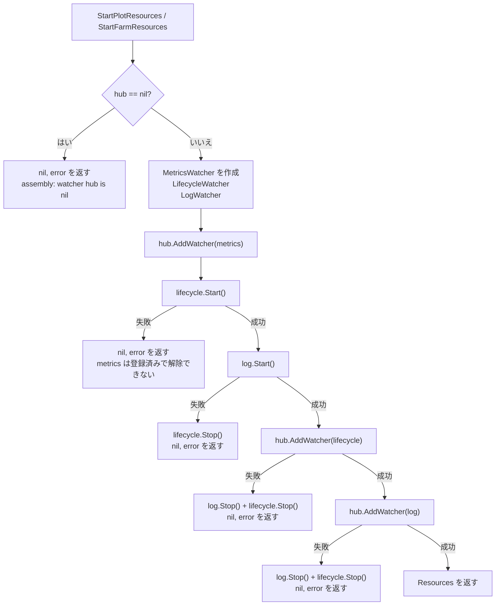
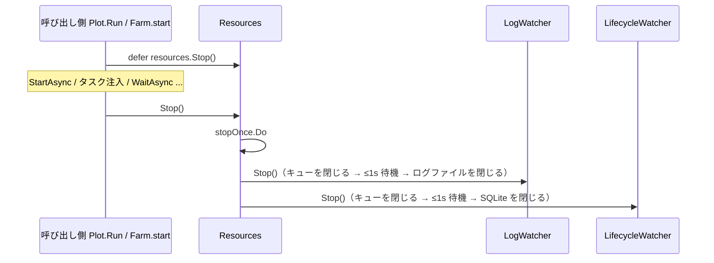
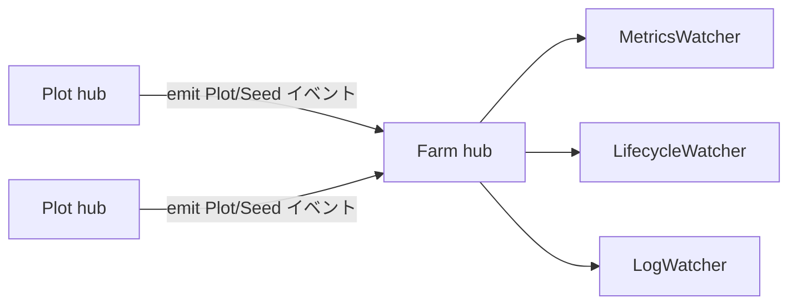

# pkg/assembly/assembly.go

> 📅 最終更新日: 2026/11/13

`pkg/assembly` は**実行期リソースの組み立て層**です。「オブザーバーインスタンスの作成、Hub への登録、消費ループの起動と停止」を `Plot` / `Farm` から切り離します。`Plot` と `Farm` 自身は `scarecrow.Hub` のみを保持し、`funnel.Spout` や `persist` オブザーバーのインスタンスを直接保持しません。

本ファイルが外部に公開するシンボルは 3 つだけです。リソースハンドル `Resources`（`Stop` メソッドを含む）、2 つの組み立てエントリ `StartPlotResources` / `StartFarmResources` で、3 つは内部フロー `startResources` を共有します。Plot レベルと Farm レベルの現在の組み立て内容は完全に同一で、2 つのエントリに分けているのは Farm 固有のリソース（リモート報告など）のための拡張ポイントを確保するためです。

## 役割

- 実行開始のたびに、指標（`scarecrow.MetricsWatcher`）、ライフサイクル（`persist.LifecycleWatcher`）、ログ（`persist.LogWatcher`）の 3 種類のオブザーバーを作成します。
- 固定の順序でオブザーバーの消費ループを起動し、呼び出し側から渡された `*scarecrow.Hub` に登録します。以降、イベントは Hub が一元配信します。
- 返却された `*Resources` を通じて、実行終了時にオブザーバーを停止し、フラッシュしてファイル / SQLite ハンドルを解放します。
- 起動に失敗した場合は、起動済みのリソースをロールバックし、「起動したが回収されない」消費コルーチンが残らないようにします。

## 中核オブジェクト

### `Resources`

```go
type Resources struct {
	lifecycle *persist.LifecycleWatcher
	log       *persist.LogWatcher
	stopOnce  sync.Once
}
```

| フィールド | 意味 |
|------|------|
| `lifecycle` | ライフサイクルオブザーバー。イベントを `seed` / `ripen` / `wither` / `prune` のレコードに変換し、非同期で SQLite に書き込みます |
| `log` | ログオブザーバー。イベントをテキスト行に変換し、非同期で `logs/grow_log(<日期>).log` に書き込みます。Plot 終了ログの計数は `MetricsWatcher` のスナップショットから直接取得します |
| `stopOnce` | `Stop` によるリソース回収が 1 回だけ実行されることを保証します |

3 つのフィールドはいずれも非公開で、外部からは `Stop` による回収のみ可能で、個々のオブザーバーを直接操作することはできません。データベースパスなどの観測情報が必要な場合は、`scarecrow.Find` を通じて Hub から対応するオブザーバーを探してください（後述の「組み立て済みリソースの観測」を参照）。

#### `Stop()`

```go
func (r *Resources) Stop()
```

今回の実行で起動したリソースを停止して回収します。

1. `stopOnce.Do(...)` により、重複呼び出しでも 1 回だけ実行されます。
2. 先に `r.log.Stop()`、次に `r.lifecycle.Stop()`（起動順と逆）。
3. 2 つの `Stop` が返す error は明示的に破棄されます（`_ =`）。

`persist` の `Stop` は最終的に `funnel.Spout.Stop` に到達します。キューチャネルを閉じ、最大 1 秒待って消費コルーチンに残りのレコードを処理させ、その後 handler の `AfterStop` を呼び出してファイル / SQLite 接続を閉じます。そのため `Resources.Stop` は**フラッシュ**の責務も担います。

> `Stop` には nil レシーバの保護がありません。`Resources` が nil のときに呼び出すと panic します。起動に失敗した場合、2 つのエントリは `(nil, err)` を返すため、呼び出し側は必ずエラーを判定してから `defer resources.Stop()` してください。

### 組み立てエントリ

| 関数 | シグネチャ | 呼び出し元 |
|------|------|--------|
| `StartPlotResources` | `func StartPlotResources(hub *scarecrow.Hub, logLevel string) (*Resources, error)` | standalone モードの `basePlot.Run`（`pkg/plot/plot.go`） |
| `StartFarmResources` | `func StartFarmResources(hub *scarecrow.Hub, logLevel string) (*Resources, error)` | `Farm.start`（`pkg/farm/farm.go`）、つまり `Farm.Run` / `Farm.Start` の共通フロー |

現時点ではどちらも `startResources` への転送のみです。

```go
func StartPlotResources(hub *scarecrow.Hub, logLevel string) (*Resources, error) {
	return startResources(hub, logLevel)
}

func StartFarmResources(hub *scarecrow.Hub, logLevel string) (*Resources, error) {
	return startResources(hub, logLevel)
}
```

`logLevel` はそのまま `persist.NewLogWatcher` に渡されます。値は `TRACE` / `DEBUG` / `SUCCESS` / `INFO` / `WARNING` / `ERROR` / `CRITICAL` で、空文字列または認識できないレベルは `INFO` として扱われます。

### 内部フロー `startResources`

```go
func startResources(hub *scarecrow.Hub, logLevel string) (*Resources, error)
```

組み立ての完全な手順：

1. `hub == nil` → 直ちに `nil, fmt.Errorf("assembly: watcher hub is nil")` を返す；
2. `scarecrow.NewMetricsWatcher()` を作成；
3. `persist.NewLifecycleWatcher()` を作成；
4. `persist.NewLogWatcher(metricsWatcher, logLevel)` を作成。ログオブザーバーは指標オブザーバーに依存し、`PlotEndEvent` のときに成熟 / 枯死 / 剪定の計数を読み取ります；
5. `hub.AddWatcher(metricsWatcher)`。指標オブザーバーを**最初に**登録します（消費ループがなく、Hub の外部で起動する必要もありません）；
6. `lifecycleWatcher.Start()`；
7. `logWatcher.Start()`；
8. `hub.AddWatcher(lifecycleWatcher)`；
9. `hub.AddWatcher(logWatcher)`；
10. `&Resources{lifecycle: lifecycleWatcher, log: logWatcher}` を返す。

3 種類のオブザーバーの違い：

| オブザーバー | 構築 | 消費ループの有無 | Hub への登録 | `Start` の要否 |
|--------|------|:--------------:|:--------------:|:------------:|
| `*scarecrow.MetricsWatcher` | `scarecrow.NewMetricsWatcher()` | いいえ（純粋なメモリ内集計） | はい | いいえ |
| `*persist.LifecycleWatcher` | `persist.NewLifecycleWatcher()` | はい（`funnel.Spout`、バッファ 100、タイムアウト 1s） | はい | はい |
| `*persist.LogWatcher` | `persist.NewLogWatcher(metrics, logLevel)` | はい（同上） | はい | はい |

> `Resources` は後者の 2 つのみを保持します。指標オブザーバーには回収すべきリソースがないため `Resources` には含まれず、`Stop` の対象にもなりません。

## 主要なフロー

### 起動と登録のタイミング



要点：

- **先に起動、後に登録**：`lifecycle` / `log` はいずれも消費ループを先に走らせてから Hub のオブザーバーリストに入ります。これにより登録が成功した瞬間から、イベントには必ず消費者が存在し、「イベントは配信されたがキューに消費者がいない」という窓が生じません。
- **登録順序が配信順序**：Hub は登録順にイベントを同期的に転送するため、イベント処理の順序は `metrics → lifecycle → log` に固定されます。指標が先に更新されるため、ログが `PlotEnd` の要約を書くときに今回の実行の最終計数を読み取れます。
- **指標を最初に登録**：`MetricsWatcher` には `Start` の手順がなく、コードは他のオブザーバーを起動する前にこれを Hub へ登録します。

### 失敗時のロールバック

| 失敗点 | 返されるエラー | 実行済みのクリーンアップ | Hub の残留 |
|--------|----------|--------------|----------|
| `hub == nil` | `assembly: watcher hub is nil` | なし（まだ何も作成していない） | なし |
| `lifecycleWatcher.Start()` | `assembly: start lifecycle watcher: %w` | なし | `metrics` は登録済み |
| `logWatcher.Start()` | `assembly: start log watcher: %w` | `lifecycle.Stop()` | `metrics` は登録済み |
| `hub.AddWatcher(lifecycleWatcher)` | Hub のエラーをそのまま返す | `log.Stop()` + `lifecycle.Stop()` | `metrics` は登録済み |
| `hub.AddWatcher(logWatcher)` | Hub のエラーをそのまま返す | `log.Stop()` + `lifecycle.Stop()` | `metrics`、`lifecycle` はともに登録済み |

> ロールバックは起動済みのオブザーバーを「停止」することしかできず、**Hub から登録解除することはできません**。`scarecrow.Hub` には削除インターフェースがないためです。そのため組み立てに失敗すると、Hub に指標オブザーバー（および登録済みのライフサイクルオブザーバー）が残留する可能性があります。通常の使い方では Hub は実行ごとに新規作成される（`newBasePlot` / `NewFarm` がそれぞれ作成）ため、残留が実行をまたいで蓄積することはありません。ただし同じ Hub で組み立てエントリを繰り返し呼び出すと、オブザーバーが重なります。

`lifecycle.Start()` の失敗は通常 `lifecycles/<日期>/` ディレクトリの作成または SQLite のオープン失敗に由来し、`log.Start()` の失敗は通常 `logs/` ディレクトリの作成またはログファイルのオープン失敗に由来します（いずれも**プロセスの作業ディレクトリ**からの相対パスです）。

### 停止のタイミング



- 停止順序は起動順序と逆で、先にログ、後にライフサイクルです。
- 各 `Spout.Stop` はチャネルを閉じた後、最大 `1s` 待って残りのレコードを消費し、正常な経路ではバッファをフラッシュし切ります。
- 2 つの `Stop` のエラーは破棄されるため、呼び出し側は `Resources.Stop` から「フラッシュのタイムアウト」や「ファイルのクローズ失敗」を知ることはできません。

## 重要な詳細

### Plot / Farm との呼び出し関係

2 つのエントリは業務コードが手動で呼ぶ通常の API ではなく、実行フレームワークの内部的な組み立てポイントです。

| 呼び出し元 | コード位置 | 動作 |
|--------|----------|------|
| `basePlot.Run(seeds, logLevel)` | `pkg/plot/plot.go` | `StartPlotResources(p.hub, logLevel)`。失敗時は**静かに戻る**（`Run` に戻り値がない）。成功時は `defer resources.Stop()` の後、`StartAsync` → 1 つずつ `Seed` → `Seal` → `WaitAsync` |
| `Farm.start(logLevel, prepare)` | `pkg/farm/farm.go` | `StartFarmResources(f.hub, logLevel)`。失敗時は error を `Farm.Run` / `Farm.Start` に返す。成功時は `defer resources.Stop()` の後、`FarmStartEvent` を発行し、`f.hub` を各 Plot の Hub に登録し、すべての Plot を `StartAsync` し、最後に 1 つずつ `WaitAsync` |

したがって：

- **standalone**：オブザーバーは Plot 自身の Hub に登録され、イベントは `basePlot.emit` が直接配信します。
- **Farm モード**：オブザーバーは Farm の Hub に登録され、`Farm.start` が `plot.AddWatcher(f.hub)` を通じて Farm Hub をオブザーバーとして各 Plot の Hub に接続します。Plot イベントはネストした Hub を経由して Farm レベルのオブザーバーへ転送されます。`scarecrow.Find` はネストした Hub を再帰的に検索するため、`Harvest` は Plot の Hub から Farm Hub に登録された `LifecycleWatcher` を見つけられます。



### 組み立て済みリソースの観測

`Resources` は内部オブザーバーを公開しないため、実行終了後は通常次のように結果を取得します。

```go
lifecycle, ok := scarecrow.Find[*persist.LifecycleWatcher](hub)
if !ok {
	// 未装配或已被替换
	return
}
dbPath := lifecycle.DBPath() // Start 之前为空字符串；Start 后指向本次运行的 .sqlite3
records, err := persist.LoadLifecycleStatusesFromPath(dbPath, "plot-name")
```

`lifecycle.DBPath()` は handler 内の `SQLitePath` を直接読み取ります。このフィールドは `LifecycleRecordHandler.BeforeStart`（つまり `Start`）で初めて値が設定されます。ログファイルのパスには対応する照会インターフェースがなく、位置は作業ディレクトリ下の `logs/grow_log(<YYYY-MM-DD>).log` に固定されています。

### Hub の登録制約

- `Hub.AddWatcher` は `nil` オブザーバーを拒否します。
- オブザーバーが `*Hub` の場合は環検出を行います。本パッケージが登録する 3 つのオブザーバーはいずれも `*Hub` ではないため、現在の実装では 2 箇所の `AddWatcher` のエラー分岐は実際には到達不能で、防御的なコードです（将来 Hub のルールが変わったり、オブザーバーの型が置き換わったりする場合のエラーチャネルを確保しています）。
- イベントは登録順に同期的に配信され、個々のオブザーバーが返す error や panic は Hub が捕捉して `ErrorHandler` に渡すため、他のオブザーバーは中断されません。`Farm` / `Plot` の `emit` は `OnEvent` の戻り値を無視します（Hub 自体も常に nil を返します）。

## 使用例

### 1 つの Hub を単独で駆動する

```go
package main

import (
	"fmt"
	"time"

	"github.com/Mr-xiaotian/CelestialGrow/pkg/assembly"
	"github.com/Mr-xiaotian/CelestialGrow/pkg/persist"
	"github.com/Mr-xiaotian/CelestialGrow/pkg/scarecrow"
)

func main() {
	hub := scarecrow.NewHub(scarecrow.WithErrorHandler(func(err error) {
		fmt.Println("watcher error:", err)
	}))

	resources, err := assembly.StartFarmResources(hub, "DEBUG")
	if err != nil {
		panic(err)
	}
	defer resources.Stop() // 保证刷盘与句柄回收

	// 模拟一次种子输入事件；真实场景由 Plot/Farm 的 emit 产生。
	if err := hub.OnEvent(scarecrow.SeedInputEvent{
		Plot:     "demo",
		Seed:     42,
		SeedRepr: "42",
		SeedID:   1,
		Time:     time.Now(),
	}); err != nil {
		panic(err)
	}

	// 重复调用安全：stopOnce 只执行一次回收。
	resources.Stop()
	resources.Stop()

	lifecycle, ok := scarecrow.Find[*persist.LifecycleWatcher](hub)
	if !ok {
		panic("lifecycle watcher is not registered")
	}

	records, err := persist.LoadLifecycleStatusesFromPath(lifecycle.DBPath(), "demo")
	if err != nil {
		panic(err)
	}
	for _, record := range records {
		fmt.Printf("plot=%s status=%s seed=%s\n", record.Plot, record.Status, record.SeedJSON)
	}
}
```

実行後、作業ディレクトリに `logs/grow_log(<日期>).log` と `lifecycles/<日期>/grow_lifecycle(<时间>).sqlite3` が生成されます。

### Plot / Farm 経由で間接的に使用する

業務コードは本パッケージを直接呼び出す必要はありません。

```go
package main

import (
	"fmt"

	"github.com/Mr-xiaotian/CelestialGrow/pkg/farm"
	"github.com/Mr-xiaotian/CelestialGrow/pkg/plot"
)

func double(seed int) (int, error) { return seed * 2, nil }

func main() {
	// standalone：内部会 StartPlotResources 并 defer Stop。
	p := plot.NewSinglePlot("double", double)
	p.Run([]int{1, 2, 3}, "INFO")

	// Farm：内部会 StartFarmResources 并 defer Stop。
	f := farm.NewFarm("demo")
	if err := f.AddPlot(plot.NewSinglePlot("double", double)); err != nil {
		panic(err)
	}
	if err := f.Run(map[string][]any{"double": {1, 2, 3}}, "INFO"); err != nil {
		panic(err)
	}

	fmt.Println("done")
}
```

> `basePlot.Run` と `Farm.Run` / `Farm.Start` は、いずれも戻る前に組み立て済みリソースを停止するため、呼び出し側が結果を受け取る時点でログと SQLite はすでにフラッシュされています。

## 注意事項

- **必ず `defer resources.Stop()` する**：`Spout` のキューにはバッファがあり、`Stop` を呼ばないとキュー内のログ / ライフサイクルレコードが失われ、ログファイルと SQLite 接続もリークします。
- **`Stop` は生産側の停止後に呼ぶ**：`Spout.Stop` はキューチャネルを閉じます。まだキューへ `Send` するコルーチンがあると panic（`send on closed channel`）します。`Plot.Run` / `Farm.start` はどちらも `defer resources.Stop()` を `WaitAsync` がすべて完了した後に発火するよう配置しており、まさにこれを保証しています。
- **起動失敗時は `(nil, err)` を返す**ため、nil に対して `Stop` を呼ばないでください。standalone の `basePlot.Run` はそのエラーを静かに飲み込みます（戻り値がない）。「Plot に何も出力がない」と調査する場合は、まず作業ディレクトリが書き込み可能か、SQLite を開けるかを確認してください。
- **`Stop` は冪等だが再利用不可**：内部オブザーバーはすでに閉じているため、`Resources` を新しい実行に再度渡すことはできません。再実行が必要な場合は組み立てエントリを改めて呼び出してください。
- **同じ Hub で繰り返し組み立てるとオブザーバーが重なる**：Hub には登録解除インターフェースがないため、同じ Plot / Farm を繰り返し `Run` すると、ログとライフサイクルレコードが重複して書き込まれます（複数の watcher が同じイベントを同時に消費します）。
- **組み立て失敗時は指標オブザーバーが残留することがある**：`lifecycle.Start` などの早期失敗では、登録済みの `MetricsWatcher` は削除されません。前述の「失敗時のロールバック」を参照してください。
- **ログレベルは大文字小文字を区別する**：大文字の列挙値のみを認識し、小文字の `debug` は未知のレベルとして `INFO` にフォールバックします。
- **出力パスは作業ディレクトリからの相対パス**：`logs/` と `lifecycles/` はどちらもプロセスの現在の作業ディレクトリを基準に作成され、バイナリの置かれたディレクトリとは無関係です。作業ディレクトリが異なれば書き込み先も変わります。
