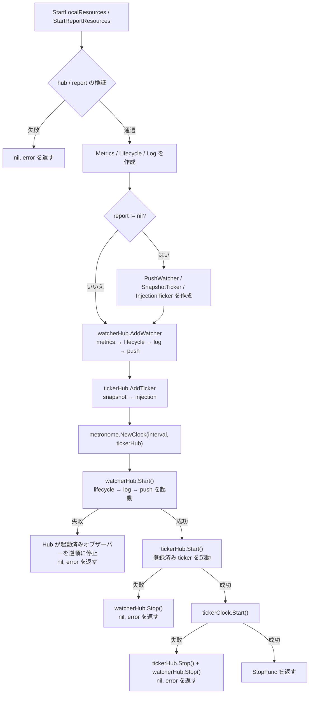
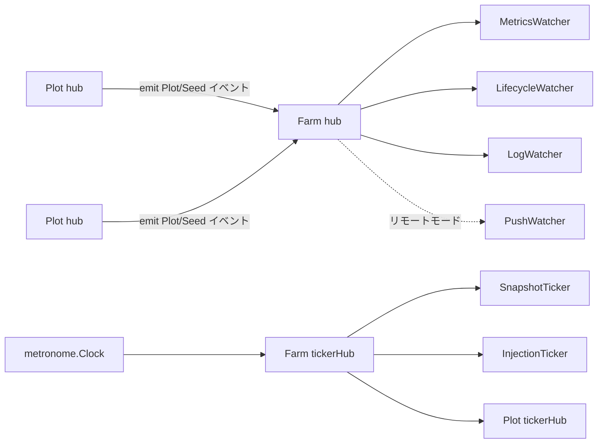

# pkg/assembly/assembly.go

> 📅 最終更新日: 2026/11/26

`pkg/assembly` は**実行期リソースの組み立て層**です。「オブザーバーインスタンスの作成、Hub への登録、消費ループとティッククロックの起動 / 停止」を `Plot` / `Farm` から切り離します。`Plot` と `Farm` 自身は `scarecrow.Hub` と `metronome.Hub` のみを保持し、`funnel.Spout`、永続化オブザーバーのインスタンス、クロックを直接保持しません。

本ファイルが外部に公開するシンボルは 3 つだけです：

| シンボル | 分類 | 用途 |
|------|------|------|
| `StopFunc` | 型 | リソース回収関数 `func() error` |
| `StartLocalResources` | 関数 | 純粋なローカル実行のためにオブザーバー、ティック Hub、ティッククロックを組み立てます |
| `StartReportResources` | 関数 | ローカルリソースに加えて、リモートプッシュとリモート注入ポーリングを追加します |

両者は内部フロー `startResources` を共有します。

## 役割

- 実行開始のたびに、指標（`scarecrow.MetricsWatcher`）、ライフサイクル（`persist.LifecycleWatcher`）、ログ（`persist.LogWatcher`）の 3 種類のオブザーバーを作成します。
- リモート報告モードでは、追加でプッシュオブザーバー `reporter.PushWatcher`、定期スナップショット `reporter.SnapshotTicker`、リモート注入 `reporter.InjectionTicker` を作成します。
- 固定の順序でオブザーバー、ticker、クロックを登録して起動します。イベントは `scarecrow.Hub` が一元配信し、周期タスクは `metronome.Hub` が一元スケジューリングします。
- 冪等な `StopFunc` を返し、実行終了時に起動と逆の順序でクロック、ticker、オブザーバーを停止し、フラッシュをトリガーしてファイル / SQLite / HTTP 接続を解放します。
- 起動に失敗した場合は起動済みのリソースをロールバックし、元のエラーを呼び出し側へ返します。

## 中核オブジェクト

### `StopFunc`

```go
type StopFunc func() error
```

`StartLocalResources` / `StartReportResources` が成功時に返す回収ハンドルです。呼び出すとティッククロック、ticker Hub、オブザーバー Hub の順に停止し、集約したエラーを返します。重複して呼び出すと直接 `nil` を返します。

### `StartLocalResources`

```go
func StartLocalResources(
    watcherHub *scarecrow.Hub,
    tickerHub *metronome.Hub,
    logLevel string,
    interval time.Duration,
) (StopFunc, error)
```

standalone Plot（`basePlot.Run`）またはローカル Farm 実行のために組み立てます：

1. `MetricsWatcher`、`LifecycleWatcher`、`LogWatcher` を作成する；
2. `metrics → lifecycle → log` の順で `watcherHub` に登録する；
3. ティッククロックを作成して起動し、ルート ticker を `tickerHub` とする；
4. `StopFunc` を返す。

`logLevel` はそのまま `persist.NewLogWatcher` に渡されます。値は `TRACE` / `DEBUG` / `SUCCESS` / `INFO` / `WARNING` / `ERROR` / `CRITICAL` で、空文字列または認識できないレベルは `INFO` として扱われます。`interval` はティッククロックの基本周期で、正の値でなければなりません。`Farm` と `Plot` はいずれも `metronome.DefaultInterval`（1 秒）を渡します。

### `StartReportResources`

```go
func StartReportResources(
    watcherHub *scarecrow.Hub,
    tickerHub *metronome.Hub,
    injectionTarget reporter.InjectionTarget,
    logLevel string,
    interval time.Duration,
    report *reporter.Config,
) (StopFunc, error)
```

ローカルリソースに加えて、リモート機能を追加で組み立てます：

- `report == nil` → `assembly: report config is nil`；
- `injectionTarget == nil` → `assembly: injection target is nil`；
- `report.SessionID` / `report.URL` と同じ `MetricsWatcher` で `*reporter.PushWatcher` を作成します（`reporter.Config.SessionID` は空にできません。`URL` は非空の http/https アドレスでなければなりません）；
- `report.SnapshotPeriod` で `*reporter.SnapshotTicker` を作成し、周期が `0` の場合は `reporter.DefaultSnapshotPeriod`（1 ティック）を使用します；
- `report.InjectionPeriod` で `*reporter.InjectionTicker` を作成し、周期が `0` の場合は `reporter.DefaultInjectionPeriod`（5 ティック）を使用し、ポーリングのタイムアウトには `0` を渡します（`reporter.DefaultPullTimeout`、3 秒を使用）；
- プッシュオブザーバーはオブザーバーリストの末尾に追加され、スナップショットと注入 ticker は順に `tickerHub` に登録されます。

`reporter.InjectionTarget` は 2 つのメソッドだけを持つインターフェースで、`*farm.Farm` が直接実装しています：

```go
type InjectionTarget interface {
    InjectTasks(tasks map[string][]any) error
    InjectTerminations(nodes []string) error
}
```

`*reporter.Config`（`pkg/api` では `Report` エイリアスとしてエクスポート）のフィールド：

| フィールド | 型 | 意味 |
|------|------|------|
| `URL` | `string` | 報告サービスのベースアドレス。末尾の `/` は正規化されて除去されます。http/https でなければなりません |
| `SessionID` | `string` | セッション識別子。組み立てエントリは非空を要求します（`Farm` は実行前に補完します） |
| `SnapshotPeriod` | `int` | 状態スナップショットのティック周期。`0` の場合は既定値 1 |
| `InjectionPeriod` | `int` | 注入ポーリングのティック周期。`0` の場合は既定値 5 |

リモートモードでのデータフロー：

| コンポーネント | トリガー | 動作 |
|------|------|------|
| `PushWatcher` | `FarmStartEvent` | グラフのメタ情報を `/api/push_graph_meta` へプッシュ |
| `PushWatcher` | `SeedWitherEvent` | 失敗したタスク 1 件を `/api/push_error` へプッシュ |
| `PushWatcher` | `FarmEndEvent` | まず終態スナップショットを 1 回補完プッシュして `/api/push_snapshot` へ送り、その後セッションのオフラインを `/api/shutdown_session` へプッシュ |
| `SnapshotTicker` | `SnapshotPeriod` ティックごと | `MetricsView.GetPlots()` からグラフ全体の状態を読み取り、`PushWatcher.PushSnapshot` に渡す |
| `InjectionTicker` | `InjectionPeriod` ティックごと | `GET /api/pull_injection?session_id=...` を実行し、返された tasks / terminations を `InjectionTarget` に渡す |

### 内部フロー `startResources`

```go
func startResources(
    watcherHub *scarecrow.Hub,
    tickerHub *metronome.Hub,
    injectionTarget reporter.InjectionTarget,
    logLevel string,
    interval time.Duration,
    report *reporter.Config,
) (StopFunc, error)
```

完全な手順：

1. `watcherHub == nil` → `assembly: watcher hub is nil`；`tickerHub == nil` → `assembly: ticker hub is nil`；
2. `scarecrow.NewMetricsWatcher()`、`persist.NewLifecycleWatcher()`、`persist.NewLogWatcher(metricsWatcher, logLevel)` を作成する；
3. `report != nil` のとき `PushWatcher`、`SnapshotTicker`、`InjectionTicker` を作成し、`PushWatcher` をオブザーバーリストに追加する；
4. 順に `watcherHub.AddWatcher(...)`：`metrics → lifecycle → log → push`；
5. 順に `tickerHub.AddTicker(...)`：`snapshotTicker → injectionTicker`；
6. `metronome.NewClock(interval, tickerHub)`；
7. `watcherHub.Start()`：登録順に `scarecrow.Lifecycle` を実装するオブザーバーを起動します。つまり `lifecycle → log → push` です（指標オブザーバーにはライフサイクルがないためスキップされます）；
8. `tickerHub.Start()`：登録順に `metronome.Lifecycle` を実装する ticker を起動します。本パッケージが登録する ticker のうちこのインターフェースを実装するのは `InjectionTicker` だけです（`SnapshotTicker` は `OnTick` / `TickPeriod` のみ）。Farm のシナリオでは ticker Hub に各 Plot の ticker Hub も事前登録されており、これらも `Hub.Start` によって再帰的に起動されます；
9. `tickerClock.Start()`：バックグラウンドのティック goroutine を起動し、1 ティック目から `tickerHub` を駆動します；
10. `stop` クロージャを返す。

> 起動順序の要点は**先に登録し、後で一括起動する**ことです。すべてのオブザーバーと ticker はまず Hub に入り、その後 Hub の `Start` が登録順に起動します。これにより、起動失敗時は Hub 自身が起動済みの項目を逆順にロールバックし、組み立て層はより外側のクロックと ticker Hub だけをロールバックすれば済みます。

ローカルとリモートのオブザーバーの違い：

| オブザーバー | 構築 | 消費ループの有無 | Hub への登録 | `Start` の要否 |
|--------|------|:--------------:|:----------:|:------------:|
| `*scarecrow.MetricsWatcher` | `scarecrow.NewMetricsWatcher()` | いいえ（純粋なメモリ内集計） | はい | いいえ |
| `*persist.LifecycleWatcher` | `persist.NewLifecycleWatcher()` | はい（`funnel.Spout`、バッファ 100、タイムアウト 1s） | はい | はい（`watcherHub.Start` が呼び出します） |
| `*persist.LogWatcher` | `persist.NewLogWatcher(metrics, logLevel)` | はい（同上） | はい | はい（`watcherHub.Start` が呼び出します） |
| `*reporter.PushWatcher` | `reporter.NewPushWatcher(...)` | はい（`funnel.Spout`、バッファ 64、Stop タイムアウト 3s；エンキュー タイムアウト 500ms） | はい（リモートモードのみ） | はい（`watcherHub.Start` が呼び出します） |

### 停止のタイミング

`StopFunc` は内部で `stopped` ブール値により冪等保護を行い、順序は固定です：

```text
StopFunc()
  ├─ stopped 已为 true → 直接返回 nil
  ├─ tickerClock.Stop()     // 停止节拍 goroutine；最多等待 5s
  ├─ tickerHub.Stop()       // 逆序停止 ticker（InjectionTicker.Stop）
  └─ watcherHub.Stop()      // 逆序停止观察者（push → log → lifecycle）
```

- 停止順序は起動順序と逆で、ログ / 永続化チャネルが閉じる前に新しい周期タスクが入らないことを保証します。
- 各 `Spout.Stop` はキューを閉じた後、各自のタイムアウトまで最大で待って排出します。ライフサイクル / ログは 1 秒、プッシュは 3 秒です。その後 handler の `AfterStop` を呼び出してファイル / SQLite / HTTP 接続を閉じます。したがって `StopFunc` は**フラッシュ**の責務も担います。
- エラーの集約方法：最初のエラーはそのまま保存し、以降のエラーは `fmt.Errorf("%w; %w", ...)` で追加し、最終的なエラーテキストは各段を `; ` で連結します。最初の呼び出しがエラーを返した場合、`stopped` はすでに true になっているため、**再度呼び出してもリトライされず**、直接 `nil` を返します。
- 冪等保護は通常のブール値であり `sync.Once` ではないため、**`StopFunc` の並行呼び出しにはデータ競合があります**。実行終了後に単一のコルーチンからのみ呼び出してください。
- `StopFunc` が `nil` のときに呼び出すと panic します。起動失敗時は `(nil, err)` が返るため、呼び出し側はまずエラーを判定しなければなりません。

## 主要なフロー

### 起動と登録のタイミング



要点：

- **登録順序が配信順序**：`scarecrow.Hub` は登録順にイベントを同期的に転送するため、イベント処理順序は `metrics → lifecycle → log → push` に固定されます。指標が先に更新されるため、ログが `PlotEnd` の要約を書くときに今回の実行の最終計数を読めます。
- **指標を最初に登録**：`MetricsWatcher` には `Start` の手順がありませんが、ログオブザーバーより先に Hub へ入らなければなりません。
- **ティッククロックは最後に起動**：すべての ticker の登録が終わってからクロックを作成して起動し、1 ティック目の喪失や半初期化状態へのヒットを避けます。

### 失敗時のロールバック

| 失敗点 | 返されるエラー | 実行済みのクリーンアップ | Hub の残留 |
|--------|----------|--------------|----------|
| `watcherHub == nil` / `tickerHub == nil` | `assembly: watcher hub is nil` / `assembly: ticker hub is nil` | なし | なし |
| `report == nil` / `injectionTarget == nil` | `assembly: report config is nil` / `assembly: injection target is nil` | なし | なし |
| reporter の構築失敗 | `reporter: ...` をそのまま返す | なし | なし（まだ未登録） |
| `AddWatcher` 失敗 | Hub のエラーをそのまま返す | なし | それ以前に登録されたオブザーバーは Hub に残るが、いずれも未起動 |
| `AddTicker` 失敗 | Hub のエラーをそのまま返す | なし | 登録済みのオブザーバーと ticker は Hub に残るが、いずれも未起動 |
| `NewClock` 失敗 | `metronome: interval must be positive, got ...` | なし | オブザーバーと ticker は登録済みだが未起動 |
| `watcherHub.Start()` 失敗 | `scarecrow: start %T: %w`（ロールバックエラーを併合することがある） | Hub 内部で今回起動したオブザーバーを逆順に停止し、Hub は再起動不可になる | オブザーバーはリストに残るが停止済み |
| `tickerHub.Start()` 失敗 | `metronome: start %T: %w` | `watcherHub.Stop()`；`tickerHub.Start` 内部で起動済み ticker を逆順に停止済み | オブザーバーは停止済み、ticker はリストに残る |
| `tickerClock.Start()` 失敗 | `metronome: ...`（現在の `Clock.Start` は常に `nil` を返すため、この分岐は防御的コード） | `tickerHub.Stop()` + `watcherHub.Stop()` | いずれも Hub に残るが停止済み |

> ロールバックは登録済みリソースを「停止」することしかできず、**`scarecrow.Hub` からオブザーバーを登録解除することはできません**（Hub に削除インターフェースがありません）。`metronome.Hub` には `RemoveTicker` がありますが、本パッケージは使用していません。通常の使い方では Hub は実行ごとに新規作成される（`newBasePlot` / `NewFarm` がそれぞれ作成）ため、残留が実行をまたいで蓄積することはありません。同じ Hub で組み立てエントリを繰り返し呼び出すと、オブザーバーが重なります。

> 検証順序：`StartReportResources` はまず `report` / `injectionTarget` を検証し、その後 `startResources` に入って 2 つの Hub を検証します。`StartLocalResources` は直接 `startResources` に入って Hub を検証します。

`LifecycleWatcher.Start()` の失敗は通常 `lifecycles/<日期>/` ディレクトリの作成または SQLite のオープン失敗に由来し、`LogWatcher.Start()` の失敗は通常 `logs/` ディレクトリの作成またはログファイルのオープン失敗に由来します（いずれも**プロセスの作業ディレクトリ**からの相対パスです）。

## 重要な詳細

### Plot / Farm との呼び出し関係

2 つのエントリは業務コードが手動で呼ぶ通常の API ではなく、実行フレームワークの内部的な組み立てポイントです：

| 呼び出し元 | コード位置 | 動作 |
|--------|----------|------|
| `basePlot.Run(seeds, logLevel)` | `pkg/plot/plot.go` | `StartLocalResources(p.watcherHub, p.tickerHub, logLevel, metronome.DefaultInterval)`；失敗時は**静かに戻る**（`Run` に戻り値がない）。成功時は `defer stop()` の後、`StartAsync` → 1 つずつ `Seed` → `Seal` → `WaitAsync` |
| `Farm.start(logLevel, report, prepare)` | `pkg/farm/farm.go` | `report == nil` なら `StartLocalResources`、そうでなければ `StartReportResources(..., f, ...)`。失敗時は error を `Farm.Run` / `Farm.Start` に返す。成功時は `defer stop()` の後、`FarmStartEvent` を発行し、`f.watcherHub` を各 Plot の Hub に登録し、すべての Plot を `StartAsync` し、`prepare` を実行し、最後に 1 つずつ `WaitAsync` |

したがって：

- **standalone**：オブザーバーは Plot 自身の Hub に登録され、イベントは `basePlot` が直接配信します；
- **Farm モード**：オブザーバーは Farm の Hub に登録され、`Farm.start` が `plot.AddWatcher(f.watcherHub)` を通じて Farm Hub をオブザーバーとして各 Plot の Hub に接続します。Plot イベントはネストした Hub を経由して Farm レベルのオブザーバーへ転送されます。`scarecrow.Find` はネストした Hub を再帰的に検索するため、`Harvest` は Plot の Hub から Farm Hub に登録された `LifecycleWatcher` を見つけられます。
- **Farm ティック**：`Farm.start` はまず各 Plot の ticker Hub を Farm の ticker Hub に登録し（`injectTickerHubs`）、その後本パッケージが作成したクロックでティックツリー全体を駆動します。



### 組み立て済みリソースの観測

オブザーバーは戻り値として公開されないため、実行終了後は通常 Hub から取得します：

```go
lifecycle, ok := scarecrow.Find[*persist.LifecycleWatcher](hub)
if !ok {
    // 未装配或已被替换
    return
}
dbPath := lifecycle.DBPath() // Start 之前为空字符串；Start 后指向本次运行的 .sqlite3
records, err := persist.LoadLifecycleStatusesFromPath(dbPath, "plot-name")
```

リモートモードでは同様に ticker が正常に組み立てられたかを確認できます：

```go
snapshot, ok := metronome.Find[*reporter.SnapshotTicker](tickerHub)
injection, ok := metronome.Find[*reporter.InjectionTicker](tickerHub)
_, _ = snapshot, injection
```

`lifecycle.DBPath()` は handler 内の `SQLitePath` を直接読み取ります。このフィールドは `LifecycleRecordHandler.BeforeStart`（つまり `Start`）で初めて値が設定されます。ログファイルのパスには対応する照会インターフェースがなく、位置は作業ディレクトリ下の `logs/grow_log(<YYYY-MM-DD>).log` に固定されています。

### Hub の登録制約

- `scarecrow.Hub.AddWatcher` は `nil` オブザーバーを拒否し、`*Hub` に対して環検出を行います；
- `metronome.Hub.AddTicker` は `nil` ticker、重複登録、不正なティック周期、Hub の環を拒否します；
- イベント / ティックはいずれも登録順に同期的に配信され、個々のオブザーバーまたは ticker が返す error / panic はそれぞれの Hub が捕捉してエラーハンドラに渡すため、他の項目は中断されません。

## 使用例

### ローカル実行：単一の Hub を独立して駆動する

```go
package main

import (
    "fmt"
    "time"

    "github.com/Mr-xiaotian/CelestialGrow/pkg/assembly"
    "github.com/Mr-xiaotian/CelestialGrow/pkg/metronome"
    "github.com/Mr-xiaotian/CelestialGrow/pkg/persist"
    "github.com/Mr-xiaotian/CelestialGrow/pkg/scarecrow"
)

func main() {
    hub := scarecrow.NewHub(scarecrow.WithErrorHandler(func(err error) {
        fmt.Println("watcher error:", err)
    }))
    tickerHub, err := metronome.NewHub(metronome.WithErrorHandler(func(err error) {
        fmt.Println("ticker error:", err)
    }))
    if err != nil {
        panic(err)
    }

    stop, err := assembly.StartLocalResources(hub, tickerHub, "DEBUG", metronome.DefaultInterval)
    if err != nil {
        panic(err)
    }
    defer stop() // 保证刷盘与句柄回收

    // 模拟一次种子输入事件；真实场景由 Plot/Farm 的 emit 产生。
    if err := hub.OnEvent(scarecrow.SeedInputEvent{
        Plot:     "demo",
        Seed:     42,
        SeedRepr: "42",
        SeedID:   1,
        Time:     time.Now(),
    }); err != nil {
        panic(err)
    }

    // 重复调用安全：stopped 保护只执行一次回收。
    _ = stop()
    _ = stop()

    lifecycle, ok := scarecrow.Find[*persist.LifecycleWatcher](hub)
    if !ok {
        panic("lifecycle watcher is not registered")
    }

    records, err := persist.LoadLifecycleStatusesFromPath(lifecycle.DBPath(), "demo")
    if err != nil {
        panic(err)
    }
    for _, record := range records {
        fmt.Printf("plot=%s status=%s seed=%s\n", record.Plot, record.Status, record.SeedJSON)
    }
}
```

実行後、作業ディレクトリに `logs/grow_log(<日期>).log` と `lifecycles/<日期>/grow_lifecycle(<时间>).sqlite3` が生成されます。

### リモートモード：報告と注入の組み立て

```go
package main

import (
    "fmt"
    "time"

    "github.com/Mr-xiaotian/CelestialGrow/pkg/assembly"
    "github.com/Mr-xiaotian/CelestialGrow/pkg/metronome"
    "github.com/Mr-xiaotian/CelestialGrow/pkg/reporter"
    "github.com/Mr-xiaotian/CelestialGrow/pkg/scarecrow"
)

// injector 演示最小注入目标；实际运行时通常直接传 *farm.Farm。
type injector struct{}

func (injector) InjectTasks(map[string][]any) error { return nil }
func (injector) InjectTerminations([]string) error  { return nil }

func main() {
    hub := scarecrow.NewHub()
    tickerHub, err := metronome.NewHub()
    if err != nil {
        panic(err)
    }

    stop, err := assembly.StartReportResources(
        hub,
        tickerHub,
        injector{},
        "INFO",
        metronome.DefaultInterval,
        &reporter.Config{
            URL:             "http://127.0.0.1:8000",
            SessionID:       "demo@1",
            SnapshotPeriod:  2,
            InjectionPeriod: 5,
        },
    )
    if err != nil {
        panic(err)
    }
    defer stop()

    // 启动事件会触发一次图元信息推送（POST /api/push_graph_meta）。
    if err := hub.OnEvent(scarecrow.FarmStartEvent{
        Farm:        "demo",
        Plots:       []string{"root"},
        Edges:       map[string][]string{"root": {}},
        SourcePlots: []string{"root"},
        StartTime:   time.Now(),
    }); err != nil {
        panic(err)
    }

    if _, ok := metronome.Find[*reporter.SnapshotTicker](tickerHub); !ok {
        panic("snapshot ticker is not registered")
    }
    fmt.Println("report resources started")
}
```

### Plot / Farm 経由で間接的に使用する

業務コードは本パッケージを直接呼び出す必要はありません：

```go
package main

import (
    "fmt"

    "github.com/Mr-xiaotian/CelestialGrow/pkg/farm"
    "github.com/Mr-xiaotian/CelestialGrow/pkg/plot"
)

func double(seed int) (int, error) { return seed * 2, nil }

func main() {
    // standalone：内部会调用 StartLocalResources 并 defer stop。
    p := plot.NewSinglePlot("double", double)
    p.Run([]int{1, 2, 3}, "INFO")

    // Farm：内部会按 report 选择 StartLocalResources / StartReportResources 并 defer stop。
    f := farm.NewFarm("demo")
    if err := f.AddPlot(plot.NewSinglePlot("double", double)); err != nil {
        panic(err)
    }
    if err := f.Run(map[string][]any{"double": {1, 2, 3}}, "INFO", nil); err != nil {
        panic(err)
    }

    fmt.Println("done")
}
```

> `basePlot.Run` と `Farm.Run` / `Farm.Start` は、いずれも戻る前に組み立て済みリソースを停止するため、呼び出し側が結果を受け取る時点でログと SQLite はすでにフラッシュされています。

## 注意事項

- **必ず `StopFunc` を呼ぶ**：`Spout` のキューにはバッファがあり、回収しないとキュー内のログ / ライフサイクル / プッシュレコードが失われ、ファイル、SQLite、HTTP 接続がリークします。起動失敗時は `nil` が返るため、呼び出さないでください。
- **`StopFunc` は生産側の停止後に呼ぶ**：`Spout.Stop` はキューチャネルを閉じます。まだキューへ `Send` するコルーチンがあると panic（`send on closed channel`）します。`Plot.Run` / `Farm.start` はどちらも `defer stop()` を `WaitAsync` がすべて完了した後に発火するよう配置しており、まさにこれを保証しています。
- **`StopFunc` は冪等だが再利用不可**：内部のオブザーバーとクロックはすでに閉じているため、戻り値を新しい実行に再度渡すことはできません。再実行が必要な場合は組み立てエントリを改めて呼び出してください。最初の `Stop` が返したエラーは 2 回目の呼び出しでリトライされません。
- **同じ Hub で繰り返し組み立てるとオブザーバーが重なる**：`scarecrow.Hub` には登録解除インターフェースがないため、同じ Plot / Farm を繰り返し `Run` すると、ログとライフサイクルレコードが重複して書き込まれます。同じ `tickerHub` を再利用すると、ticker の重複登録により組み立てに失敗する可能性があります。
- **組み立て失敗時は登録済みリソースが残留することがある**：早期の失敗では登録済みのオブザーバー / ticker は削除されません。前述の「失敗時のロールバック」を参照してください。
- **ログレベルは大文字小文字を区別する**：大文字の列挙値のみを認識し、小文字の `debug` は未知のレベルとして `INFO` にフォールバックします。
- **出力パスは作業ディレクトリからの相対パス**：`logs/` と `lifecycles/` はどちらもプロセスの現在の作業ディレクトリを基準に作成され、バイナリの置かれたディレクトリとは無関係です。作業ディレクトリが異なれば書き込み先も変わります。
- **リモートモードは完全な設定を要求する**：`SessionID` が空、または `URL` が http/https でない場合、reporter の構築に失敗します。`Farm` は空の `SessionID` を自動補完するだけで、`URL` の検証 / 補完は行いません。
