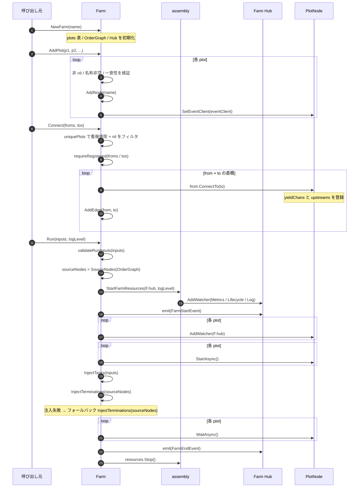
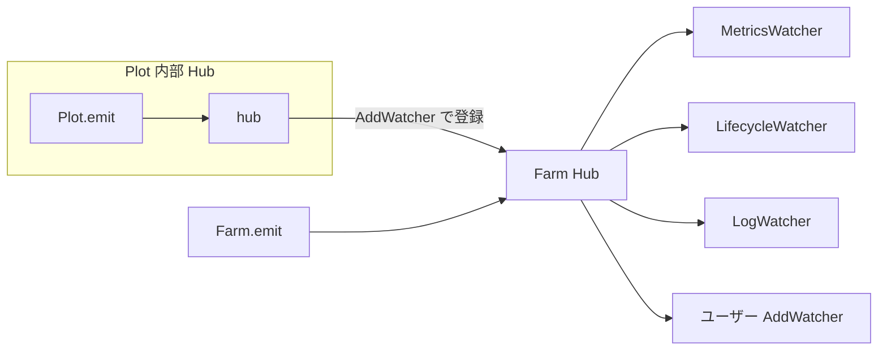

# pkg/farm/farm.go

> 📅 最終更新日: 2026/11/13

## 役割

`farm` パッケージは CelestialGrow の「グラフレベル」スケジューラであり、`farm.go` は `Farm` 型を提供する。複数の `plot.PlotNode` ノードを静的な有向グラフへ編成し、以下を担う：

- ノードの登録と名称の一意性検証
- グループ間（ハイパーエッジ）方式の全結合の確立
- Farm レベルのオブザーバー登録。**階層 Hub** を通じて Farm イベントとすべての Plot イベントを同時に受信する
- 実行時のリソース組み立て（`assembly.StartFarmResources` がログとライフサイクルオブザーバーの作成 / 起動 / 回収を一元化）
- 実行前のグラフ構造レンダリング（`getStructureList` → `RenderStructureList`）を `FarmStartEvent` へ書き込む
- ソースノードの検出（`SourceNodes`）、初期種子の注入、終了シグナルの注入と終了待機

`Farm` はオーケストレーション層のみを管理し、Plot のジェネリックな種子 / 果実の型には関与しない——これは `plot.PlotNode` インターフェースが消去している。グラフアルゴリズム自体は同じディレクトリの `graph.go` に、構造レンダリングは `render.go` にあり、詳細は [`graph.md`](./graph.md) と [`render.md`](./render.md) を参照。

## 中核オブジェクト

### `Farm` 構造体

```go
type Farm struct {
    name        string
    plots       map[string]plot.PlotNode
    sourceNodes []string
    *OrderGraph

    eventClient runtime.EventClient
    hub         *scarecrow.Hub
}
```

| フィールド | 役割 |
| --- | --- |
| `name` | Farm 名。`FarmStartEvent` / `FarmEndEvent` とログに書き込まれる |
| `plots` | plot 名で索引されるノード表。登録検証と検索に用いる |
| `sourceNodes` | `Run` / `Start` 開始時に一度だけ計算される「ソースノード代表」。各 Source SCC から 1 つ取る |
| `*OrderGraph` | 埋め込まれた有向グラフ。plot 間のエッジを記録し、トポロジーと SCC 分析に用いる |
| `eventClient` | 共有されるランタイムイベントクライアント。`AddPlot` によって各 plot に注入される |
| `hub` | Farm レベルのオブザーバー Hub。各 Plot に登録されるネスト Hub でもある |

> `Farm` は spout / inlet / 永続化オブザーバーをもはや保持しない。実行時のリソースはすべて `pkg/assembly` が組み立て、Farm は 1 つの Hub だけを公開する。

### `PlotNode` インターフェース契約

`Farm` は `plot.PlotNode` インターフェースを通じて具体的なノードと疎結合になっている。このインターフェースは `pkg/plot/plot.go` に定義されており、`Farm` は実際に以下のメソッドを呼び出す：

| メソッド | 用途 |
| --- | --- |
| `GetName() string` | 一意な識別とエッジのマッチング |
| `GetState() int32` | ノード状態の読み取り（`0=idle` / `1=running` / `2=done`） |
| `GetSeedChanAny() any` | `any` として `seedChan` を公開し、上流の `ConnectTo` が型アサーションを行えるようにする |
| `ConnectTo(next PlotNode) error` | 型の互換性を検証し、下流の出力チャネルと上流名を登録する。型が一致しない場合は error を返す |
| `AddUpstream(name string)` | 上流の `ConnectTo` から呼ばれ、seal 集約のために上流名を登録する |
| `AddWatcher(listener scarecrow.Watcher) error` | オブザーバーを登録する。Farm は起動時に Farm Hub をここへ登録する |
| `SetEventClient(runtime.EventClient)` | `AddPlot` 時に同一のイベントクライアントを一括注入する |
| `StartAsync()` / `WaitAsync()` | 非同期ライフサイクル制御 |
| `SeedAny(seed any) error` | 初期種子を注入する（`InjectTasks` が 1 つずつ呼ぶ） |
| `Seal()` | 外部の終了シグナルを注入する（`InjectTerminations` が呼ぶ） |

## 公開シンボル

| シンボル | シグネチャ | 用途 |
| --- | --- | --- |
| `NewFarm` | `func NewFarm(name string) *Farm` | Farm を構築する：plot 表、空のグラフ、ローカルイベントクライアント、空の Hub を初期化する |
| `PlotCount` | `func (f *Farm) PlotCount() int` | 登録済み plot の数を返す |
| `HasPlot` | `func (f *Farm) HasPlot(name string) bool` | 指定した plot が登録済みかを判定する |
| `GetPlot` | `func (f *Farm) GetPlot(name string) (plot.PlotNode, bool)` | 名前で plot を取得する。`ok` は存在有無を表す |
| `AddPlot` | `func (f *Farm) AddPlot(plots ...plot.PlotNode) error` | 1 つ以上の plot を登録する。非 nil、名称が非空かつ一意であることを要求する |
| `Connect` | `func (f *Farm) Connect(fromPlots, toPlots []plot.PlotNode) error` | ソースグループとターゲットグループの間に直積方式の接続を確立する |
| `AddWatcher` | `func (f *Farm) AddWatcher(watcher scarecrow.Watcher) error` | Farm レベルのオブザーバーを登録する（Farm イベントと Plot イベントを同時に受信する） |
| `Run` | `func (f *Farm) Run(inputs map[string][]any, logLevel string) error` | 同期実行：起動 → 種子注入 → source の終了 → 終了待機 |
| `Start` | `func (f *Farm) Start(logLevel string) error` | 同期実行だが注入は一切行わず、外部から駆動する |
| `InjectTasks` | `func (f *Farm) InjectTasks(tasks map[string][]any) error` | 指定した Plot へ種子を注入する。実行時に呼び出せる |
| `InjectTerminations` | `func (f *Farm) InjectTerminations(nodes []string) error` | 指定した Plot へ終了シグナルを注入する。実行時に呼び出せる |

### `Run` / `Start` / `Inject*` の意味論の違い

| メソッド | Plot を起動するか | 種子を注入するか | 終了シグナルを注入するか | ブロック | 典型的なシナリオ |
| --- | :---: | :---: | :---: | :---: | --- |
| `Run(inputs, logLevel)` | ✅ | ✅ `inputs` | ✅ `sourceNodes` | はい | 一括バッチ処理 |
| `Start(logLevel)` | ✅ | ❌ | ❌ | はい | 外部駆動（reporter、対話的な注入など） |
| `InjectTasks(tasks)` | ❌ | ✅ `tasks` | ❌ | いいえ | 実行時の種子追加 |
| `InjectTerminations(nodes)` | ❌ | ❌ | ✅ `nodes` | いいえ | 実行時の指定 Plot の終了 |

- `Run` = `validateRunInputs` + `start(logLevel, prepare)` であり、`prepare` は `InjectTasks(inputs)` と `InjectTerminations(f.sourceNodes)` を順に実行する。
- `Start` は入力検証を行わず、直接 `start(logLevel, nil)` を呼ぶ；**外部から終了シグナルが注入されない限り `Start` は返らない**。
- `InjectTasks` / `InjectTerminations` は登録済みの Plot のみを操作し、リソースの組み立ても行わず、`sourceNodes` も変更しない。

> ログレベルは `NewFarm` では決まらない：`logLevel` は実行（`Run` / `Start`）ごとのパラメータであり、空文字列は `INFO` として扱われる。

## 主要フロー

### `AddPlot → Connect → Run` の全経路



### `start` の内部フロー（`Run` / `Start` 共通）

1. `startTime` を記録する。
2. `assembly.StartFarmResources(f.hub, logLevel)` が実行時リソースを組み立てる：`MetricsWatcher`、`LifecycleWatcher`、`LogWatcher` を作成し、起動後に Farm Hub へ登録する。失敗した場合は直ちに返り、Plot はまだ起動していない。
3. `defer resources.Stop()`：実行終了時に停止してフラッシュする。
4. `scarecrow.FarmStartEvent` を発射する。`Farm`、`IsDAG`、`Plots`、`Edges`、`SourcePlots`、`Structure`、`StartTime` を含む。
5. `defer` で `scarecrow.FarmEndEvent` を発射する（`Elapsed` は `time.Since(startTime)`）。
6. 各 plot について `plot.AddWatcher(f.hub)` を呼ぶ——**Farm Hub をネスト Hub として各 Plot へ登録する**。
7. 各 plot について `StartAsync()` を呼ぶ。
8. `prepare()` を呼ぶ（`Run` では注入ロジック、`Start` では `nil`）。
9. `prepare` がエラーを返した場合でも、フォールバックとして `InjectTerminations(f.sourceNodes)` を 1 回実行する（そのエラーは無視する）。終了シグナルを永遠に受け取らないグラフを待ち続けるのを避けるためである。
10. 各 plot について `WaitAsync()` を呼び、すべて終了した後に `prepareErr` を返す。

> `start` は組み立てエラーまたは注入エラーだけを返す；Plot 内部の育成失敗は `SeedWitherEvent` の形でオブザーバー体系に入り、`Run` / `Start` が error を返すことはない。

### 階層 Hub の配信



- Plot イベント（`PlotStart`、`SeedRipen` など）は Plot 自身の Hub が登録済みオブザーバーへ配信し、Farm Hub もその 1 つであるため、さらに上位へ配信される。
- Farm イベント（`FarmStartEvent` / `FarmEndEvent`）は直接 Farm Hub に入り、Plot へは**配信されない**。
- `scarecrow.Find` はネスト Hub をたどってオブザーバーを検索でき、`plot.Harvest()` はまさにこれによって Plot Hub → Farm Hub の連鎖上で `LifecycleWatcher` を見つける。
- `Hub` のコピーオンライトな意味論は実行時のオブザーバー追加を許すが、それは以降のイベントにのみ有効である；同じ Hub を重複登録すると配信が重複する。

### `sourceNodes` の計算

`Run` と `Start` は起動前にいずれも `f.sourceNodes = SourceNodes(f.OrderGraph)` を実行する：

1. `TarjanSCC` で強連結成分を求める；
2. 凝縮グラフにおいて入次数が 0 の Source SCC を計算する（`SourceSCCs`）；
3. 各 Source SCC から `scc[0]` を代表ノードとして取る（`SourceNodes`）。

これにより、source が強連結なサイクル内にあっても代表ノード 1 つにだけ終了シグナルを送り、seal の重複を避ける。孤立ノード（`AddPlot` 後もエッジがないもの）も同様に Source SCC となるため、終了シグナルが注入される。

## エラーシナリオ

### `AddPlot`

- いずれかの plot が `nil` → `plot is nil`
- 名称が空 → `plot name cannot be empty`
- 名称が重複 → `plot %q already exists`

最初のエラーで直ちに返る；それまでに正常に追加された plot は**ロールバックされない**。

### `Connect`

- 重複排除後に `fromPlots` が空 → `from plots cannot be empty`
- 重複排除後に `toPlots` が空 → `to plots cannot be empty`
- いずれかの plot が `nil` または未登録 → `plot is nil` / `plot %q is not registered in farm`
- `from.ConnectTo(to)` の型アサーションが失敗 → `plot %q yield type is incompatible with plot %q seed type` をそのまま伝播する

> ⚠️ **部分的な失敗は取り消されない**：内側のループは一度失敗すると直ちに返り、確立済みの接続（`yieldChans`、`upstreams`、グラフのエッジ）は残る。再度 `Connect` するとグラフ層では重複エッジとして無視されるが、Plot 内部のマッピングには古い状態が残る。

### `AddWatcher`

- `watcher` が `nil` → `scarecrow: cannot add nil listener`
- Hub の循環を形成 → `scarecrow: cyclic hub registration rejected: ...` / `scarecrow: cannot add a hub to itself`

### `Run`

| 段階 | エラー発生源 | 説明 |
| --- | --- | --- |
| 検証 | `validateRunInputs` | `inputs` に未登録の plot が存在 → `plot %q is not registered in farm`。この時点で**Plot は 1 つも起動していない** |
| 組み立て | `assembly.StartFarmResources` | Hub が nil、watcher の起動失敗など；Plot はまだ起動していない |
| 登録 | `plot.AddWatcher(f.hub)` | Hub の循環または nil のオブザーバー；`StartAsync` の前に返る |
| 注入 | `InjectTasks` | 未登録 plot、`SeedAny` の型アサーション失敗（`plot %q seed type mismatch: got %T`） |
| 注入 | `InjectTerminations` | 未登録 plot |
| 待機 | `WaitAsync` | エラーを返さない |

### `InjectTasks`

- まずすべての key に対して `validateRunInputs` を行う：いずれかのターゲットが未登録 → エラーを返し、**種子は 1 つも注入しない**。
- その後 map のイテレーション順に 1 つずつ `SeedAny` する；途中で型が一致しないものがあれば直ちに返り、それまでに注入した種子は**取り消せない**。

### `InjectTerminations`

- まずすべての名称が登録済みであることを検証する；いずれかが未登録 → エラーを返し、**終了シグナルは 1 つも注入しない**。
- 検証が通れば 1 つずつ `Seal()` を呼び、外部の終了シグナル（`Source == "__input__"`）を注入する。強い終了の意味論を持ち、まだ到達していない上流の seal を待たない。
- ある Plot へ終了シグナルを注入した後、その Plot へ種子を注入しても処理されない。

## 重要な詳細

### グループ間の直積

`Connect(froms, tos)` はまず両端に対して `uniquePlots`（重複排除 + `nil` のフィルタリング）を行い、その後 `len(froms) × len(tos)` 本のエッジを確立する：

```go
farm.Connect([]plot.PlotNode{root}, []plot.PlotNode{midA, midB})
// 等价于 root → midA 与 root → midB 两条独立边
```

「ソースグループ × ターゲットグループ」の間だけにエッジが張られ、同一グループ内のノード同士は接続されない。

### 注入失敗時の終了フォールバック

`start` では `prepare()` が失敗した後でも `InjectTerminations(f.sourceNodes)` を呼ぶ：

- 終了シグナルのないグラフで `WaitAsync` が永久にブロックするのを避ける；
- フォールバックのエラーは明示的に無視され（`_ =`）、戻り値は元の `prepareErr` のままである；
- このフォールバックは `sourceNodes` だけを終了させ、下流は seal シグナルを受け取った後に通常の伝播経路で終了する。

### イベントとログ

- `Farm` は 2 つのイベントだけを発射する：`FarmStartEvent`、`FarmEndEvent`。これらは `pkg/scarecrow/event.go` に定義されている。
- `Structure` フィールドは `getStructureList()` に由来する。すなわち `RenderStructureList(f.Nodes(), f.OutEdges(), f.sourceNodes)` である。
- `persist.LogWatcher` は `FarmStartEvent` を消費するときに構造を 1 行ずつ出力し、`FarmEndEvent` を消費するときに所要時間を出力する。
- `Farm` 自身はデータベースへ書き込まない；ライフサイクルとログの永続化はすべて `assembly` が登録したオブザーバーが行う。

### `pkg/runtime` との協調

`eventClient` は `AddPlot` 時に注入され、すべての plot が同一のイベント ID 名前空間を共有するため、plot をまたぐ seed → fruit → seal のイベント連鎖を追跡できる。

### 並行制御

- `Run` / `Start` は**同期**呼び出しである：順に `StartAsync` した後、`WaitAsync` ですべての plot の終了を待つ。
- `StartAsync` の内部では `sync.WaitGroup.Go`（Go 1.25 の書き方）を用いて各 plot の `sprout` スケジューラを起動する。
- `InjectTasks` / `InjectTerminations` は `Start` がブロックしている間に他のコルーチンから呼べるよう設計されている；`Farm` の `plots` 表自体はロックしないため、**登録 / 接続の段階を実行段階と並行させることはできない**。

## 使用例

### バッチ処理：`Run`

```go
package main

import (
    "fmt"

    "github.com/Mr-xiaotian/CelestialGrow/pkg/farm"
    "github.com/Mr-xiaotian/CelestialGrow/pkg/plot"
)

func main() {
    double := plot.NewSinglePlot("double", func(seed int) (int, error) {
        return seed * 2, nil
    }, plot.WithTenders(2))

    format := plot.NewSinglePlot("format", func(seed int) (string, error) {
        return fmt.Sprintf("result=%d", seed), nil
    })

    f := farm.NewFarm("demo_farm")
    if err := f.AddPlot(double, format); err != nil {
        panic(err)
    }
    if err := f.Connect([]plot.PlotNode{double}, []plot.PlotNode{format}); err != nil {
        panic(err)
    }

    if err := f.Run(map[string][]any{
        "double": {1, 2, 3, 4},
    }, "INFO"); err != nil {
        panic(err)
    }
}
```

### 外部駆動：`Start` + `InjectTasks` / `InjectTerminations`

```go
package main

import (
    "fmt"

    "github.com/Mr-xiaotian/CelestialGrow/pkg/farm"
    "github.com/Mr-xiaotian/CelestialGrow/pkg/plot"
    "github.com/Mr-xiaotian/CelestialGrow/pkg/scarecrow"
)

func main() {
    root := plot.NewSinglePlot("root", func(seed int) (int, error) {
        return seed * 2, nil
    }, plot.WithTenders(2), plot.WithChanSize(8))

    f := farm.NewFarm("external_driven")
    if err := f.AddPlot(root); err != nil {
        panic(err)
    }

    if err := f.AddWatcher(scarecrow.WatcherFunc(func(event scarecrow.Event) error {
        switch ev := event.(type) {
        case scarecrow.PlotStartEvent:
            fmt.Println("plot started:", ev.Plot)
        case scarecrow.FarmEndEvent:
            fmt.Println("farm done in", ev.Elapsed)
        }
        return nil
    })); err != nil {
        panic(err)
    }

    go func() {
        for i := 0; i < 3; i++ {
            if err := f.InjectTasks(map[string][]any{"root": {i}}); err != nil {
                panic(err)
            }
        }
        if err := f.InjectTerminations([]string{"root"}); err != nil {
            panic(err)
        }
    }()

    if err := f.Start("INFO"); err != nil {
        panic(err)
    }
}
```

> `Start` はすべての Plot が終了するまでブロックする；外部のコルーチン（またはシグナル処理ロジック）が最終的に `InjectTerminations` を呼ぶことを保証しなければ、呼び出しは返らない。

### 実行終了後に結果を読む

```go
records, err := root.Harvest()
if err != nil {
    panic(err)
}
for _, record := range records {
    fmt.Println(record.Status) // 例如 ripen
}
```

`Harvest` は Farm Hub が Plot Hub へ登録済みであることに依存し、それによってネスト Hub をたどって `LifecycleWatcher` を見つけられる。

## 注意事項

- **再入不可**：同一の `Farm` インスタンスは `Run` / `Start` の並行実行や繰り返し実行をサポートしない。`start` のたびに Farm Hub が各 Plot へ再登録され、イベント配信が重複する；Plot の `state` も `done` のままである。
- **注入順序**：`InjectTasks` は `plots[name]` が登録済みであることに依存する。実行時の注入前に登録表を変更しないこと。
- **終了は不可逆**：`Seal()` の後、その Plot の `sprout` は種子を消費しなくなる；`InjectTasks` はエラーを返さないが、種子は `seedChan` に滞留し、バッファが満杯になると呼び出しがブロックされる。
- **グラフとノード集合**：`OrderGraph` のノードは `AddEdge` によって自動補完されることがあるが、通常の経路では `AddPlot` がすべてのノードを登録済みである；`sourceNodes` は `plots` のビューではなくグラフのビューを用いる。
- **ログレベル**：`logLevel` の値は `pkg/persist` のレベル表を参照し、未知の値は `INFO` として扱われる。
- **テストカバレッジ**：`farm_connect_test.go`、`farm_start_test.go`、`farm_structure_test.go`、`farm_route_test.go`、`farm_split_test.go`、`farm_inject_test.go`、`farm_harvest_test.go`、`graph_test.go`、`render_test.go` が、登録 / 接続、Run の線形フロー、非自明なトポロジー、ルーティング / 分割、外部注入、Harvest、グラフアルゴリズムと構造レンダリングをカバーする。
