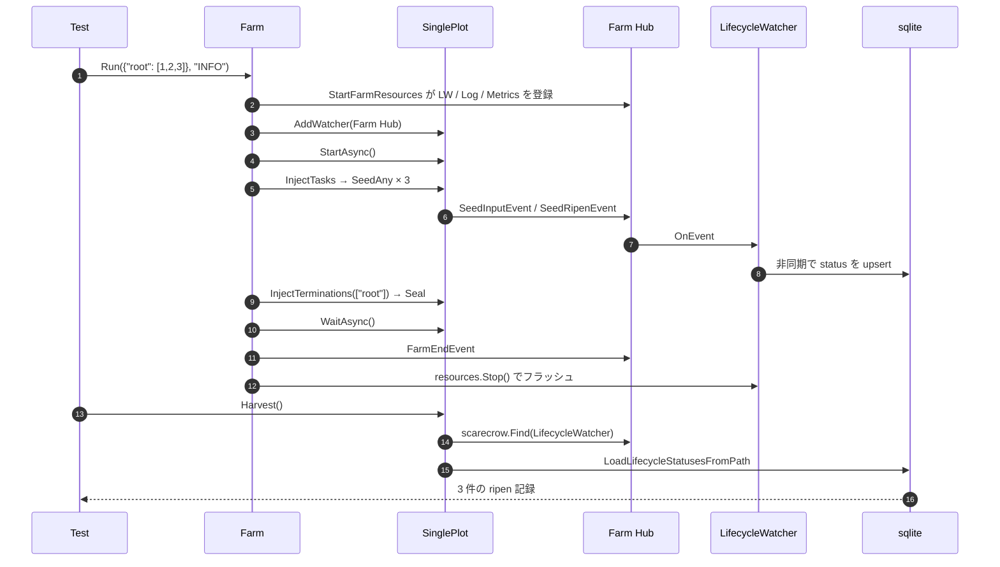

# pkg/farm/farm_harvest_test.go

> 📅 最終更新日: 2026/11/13

## 役割

`farm_harvest_test.go` は `package farm_test` として「Farm の実行終了後、Plot が自身のライフサイクルスナップショットを読み取れるか」というパッケージ横断の協調経路をカバーする：

- Farm レベルの `assembly` が組み立てた `LifecycleWatcher` は **Farm Hub** に登録される；
- Farm Hub は `start` の中で各 Plot の Hub へ登録される；
- Plot は実行時に `SeedInputEvent` / `SeedRipenEvent` を発し、ネスト Hub を経て `LifecycleWatcher` へ届き、非同期で sqlite へ書き込まれる；
- `Run` が返った後に `resources.Stop()` がフラッシュし、`root.Harvest()` がネスト Hub をたどってオブザーバーを見つけ、データベースを読み取る。

したがってこのテストが検証するのは単一の getter ではなく、**Hub の階層 + 永続化 + リソース回収** の三者が共同で作用した結果である。

## テストケース

| テスト関数 | 検証点 |
| --- | --- |
| `TestFarmRunHarvest` | 単一 Plot の Farm が `Run(..., "INFO")` で 3 つの種子を処理した後、`root.Harvest()` が 3 件の記録を返し、各行の `Status == "ripen"` である |

## テストの重点

### 1. `Run` の完全なデフォルト経路

```go
root := plot.NewSinglePlot("root", func(seed int) (int, error) {
    return seed * 2, nil
}, plot.WithTenders(2))

farm := farm.NewFarm("farm_harvest")
farm.AddPlot(root)
farm.Run(map[string][]any{"root": {1, 2, 3}}, "INFO")
```

`root` は唯一のノードであるため `sourceNodes == ["root"]`：`Run` は 3 つの種子を注入し自動的に `Seal()` するため、テストが手動で終了させる必要はない。

### 2. ネスト Hub の検索

`Harvest` の内部では `scarecrow.Find[*persist.LifecycleWatcher](p.hub)` を用いる。この検索はまず Plot の直属のオブザーバーを調べ、次にネスト Hub へ再帰的に入る——Farm Hub はまさに `plot.AddWatcher(f.hub)` によってここへ掛けられている。階層登録が欠けていれば `Harvest` は `plot %q lifecycle watcher is not registered` を返し、テストは直ちに失敗する。

### 3. 状態スナップショットであり生イベントではない

`LifecycleWatcher` は `SeedInputEvent` を `seed` 記録として書き、`SeedRipenEvent` を `ripen` 記録へ昇格させる。`LifecycleStatusRecord.Status` が最終的な状態文字列であるため、`"ripen"` のアサーションは同時に以下をカバーする：

- seed → ripen の状態昇格；
- `FruitJSON` などのフィールドの永続化経路が主キーを壊していないこと；
- 記録が `plot` 名でフィルタされていること（`LoadLifecycleStatusesFromPath(dbPath, p.name)`）。

### 4. リソースのフラッシュのタイミング

`Run` 内の `defer resources.Stop()` は spout を停止し sqlite を閉じる。`Harvest` は `Run` が返った後に呼ばれるため、3 件すべての記録を読める。これは `Stop` の flush 意味論を間接的に検証している。



## 重要なアサーション

| アサーション | 意味 |
| --- | --- |
| `err != nil` で失敗 | `Harvest` のエラーは「オブザーバー未登録」「データベース未準備」の 2 種類の前提条件をカバーする |
| `len(records) == 3` | 3 つの入力がそれぞれ 1 件だけ状態スナップショットを生成する |
| 各行の `record.Status == "ripen"` | 成功経路がすべて `SeedRipenEvent` を通り、wither / prune と誤判定されていない |

> 記録件数と input 数が厳密に等しいことは、「同一の `InputEventID` は 1 行だけ保持する」という upsert の意味論をも暗黙に検証している。

## 関連ソース

- `pkg/farm/farm.go`：`Run` / `start` / `InjectTasks` / `InjectTerminations`
- `pkg/farm/farm.go`：`AddWatcher`（Farm Hub の対外エントリ）
- `pkg/assembly/assembly.go`：`StartFarmResources` / `Resources.Stop`
- `pkg/plot/plot.go`：`Harvest` / `AddWatcher` / `emit`
- `pkg/persist/lifecycle.go`：`LifecycleWatcher`（`seed` → `ripen` の状態昇格）
- `pkg/persist/sqlite.go`：`LifecycleStatusRecord` / `LoadLifecycleStatusesFromPath`
- `pkg/scarecrow/hub.go`：`Find`（ネスト Hub を貫通する）

## 実行方法

```bash
go test ./pkg/farm/ -run 'TestFarmRunHarvest' -v
```

## 注意事項

- このテストは実際にライフサイクル用の sqlite を作成して書き込む；アサーションは件数と状態のみに依存し、データベースのパスには依存しない。
- `Harvest` は実行終了後にのみ呼べる：実行中は `DBPath` が既に準備されていても、キューの記録がまだフラッシュされておらず、件数が不足する可能性がある。
- 将来 `Farm` から Hub の階層登録が取り除かれると（たとえば persist オブザーバーを直接保持する形に戻すと）、本テストが最初に失敗する。
