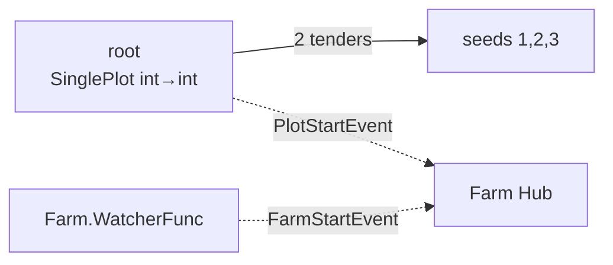
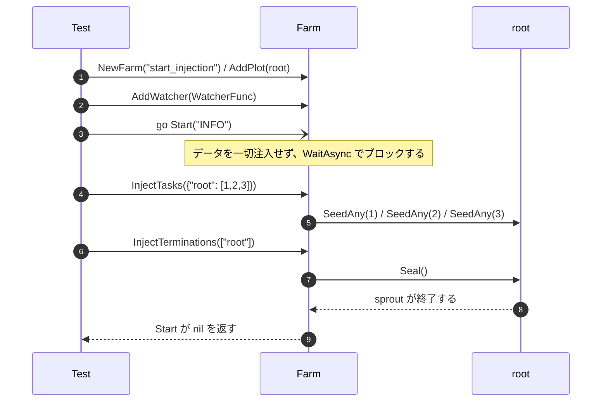

# pkg/farm/farm_inject_test.go

> 📅 最終更新日: 2026/11/13

## 役割

`farm_inject_test.go` は `package farm_test` として `Farm` の**外部駆動モード**をカバーする：

- `Start(logLevel)` 自体は種子も終了シグナルも注入しない；
- 呼び出し側は `Start` がブロックしている間に `InjectTasks` / `InjectTerminations` を通じてタスクフローを動的に制御できる；
- Farm レベルの watcher（`Farm.AddWatcher`）は Farm イベントと Plot イベントを同時に受信できる。

これは `Farm.Run` の分割後に追加された能力（`Start` / `InjectTasks` / `InjectTerminations`）の中核的な回帰テストである。

## テストケース

| テスト関数 | 検証点 |
| --- | --- |
| `TestFarmStartWithInjection` | `Start` は自動注入を行わない；実行時に 3 つの種子を注入するとすべて処理される；`FarmStartEvent` と 1 回の `PlotStartEvent` がともに Farm レベル watcher に観測される；`Start` は終了シグナルの後に正常に返る |

## テスト対象のトポロジー



`root` は 1 つだけである：`NewSinglePlot("root", ..., plot.WithTenders(2), plot.WithChanSize(8))`。source と sink を兼ねるため、注入の意味論とイベント配信に注意を集中できる。

## 主要フロー



## 重要な詳細

### 1. `Start` は注入しない

`Start` は `sourceNodes` を計算して `start(logLevel, nil)` を呼ぶだけである；`prepare` が `nil` のとき `InjectTasks` / `InjectTerminations` は呼ばれない。テストはまず注入しなければならず、そうでなければ `Start` は永遠に返らない。

### 2. 実行時注入のタイミング

`InjectTasks` は `Start` の goroutine が起動した直後に呼ばれる：

- Plot の `seedChan` には `WithChanSize(8)` のバッファがあるため、`StartAsync` がまだスケジュールされていなくても書き込みはブロックしない；
- `InjectTerminations` は種子の後に呼ばれ、`sprout` は先入れ先出しでキューに入った 3 つの種子を処理し終えてから終了する；
- `errCh` はバッファ 1 つを持ち、`Start` が返った後にテストが終了して goroutine が永久にブロックするのを避ける。

> `WithChanSize` を 0 にすると、注入と `StartAsync` のスケジューリング順序が追加の暗黙依存となり、テストの安定性が低下する。

### 3. Farm レベル watcher の階層配信

`AddWatcher` は Farm Hub へ登録され；`start` の中で Farm Hub はさらに `root` の Hub へ登録される。したがって同じ watcher が以下を受信する：

| イベント | 発生源 | アサーション |
| --- | --- | --- |
| `FarmStartEvent` | `Farm.emit`（Farm Hub） | `farmStarted == true` |
| `PlotStartEvent` | `root.notifyStart` → root Hub → Farm Hub | `plotStarts == 1` |

`PlotStartEvent` のカウントが 1 であることは同時に、Farm Hub が 1 回だけ登録され、配信の重複が起きていないことを示す。

### 4. 並行安全

オブザーバーのコールバックは異なるコルーチンから発火しうる（Farm 起動のコルーチンと Plot の `StartAsync` コルーチン）。テストでは `sync.Mutex` で `seeds` / `farmStarted` / `plotStarts` を保護し、最終アサーションの前にも一括してロックして読み取る。

### 5. 種子の内容は件数のみを検証する

`root` の cultivator は受け取った seed を `seeds` へ追加し、テストは `len(seeds) == 3` をアサートする：

- 「注入した種子が確かに `sprout`/`tend` に消費された」ことを検証し、チャネルに留まっていないことを確認する；
- 2 つの tender が並行実行されるため、処理順序は制約しない。

## 関連ソース

- `pkg/farm/farm.go`：`Start` / `start` / `InjectTasks` / `InjectTerminations` / `AddWatcher`
- `pkg/assembly/assembly.go`：`StartFarmResources`（`Start` も同様にリソースを組み立てる）
- `pkg/plot/plot.go`：`StartAsync` / `SeedAny` / `Seal` / `AddWatcher` / `notifyStart`
- `pkg/scarecrow/watcher.go`：`Watcher` / `WatcherFunc`
- `pkg/scarecrow/event.go`：`FarmStartEvent` / `PlotStartEvent`

## 実行方法

```bash
go test ./pkg/farm/ -run 'TestFarmStartWithInjection' -v
```

## 注意事項

- このケースの `Start` は独立した goroutine で実行され、メインのコルーチンが注入を担う；注入を `Start` の前に呼んでも同様に動作する（チャネルにバッファがある）が、「実行時の注入」という意味論はカバーしなくなる。
- `Start` のエラーは `errCh` を通じて返される；`t.Fatal` で直接メインのコルーチンを終了させてはならない。そうしないとブロック中の `Start` goroutine がリークする。
- 将来 `Start` が自動注入に変わった場合、`farmStarted` / `seeds` のアサーションは失敗しないが、「終了シグナルがなければ返らない」という意味論が変わるため、本テストを同時に更新する必要がある。
