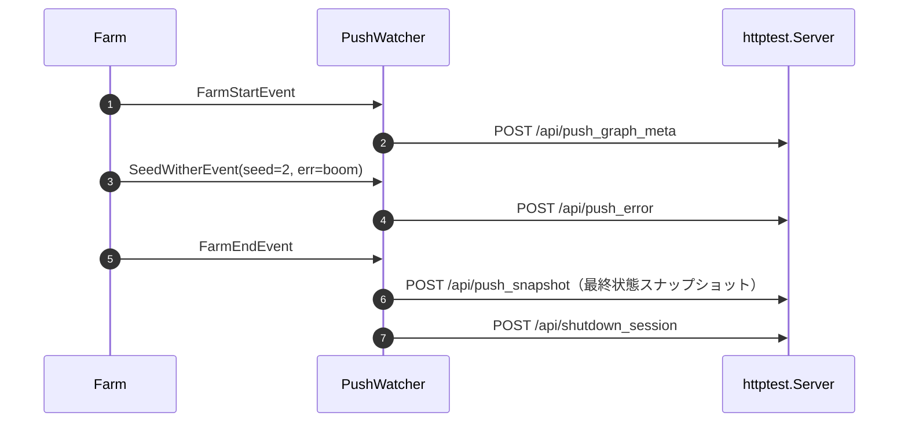

# pkg/farm/farm_report_test.go

> 📅 最終更新日: 2026/11/26

## 役割

`farm_report_test.go` は `package farm_test` として `Farm` の**リモート報告モード**をカバーし、`Run` が非 nil の `*reporter.Config` を受け取ったときに次が成立することを検証する：

- `assembly.StartReportResources` が `PushWatcher`、`SnapshotTicker`、`InjectionTicker` を組み立てる；
- `FarmStartEvent` がグラフのメタ情報へ変換され `/api/push_graph_meta` へプッシュされる；
- seed の育成失敗で発生した `SeedWitherEvent` が `/api/push_error` へプッシュされる；
- `FarmEndEvent` がまず最終状態スナップショット `/api/push_snapshot` を追加送信し、続いてセッションのオフライン `/api/shutdown_session` をプッシュする；
- `SessionID` が空の場合は `normalizeReport` が自動生成する。

テストは `net/http/httptest` で実際の HTTP サービスを起動し、各リクエストのパスと JSON body を記録する。「Farm → assembly → reporter」という一連の経路に対するブラックボックス回帰テストである。

## テストケース

| テスト関数 | 検証点 |
| --- | --- |
| `TestFarmRunWithReportPushesGraphErrorSnapshotAndShutdown` | 単一 Plot の Farm に `SessionID: "farm@1"` を明示的に渡す；実行後に 4 つの報告エンドポイントがすべてアクセスされ、グラフのメタ情報、エラー、オフライン payload のフィールドが正しい |
| `TestFarmRunGeneratesSessionID` | `SessionID` を含まない `reporter.Config` を渡す；`/api/push_graph_meta` の `session_id` が `"auto_session@"` を接頭辞とする |

## 主要なフロー

### 1. ケースのトポロジーと失敗の注入

```go
root := plot.NewSinglePlot("root", func(seed int) (int, error) {
    if seed == 2 {
        return 0, errors.New("boom")
    }
    return seed * 2, nil
}, plot.WithTenders(2))

f := farm.NewFarm("report_farm")
f.AddPlot(root)
f.Run(map[string][]any{"root": {1, 2, 3}}, "INFO", &reporter.Config{
    URL:       server.URL,
    SessionID: "farm@1",
})
```

`root` は source と sink を兼ね、seed `2` が `boom` を投げるため、`SeedWitherEvent` が 1 件発生する。`Run` は `SnapshotPeriod` / `InjectionPeriod` を設定しないため、両者は `reporter` パッケージの既定周期で動作する。

### 2. リクエストの因果順序

テストは順序をアサートしないが、イベントの発生順に従えば 4 つのリクエストの因果連鎖は次のとおりである：



実行時間が長い場合、`SnapshotTicker` が追加の `/api/push_snapshot` を挿入することもある；本ケースはすぐに終了するため、テストはこのエンドポイントが少なくとも 1 回現れることだけを要求する。

### 3. グラフのメタ情報フィールド

```json
{
  "session_id": "farm@1",
  "graph": "report_farm",
  "node_meta": {
    "root": {
      "class_name": "SinglePlot",
      "execution_mode": "thread",
      "max_workers": 2
    }
  }
}
```

- `graph` は `FarmStartEvent.Farm` に由来する；
- `node_meta` は `Farm.getNodeMeta()` が集約した各 Plot の `GetMeta()` に由来する；
- `NodeMeta.MaxWorkers` は `plot.WithTenders(2)` で設定した tender 数に等しい；
- JSON 逆シリアル化後の数値は `float64` であるため、テストは `max_workers == float64(2)` をアサートする。

### 4. エラーとオフラインの payload

| 端点 | フィールド | アサート値 | 由来 |
| --- | --- | --- | --- |
| `/api/push_error` | `node` | `"root"` | `SeedWitherEvent.Plot` |
| `/api/push_error` | `error_message` | `"boom"` | `SeedWitherEvent.Err` の `%v` |
| `/api/shutdown_session` | `session_id` | `"farm@1"` | 設定中のセッション識別子 |

`/api/push_error` には `event_id`、`task_json`、`error_type`、`ts` フィールドも含まれるが、本テストはノード名とエラーテキストのみを検証する。

## 境界とアサーションの重点

- **端点の集合のみを検証**：テストは `slices.Contains` で 4 つのパスがすべて存在することを確認し、リクエスト回数と順序は制約しない；周期スナップショットやリトライにより追加のリクエストが発生しうる。
- **注入の取得は検証しない**：`StartReportResources` は `InjectionTicker` も組み立てるが、本ファイルには `/api/pull_injection` を要求するアサーションがなく、注入の挙動は `pkg/reporter/inject_test.go` がカバーする。
- **セッション識別子はそのまま透過**：明示的な `SessionID` は書き換えられず、すべての報告レコードが同じ値を使う。
- **自動生成の規則**：`SessionID` が空のとき、`normalizeReport` は `fmt.Sprintf("%s@%d", f.name, time.Now().UnixNano())` を生成するため、テストは `auto_session@` の接頭辞のみをアサートし、完全な値はアサートしない。
- **失敗は主フローをブロックしない**：`PushWatcher` の HTTP 失敗はログに書かれるだけで、`Run` がエラーを返すことはない；本テストのサーバーは常に `200 OK` を返し、報告経路が完全に通ることを保証する。
- **StopFunc のフラッシュ**：`Run` は返る前にリソースを停止し、`PushWatcher.Stop` が inlet を閉じてバックグラウンド spout の消費完了を待つため、テストが `Run` の返却後にリクエスト記録を読むのは安定している。
- **補助関数**：`findReport` はパスで最初のレコードを取り、存在しない場合は直接 `t.Fatalf` する；`capturedReport` は `path` と body のコピーを保存し、共有スライスが後続のリクエストで上書きされるのを避ける。

## 関連ソース

- `pkg/farm/farm.go`：`Run` / `start` / `normalizeReport` / `getNodeMeta`
- `pkg/assembly/assembly.go`：`StartReportResources`（`PushWatcher` / `SnapshotTicker` / `InjectionTicker` を組み立てる）
- `pkg/reporter/push.go`：`PushWatcher.OnEvent`（`FarmStartEvent` / `SeedWitherEvent` / `FarmEndEvent` からエンドポイントへの対応付け）
- `pkg/reporter/config.go`：`Config`
- `pkg/plot/plot.go`：`GetMeta` / `SinglePlot` の `NodeMeta`
- `pkg/scarecrow/event.go`：`FarmStartEvent` / `FarmEndEvent` / `SeedWitherEvent`

## 実行方法

```bash
go test ./pkg/farm/ -run 'TestFarmRunWithReport|TestFarmRunGeneratesSessionID' -v
```

## 注意事項

- このテストは外部ネットワークへアクセスせず、`httptest.Server` はランダムなローカルポートを待ち受ける；`server.URL` をそのまま `reporter.Config.URL` として使う。
- テストは実際に節拍クロックとバックグラウンドのプッシュ spout を組み立てるが、周期は非常に短く、`Run` の終了時にリソースが停止されるため goroutine は残らない。
- `report` を `nil` に変えると 4 つのエンドポイントはいずれもリクエストを受け取らず、`findReport` は直ちに失敗する；これはローカル / 報告という 2 つの組み立て分岐の回帰ポイントそのものである。
