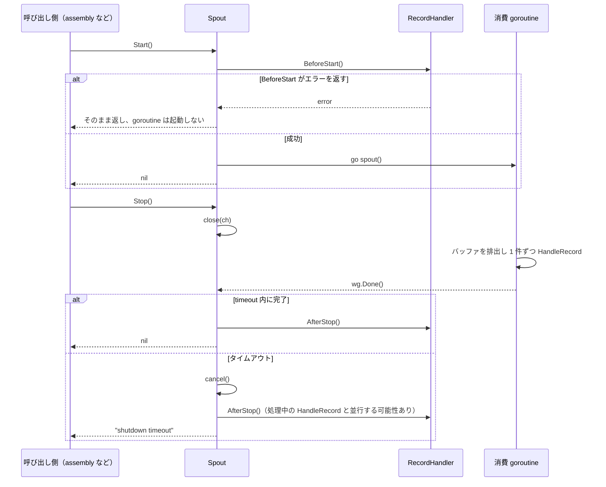
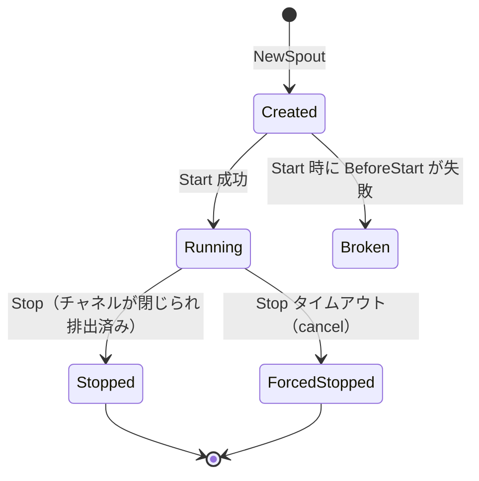

# pkg/funnel/spout.go

> 📅 最終更新日: 2026/11/13

`pkg/funnel/spout.go` は `Spout[T]` ジェネリック抽象を定義する——CelestialGrow の非同期消費基盤における**消費側**（読み取り側）である。バッファ付きの Go channel を保持し、バックグラウンド goroutine で継続的にレコードを読み取って `RecordHandler[T]` に引き渡す。同時に `BeforeStart` / `HandleRecord` / `AfterStop` という 3 段階のインターフェースによってリソースのライフサイクルを明確にする。

> **命名に関する注意**：`Spout` は直感的には「出口」のように見えるが、本パッケージにおいては**消費側**である。`Spout` は内部のチャネルからレコードを「噴出し」続けて handler に渡し、対となる `Inlet` こそがレコードを「流し込む」生産側である。

## 役割

- バックグラウンド goroutine でバッファ付き channel から継続的にレコードを読み取る。
- 「業務処理」を `RecordHandler[T]` インターフェースとして注入し、異なる永続化バックエンド（ファイル / SQLite）間での再利用を可能にする。
- 2 段階のシャットダウンを提供する。まず `close(ch)` でグレースフル終了をトリガーし（バッファも排出する）、タイムアウトしても終了しない場合は `cancel()` で消費 goroutine を今回の `HandleRecord` の復帰後に終了させる。これにより呼び出し側が無限に待つことはない。

## 中核オブジェクト

### `type RecordHandler[T any]`（インターフェース）

```go
type RecordHandler[T any] interface {
    BeforeStart() error
    HandleRecord(record T) error
    AfterStop() error
}
```

| メソッド | 呼び出されるタイミング | 典型的な用途 |
|------|-----------|----------|
| `BeforeStart() error` | `Spout.Start` 内部、消費 goroutine の起動**前**に同期的に呼び出される | ファイルのオープン、データベース接続の確立、バッファの初期化 |
| `HandleRecord(record T) error` | 消費 goroutine がレコードを 1 件読み取るたび | 単一レコードのシリアライズ / 書き込み |
| `AfterStop() error` | `Spout.Stop` の終了段階。**タイムアウトの有無にかかわらず**呼び出される | ファイルのクローズ、`fsync`、接続の解放 |

3 つのメソッドが返す `error` の扱いは異なる。`BeforeStart` のエラーは `Start` がそのまま返す。`HandleRecord` のエラーは `spout()` によって**黙って破棄**される。`AfterStop` のエラーは `Stop()` によって**黙って破棄**される（`Stop` はシャットダウンタイムアウトのエラーのみを返す）。したがって、handler 内で重大な失敗を戻り値だけに委ねてはならない。

### `type Spout[T any]`

```go
type Spout[T any] struct {
    ch      chan T               // 内部缓冲通道，对外通过 GetQueue 暴露只写句柄
    wg      sync.WaitGroup       // 跟踪消费 goroutine
    timeout time.Duration        // Stop 时优雅关闭的最大等待时间
    ctx     context.Context      // 内部 ctx，被 Stop 在超时时 cancel
    cancel  context.CancelFunc
    handler RecordHandler[T]     // 注入的处理器
}
```

- **ジェネリックパラメータ `T`**：単一レコードの型。たとえば `persist.LogWatcher` の内部では `*funnel.Spout[persist.LogRecord]` を使用する。
- フィールドはすべてエクスポートされておらず、構築とライフサイクル管理は公開メソッドを通じてのみ行える。

### 構築：`NewSpout[T any]`

```go
func NewSpout[T any](handler RecordHandler[T], bufferSize int, timeout time.Duration) *Spout[T]
```

- `handler`：`RecordHandler[T]` を実装している必要があり、すべてのメソッドは**同一の**消費 goroutine によって直列に呼び出される。
- `bufferSize`：内部の `make(chan T, bufferSize)` の容量。`0` はバッファなしチャネルを生成する（合法だが、`Send` が即座に背圧に直面する）。**負数**を渡すと `make` が panic する（現在の実装では検証を行っていない）。
- `timeout`：`Stop` 段階のグレースフルシャットダウンの最大待機時間。`0` はほぼ即座に「強制キャンセル」分岐を通ることを意味する（`time.After(0)` が即座に読み取り可能になる）。

### 公開メソッド

| メソッド | シグネチャ | 役割 |
|------|------|------|
| `GetQueue` | `func (s *Spout[T]) GetQueue() chan<- T` | 書き込み専用ハンドルを返し、`Inlet` がバインドする |
| `Start` | `func (s *Spout[T]) Start() error` | `handler.BeforeStart` を呼び、消費 goroutine を起動する |
| `Stop` | `func (s *Spout[T]) Stop() error` | まず `close(ch)` で排出してグレースフル終了。タイムアウトなら `cancel()` で強制終了し、最終的に `handler.AfterStop()` を呼ぶ |
| `Handler` | `func (s *Spout[T]) Handler() RecordHandler[T]` | 現在注入されている handler を返す。デバッグやテストのアサーションに便利 |

> `Spout` は同期的な「1 件取得」メソッドを提供しない。レコードはバックグラウンド goroutine によってのみ自動的にチャネルから取得され、外部には「起動・停止 + キュー入口」のみを公開する。

#### `GetQueue() chan<- T`

- 呼び出すたびに同一の `chan T` を返す（コンパイラが双方向チャネルから書き込み専用型を派生させる）。
- 呼び出し元は通常 `funnel.NewInlet[T](spout.GetQueue(), timeout)` である。
- このチャネルを他の場所で書き込んだりクローズしたりしては**ならない**——所有権は `Spout` にある。

#### `Start() error`

1. `s.handler.BeforeStart()` を同期的に呼び出す。非 `nil` のエラーが返された場合は goroutine を起動**せず**、そのエラーをそのまま返す。
2. `s.wg.Add(1)` の後に `go s.spout()` する。
3. 成功時は即座に返る（非ブロッキング）。`BeforeStart` が失敗した場合でもリソースの一部はすでに開かれている可能性があるが、`Start` はロールバックしない。補償的なクリーンアップが必要かどうかは呼び出し側が判断すべきである。

#### `Stop() error`

```text
Stop()
  ├─ close(s.ch)                      // 触发 spout() 在 <-s.ch 处排空后返回
  ├─ 等待 wg.Wait() done 通道，最多 timeout
  │     ├─ 正常 done        → err = nil
  │     └─ timeout 触发     → s.cancel()，err = errors.New("shutdown timeout")
  └─ 无论是否超时，都执行 s.handler.AfterStop()          // 返回值被丢弃
```

重要な点：

- `close(s.ch)` を**必ず**行ってはじめて `<-s.ch` の `ok=false` 分岐が成立し、`spout()` がグレースフルに返ることができる。
- チャネルをクローズしても**レコードは失われない**：受信側はバッファに残ったレコードを FIFO で取り切ってから（毎回 `ok=true`）`ok=false` を受け取るため、正常系では `Stop` が返る前にキューは排出済みである。
- タイムアウト経路では**レコードが失われる**：`ctx` がキャンセルされると、消費 goroutine は現在の `HandleRecord` が返った直後に終了し、バッファ内の未処理レコードは破棄される。
- 内部 `ctx` は**タイムアウト**時にのみ `cancel()` され、正常系では決してトリガーされない。これは処理中の handler を誤って止めないための設計上の選択である。
- `AfterStop` は**すべての**終了経路で呼び出される（`Start` が一度も成功していない場合でも）。これによりリソースのリークを防ぐ。
- 返される `error` はタイムアウトの状況でのみ非 `nil` となり、呼び出し側はこれによってアラートが必要かを判定できる。

#### `Handler() RecordHandler[T]`

- 構築時に注入された handler（インターフェース値のコピー）を返す。実行時に handler の状態をレポートしたり、単体テストのアサーションなどに使用できる。
- `persist.LifecycleWatcher.DBPath()` はまさに `s.spout.Handler().(*persist.LifecycleRecordHandler)` で型アサーションしてから `SQLitePath` を読み取っている。
- 読み取りのみ可能で、handler の差し替えには**使用できない**。`handler` フィールドはエクスポートされておらず setter もないため、このコピーを変更しても `Spout` 内部が保持するインスタンスには影響しない。

### 内部メソッド `spout()`（非エクスポート）

消費ループ：

```go
for {
    select {
    case record, ok := <-s.ch:
        if !ok { return }                    // 通道关闭：优雅退出
        s.handler.HandleRecord(record)       // 返回值被丢弃
    case <-s.ctx.Done():
        return                              // Stop 超时：强制退出
    }
}
```

- `Start` が起動する goroutine の入口である。`wg.Done()` は `defer` 内で呼ばれ、カウントが確実にゼロになるようにする。
- 直列処理：単一 goroutine が順番に `HandleRecord` を呼び出すため、handler 内部で「複数レコードの並行到達」のためにロックを取る必要はない。
- 2 つの終了経路：`ok=false`（チャネルが `Stop` によって閉じられ、かつ排出済み）または `ctx.Done()`（`Stop` のタイムアウトによる強制終了）。
- `select` は 2 つの経路が同時に準備完了した場合にランダムに選択するため、タイムアウトでキャンセルされた瞬間に、すでに準備完了していたレコードをもう 1 件処理してしまう可能性がある。

## 重要なフロー

### 起動・停止のタイミング



### 状態遷移



`Broken` と `Stopped` / `ForcedStopped` はいずれも**再利用できない**：`ch` が閉じられているか、handler がすでに `AfterStop` を実行済みである。

## persist / assembly との呼び出し関係

```text
persist.LogWatcher / LifecycleWatcher ──持有──▶ funnel.Inlet[T] ──Send(T)──┐
                                                                          ▼
                                                        chan T（Spout 内部缓冲通道，容量 100）
                                                                          │
                                              GetQueue() 把同一个 chan T 暴露给 Inlet
                                                                          ▼
funnel.Spout[T]（单后台 goroutine）──HandleRecord(T)──▶ persist.LogRecordHandler / LifecycleRecordHandler
```

- `persist.LogRecordHandler` / `persist.LifecycleRecordHandler` はいずれも `RecordHandler[T]` を実装している：
  - `BeforeStart`：`logs/` ディレクトリを作成し、日付ごとにログファイルを開く / `lifecycles/<date>/` ディレクトリを作成し、SQLite を開く。
  - `HandleRecord`：1 行のテキストに整形してファイルへ追記する / `Kind`（`seed` / `ripen` / `wither` / `prune`）に応じてイベントを書き込み、状態を更新する。
  - `AfterStop`：ログファイルを閉じる / SQLite 接続を閉じる。
- `persist.LogWatcher` / `LifecycleWatcher` は非エクスポートの `newLogWatcher` / `newLifecycleWatcher` 内で `funnel.NewSpout(handler, 100, time.Second)` により `Spout` を構築し、さらに `funnel.NewInlet(spout.GetQueue(), time.Second)` で対となる `Inlet` を構築する。
- `pkg/assembly` がライフサイクルを一元管理する：`StartPlotResources` / `StartFarmResources` が 2 つのオブザーバーを作成し、**先に `lifecycle.Start()`、その後に `log.Start()`** を呼んでから `*scarecrow.Hub` に登録する。`Resources.Stop`（`sync.Once` で保護）は逆順に、先に `log.Stop()`、その後に `lifecycle.Stop()` を実行する。
- `Plot` / `Farm` は `Hub` だけを保持し、`Spout` を直接保持しない。`BindInlet` / `StartSpouts` / `StopSpouts` のようなインターフェースも持たない——チャネルの作成とバインドはすべて `persist` のオブザーバーのコンストラクタに封じ込められている。

## Inlet との協調（inlet ← spout）

```go
// 片段：T 为记录类型，handler 为调用方实现的 funnel.RecordHandler[T]
// 1. Spout 持有通道，并注入具体 handler
spout := funnel.NewSpout[T](handler, 100, time.Second)

// 2. 启动消费循环（内部先调 handler.BeforeStart）
if err := spout.Start(); err != nil {
    return err
}

// 3. Inlet 绑定到 Spout 暴露的只写句柄
inlet := funnel.NewInlet[T](spout.GetQueue(), time.Second)

// 4. 上游只需调 inlet.Send(...)；通道满了会等 1s，超时返回错误
```

タイミングの保証：

1. **`Start` の後に `Inlet` を構築する**：消費ループが起動していない状態で送信されたデータはバッファに溜まるだけであり（容量は有限）、バッファが満杯になると `Send` はすべてタイムアウトする。
2. **先に書き込みを停止し、次に読み取りを停止する**：推奨順序は「上流が `Send` の呼び出しを停止 → `inlet.Close()` → `spout.Stop()`」である。`Spout.Stop` の内部で `close(ch)` が行われるため、それ以降に `Send` が書き込み分岐に到達すると panic する（`send on closed channel`）。
3. `inlet.Close()` は `ctx` をキャンセルするだけで、すでに `select` に入った `Send` が書き込み分岐に到達して panic することを**防げない**。保証するのは「ブロック中の `Send` が素早く `context.Canceled` を返すこと」だけである。

## 使用例

最小限の `Spout` + `Inlet` の組み合わせ（`inlet.md` と対になる）：

```go
package main

import (
    "fmt"
    "time"

    "github.com/Mr-xiaotian/CelestialGrow/pkg/funnel"
)

type PrintHandler struct {
    cnt int
}

func (p *PrintHandler) BeforeStart() error       { fmt.Println("spout start"); return nil }
func (p *PrintHandler) HandleRecord(r int) error { p.cnt++; return nil }
func (p *PrintHandler) AfterStop() error         { fmt.Println("spout stop, total:", p.cnt); return nil }

func main() {
    handler := &PrintHandler{}

    spout := funnel.NewSpout[int](handler, 16, time.Second)
    if err := spout.Start(); err != nil {
        panic(err)
    }

    inlet := funnel.NewInlet[int](spout.GetQueue(), 200*time.Millisecond)
    for i := 0; i < 100; i++ {
        _ = inlet.Send(i) // 队列满时最多等 200ms，失败即丢弃本条
    }

    inlet.Close() // 先停写入
    if err := spout.Stop(); err != nil {
        fmt.Println("shutdown timeout:", err)
    }
}
```

`HandleRecord` は単一の goroutine からのみ呼び出されるため、例の `cnt++` にロックは不要である。

## 注意事項

- `Spout` は**単一 goroutine による直列**消費である。`HandleRecord` で時間のかかる操作（同期ネットワークリクエストなど）を行うべきではない。そうでなければパイプライン全体のボトルネックとなる。並列処理が必要な場合は `HandleRecord` の内部でさらにディスパッチすること。
- タイムアウト経路では、`AfterStop` がまだ実行中の `HandleRecord` と**並行**して発生する可能性がある（例えば一方が `WriteString`、もう一方が `Close`）。時間のかかる handler は「クローズ後は書き込まない」ことを自ら保証するか、正常系が完了するのに十分な大きさの `timeout` を設定すべきである。
- `bufferSize` と `timeout` は重要なチューニングポイントである：
  - `bufferSize` が大きいほど吸収できるバーストトラフィックは増えるが、メモリ使用量も増え、正常終了時に排出すべきレコードも多くなる。
  - `timeout` が大きいほど終了は「穏やか」になるが、プロセス終了時にはより長く待たされることになる。
- `RecordHandler.HandleRecord` と `AfterStop` のエラーはどちらも無視されるため、重大なエラー状態を戻り値だけに書き込んでは**ならない**。失敗を可観測にしたい場合は handler の内部で自ら記録すべきである（`persist` の handler は現在エラーを戻り値で伝えているが、呼び出し側は受け取れない）。
- **`Start` は繰り返し呼べない**：2 回呼ぶと `BeforeStart` が 2 回実行され（ファイルを二重に開く可能性がある）、消費 goroutine も 2 つ起動する。両者は同じチャネルを奪い合い、`HandleRecord` が並行実行される可能性がある。
- **`Stop` はべき等ではない**：`ch` はすでに閉じられているため、再度 `Stop` すると panic する（`close of closed channel`）。`pkg/assembly` は `sync.Once` で 1 層ラップし、1 回だけ停止することを保証している。
- `Stop` は `Start` より前に呼び出すこともできる：チャネルを閉じ、`wg.Wait()` を即座に通過し、その後 `AfterStop` を呼び出す。そのため handler の `AfterStop` は「`BeforeStart` が実行されていない」状態を許容できなければならない。
- `Handler()` が返す参照は読み取り専用であり、その内部状態を外部から変更することは許容される（例えば書き込み済み件数の照会）。ただし handler 全体を差し替えても効果はない。
