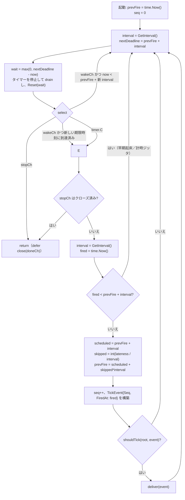
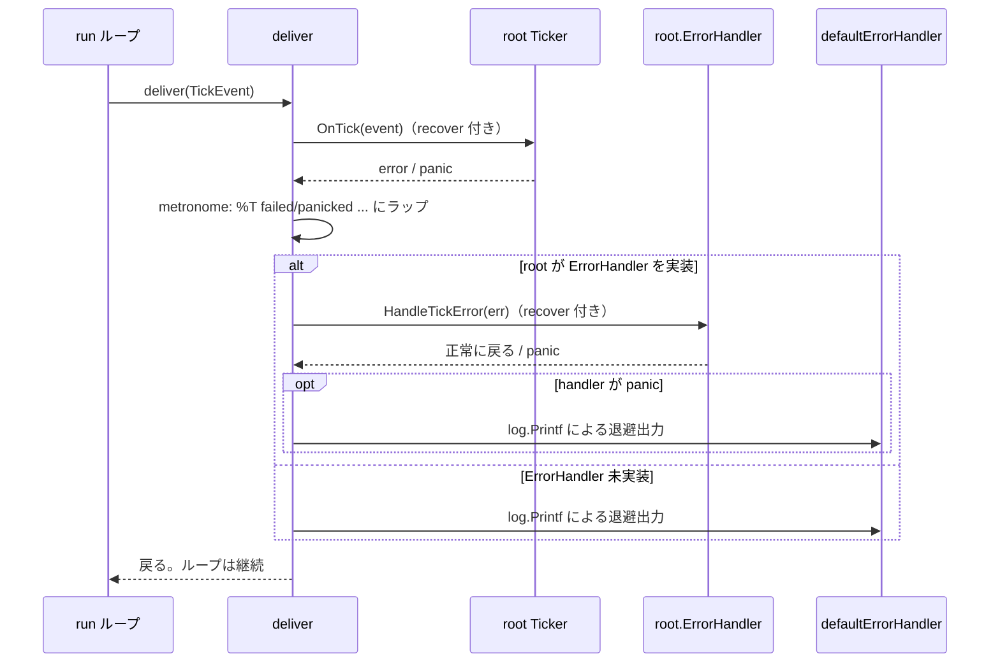

# pkg/metronome/clock.go

> 📅 最終更新日: 2026/11/26

`pkg/metronome/clock.go` は節拍ツリーの**唯一の時間源** `Clock` を実装します：独立した goroutine で固定周期でルート `Ticker` を駆動し、単調クロックで予定発火時刻をアンカーし、「拍をスキップし、追いかけない」戦略を採ることで、長時間の処理が節拍の嵐を引き起こすのを防ぎます。ルート ticker の error / panic は自身の `ErrorHandler` に渡され、ハンドラ自体が panic した場合は `log` 出力へ退避するため、クロックが 1 回の節拍失敗で黙って停止することはありません。

## 役割

- 周期的な `TickEvent` の供給源を提供し、`Hub` ツリーの上で唯一の駆動者です（`Hub` 自身は自転しません）。
- `DefaultInterval` でプロジェクト全体の既定基準周期（1 秒）を与え、`pkg/assembly`、`pkg/farm`、`pkg/plot` など多くの箇所がこれを既定の `interval` として渡します。
- 実行期の `SetInterval` による動的な速度変更をサポートし、待機中のループを即座に起床させ、新しい周期を**次の拍**から有効にします。
- ルート ticker の失敗を `deliver` 内に隔離し、バックグラウンドループの継続を保証します。

## 主要オブジェクト

### 定数

```go
const (
    DefaultInterval = time.Second // 默认基准周期
    joinTimeout     = 5 * time.Second
)
```

| 名称 | 公開 | 意味 |
|------|:----:|------|
| `DefaultInterval` | ✅ | 既定の節拍周期で `1s`。呼び出し側が明示的に `NewClock` へ渡すもので、`NewClock` 自身が既定値を適用することはありません。 |
| `joinTimeout` | ❌ | `Stop` がバックグラウンド goroutine の終了を待つ上限で `5s`。タイムアウトするとエラーを返しますが、goroutine はまだ実行中かもしれません。 |

### `type Clock`

```go
type Clock struct {
    root Ticker

    mu       sync.RWMutex // 保护 interval
    interval time.Duration

    stateMu sync.Mutex   // 保护运行状态与三个 channel
    running bool
    stopCh  chan struct{}
    doneCh  chan struct{}
    wakeCh  chan struct{} // 容量 1，用于 SetInterval 唤醒
}
```

- `root`：ルート ticker で、通常は `*Hub`。構築後に差し替えることはできません。
- `mu` と `stateMu` は**分離**されています：周期の読み書きが起動／停止の判定をブロックせず、`SetInterval` は `mu` だけを取って値を変え、その後短時間だけ `stateMu` を取って `wakeCh` を取得できます。
- `stopCh` / `doneCh` / `wakeCh` は `Start` のたびに作り直されるため、クロックは停止後に再起動できます。
- `wakeCh` の容量は 1 で、送信には `select + default` を使うため、周期を連続して変更しても起床シグナルが溜まりません。

### 構築：`NewClock(interval time.Duration, root Ticker) (*Clock, error)`

| エラー場面 | 戻り値 |
|---------|------|
| `root == nil` | `metronome: root ticker is nil` |
| `interval <= 0` | `metronome: interval must be positive, got %s`（`%s` は `time.Duration` の文字列表現で、`0s`、`-1ms` など） |

構築は検証と代入のみを行い、goroutine を**起動せず**、`root.Start()` も**呼びません**。

### 公開メソッド

| メソッド | シグネチャ | 役割 |
|------|------|------|
| `Start` | `func (c *Clock) Start() error` | バックグラウンドの節拍 goroutine を起動する。すでに実行中ならそのまま `nil` を返す |
| `Stop` | `func (c *Clock) Stop() error` | ループに終了を通知して終了を待つ。最大 `5s` 待つ |
| `IsRunning` | `func (c *Clock) IsRunning() bool` | `running` フラグを返す |
| `GetInterval` | `func (c *Clock) GetInterval() time.Duration` | 現在の周期を読み取る |
| `SetInterval` | `func (c *Clock) SetInterval(interval time.Duration) error` | 周期を変更し、次の拍から有効にする |

#### `Start() error`

1. `stateMu` を取得する。`running` が真ならそのまま `nil` を返す（**冪等**）。
2. `stopCh`、`doneCh`、容量 1 の `wakeCh` を新規作成し、`running = true` にする。
3. `go c.run(...)` の後、直ちに `nil` を返す。

`Start` には現在失敗経路がなく、戻り値は常に `nil` です。シグネチャが `error` を保っているのは `Lifecycle` インターフェースに合わせるためです。停止後に再起動すると、まったく新しい goroutine と、1 から数え直す `Seq` が得られます。

#### `Stop() error`

1. `stateMu` を取得する。実行中でなければそのまま `nil` を返す（**冪等**）。
2. `stopCh` / `doneCh` を取り出し、**先に `running` を `false` にしてから**ロックを解放する。
3. `close(stopCh)` を行い、その後 `doneCh` と `time.After(joinTimeout)` のどちらかを選ぶ：
   - goroutine が正常終了（`run` の `defer close(doneCh)`）：`nil` を返す；
   - `5s` を超過：`metronome: clock goroutine did not terminate within 5s` を返す。

> **タイムアウトの本当の意味**：`run` はループ先頭と `select` の中でしか `stopCh` を確認せず、一度 `deliver`（すなわちルート ticker の `OnTick`）に入ると中断できません。ある ticker が 5 秒以上ブロックすると、`Stop` はタイムアウトしてエラーを返しますが、`running` はすでに `false` です——このとき `IsRunning()` は「停止済み」を報告しますが、goroutine はまだ生きていて、戻った後に自力で終了します。

#### `IsRunning() bool`

`running` フラグを読むだけで、goroutine が実際に生きているかは探査しません。したがってこれは「起動済みで `Stop` が呼ばれていない状態かどうか」に答えるものであり、「goroutine が動いているか」ではありません。

#### `GetInterval() / SetInterval(interval time.Duration) error`

- `GetInterval` は `mu.RLock` を取って値を返し、任意の goroutine から呼べます。
- `SetInterval` はまず `interval > 0` を検証し、そうでなければ `metronome: interval must be positive, got %s` を返します。検証を通れば値を変え、その後 `stateMu` を取って実行中かどうかを判定し、実行中なら `wakeCh` へ 1 回だけ非ブロッキング送信します。
- 実行中でない場合は値を変えるだけで起床させません（次の `Start` が自然に新しい値を使います）。
- 起床の意義：ループはこのとき**古い周期**で設定された長い timer 上で `select` している可能性があります。起床しなければ古い期限時刻まで再計算を待つことになり、周期変更は最大で古い周期 1 つ分遅れます。`TestClockSetIntervalTakesEffectOnNextTick` はまさにこれを検証しています（200ms → 10ms で、120ms 以内に最初の拍を受け取ることを要求）。

## 主要フロー

### メインループ `run`



要点：

1. **タイマーを止めてから `Reset`**：`if !timer.Stop() { select { case <-timer.C: default: } }` で、すでに到達している可能性のある古い発火を消し、「前回の timer がこの拍を早く打ち出してしまう」のを避けます。
2. **`stopCh` を 2 回確認**：`select` 中に 1 回、`select` の後で実際に発火する前にもう一度非ブロッキングで確認し、「Stop 済みなのに余分に 1 拍打つ」窓を短縮します（完全には消せません：確認後に `stopCh` が閉じられた場合、その拍は依然として配送されます）。
3. **早期起床では発火しない**：`fired.Before(prevFire.Add(interval))` が真ならそのまま `continue` し、タイマーのジッタや `wakeCh` による早期起床が「周期の短縮」を引き起こすのを防ぎます。

### アンカーと「拍をスキップし、追いかけない」

グリッドは `fired`（実際の発火時刻）ではなく、`prevFire`（前回の**計画**発火時刻）と `interval` で決まります：

| 状況 | 計算 | 結果 |
|------|------|------|
| 定刻 | `fired ≈ scheduled = prevFire + interval` | `lateness ≈ 0`、`skipped = 0`、`prevFire = scheduled`、グリッドはドリフトしない |
| わずかな遅延（1 周期未満） | `lateness = fired - scheduled ∈ (0, interval)` | `skipped = 0`、`prevFire = scheduled`、次の拍も元のグリッド上にあり、間隔が圧縮される |
| 明らかな遅延（1 周期以上） | 例：`interval = 10ms`、`scheduled = T+10ms`、`fired = T+35ms` | `lateness = 25ms`、`skipped = 2`、`prevFire = T+30ms`、次の期限は `T+40ms` |

これからいくつかの確定的な性質が導かれます：

- **補発しない**：スキップされた拍が 1 つずつ `OnTick` を呼ぶことは**なく**、新しい `Seq` も消費しません。上の例では `T+20ms`、`T+30ms` の 2 拍が独立したイベントとして現れることは永遠にありません。
- **即時の再発火は最大 1 回**：1 回の `OnTick` に 55ms かかった場合（`interval = 10ms`）、戻った後に `wait` が負になって 0 に丸められ、ループは直ちに**1 拍**打ち出し（`PrevFire` は `T+60ms` に揃う）、その後は `T+70ms`、`T+80ms` と続き、5 回連続のバーストにはなりません。
- **グリッドは長期的にドリフトしない**：`prevFire` を進めるのに常に `scheduled`（`fired` ではない）を使うため、長期的な平均周波数は `interval` で決まり、誤差が蓄積しません。
- **グリッドの間隔は常に `interval`**：2 回の実際の発火の間隔は `interval` よりわずかに小さくなることがあります（前の拍が遅れ、次の拍が元のグリッド上にあるため）が、早期起床によって小さくなることはありません。

> この戦略の動機は `Clock` の doc-string に書かれています：遅い処理の後に集中的に補発するより、むしろスキップするほうがよい。そうしなければ下流（特にネットワーク報告や注入系の ticker）がリクエストの嵐に見舞われます。

### 動的な周期変更

`SetInterval` の効果は次のループ反復で現れます：

- 新しい期限時刻 = `prevFire + 新 interval`。すなわち「周期を変えた瞬間」ではなく、**前の拍の計画時刻**を新しいアンカーとしてグリッドを引き直します。
- 新しい周期が非常に短く、新しい期限時刻がすでに過ぎている場合、`wakeCh` 分岐の条件は成立せず、ループは直ちに 1 拍発火します（「早く到来した次の拍」に相当）。その後は新しいグリッドで動作します。
- 新しい周期が非常に長い場合、`wakeCh` で起床した後に条件が成立し、ループは `continue` して新しい長さで timer を再設定します——これが「古い timer の満了を待たなくてよい」鍵です。
- 周期変更が `OnTick` の実行中に起きた場合、起床トークンは容量 1 の `wakeCh` に残り、`OnTick` が戻った直後に消費されるため失われません。

### ルート ticker の呼び出しとエラー隔離 `deliver`



- `OnTick` の panic は `recover` によって `metronome: %T panicked on tick %d: %v` に変換されます；
- `OnTick` が返したエラーは `metronome: %T failed on tick %d: %w` にラップされます（`%w` を保つため `errors.Is` が貫通できます）；
- ルート ticker が `ErrorHandler` を実装していれば、エラーは `HandleTickError` に渡されます。**ハンドラ自身が panic した場合**は上位へ投げ直さず、`defaultErrorHandler(fmt.Errorf("metronome: %T error handler panicked: %v", ...))` を呼びます；
- `ErrorHandler` を実装していない場合はそのまま `defaultErrorHandler(err)`、すなわち `log.Printf("metronome: %v", err)`（標準エラーへ出力）になります。

> Clock が認識するのは**ルート ticker** の `ErrorHandler` だけです。ルートが `*Hub` の場合、子 ticker のエラーは `Hub` 自身が吸収し、`Hub.OnTick` は常に `nil` を返すため、Clock のこの退避経路は通常の組み立てではほとんど通られません。

## 使用例

### 最小の実行可能なクロック（Hub をルートにする）

```go
package main

import (
    "fmt"
    "time"

    "github.com/Mr-xiaotian/CelestialGrow/pkg/metronome"
)

type printer struct{}

func (p *printer) OnTick(event metronome.TickEvent) error {
    fmt.Printf("seq=%d at=%s\n", event.Seq, event.FiredAt.Format(time.RFC3339Nano))
    return nil
}

func main() {
    hub, err := metronome.NewHub()
    if err != nil {
        panic(err)
    }
    if err := hub.AddTicker(&printer{}); err != nil {
        panic(err)
    }

    clock, err := metronome.NewClock(metronome.DefaultInterval, hub)
    if err != nil {
        panic(err)
    }

    // 先启动 Hub 的生命周期，再启动时钟；Clock 不会替你调用 hub.Start()。
    if err := hub.Start(); err != nil {
        panic(err)
    }
    if err := clock.Start(); err != nil {
        panic(err)
    }

    time.Sleep(3500 * time.Millisecond)

    // 提速到 200ms/拍，下一拍起生效。
    if err := clock.SetInterval(200 * time.Millisecond); err != nil {
        panic(err)
    }
    time.Sleep(time.Second)

    // 先停时钟（不再产生节拍），再停 Hub 的生命周期。
    if err := clock.Stop(); err != nil {
        panic(err)
    }
    if err := hub.Stop(); err != nil {
        panic(err)
    }
}
```

### ルート ticker の失敗を処理する

```go
type resilientRoot struct {
    handler func(error)
}

func (r *resilientRoot) OnTick(metronome.TickEvent) error {
    return fmt.Errorf("network unavailable")
}

// 实现 ErrorHandler：Clock 会优先调用它，而不是打印默认日志。
func (r *resilientRoot) HandleTickError(err error) {
    r.handler(err)
}

func run() error {
    root := &resilientRoot{handler: func(err error) { fmt.Println("handled:", err) }}
    clock, err := metronome.NewClock(metronome.DefaultInterval, root)
    if err != nil {
        return err
    }
    return clock.Start() // 每拍失败都会被 handle，时钟继续运行
}
```

## 注意事項

- **`OnTick` は同期**：ルート ticker（通常は `Hub` ツリー全体）はクロックの goroutine 上で直列に実行されるため、遅い ticker は後続の節拍を遅らせ、`Stop` をタイムアウトさせる可能性があります。
- **`Stop` がタイムアウトしても goroutine を強制終了しない**：Go は実行中の関数を中断できません。タイムアウトは「もう待てない」ことだけを意味します。`OnTick` を設計する際はタイムアウト／キャンセルの仕組みを自前で持たせてください。
- **`Stop` の後に `Start` すると `Seq` がリセットされる**：新しい goroutine は `seq = 0` から始まり、最初の拍は依然として `1` です。
- **`Start`/`Stop` は並行衝突を想定していない**：`Stop` は `stateMu` を解放した後に `close(stopCh)` を行います。このとき別の goroutine が `Start` を呼んで channel を置き換えていると、`Stop` は古い `stopCh` を閉じ、古い `doneCh` を待ち、新しいループは影響を受けません——結果として「`Stop` は `nil` を返したがクロックはまだ動いている」ことがあり得ます。ライフサイクルは単一の制御主体が直列に駆動すべきです（`pkg/assembly` のやり方がまさにそれです）。
- **クロックはルート ticker のライフサイクルを管理しない**：`NewClock`/`Start` はどちらも `root.Start()` を呼びません。ルートが `*Hub` の場合は先に `hub.Start()`（子 ticker の起動）を呼び、その後 `clock.Start()` を呼ぶ必要があり、停止は逆順です。
- **`interval` が小さいほど `Stop` は途中の拍を待ちやすい**が、5 秒の余裕は通常十分です。本当に危険なのはブロックする `OnTick` です。
- **`FiredAt` は単調成分を使ってスケジューリングに参加**するため、システムの時刻変更で跳躍は起きません。ただしログに表示されるのは壁時計の時刻です。
