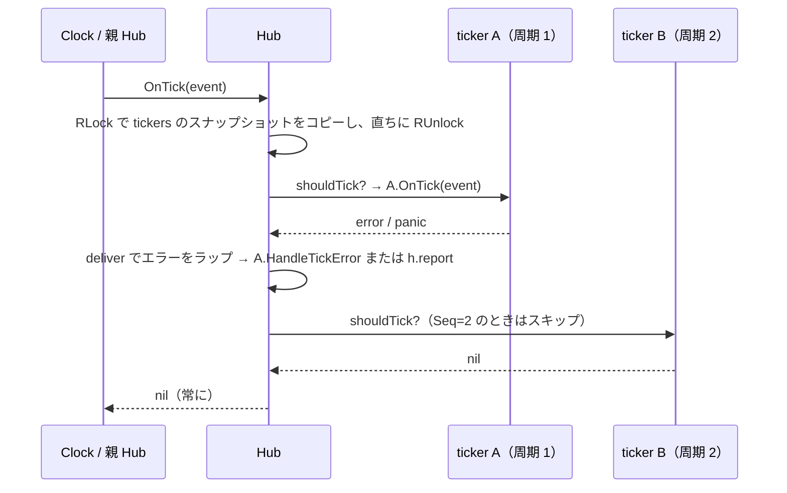
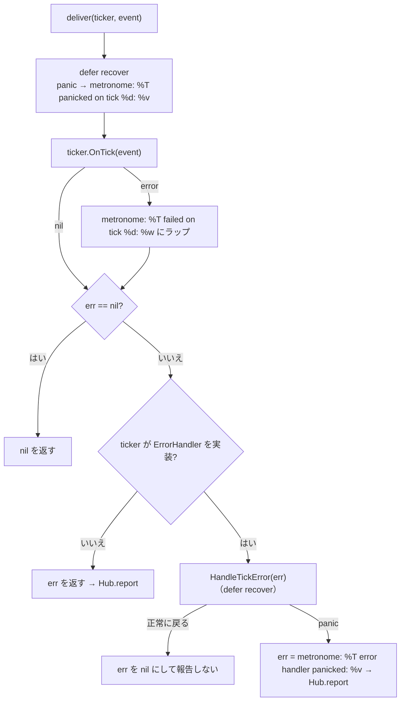
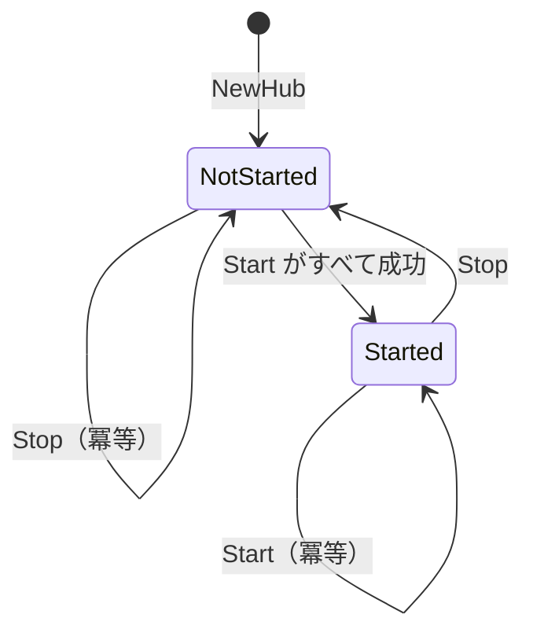
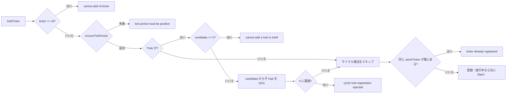

# pkg/metronome/hub.go

> 📅 最終更新日: 2026/11/26

`pkg/metronome/hub.go` は節拍の配信センター `Hub` を実装します。`Hub` 自身は `Ticker`（`OnTick`）であり、同時に `Periodic`（`TickPeriod`）と `Lifecycle`（`Start`/`Stop`）でもあるため、同じ実装が `Clock` のルート受け手としても、別の `Hub` ツリーへ子ノードとして接続しても、**階層配信**を構成できます。各節拍は子 ticker の `TickPeriod` でフィルタした後、**登録順に同期的に**転送されます。個々の ticker の error / panic は隔離されて自身の `ErrorHandler` に渡され、なければ `Hub` の既定エラーハンドラに渡されるため、残りの ticker を中断することは決してありません。

## 役割

- **ファンアウト**：上流の `TickEvent` を命中したすべての子 ticker へ配信し、厳密な登録順を保ちます。
- **フィルタ**：`Periodic.TickPeriod()` による拍単位のフィルタを行い、`Periodic` を実装しない ticker は周期 1 とみなします。
- **隔離**：各子 ticker の失敗を自身に限定し、`OnTick` は常に `nil` を返します。
- **ライフサイクルの編成**：`Lifecycle` を実装する子項目を登録順に `Start`、逆順に `Stop` し、実行期の追加・削除もサポートします。
- **構造の問い合わせ**：`Contains` は直接の子項目を調べ、ジェネリックな `Find[T]` は Hub ツリー全体から指定型の最初の ticker を探します（`pkg/assembly` はこれを使って `*reporter.SnapshotTicker` / `*reporter.InjectionTicker` が組み込まれているか確認します）。

## 主要オブジェクト

### `type HubOption` と構成関数

```go
type HubOption func(*Hub) error

func WithErrorHandler(handler func(error)) HubOption
func WithTickPeriod(period int) HubOption
```

| オプション | 役割 | 失敗する状況 |
|------|------|---------|
| `WithErrorHandler(handler)` | `Hub` の既定エラーハンドラを設定し、「ticker が `ErrorHandler` を実装していない」または「`HandleTickError` がさらに panic した」場合に使われます。`nil` を渡すのは未設定と同じ（既定ログに退避）。 | 失敗しない |
| `WithTickPeriod(period)` | `Hub` が**子 ticker** として動作するときの自身の節拍周期を設定し、既定は `1`。 | `period < 1` → `metronome: tick period must be positive, got %d`、`NewHub` がそのエラーを直接返す |

オプションは `NewHub` 内で渡された順に適用され、いずれかがエラーを返すと全体が失敗して `nil, err` を返します。

### `type Hub`

```go
type Hub struct {
    mu      sync.RWMutex // 保护 tickers 与 period
    tickers []Ticker     // 注册顺序，分发顺序即此顺序

    lifecycleMu sync.Mutex // 串行化 Start/Stop/AddTicker/RemoveTicker
    started     bool

    period  int
    onError func(error)
}
```

- `tickers` は**順序付きスライス**で、`OnTick` はこの順序に依存し、`Find` も安定した探索のためにこれに依存します。
- `lifecycleMu` はライフサイクル関連のメソッドだけが保持し、`OnTick` は取得しません——両者は並行でき、代償は「取り外した後でも途中の拍が届く可能性がある」ことです（後述）。
- `period` は `Hub` 自身が子 ticker として動作するときの周期です。`TickPeriod()` は `< 1` の値を防御的に補正して 1 を返しますが、構築／設定時にすでに検証済みです。

### 構築：`NewHub(opts ...HubOption) (*Hub, error)`

- 既定は `period = 1`、`onError = nil`。
- 引数なしなら常に成功し、`WithTickPeriod(0)` などの不正値を伴う場合はそのオプションのエラーを返します。

### 公開メソッド

| メソッド | シグネチャ | 役割 |
|------|------|------|
| `TickPeriod` | `func (h *Hub) TickPeriod() int` | 子 ticker としての自身の周期を返す。`< 1` のときは 1 を返す |
| `SetTickPeriod` | `func (h *Hub) SetTickPeriod(period int) error` | 実行期に自身の周期を変更する |
| `AddTicker` | `func (h *Hub) AddTicker(ticker Ticker) error` | 子 ticker を登録する |
| `RemoveTicker` | `func (h *Hub) RemoveTicker(ticker Ticker) error` | 子 ticker の登録を解除する |
| `Contains` | `func (h *Hub) Contains(ticker Ticker) bool` | **直接の**子項目かどうか |
| `Start` | `func (h *Hub) Start() error` | 登録順に `Lifecycle` を実装する子項目を起動する |
| `Stop` | `func (h *Hub) Stop() error` | 逆順に `Lifecycle` を実装する子項目を停止する |
| `OnTick` | `func (h *Hub) OnTick(event TickEvent) error` | 節拍を配信する。常に `nil` を返す |

### ジェネリック検索：`Find[T Ticker]`

```go
func Find[T Ticker](hub *Hub) (T, bool)
```

- 型パラメータ `T` は `Ticker` を満たす必要があり、具体型（`*reporter.SnapshotTicker` など）でもインターフェース（`metronome.Lifecycle` など）でも構いません。
- `(zero, false)` を返す場合：`hub == nil`、ツリー全体に一致する項目がない。
- 内部では `map[*Hub]struct{}` で訪問済みの Hub を記録するため、構造に異常な循環があっても無限再帰しません。

## 主要フロー

### 節拍の配信 `OnTick`



1. **スナップショット**：`mu.RLock` の下で `append([]Ticker(nil), h.tickers...)` を行い、その後の走査は完全にスナップショットに基づきます。したがって配信中の `AddTicker`/`RemoveTicker` は今回の走査集合を変えません。
2. **登録順**：`for _, ticker := range tickers` で直列に呼び、決して並行にしません。前の ticker の実行が終わってから次を呼ぶため、順序はテストで安定的にアサートできます（`TestHubFansOutInRegistrationOrder` は `a, b, c` を期待）。
3. **周期フィルタ**：`shouldTick(ticker, event)` → `(event.Seq-1)%period == 0`。`period < 1` は命中しないものとします。
4. **エラー隔離**：`h.deliver` が非 nil を返すと `h.report(err)` を呼び、その後次の ticker へ進みます。
5. **戻り値は常に `nil`**：子 ticker の失敗は親 Hub へ伝播せず、親 Hub も重複して報告しません——各エラーは**直接の親**で 1 回だけ処理されます。

### 単一 ticker の呼び出しとエラーの収束 `deliver`



- `ErrorHandler` があり処理に成功した場合、`err` は明示的に `nil` にされ、`Hub` の既定ハンドラを**再び**発火させません（`TestHubUsesTickerErrorHandlerBeforeDefaultReporter` は `reported` が空であることをアサート）。
- `ErrorHandler` があるが自身が panic した場合、panic はエラーに変換されて引き続き報告されます——これは「ハンドラ自体にバグがあっても節拍の失敗を飲み込ませない」ための受け皿です。

### 既定のエラー処理 `report`

```go
func (h *Hub) report(err error) {
    handler := h.onError
    if handler == nil {
        handler = defaultErrorHandler
    }
    defer func() {
        if recovered := recover(); recovered != nil {
            defaultErrorHandler(fmt.Errorf("metronome: error handler panicked: %v", recovered))
        }
    }()
    handler(err)
}
```

- `h.onError` が `nil` のときは `defaultErrorHandler` を使います：`log.Printf("metronome: %v", err)` で標準エラーへ出力します。
- `h.onError` 自身が panic した場合は既定ログへ退避し、`OnTick` は後続の ticker の処理を続けます（`TestHubSurvivesDefaultErrorHandlerPanic` は健全な ticker が依然として呼ばれることを検証）。
- `deliver` がすでにエラーを `metronome: ...` にラップしているため、既定ログには `metronome: metronome: ...` の二重プレフィックスが現れます——これは現在の実装の実際の出力で、意味には影響しません。

### ライフサイクル：Start / Stop



- **`Start`**：`lifecycleMu` を保持する。すでに `started` ならそのまま `nil` を返す。`tickers` のスナップショットをコピーした後、登録順に走査し、`Lifecycle` を実装しない項目を飛ばして 1 つずつ `Start()` する。
  - ある項目が失敗すると直ちに停止する：すでに起動に成功した項目に対して `stopReversed`（逆順の `Stop`）を呼び、`errors.Join(startErr, stopErr)`（ロールバックも失敗）または `startErr` のみを返す。`started` は **`false` のまま**で、修正後に再試行できます。
  - すべて成功した場合にのみ `started = true` にする。
- **`Stop`**：`lifecycleMu` を保持する。`started` でなければ `nil` を返す。スナップショットをコピーし、**先に `started = false`** にしてから、すべての `Lifecycle` 子項目を集めて `stopReversed` し、`errors.Join` ですべての停止エラーを集約する（最初の失敗で後続を飛ばすことはない）。

`stopReversed` の詳細：末尾から前へ走査し、各エラーを `metronome: stop %T: %w` にラップし、最後に `errors.Join` で 1 つのエラーにまとめる（複数エラーのとき `Error()` は改行で連結され、`errors.Is` は個別にマッチできる）。

### 実行期の Add / Remove

| 場面 | 動作 |
|------|------|
| Hub が未起動のときの `AddTicker` | 登録のみで、`Start` は呼ばない |
| Hub が起動済みのときの `AddTicker` | ticker が `Lifecycle` を実装していれば、**先に `Start` してから登録**する。`Start` に失敗すると `metronome: start %T: %w` を返し、**登録しない**。その ticker の内部状態を自動でロールバックすることはない |
| Hub が未起動のときの `RemoveTicker` | スライスから直接取り外し、`Stop` は呼ばない |
| Hub が起動済みのときの `RemoveTicker` | **先に取り外してから `Stop`**。`Stop` に失敗しても「取り外し済み」のまま、`metronome: stop %T: %w` を返す |

「先に起動してから登録／先に取り外してから停止」の順序により、新しい ticker が半初期化状態で節拍を受け取ることはなく、取り外された ticker が**新しく作成された**スナップショットで節拍を受け取ることもありません。

> 例外：`OnTick` は取り外しの**前に**スナップショットをコピーしているため、配信中のこのラウンドは「取り外されたばかりで Stop 中の」ticker にさらに 1 拍届ける可能性があります。ライフサイクルと配信の間の隔離は「ベストエフォート」であり、厳密な障壁ではありません。

### サイクル検出と重複登録

`AddTicker` の検証順序：`nil` → 周期の正当性 → `rejectCycle` → 重複判定 → 登録。



- **自己参照**：`a.AddTicker(a)` → `metronome: cannot add a hub to itself`。
- **間接的な循環**：`a.AddTicker(b)` の成功後に `b.AddTicker(a)` → `metronome: cyclic hub registration rejected: target hub already contains this hub`（`TestHubRejectsCyclicRegistration`）。
- **重複判定は `sameTicker` を使う**：

  ```go
  leftType := reflect.TypeOf(left)
  rightType := reflect.TypeOf(right)
  if leftType == nil || rightType == nil || leftType != rightType { return false }
  if !leftType.Comparable() { return false }
  return left == right
  ```

  - 動的型が異なる → 永久に等しくない；
  - 型が比較不能（`TickerFunc`、slice/map フィールドを含む値型など）→ **重複判定しない**ため、重複登録できる；
  - 比較可能な型 → `==` で判定する。すなわちポインタ構造体は**インスタンスのアドレス**で等価判定する（`TestHubRejectsDuplicateRegistration` は同じ `*periodProbe` で検証）。

### `Contains` と `Find` の探索の意味

- `Contains(ticker)`：**直接の**子項目だけを調べ、同様に `sameTicker` を使います。したがって `Hub` は「孫ノード」の存在を報告せず、`TickerFunc` は常に `false` を返します。
- `Find[T](hub)`：層ごとに進む深さ優先——
  1. まず現在の Hub の**すべての直接の子項目**の中に型 `T` があるかを見る（登録順で最初の 1 つ）；
  2. 次に登録順に子 `*Hub` へ再帰的に入る。
  
  したがって「近いものを優先」します：親 Hub が `childHub` と `tickerX` の両方を登録しており、どちらも `T` にマッチする場合、`childHub` が登録順で前でも `tickerX` が先に返されます。`Find` は渡された `hub` 自身にはマッチしません（その子項目とサブツリーのみを調べます）。

## 重要な詳細

### エラーメッセージ一覧

| 発生点 | エラーテキスト |
|--------|---------|
| `AddTicker(nil)` | `metronome: cannot add nil ticker` |
| 周期が不正（`AddTicker` / `NewHub` / `SetTickPeriod`） | `metronome: tick period must be positive, got %d` |
| 自己登録 | `metronome: cannot add a hub to itself` |
| 間接的な循環 | `metronome: cyclic hub registration rejected: target hub already contains this hub` |
| 重複登録 | `metronome: ticker already registered` |
| 実行期の `AddTicker` で起動失敗 | `metronome: start %T: %w` |
| `RemoveTicker(nil)` | `metronome: cannot remove nil ticker` |
| 未登録項目の削除 | `metronome: ticker is not registered` |
| 実行期の `RemoveTicker` で停止失敗 | `metronome: stop %T: %w` |
| `OnTick` の panic | `metronome: %T panicked on tick %d: %v` |
| `OnTick` がエラーを返す | `metronome: %T failed on tick %d: %w` |
| ticker の `HandleTickError` の panic | `metronome: %T error handler panicked: %v` |
| `Hub.onError` の panic | 既定ログ出力 `metronome: metronome: error handler panicked: %v`（内側のエラーがすでにプレフィックスを持ち、`log.Printf` がさらにもう 1 層付ける） |

### 並行性とロック

- `mu`（`RWMutex`）は `tickers` と `period` を保護します。`OnTick`/`Find`/`Contains`/`TickPeriod` は読み取りロックのみを取り、ロック内でスナップショットのコピーを完了し、**ロックを保持したまま ticker を呼びません**——したがって ticker が `OnTick` 内で `hub.AddTicker` / `hub.Contains` を呼び返しても自己デッドロックしません。
- `lifecycleMu` は `Start`/`Stop`/`AddTicker`/`RemoveTicker` を直列化し、「起動と停止の交差」「同じ子項目の二重起動」を防ぎます。
- `Start`/`Stop` は `lifecycleMu` を保持している間も短時間 `mu` を取って `tickers` を読み書きし、ロック順序は常に `lifecycleMu → mu` です。`OnTick` は `mu` のみを取り、逆方向にロックを保持しないため、デッドロックの環はありません。
- `OnTick` とライフサイクルの変更は並行できます：`Hub` は「ticker が停止した後は絶対に節拍を受け取らない」ことを保証しません（前述の途中スナップショットを参照）。

### `Clock` との責務の境界

- `Hub` は**自分で節拍を生成しません**：`Clock`（または親 `Hub`）が `OnTick` を呼ぶ必要があります。テストでは `hub.OnTick(TickEvent{Seq: 1})` を直接手で呼んでおり、これがクロックなしの場面での正当な使い方です。
- `Clock` はルート `Hub` の `Start`/`Stop` を**呼びません**。標準の順序は `hub.Start()` → `clock.Start()` で、停止時は `clock.Stop()` → `hub.Stop()` です（`pkg/assembly` の `startResources` がこのパターン）。
- `Hub` は `Lifecycle` を実装しているため、子 `Hub` を**起動済み**の親 Hub に登録すると自動的に `child.Start()` が呼ばれます。親 Hub の `Stop` 時には逆順に子 Hub が停止し、サブツリー全体が再帰的に停止します。

### `Periodic` と `TickPeriod` の関係

`Hub` 自身の `TickPeriod()` は、それが**子 ticker** として動作するときに親 Hub/Clock から読み取られるだけです。自身が子 ticker へ配信する際のフィルタには影響しません（フィルタは子 ticker の周期だけを見ます）。`WithTickPeriod(2)` は「このサブツリーは 2 拍ごとに 1 回しか節拍を受け取らない」ことを意味し、サブツリー内部で見える `Seq` は `1, 3, 5, ...` になります（親層が渡した `Seq` は振り直されないため）。

## 使用例

### 階層 Hub + 周期フィルタ + カスタムエラー処理

```go
package main

import (
    "errors"
    "fmt"
    "time"

    "github.com/Mr-xiaotian/CelestialGrow/pkg/metronome"
)

type counter struct {
    name   string
    period int
    n      int
}

func (c *counter) TickPeriod() int { return c.period }

func (c *counter) OnTick(event metronome.TickEvent) error {
    c.n++
    fmt.Printf("[%s] seq=%d 第 %d 次执行\n", c.name, event.Seq, c.n)
    return nil
}

type faulty struct{}

func (faulty) OnTick(metronome.TickEvent) error { return errors.New("boom") }

func main() {
    // 子 Hub：每 3 拍才从父 Hub 收到一次节拍。
    child, err := metronome.NewHub(metronome.WithTickPeriod(3))
    if err != nil {
        panic(err)
    }
    if err := child.AddTicker(&counter{name: "child-odd", period: 2}); err != nil {
        panic(err)
    }

    parent, err := metronome.NewHub(metronome.WithErrorHandler(func(err error) {
        fmt.Println("hub 默认处理器:", err)
    }))
    if err != nil {
        panic(err)
    }

    // 注册顺序即分发顺序。
    for _, t := range []metronome.Ticker{
        &counter{name: "fast", period: 1},
        faulty{},
        &counter{name: "slow", period: 4},
        child,
    } {
        if err := parent.AddTicker(t); err != nil {
            panic(err)
        }
    }

    // 启动生命周期（child 会被递归启动），再由 Clock 驱动。
    if err := parent.Start(); err != nil {
        panic(err)
    }
    clock, err := metronome.NewClock(100*time.Millisecond, parent)
    if err != nil {
        panic(err)
    }
    if err := clock.Start(); err != nil {
        panic(err)
    }

    time.Sleep(time.Second)

    if err := clock.Stop(); err != nil {
        panic(err)
    }
    if err := parent.Stop(); err != nil {
        panic(err)
    }

    // 泛型查找：确认某类型是否已装配。
    if c, ok := metronome.Find[*counter](parent); ok {
        fmt.Println("找到 counter:", c.name)
    }
}
```

### 実行期の追加・削除

```go
hub, _ := metronome.NewHub()
if err := hub.Start(); err != nil { // 先启动空 Hub
    panic(err)
}

t := &counter{name: "late", period: 1}
if err := hub.AddTicker(t); err != nil { // 已启动 → 立即 Start（若实现 Lifecycle）
    panic(err)
}

// 摘除后立即 Stop（若实现 Lifecycle）；此后的新一轮节拍不再包含它。
if err := hub.RemoveTicker(t); err != nil {
    panic(err)
}
_ = hub.Stop()
```

## 注意事項

- **配信は同期・直列**：どの ticker がブロックしても同じラウンドの後続 ticker が遅れ、`Clock.Stop` が 5 秒後にタイムアウトする可能性があります。並行処理が必要な ticker は自分でキューや goroutine へ処理を投げるべきです。
- **`OnTick` は常に `nil` を返す**：`hub.OnTick` の戻り値で下流の失敗を感知しようとしてはいけません。`WithErrorHandler` を使うか、ticker に `ErrorHandler` を実装させてください。
- **`Find` は最初の一致項目のみを返す**、しかも「近いものを優先」します。同じ型名の複数インスタンスが必要な場合は自分で走査するか、`Contains` + 明示的な参照に切り替えてください。
- **`TickerFunc` は重複判定できず、`Contains`/`Find` でも安定して識別できない**：`sameTicker` は比較不能な型に対して直ちに `false` を返します。重複排除の意味が必要な場合はポインタ構造体を使ってください。
- **登録順は契約**：`Start` の順序、`OnTick` の配信順序、`Stop` の逆順はいずれもスライスの順序に依存します。実行期の `RemoveTicker` は後ろの要素を前に詰めますが、残りの要素の相対順序は変えません。
- **`Start` が失敗した後も `started` は `false` のまま**で、ロールバック済みの項目を個別に `Stop` すべきではありません。修正後はそのまま `Start` を再試行できます。
- **`RemoveTicker` の `Stop` 失敗で ticker が戻ることはない**：エラーは「停止時にエラーが出た」ことだけを示し、登録関係はすでに変更されています。呼び出し側が停止の再試行や再登録を行うかどうかを自分で決める必要があります。
- **既定のエラーハンドラは標準エラーへ書く**：`log.Printf("metronome: %v", err)`。長時間実行でエラーが頻繁な場合は、レート制限や集約のために `WithErrorHandler` を明示的に提供することを推奨します。
