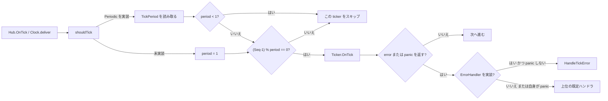

# pkg/metronome/ticker.go

> 📅 最終更新日: 2026/11/26

`pkg/metronome/ticker.go` は節拍システムの最小の契約を定義します：**受け手** `Ticker`、および 3 つの任意能力インターフェース `Lifecycle`、`ErrorHandler`、`Periodic` です。`Clock` と `Hub` はこれらのインターフェースにのみ依存するため、業務側は `OnTick` を実装するだけで組み込め、必要に応じてライフサイクル、エラー処理、周期フィルタを補えば済みます。

## 役割

- `Ticker`：節拍を受け取りたい型が必ず実装すべき唯一のメソッド。
- `Lifecycle`：`Hub` が子リソースの起動／停止を一括管理できるようにします（`Start` は登録順、`Stop` は逆順）。
- `ErrorHandler`：エラーを Hub の既定ハンドラまで伝播させず、ticker 自身で処理できるようにします。
- `Periodic`：「N 拍ごとに 1 回発火する」ことを宣言し、上位層が配信前にフィルタします。
- `TickerFunc`：通常の関数を `Ticker` に適合させ、使い捨てのロジックのために構造体を定義せずに済みます。

## 主要オブジェクト

### `type Ticker interface`

```go
type Ticker interface {
    OnTick(event TickEvent) error
}
```

- `shouldTick` の判定が命中した場合（`Periodic` を実装していない場合は周期 1、すなわち毎拍命中）にのみ呼ばれます。
- 返された `error` は上位の `Hub` または `Clock` が捕捉してエラーハンドラへ渡し、**他の ticker を中断しません**。
- `OnTick` は配信側（`Clock` のバックグラウンド goroutine、または親 `Hub` の呼び出しスタック）で**同期的に実行**されるため、遅い ticker は節拍チェーン全体を遅らせます。

### `type Lifecycle interface`

```go
type Lifecycle interface {
    Start() error
    Stop() error
}
```

`Hub` は登録項目の中からこのインターフェースを識別します：`Start` は登録順に呼び、`Stop` は逆順に呼びます。**このインターフェースを実装しない ticker は節拍の配信にのみ参加**し、`Hub` はそれらに対して起動／停止の操作を一切行いません。

> `Hub` 自身も `Start`/`Stop` を実装しているため `Lifecycle` を満たします——これがネストした Hub を親 Hub が再帰的に起動／停止できる理由です。

### `type ErrorHandler interface`

```go
type ErrorHandler interface {
    HandleTickError(err error)
}
```

`OnTick` が error を返すか panic した場合、`Hub`/`Clock` は**優先的に**このフックを呼び、すでにラップ済みのエラー（`metronome: *T failed on tick 7: ...` の形）を渡します。次の場合にのみ上位の既定ハンドラへ退避します：

- ticker が `ErrorHandler` を実装していない；
- `HandleTickError` 自身が panic した。

### `type Periodic interface`

```go
type Periodic interface {
    TickPeriod() int
}
```

- 戻り値は正の整数でなければなりません：`1` は毎拍発火、`2` は 2 拍ごとに 1 回発火を意味します。
- `Hub`/`Clock` は**配信のたびにこの値を読み直す**ため、実装側は実行期に周期を動的に調整できます。
- `AddTicker` は登録時に一度だけ検証します（不正値なら直ちにエラーを返す）が、実行期に `TickPeriod()` が `< 1` を返すと、`shouldTick` はその ticker を黙ってスキップします（エラーも発火もなし）。

### `type TickerFunc`

```go
type TickerFunc func(event TickEvent) error

func (f TickerFunc) OnTick(event TickEvent) error
```

- アダプタ：`OnTick` はラップされた関数を直接呼び、戻り値をそのまま透過させます。
- 関数型は**比較不能**であるため、`Hub` の重複判定（`sameTicker`）は 2 つの `TickerFunc` を同一インスタンスとは見なしません——**同じ `TickerFunc` 値を複数回登録でき**、そのたびに節拍を受け取ります。テスト `TestHubFansOutInRegistrationOrder` はまさにこの性質を利用して 3 つの `TickerFunc` を登録しています。
- `nil` の `TickerFunc` はインターフェースに入れられます（インターフェース自体は非 nil）が、`OnTick` を呼ぶと panic します。`Clock`/`Hub` の recover がそれをエラーに変換するため、プロセスはクラッシュしません。

### 非公開の補助関数（動作の取り決め）

| 関数 | 動作 |
|------|------|
| `ensureTickPeriod(period int) error` | `period < 1` のとき `metronome: tick period must be positive, got %d` を返す。 |
| `tickPeriod(ticker Ticker) int` | `Periodic` を実装していればその戻り値を、そうでなければ `1` を返す。 |
| `shouldTick(ticker Ticker, event TickEvent) bool` | `period < 1` なら `false`、そうでなければ `(event.Seq-1)%period == 0` を返す。 |

## 主要フロー



## 重要な詳細

- **インターフェースは暗黙的**：ticker は「あるインターフェースを実装する」と明示する必要はなく、メソッドセットが一致すれば `type assertion` で識別されます。典型的な組み合わせは 4 つの能力を自由に接続したもので、例えば「`Periodic` と `Lifecycle` の両方を実装する」などです。
- **周期フィルタは `(Seq-1) % period` を使う**：`Seq` は 1 から始まるため、`period = 2` は `1, 3, 5, ...`（奇数拍）に命中し、`2, 4, 6, ...` ではありません。ここは間違えやすい境界です。
- **周期は登録時に検証し、配信時に読み取る**：`AddTicker` が検証するのは「登録した瞬間」の `TickPeriod()` です。その後実装側がそれを `0` に変えても登録は失敗しませんが、その ticker は永久に黙ってスキップされます。
- **エラーハンドラが受け取るのは「ラップ後のエラー」のみ**：`errors.Is` / `errors.As` は `%w` のラップを貫通して元のエラーを特定できるため、`TestHubIsolatesTickerError` はそのようにアサートしています。
- **`HandleTickError` には戻り値がない**：上位へ「再報告」することはできません。Hub の既定ハンドラへ退避したい場合は panic するしかありません（その後 recover でエラーに変換され `Hub.report` に渡されます）。

## 使用例

### 最小 ticker + 周期 + ライフサイクル

```go
package main

import (
    "fmt"
    "time"

    "github.com/Mr-xiaotian/CelestialGrow/pkg/metronome"
)

// Sampler 每 5 拍采样一次，并演示生命周期的接入方式。
type Sampler struct {
    name   string
    closed bool
}

func (s *Sampler) TickPeriod() int { return 5 } // 实现 Periodic

func (s *Sampler) Start() error { // 实现 Lifecycle
    fmt.Println(s.name, "started")
    return nil
}

func (s *Sampler) Stop() error {
    s.closed = true
    fmt.Println(s.name, "stopped")
    return nil
}

func (s *Sampler) OnTick(event metronome.TickEvent) error { // 实现 Ticker
    fmt.Println(s.name, "sample at seq", event.Seq, event.FiredAt.Format(time.RFC3339))
    return nil
}

// 可选：自行处理错误，避免落到 Hub 的默认日志。
func (s *Sampler) HandleTickError(err error) { // 实现 ErrorHandler
    fmt.Println(s.name, "tick error:", err)
}
```

### `TickerFunc` で使い捨てのロジックを書く

```go
hub, err := metronome.NewHub()
if err != nil {
    panic(err)
}

ticks := 0
if err := hub.AddTicker(metronome.TickerFunc(func(event metronome.TickEvent) error {
    ticks++
    fmt.Println("tick", event.Seq)
    return nil
})); err != nil {
    panic(err)
}
```

`TickerFunc` には `TickPeriod()` が存在しないため周期 1 として毎拍発火します。`Lifecycle` も実装しないため、`Hub.Start`/`Stop` は何も行いません。

## 注意事項

- **大きなインターフェースではなく分割されたインターフェース**：`OnTick` だけを実装すれば正当な ticker です。「見た目を完全にする」ために空回りする `Start`/`Stop` を実装しないでください——`Lifecycle` を実装すると、`Hub` は起動／停止時に実際にそれらを呼び、失敗すれば `Hub` の起動／停止フローも中断されます。
- **`OnTick` は速く**：クロックの goroutine（または親 ticker の呼び出しスタック）上にあるため、ブロックすると後続の節拍を直接遅らせ、`Clock.Stop` が 5 秒後にタイムアウトしてエラーを返す可能性があります。
- **`Periodic` の戻り値を動的に 0 に縮めない**：`shouldTick` は黙ってスキップし、「ticker がなぜか発火しなくなる」形で現れます。
- **`TickerFunc` は重複判定できない**：「同じインスタンスを 1 回だけ登録する」意味が必要な場合は、関数アダプタではなくポインタ構造体を使ってください。
- **`ErrorHandler` は万能の受け皿ではない**：それ自身が panic すると、`Hub` は既定ログへ、`Clock` も既定ログへ退避します——どちらの層にも recover がありますが、エラーメッセージには「error handler panicked」のラップが余分に付きます。
