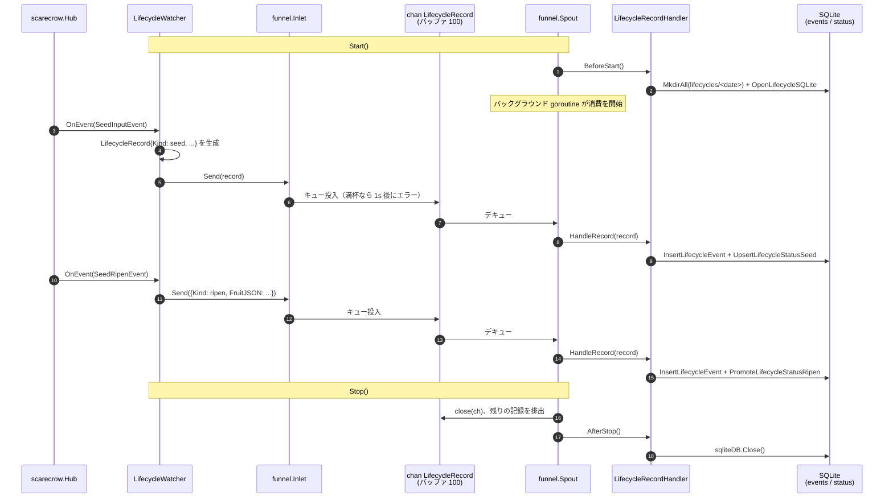

# pkg/persist/lifecycle.go

> 📅 最終更新日: 2026/11/13

## 役割

`pkg/persist/lifecycle.go` は `pkg/scarecrow` の実行期イベントを **ライフサイクル記録** に変換し、SQLite へ非同期に書き込みます：

- `scarecrow.Watcher` を実装する `LifecycleWatcher` が「イベント → `LifecycleRecord`」の変換と送信を担当します。
- `LifecycleRecordHandler` は `funnel.RecordHandler[LifecycleRecord]` を実装し、「記録 → SQLite」の書き込みを担当します。
- 両者は `funnel.Spout` / `funnel.Inlet` で接続されます。`Spout` はバックグラウンド goroutine で直列に消費し、`Inlet` は並行安全な送信を担当します。

各種子はデータベース内で 2 種類のデータとして表現されます：`events`（イベント本体 + `event_parents` 親辺）と `status`（`input_event_id` を主キーとする最新状態スナップショット）です。本ファイル自体は SQL を書かず、テーブル作成と CRUD はすべて [`sqlite.md`](./sqlite.md) で実装されています。

> 本ファイルは `pkg/funnel` と `pkg/scarecrow` のみに依存し、`pkg/runtime` を直接参照しません。イベント ID はイベント構造体が保持し（`SeedID` / `FruitID` / `WeedID` / `PruneID`）、永続化層はそのまま書き込みます。

## 主要オブジェクト

### `LifecycleRecord` — キューのペイロード

```go
type LifecycleRecord struct {
    Kind           string
    InputEventID   int
    CurrentEventID int
    ParentIDs      []int
    PlotName       string
    SeedJSON       string
    FruitJSON      string
    WitherType     string
    WitherMessage  string
    TS             float64
}
```

| フィールド | 意味 |
|------|------|
| `Kind` | 操作種別。パッケージ内定数 `lifecycleSeed` / `lifecycleRipen` / `lifecycleWither` / `lifecyclePrune`（すなわち `seed` / `ripen` / `wither` / `prune`）を取る。同時に `events.event_type` として書き込まれる |
| `InputEventID` | この種子（入力）のイベント ID。`status.input_event_id` に対応 |
| `CurrentEventID` | 今回生成されたイベント ID。`events.event_id` と `status.current_event_id` に対応し、`seed` 時は `InputEventID` と等しい |
| `ParentIDs` | 親イベント ID のリスト。`event_parents` の辺に書き込む。外部から注入された種子は `nil` |
| `PlotName` | イベントが属する Plot 名。`events.plot` と `status.plot` に書き込む |
| `SeedJSON` | 種子ペイロードの JSON。`seed` 記録のみ設定 |
| `FruitJSON` | 果実の JSON。`ripen` 記録のみ設定 |
| `WitherType` | 枯死エラーの型。`wither` 記録のみ設定（`fmt.Sprintf("%T", err)`） |
| `WitherMessage` | 枯死エラーのテキスト。`wither` 記録のみ設定（`fmt.Sprintf("%v", err)`） |
| `TS` | イベント時刻（Unix 秒、浮動小数点、ミリ秒精度）。イベントの `Time` フィールドから換算 |

### `LifecycleRecordHandler` — コンシューマ側

```go
type LifecycleRecordHandler struct {
    SQLitePath string
    sqliteDB   *sql.DB
}
```

`funnel.RecordHandler[LifecycleRecord]` を実装します：

| メソッド | 呼び出しタイミング | 動作 |
|------|----------|------|
| `BeforeStart() error` | `Spout.Start()` 内、消費ループ開始前 | `lifecycles/<YYYY-MM-DD>/` を作成し（権限 `0755`）、`grow_lifecycle(<HH-MM-SS.mmm>).sqlite3` のパスを組み立て、`OpenLifecycleSQLite` を呼んでデータベースを開いてテーブルを作成する。パスは `SQLitePath` に、ハンドルは `sqliteDB` に保存する |
| `HandleRecord(record LifecycleRecord) error` | 各記録のデキュー時 | まず `sqliteDB != nil` を検証し、次に `Kind` に従って先にイベントを書き、その後で状態スナップショットを書き込み／昇格する |
| `AfterStop() error` | `Spout.Stop()` の終了処理 | `sqliteDB` をクローズして nil にする。ハンドルがもともと空ならそのまま `nil` を返す |

> `SQLitePath` は公開フィールドで、`AfterStop` の後も最後に開いたパスが残ります。オフライン読み取りは `LoadLifecycleStatusesFromPath`（[`sqlite.md`](./sqlite.md) 参照）で行い、`LifecycleRecordHandler` 自身はクエリメソッドを提供しません。

### `LifecycleWatcher` — イベントオブザーバ

```go
type LifecycleWatcher struct {
    spout *funnel.Spout[LifecycleRecord]
    inlet *funnel.Inlet[LifecycleRecord]
}
```

| メソッド | 動作 |
|------|------|
| `NewLifecycleWatcher() *LifecycleWatcher` | デフォルトの `LifecycleRecordHandler` で構築する：`funnel.NewSpout(handler, 100, time.Second)` + `funnel.NewInlet(spout.GetQueue(), time.Second)` |
| `Start() error` | `spout.Start()` に委譲する：`BeforeStart` を発火してディレクトリ作成・データベースオープンを行い、バックグラウンド消費 goroutine を起動する |
| `Stop() error` | `spout.Stop()` に委譲する：チャネルを閉じ、キューが空になるまで待ち（最大 1s）、最後に `AfterStop` でデータベースを閉じる。タイムアウト時は `shutdown timeout` を返す |
| `DBPath() string` | 下位 handler の `SQLitePath` を返す。消費ループがまだ `Start` していない場合は空文字列 |
| `OnEvent(event scarecrow.Event) error` | イベント種別に応じて `LifecycleRecord` を構築し `inlet.Send` する。関心のないイベントはそのまま `nil` を返す |

> `newLifecycleWatcher(handler funnel.RecordHandler[LifecycleRecord])` はパッケージ内コンストラクタで、テストはこれを使ってキャプチャ用 handler を注入します。この場合 `DBPath()` は handler が `*LifecycleRecordHandler` ではないため空文字列を返します。

## イベントマッピング

`OnEvent` は 4 種類の種子結果イベントのみを処理し、それ以外のイベントはすべて無視します：

| `scarecrow` イベント | `Kind` | `InputEventID` | `CurrentEventID` | `ParentIDs` | ペイロード |
|------------------|--------|----------------|------------------|-------------|------|
| `SeedInputEvent` | `seed` | `SeedID` | `SeedID` | `ev.Parents` | `SeedJSON = toLifecycleJSON(ev.Seed)` |
| `SeedRipenEvent` | `ripen` | `SeedID` | `FruitID` | `[]int{ev.SeedID}` | `FruitJSON = toLifecycleJSON(ev.Fruit)` |
| `SeedWitherEvent` | `wither` | `SeedID` | `WeedID` | `[]int{ev.SeedID}` | `WitherType = %T(ev.Err)`、`WitherMessage = %v(ev.Err)` |
| `SeedPruneEvent` | `prune` | `SeedID` | `PruneID` | `[]int{ev.SeedID}` | なし |

明示的に無視される（`return nil`、書き込みなし）イベント：`FarmStartEvent`、`FarmEndEvent`、`PlotStartEvent`、`PlotEndEvent`、`SeedReplantEvent`、`SealInputEvent`、`SealMergeEvent`。パッケージ外から新たなイベント種別を追加することはできず（`scarecrow.Event` の `isEvent()` は非公開メソッド）、したがって switch の外側のフォールバック分岐が実際に発火することはありません。

タイムスタンプは一律 `unixSeconds(ev.Time)` で生成されます：

```go
func unixSeconds(t time.Time) float64 {
    return float64(t.UnixMilli()) / 1000
}
```

したがって `TS` はミリ秒精度で、キュー滞留の影響を受けずイベント発生時刻と一致します。

## 主要フロー



### `HandleRecord` の Kind ルーティング

```go
func (l *LifecycleRecordHandler) HandleRecord(record LifecycleRecord) error {
    if l.sqliteDB == nil {
        return fmt.Errorf("生命周期 sqlite 未初始化")
    }

    switch record.Kind {
    case lifecycleSeed:
        if err := InsertLifecycleEvent(l.sqliteDB, record.CurrentEventID, record.Kind, record.PlotName, record.TS, record.ParentIDs); err != nil {
            return err
        }
        return UpsertLifecycleStatusSeed(l.sqliteDB, record.InputEventID, record.SeedJSON, record.PlotName, record.TS)
    // ripen / wither / prune 同理：先 InsertLifecycleEvent，再 PromoteLifecycleStatusXxx
    default:
        return fmt.Errorf("unsupported lifecycle operation: %s", record.Kind)
    }
}
```

要点：

- 4 種類の `Kind` はいずれも先に `events`（`event_parents` 親辺を含む）を書き、成功した後に `status` を書きます。イベントの書き込みに失敗した場合、状態は変更されず、両者の整合性が保たれます。
- `ripen` / `wither` / `prune` は `UPDATE status ... WHERE input_event_id = ?` で昇格するため、対応する `seed` 記録がすでに書き込まれている必要があります（`UPDATE` がヒットしなくてもエラーにはなりません。[`sqlite.md`](./sqlite.md) 参照）。
- `kind` が不正な場合は `unsupported lifecycle operation: <kind>` を返し、`sqliteDB == nil` の場合は `生命周期 sqlite 未初始化` を返します。
- すべてのエラーはそのまま上位へ返され、`Spout` の消費ループで破棄されます（`Spout` は `HandleRecord` の戻り値を検査しません）。書き込み失敗を観測したい場合は、SQLite ファイル自体かログに頼るしかありません。

### DB パスとディレクトリ

```text
lifecycles/<YYYY-MM-DD>/grow_lifecycle(<HH-MM-SS.mmm>).sqlite3
```

- 日付 `2006-01-02`、時刻 `15-04-05.000` は `BeforeStart` 内でそれぞれ一度ずつ `time.Now()` を取ります。同じ日に複数回起動すると複数のファイルができます。
- ディレクトリ権限は `0755`。ファイルは `sql.Open("sqlite", "file:...")` が自動的に作成し、`BeforeStart` は明示的にファイルを作りません。
- `os.MkdirAll` の失敗 → `创建生命周期目录失败: %w`、データベースのオープン失敗 → `打开生命周期 sqlite 失败: %w`。
- `Start` に失敗した場合、起動済みの消費ループは残りません。`assembly` は `Start` が成功してからでないとオブザーバを Hub に登録しません。

### `toLifecycleJSON` のフォールバック

```go
func toLifecycleJSON(value any) string {
    data, err := json.Marshal(value)
    if err == nil {
        return string(data)
    }
    lifecycle, lifecycleErr := json.Marshal(fmt.Sprintf("%+v", value))
    if lifecycleErr == nil {
        return string(lifecycle)
    }
    return `"marshal_error"`
}
```

まず `json.Marshal` を優先し、失敗した場合は `fmt.Sprintf("%+v", value)` の JSON 文字列に退避し、それも失敗した場合は `"marshal_error"` を固定で書き込みます。返り値は常に正当な JSON テキストで、`status.seed_json` に `NULL` が現れることはありません。

## 公開シンボル一覧

| シンボル | 種別 | 用途 |
|------|------|------|
| `LifecycleRecord` | 型 | キューのペイロード（`Kind` + イベントフィールド + 状態フィールド） |
| `LifecycleRecordHandler` | 型 | `funnel.RecordHandler[LifecycleRecord]` 実装。書き込みを担当 |
| `(*LifecycleRecordHandler).BeforeStart` | メソッド | ディレクトリ作成、データベースオープン、テーブル作成 |
| `(*LifecycleRecordHandler).HandleRecord` | メソッド | `Kind` に従ってイベントを書き、状態を進める |
| `(*LifecycleRecordHandler).AfterStop` | メソッド | データベースハンドルをクローズする |
| `LifecycleWatcher` | 型 | `scarecrow.Watcher` 実装。イベント → 記録 |
| `NewLifecycleWatcher` | 関数 | オブザーバを作成する（デフォルト handler、バッファ 100、タイムアウト 1s） |
| `(*LifecycleWatcher).Start` | メソッド | 消費ループを起動しデータベースを開く |
| `(*LifecycleWatcher).Stop` | メソッド | 消費ループを停止し、フラッシュしてデータベースを閉じる |
| `(*LifecycleWatcher).DBPath` | メソッド | 今回の実行の SQLite パスを返す |
| `(*LifecycleWatcher).OnEvent` | メソッド | イベントの変換と送信 |

> `lifecycleSeed` / `lifecycleRipen` / `lifecycleWither` / `lifecyclePrune`、`newLifecycleWatcher`、`unixSeconds`、`toLifecycleJSON` はいずれもパッケージ内の非公開シンボルです。

## 使用例

`scarecrow.Hub` を配信センターとして、オブザーバを起動してからイベントを送信し、終了後に `DBPath()` でオフライン読み取りします：

```go
package main

import (
    "errors"
    "fmt"
    "time"

    "github.com/Mr-xiaotian/CelestialGrow/pkg/persist"
    "github.com/Mr-xiaotian/CelestialGrow/pkg/scarecrow"
)

func main() {
    hub := scarecrow.NewHub()
    watcher := persist.NewLifecycleWatcher()
    if err := hub.AddWatcher(watcher); err != nil {
        panic(err)
    }
    if err := watcher.Start(); err != nil {
        panic(err)
    }

    now := time.Now()
    events := []scarecrow.Event{
        scarecrow.SeedInputEvent{Plot: "stage_a", Seed: 1, SeedID: 1, Time: now},
        scarecrow.SeedRipenEvent{Plot: "stage_a", Seed: 1, Fruit: 2, SeedID: 1, FruitID: 2, Time: now},
        scarecrow.SeedInputEvent{Plot: "stage_a", Seed: 2, SeedID: 3, Time: now},
        scarecrow.SeedWitherEvent{Plot: "stage_a", Seed: 2, Err: errors.New("boom"), SeedID: 3, WeedID: 4, Time: now},
    }
    for _, event := range events {
        if err := hub.OnEvent(event); err != nil {
            panic(err)
        }
    }

    if err := watcher.Stop(); err != nil {
        panic(err)
    }

    // Stop 後 SQLitePath 仍保留，可离线查询
    dbPath := watcher.DBPath()
    statuses, err := persist.LoadLifecycleStatusesFromPath(dbPath, "stage_a")
    if err != nil {
        panic(err)
    }
    for _, status := range statuses {
        fmt.Println(status.InputEventID, status.CurrentEventID, status.Status, status.WitherMessage)
    }
}
```

実行後、`lifecycles/<date>/grow_lifecycle(<time>).sqlite3` の `status` テーブルに 2 行が得られます：`1 2 ripen` と `3 4 wither boom`。

## 注意事項

- **必ず `Start` してからイベントを受ける**：`BeforeStart` が `sqliteDB` を初期化するため、そうしないと `HandleRecord` は `生命周期 sqlite 未初始化` を返します。このエラーは `Spout` に破棄されるため、「イベントが静かに失われる」形で現れます。
- **`OnEvent` は呼び出し元をブロックする**：送信は容量 100 のバッファ付きチャネルを使い、タイムアウトは 1s です。キューが満杯になると `OnEvent` は `inlet send timeout after 1s` を返し、`Hub` がそれを `ErrorHandler` に渡します。オブザーバは `OnEvent` 内で重い処理をすべきではありません。
- **`Spout.Stop` のフラッシュ意味論**：まず `close(ch)` で消費ループに残りの記録を排出させます。1s 以内に排出できない場合はコンテキストをキャンセルして `shutdown timeout` を返し、その後はタイムアウトの有無にかかわらずデータベースを閉じます。したがって高頻度書き込みの後は直ちに `Stop` すべきで、プロセス終了に頼ってはいけません。
- **`DBPath()` はデフォルト handler にのみ有効**：`DBPath` は型アサーションで `*LifecycleRecordHandler.SQLitePath` を取得するため、カスタム handler（テストなど）を注入した場合は空文字列を返します。呼び出し側は空文字列を「データベース利用不可」と見なすべきです。
- **`AfterStop` の後はハンドルが nil になるがパスは残る**：したがって `DBPath()` は `Stop` の後でもパスを返せ、`LoadLifecycleStatusesFromPath` と組み合わせてオフライン検索ができます（`Plot.Harvest` はこの方式で実装されています）。
- **状態の昇格は seed の先行書き込みに依存**：`Promote*` は `UPDATE` であり、対象行が存在しない場合は 0 行に影響してエラーになりません。上流は `SeedInputEvent` を対応する `Ripen` / `Wither` / `Prune` イベントより先に送信することを保証する必要があります。
- **エラーメッセージは `fmt.Sprintf` 形式**：`WitherType` / `WitherMessage` はそれぞれ `%T` / `%v` を取るため、ラップされたエラーではエラーチェーンが失われ、最外層のテキストのみが残ります。
- **タイムスタンプはイベント由来**：`TS` は `ev.Time` から計算され（ミリ秒精度）、`time.Now()` とは無関係です。イベントを再生すると元の実行と同じタイムラインが得られます。
