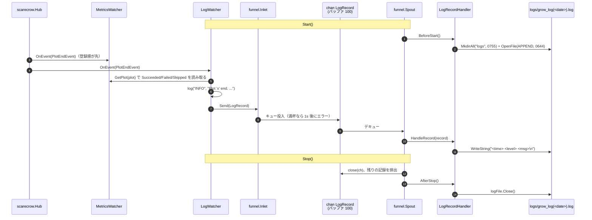

# pkg/persist/log.go

> 📅 最終更新日: 2026/11/13

## 役割

`pkg/persist/log.go` は `pkg/scarecrow` の実行期イベントをテキストログに変換し、ファイルへ非同期に追記します：

- `LogWatcher` は `scarecrow.Watcher` を実装し、`OnEvent` 内で「イベント → `LogRecord`」のマッピングとレベルフィルタリングを行います。
- `LogRecordHandler` は `funnel.RecordHandler[LogRecord]` を実装し、記録を 1 行のテキストに整形して `logs/grow_log(YYYY-MM-DD).log` へ書き込みます。
- 両者は `funnel.Spout` / `funnel.Inlet` で接続され、書き込みはバックグラウンド goroutine で行われるため、業務の実行経路は 1 回のキュー投入コストだけを負担します。

`LogWatcher` はさらに `*scarecrow.MetricsWatcher` を保持します。`PlotEndEvent` の果実／雑草／剪定の件数は指標スナップショットから直接読み取り、自前で計数しません。

> ライフサイクルの永続化は [`lifecycle.md`](./lifecycle.md) / [`sqlite.md`](./sqlite.md) を参照してください。ログと同じく Inlet/Spout 抽象を共有しますが、チャネルとファイルは共有しません。両方は `pkg/assembly` が一括作成し、`scarecrow.Hub` に登録して起動します。

## 主要オブジェクト

### `LogRecord` — キューのペイロード

```go
type LogRecord struct {
    FormatTime string
    Level      string
    Message    string
}
```

| フィールド | 説明 |
|------|------|
| `FormatTime` | イベント時刻の整形結果（`2006-01-02 15:04:05`）。`log` が送信前にイベント自身の時刻から生成する |
| `Level` | `TRACE` / `DEBUG` / `SUCCESS` / `INFO` / `WARNING` / `ERROR` / `CRITICAL` のいずれか |
| `Message` | すでにレンダリング済みのテキスト（時刻とレベルを含まない） |

### `LogRecordHandler` — コンシューマ側

```go
type LogRecordHandler struct {
    LogPath string
    logFile *os.File
}
```

`funnel.RecordHandler[LogRecord]` を実装します：

| メソッド | 呼び出しタイミング | 動作 |
|------|----------|------|
| `BeforeStart() error` | `Spout.Start()` 内、消費ループ開始前 | `logs/` を作成し（権限 `0755`）、`O_CREATE \| O_WRONLY \| O_APPEND`、権限 `0644` で `logs/grow_log(<YYYY-MM-DD>).log` を開き、パスを `LogPath` に保存する |
| `HandleRecord(record LogRecord) error` | 各記録のデキュー時 | `fmt.Sprintf("%s %s %s\n", FormatTime, Level, Message)` で 1 行に組み立てて `WriteString` する |
| `AfterStop() error` | `Spout.Stop()` の終了処理 | `logFile` をクローズする（nil にはしない） |

エラーテキストはそれぞれ `创建日志目录失败: %w`、`打开日志文件失败: %w`、`写入日志文件失败: %w`、`关闭日志文件失败: %w` です。

### `LogWatcher` — イベントオブザーバ

```go
type LogWatcher struct {
    spout    *funnel.Spout[LogRecord]
    inlet    *funnel.Inlet[LogRecord]
    metrics  *scarecrow.MetricsWatcher
    minLevel int
}
```

| メソッド | 動作 |
|------|------|
| `NewLogWatcher(metrics *scarecrow.MetricsWatcher, level string) *LogWatcher` | デフォルトの `LogRecordHandler` で構築する。`level` は `levelOrder` で `minLevel` に変換され、未知のレベルは `INFO` にフォールバックする。バッファ 100、送信タイムアウト 1s |
| `Start() error` | `spout.Start()` に委譲する：`BeforeStart` を発火してディレクトリ作成・ファイルオープンを行い、バックグラウンド消費 goroutine を起動する |
| `Stop() error` | `spout.Stop()` に委譲する：チャネルを閉じ、キューを排出し（最大 1s）、最後に `AfterStop` でファイルを閉じる。タイムアウト時は `shutdown timeout` を返す |
| `OnEvent(event scarecrow.Event) error` | イベント種別に応じて `log(level, message, at)` を呼ぶ。関心のないイベントはそのまま `nil` を返す |

> `newLogWatcher(handler funnel.RecordHandler[LogRecord], metrics *scarecrow.MetricsWatcher, level string)` はパッケージ内コンストラクタで、テストはこれを使ってキャプチャ用 handler を注入します。

### レベル表 `levelOrder`

```go
var levelOrder = map[string]int{
    "TRACE":    0,
    "DEBUG":    1,
    "SUCCESS":  2,
    "INFO":     3,
    "WARNING":  4,
    "ERROR":    5,
    "CRITICAL": 6,
}
```

数値が小さいほど優先度が低くなります。`log` はキュー投入前に `levelOrder[level] < minLevel` を判定し、成立した場合は**黙って破棄**して `nil` を返します。したがって `NewLogWatcher(metrics, "WARNING")` は `WARNING` / `ERROR` / `CRITICAL` のみを通します。

## イベントからテキストへのマッピング

| イベント | レベル | テキストテンプレート（`%.2fs` は経過秒数） |
|------|------|-------------------------------|
| `FarmStartEvent` | `INFO` | まず `Farm '<farm>' start. Structure:` を出力し、その後 `ev.Structure` の各項目を 1 行ずつ出力する |
| `FarmEndEvent` | `INFO` | `Farm '<farm>' end. Use <elapsed>s.` |
| `PlotStartEvent` | `INFO` | `Plot '<plot>' start with <tenders> tenders.` |
| `PlotEndEvent` | `INFO` | `Plot '<plot>' end. Use <elapsed>s. <ripened> ripened, <withered> withered, <pruned> pruned.` |
| `SeedInputEvent` | `DEBUG` | `In '<plot>', Seed <seedRepr> input. [<seedID>*]` |
| `SeedRipenEvent` | `SUCCESS` | `In '<plot>', Seed <seedRepr> ripened. Fruit is <fruitRepr>. Use <elapsed>s. [<seedID>-><fruitID>*]` |
| `SeedWitherEvent` | `ERROR` | `In '<plot>', Seed <seedRepr> withered: <err>. Use <elapsed>s. [<seedID>-><weedID>*]` |
| `SeedPruneEvent` | `INFO` | `In '<plot>', Seed <seedRepr> pruned. Use <elapsed>s. [<seedID>-><pruneID>*]` |
| `SeedReplantEvent` | `WARNING` | `In '<plot>', Seed <seedRepr> attempt <n> withered: <err>. Replanting. [<seedID>*]` |
| `SealInputEvent` / `SealMergeEvent` | — | 無視され、ログを生成しない |

要点：

- `PlotEndEvent` の件数は `metrics.GetPlot(ev.Plot)` から取得し、`PlotMetrics.Succeeded` / `Failed` / `Skipped` を読みます。`metrics == nil` またはその Plot が未登録の場合は零値が返り、ログは `0 ripened, 0 withered, 0 pruned` と表示されます。`GetPlot` の `ok` は無視されます。
- `FarmStartEvent` は唯一複数行を生成するマッピングです：まず見出し行を出力し、次に `Structure` の順に 1 行ずつ出力します。いずれかの行の送信に失敗すると直ちにエラーを返します。
- 時刻はイベント自身のフィールド（`StartTime` / `EndTime` / `Time`）から取得し、ログ書き込み時の `time.Now()` ではありません。したがってイベントを再生すると元のタイムラインを再現できます。
- `log` のシグネチャは `log(level, message string, at time.Time) error` です：フィルタに該当した場合は `nil` を返し、そうでなければ `inlet.Send` のエラーを返します（キューが満杯で 1s 経過すると `inlet send timeout after 1s`）。

## 主要フロー



### ファイル配置と追記の意味論

```text
logs/
└── grow_log(2026-11-13).log
```

- ファイル名は日付のみを含み（`time.Now().Format("2006-01-02")`）、同じ日の複数回の実行や複数プロセスの書き込みはすべて同じファイルへ追記されます。
- ローテーションの仕組みはありません：日付が変われば自然に新しいファイルが生成され、古いファイルは外部アーカイブ用に残されます。
- `HandleRecord` は 1 回の `WriteString` で 1 行全体を書きます。`Spout` が単一 goroutine で直列に呼ぶため、通常の使用では行内の混在は起きません。

### 非同期とフラッシュ

- `OnEvent` はマッピング・フィルタリング・キュー投入のみを行い、実際の `WriteString` は `Spout` のバックグラウンド goroutine で実行されます。
- `Stop` はまず `close(ch)` を行い、消費ループはバッファ内の残りの記録を読み終えてから終了します。1s 以内に排出できない場合、`Spout` はコンテキストをキャンセルして `shutdown timeout` を返します。
- タイムアウトの有無にかかわらず `AfterStop` は実行されファイルハンドルを閉じるため、`Stop` が返った時点でログは永続化されハンドルも解放されています。
- `pkg/assembly.Resources.Stop` は先にログを停止し、その後にライフサイクルオブザーバを停止するため、実行終了時に 2 種類のキューがどちらも空になります。

## 公開シンボル一覧

| シンボル | 種別 | 用途 |
|------|------|------|
| `LogRecord` | 型 | キューのペイロード |
| `LogRecordHandler` | 型 | `funnel.RecordHandler[LogRecord]` 実装。ファイル書き込みを担当 |
| `LogWatcher` | 型 | `scarecrow.Watcher` 実装。イベント変換とレベルフィルタリングを担当 |
| `NewLogWatcher` | 関数 | オブザーバを作成する（デフォルト handler、バッファ 100、タイムアウト 1s） |
| `(*LogWatcher).Start` | メソッド | 消費ループを起動しログファイルを開く |
| `(*LogWatcher).Stop` | メソッド | 消費ループを停止し、フラッシュしてファイルを閉じる |
| `(*LogWatcher).OnEvent` | メソッド | イベントの変換と送信 |

> `levelOrder`、`newLogWatcher`、`(*LogWatcher).log` はパッケージ内の非公開シンボルです。

## 使用例

```go
package main

import (
    "errors"
    "time"

    "github.com/Mr-xiaotian/CelestialGrow/pkg/persist"
    "github.com/Mr-xiaotian/CelestialGrow/pkg/scarecrow"
)

func main() {
    hub := scarecrow.NewHub()
    metrics := scarecrow.NewMetricsWatcher()
    watcher := persist.NewLogWatcher(metrics, "DEBUG")

    // 指标观察者需先注册，PlotEnd 时才能读到完整计数
    if err := hub.AddWatcher(metrics); err != nil {
        panic(err)
    }
    if err := hub.AddWatcher(watcher); err != nil {
        panic(err)
    }
    if err := watcher.Start(); err != nil {
        panic(err)
    }

    now := time.Now()
    events := []scarecrow.Event{
        scarecrow.FarmStartEvent{Farm: "demo", Structure: []string{"harvester -> packager"}, StartTime: now},
        scarecrow.PlotStartEvent{Plot: "harvester", Tenders: 2, StartTime: now},
        scarecrow.SeedInputEvent{Plot: "harvester", Seed: 1, SeedRepr: "1", SeedID: 1, Time: now},
        scarecrow.SeedRipenEvent{Plot: "harvester", Seed: 1, SeedRepr: "1", Fruit: 2, FruitRepr: "2", SeedID: 1, FruitID: 2, Elapsed: 120 * time.Millisecond, Time: now},
        scarecrow.SeedInputEvent{Plot: "harvester", Seed: 3, SeedRepr: "3", SeedID: 3, Time: now},
        scarecrow.SeedWitherEvent{Plot: "harvester", Seed: 3, SeedRepr: "3", Err: errors.New("boom"), SeedID: 3, WeedID: 4, Elapsed: 400 * time.Millisecond, Time: now},
        scarecrow.PlotEndEvent{Plot: "harvester", EndTime: now, Elapsed: 1230 * time.Millisecond},
        scarecrow.FarmEndEvent{Farm: "demo", EndTime: now, Elapsed: 1400 * time.Millisecond},
    }
    for _, event := range events {
        if err := hub.OnEvent(event); err != nil {
            panic(err)
        }
    }

    if err := watcher.Stop(); err != nil {
        panic(err)
    }
}
```

`logs/grow_log(<date>).log` に追記される内容：

```text
2026-11-13 10:00:00 INFO Farm 'demo' start. Structure:
2026-11-13 10:00:00 INFO harvester -> packager
2026-11-13 10:00:00 INFO Plot 'harvester' start with 2 tenders.
2026-11-13 10:00:00 DEBUG In 'harvester', Seed 1 input. [1*]
2026-11-13 10:00:00 SUCCESS In 'harvester', Seed 1 ripened. Fruit is 2. Use 0.12s. [1->2*]
2026-11-13 10:00:00 DEBUG In 'harvester', Seed 3 input. [3*]
2026-11-13 10:00:00 ERROR In 'harvester', Seed 3 withered: boom. Use 0.40s. [3->4*]
2026-11-13 10:00:00 INFO Plot 'harvester' end. Use 1.23s. 1 ripened, 1 withered, 0 pruned.
2026-11-13 10:00:00 INFO Farm 'demo' end. Use 1.40s.
```

## 注意事項

- **フィルタリングはオブザーバ側、キュー投入前**：`minLevel` に達しないイベントはチャネルに入らず、エラーも発生しません。したがってデフォルトの `INFO` では `SeedInputEvent`（`DEBUG`）が破棄されます。
- **未知のレベルは `INFO` にフォールバック**：`NewLogWatcher(metrics, "VERBOSE")` はエラーにならず、`minLevel = levelOrder["INFO"]` となります。ただし `log` 内部は `levelOrder[level]` で直接表を引くため、未登録のレベルは零値 `0` となり、`minLevel > 0` の場合は黙って破棄されます——内部コードは 7 つの正規レベル名のみを使うべきです。
- **`PlotEndEvent` は指標オブザーバに依存**：`metrics` が `nil` またはその Plot が未登録の場合、件数はすべて 0 になります。`pkg/assembly` は `MetricsWatcher` を `LogWatcher` より先に同じ Hub へ登録することを保証するため、`PlotEndEvent` が到達した時点で件数は最新です。
- **`OnEvent` は呼び出し元をブロックする**：キュー容量 100、タイムアウト 1s です。キューが満杯になると `inlet send timeout after 1s` を返し、`Hub` がそれを `ErrorHandler` に渡しますが、他のオブザーバは中断されません。
- **`FormatTime` はイベント時刻由来**：`at.Format("2006-01-02 15:04:05")` で生成されます。イベント時刻が零値の場合、ログには `0001-01-01 00:00:00` と表示されます。
- **ファイルは日単位で追記され、ローテーションはない**：同じ日のすべての実行が 1 つのファイルを共有します。サイズで分割する必要がある場合は本ファイルの外側で実装しなければなりません。
- **`AfterStop` は `logFile` を nil にしない**：ハンドルを閉じるだけで、`LogPath` は調査しやすいように残ります。`Stop` を繰り返すとチャネルを二重に閉じて panic するため、`assembly.Resources.Stop`（内部で `sync.Once`）からのみ統一的に呼ぶべきです。
- **エラーの伝播**：`BeforeStart` / `HandleRecord` / `AfterStop` のエラーは `Start` / `Stop` を経由して返されます。`HandleRecord` のエラーは `Spout` 内部で破棄され、`OnEvent` の呼び出し元へは戻りません。
