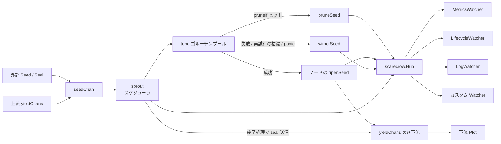
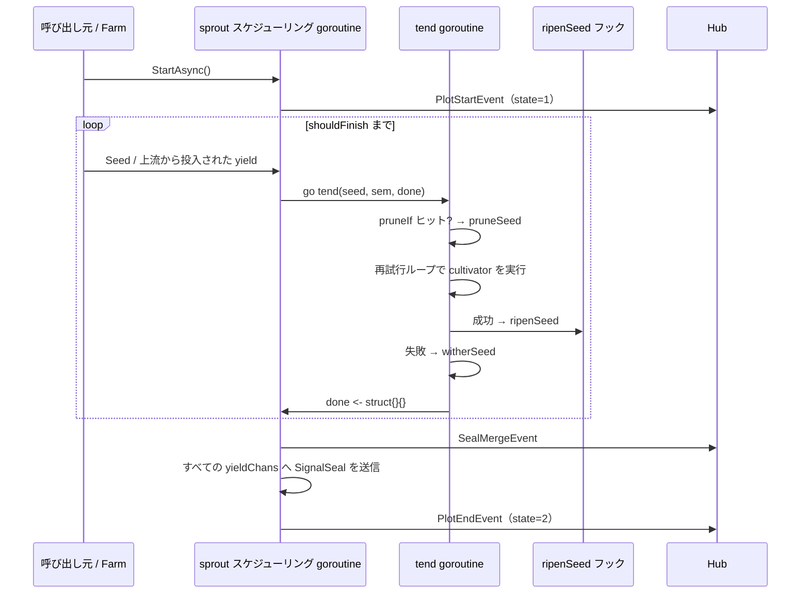

# pkg/plot/plot.go

> 📅 最終更新日: 2026/11/13

`plot.go` は `pkg/plot` の **共有実行骨格** であり、パッケージドキュメントも兼ねます。次の 2 つを定義します：

1. `PlotNode` インターフェース——ジェネリクスを消去した後、`pkg/farm` が異なる seed/fruit 型のノードを統一的に保持するためのもの。
2. `basePlot[S, F, Y]` ジェネリック構造——`SinglePlot`、`SplitPlot`、`RoutePlot` が共通で埋め込む基底クラス。

`basePlot` はほぼすべての共通責務を担います。上流・下流の接続、並行スケジューリング（`sprout` + `tend`）、剪定と再試行、seal のマージ、指標の読み取り、イベント送信、standalone のバッチ実行と結果のエクスポート。ノード間の唯一の差異は構築時に注入される `ripenSeed` フックで表現されるため、3 種類のノードはそれぞれ `ripenSeed` メソッドを 1 つ実装するだけで済みます。

## 役割

- `PlotNode` インターフェースを定義し、`Farm` と plot の間の契約とします。
- `basePlot` の共有骨格を提供し、`SinglePlot` / `SplitPlot` / `RoutePlot` がスケジューリング、再試行、結果処理を重複実装するのを避けます。
- 3 つのジェネリックパラメータで「種子型」「結果型」「下流 yield 型」を分離し、同じ骨格でブロードキャスト（`SinglePlot`）、分割（`SplitPlot`）、ルーティング（`RoutePlot`）という 3 つの成功セマンティクスを支えられるようにします。
- 「イベント + オブザーバ」モデルで実行期の情報を出力します。指標、ライフサイクル、ログはすべて `pkg/scarecrow` の `Hub` が配信し、`basePlot` 自身は永続化リソースを一切保持しません。

## 中核となるオブジェクト

### `PlotNode` インターフェース

```go
type PlotNode interface {
	GetName() string
	GetState() int32
	GetSeedChanAny() any

	ConnectTo(next PlotNode) error
	AddUpstream(name string)
	AddWatcher(listener scarecrow.Watcher) error
	SetEventClient(eventClient runtime.EventClient)

	StartAsync()
	WaitAsync()
	SeedAny(seed any) error
	Seal()
}
```

| メソッド | 用途 |
|------|------|
| `GetName()` | plot 名を返す（`Farm` 内で一意である必要がある） |
| `GetState()` | 状態を返す：`0=idle`、`1=running`、`2=done` |
| `GetSeedChanAny()` | `seedChan` を `any` として公開し、上流の `ConnectTo` が型アサーションを行うためのもの |
| `ConnectTo(next)` | 「本ノードの yield → 下流の seed」の接続を確立し、型を検証する |
| `AddUpstream(name)` | **上流**が `ConnectTo` 時に呼び出し、本ノードの上流名を登録する。seal の集約に使用 |
| `AddWatcher(listener)` | 本ノード内部の `Hub` にオブザーバを登録する。重複登録するとイベントを重複して受け取る |
| `SetEventClient(eventClient)` | イベント ID の採番器を注入する（`Farm` は同じ client を統一的に注入する） |
| `StartAsync()` / `WaitAsync()` | スケジューラを非同期起動する / バックグラウンド goroutine の終了をブロックして待つ |
| `SeedAny(seed)` | 単一の seed を `any` として播く。`Farm` が初期タスクを注入する際に使用 |
| `Seal()` | 外部からの終了信号を送る |

> このインターフェースには `AddObserver`、`BindInlet`、`StartSpouts`、あるいはカウンタの読み書きメソッドは **ありません**。オブザーバは一律 `scarecrow.Watcher` で、永続化リソースは `pkg/assembly` が組み立て、指標はイベントストリームから再構築します。

### `basePlot[S, F, Y]` 構造

```go
type basePlot[S any, F any, Y any] struct {
	name       string
	cultivator func(S) (F, error)
	ripenSeed  func(seedPayload runtime.Payload[S], fruit F, startTime time.Time)
	plotOptions

	seedChan   chan runtime.Payload[S]
	yieldChans map[string]chan runtime.Payload[Y]
	upstreams  map[string]struct{}

	eventClient runtime.EventClient
	hub         *scarecrow.Hub

	ctx    context.Context
	cancel context.CancelFunc
	wg     sync.WaitGroup
	state  atomic.Int32 // 0=idle, 1=running, 2=done
}
```

| ジェネリックパラメータ | セマンティクス |
|---------|------|
| `S` | 種子（seed）の入力型。すなわち `cultivator` の引数型 |
| `F` | 本ノードの **結果** 型。すなわち `cultivator` の戻り値型（3 種類のノードでそれぞれ異なる） |
| `Y` | 下流へ出力する yield 型。下流ノードの `S` と一致している必要がある |

| フィールド | 意味 |
|------|------|
| `name` | plot 名 |
| `cultivator` | 育成関数。本ノードの結果型 `F` を返す |
| `ripenSeed` | 成功フック。具体的なノードが注入する。シグネチャは固定で `(seedPayload, fruit F, startTime)` |
| `plotOptions` | 埋め込まれた任意設定（並行数、バッファ、再試行戦略、剪定述語）。`option.md` を参照 |
| `seedChan` | seed の入力チャネル。容量 = `WithChanSize`。データと制御信号（`SignalSeal`）が共用する |
| `yieldChans` | `下流 plot 名 → その下流の seed チャネル`。`ConnectTo` が埋める |
| `upstreams` | 登録済みの上流 plot 名の集合。seal が揃ったかを判定するために使用 |
| `eventClient` | プロセス内のイベント ID 採番器。既定は `runtime.NewLocalEventClient()` |
| `hub` | 本ノードのイベント配信センター。既定は `scarecrow.NewHub()`。オブザーバは `AddWatcher` で登録する |
| `ctx` / `cancel` | `context.WithCancel(context.Background())` から派生し、内部での強制終了に使用 |
| `wg` | `StartAsync` が起動したバックグラウンド goroutine を集約する |
| `state` | 状態のアトミック変数（0/1/2） |

### 3 種類のノードのジェネリックな実体化

| ノード | 基底の `basePlot` | 結果型 | 下流 yield 型 `Y` |
|------|----------------|---------|--------------------|
| `SinglePlot[S, F]` | `basePlot[S, F, F]` | `F` | `F` |
| `SplitPlot[S, F]` | `basePlot[S, []F, F]` | `[]F` | `F` |
| `RoutePlot[S, Y]` | `basePlot[S, map[string]Y, Y]` | `map[string]Y` | `Y` |

> `ConnectTo` は型アサーションで「上流の `Y`」と「下流の `S`」が一致するかを検証するため、`SinglePlot[S, F]` は `S == F` の下流ノードにしか接続できません。それ以外の場合は接続時にただちに型非互換エラーを返します。

### 構築（非公開）

```go
func newBasePlot[S any, F any, Y any](
	name string,
	cultivator func(S) (F, error),
	ripenSeed func(seedPayload runtime.Payload[S], fruit F, startTime time.Time),
	opts ...Option,
) *basePlot[S, F, Y]
```

同パッケージの `NewSinglePlot` / `NewSplitPlot` / `NewRoutePlot` からのみ呼び出されます。流れ：

1. `defaultOptions()` を取得し、`opts` を順に適用する。
2. `context.WithCancel(context.Background())` から `ctx / cancel` を派生させる。
3. `seedChan`（容量 `chanSize`）と空の `yieldChans` / `upstreams` を確保する。
4. `eventClient = runtime.NewLocalEventClient()` と `hub = scarecrow.NewHub()` を初期化する。

## 指標の読み取り

`basePlot` はもはやカウンタを持たず、指標はイベントストリームから再構築されます。`pkg/assembly` が実行期間中に `*scarecrow.MetricsWatcher` を plot の `hub` に登録し、`basePlot` は読み取り時に `scarecrow.Find` で hub（入れ子の hub を含む）からそれを探します。

```go
func (p *basePlot[S, F, Y]) currentMetrics() (scarecrow.PlotMetrics, bool) {
	metrics, ok := scarecrow.Find[*scarecrow.MetricsWatcher](p.hub)
	if !ok {
		return scarecrow.PlotMetrics{}, false
	}
	return metrics.GetPlot(p.name)
}
```

| メソッド | データの出所（`PlotMetrics`） | 説明 |
|------|--------------------------|------|
| `GetSeedNum() int` | `InputTotal` | 入力総数 = 外部注入 + 各上流からの投入 |
| `GetFruitNum() int` | `Succeeded` | 成熟（成功）数 |
| `GetWeedNum() int` | `Failed` | 枯死（失敗）数 |
| `GetPruneNum() int` | `Skipped` | 剪定（スキップ）数 |
| `GetCompleted() int` | `Processed` | 処理済み数 = 成熟 + 枯死 + 剪定 |
| `IsFinish() bool` | `Processed == InputTotal` | すべての入力 seed が結果を出した |

> 指標オブザーバが組み立てられていない場合（たとえば `Run` を経ずに直接 `StartAsync` した、`MetricsWatcher` を登録していないなど）：カウント系メソッドは `0` を返し、`IsFinish()` は `false` を返します。これらのメソッドが読むのは **現在のスナップショット** であり、並行下では各フィールドが同一時点で厳密に一致したビューではありません。

## イベント送信

`basePlot` は `emit` でイベントを `hub` 上のすべてのオブザーバへ同期的に配信します。オブザーバが返したエラーや panic は `Hub` のエラーハンドラが消費するため、実行経路には影響しません：

```go
func (p *basePlot[S, F, Y]) emit(event scarecrow.Event) {
	_ = p.hub.OnEvent(event)
}
```

| イベント | 発生箇所 | 主要フィールド |
|------|--------|---------|
| `PlotStartEvent` | `notifyStart` | `Plot`、`Tenders`、`StartTime` |
| `PlotEndEvent` | `notifyFinish` | `Plot`、`EndTime`、`Elapsed` |
| `SeedInputEvent` | `Seed`（`From` が空）；具体的なノードの `ripenSeed`（`From` は上流名） | `Seed`、`SeedRepr`、`SeedID`、`Parents` |
| `SeedRipenEvent` | 具体的なノードの `ripenSeed` | `Fruit`、`FruitRepr`、`SeedID`、`FruitID` |
| `SeedWitherEvent` | `witherSeed` | `Err`、`SeedID`、`WeedID` |
| `SeedPruneEvent` | `pruneSeed` | `SeedID`、`PruneID` |
| `SeedReplantEvent` | `tend` の再試行ループ | `Err`、`Attempt`、`SeedID` |
| `SealInputEvent` | `Seal` | `SealID` |
| `SealMergeEvent` | `sprout` の終了処理 | `ParentIDs`、`SealID` |

> ライフサイクルとログはもはや `basePlot` が直接 DB に書きません。`pkg/persist` の `LifecycleWatcher` / `LogWatcher` が通常の `Watcher` としてこれらのイベントを購読し、`pkg/assembly.StartPlotResources` が生成と登録を担います。イベント ID は引き続き `eventClient.Emit(...)` が採番します：`seed` / `fruit` / `weed` / `prune` / `seal`。

## 主要なフロー

### データフロー



### 起動と終了処理



- `StartAsync` は goroutine を 1 つ（`sprout`）だけ起動し、その終了は `wg` が収束させます。
- `sprout` は容量 `numTenders` の `sem` セマフォで並行数を制限します。`sem <- struct{}{}` が満杯ならブロックするため、スケジューリング側にバックプレッシャが生まれます。
- seed ごとに `tend` goroutine を 1 つ派生させ、`inFlight` の増減は `done` チャネルで行います。
- `tend` は戻る前に必ず `<-sem`（トークン解放）と `done <- struct{}{}` を実行します。

### `sprout` 主ループ

```go
sem := make(chan struct{}, p.numTenders)
done := make(chan struct{}, p.numTenders)
sealedFrom := make(map[string]int, len(p.upstreams))

ctxCancel := false
inputClosed := false
inFlight := 0
shouldFinish := func() bool {
	return ctxCancel || (inputClosed && inFlight == 0)
}
```

`select` の 3 分岐：

| 分岐 | 動作 |
|------|------|
| `seed := <-p.seedChan` | `Signal == SignalSeal` なら `inputClosed = p.markSealed(seed.Source, seed.EventID, sealedFrom)`。そうでなければセマフォを占有し、`inFlight++`、`go p.tend(...)` を実行 |
| `<-done` | `inFlight--` |
| `<-p.ctx.Done()` | `ctxCancel = true`（内部キャンセル、強制終了） |

`shouldFinish()` が真になると終了処理に入ります。`sealedFrom` に記録された各 seal のイベント ID を `parentIDs` として集め、`eventClient.Emit("seal", parentIDs)` で `sealID` を採番し、`SealMergeEvent` を発行した後、**すべての** `yieldChans` へ `Payload[Y]{Signal: SignalSeal, Source: p.name, EventID: sealID}` を送り、最後に return します。

> 終了処理のブロードキャストは **ブロッキング** です。下流がすでに消費を停止していて `seedChan` のバッファが満杯だと、上流は `sprout` の終了処理で詰まります。

### 入力の閉鎖と seal の伝播

`markSealed(source string, sealID int, sealedFrom map[string]int) bool` の判定順：

| 条件 | 結果 |
|------|------|
| `source == sourceInput`（外部の `Seal()`） | `sealedFrom` に記録し、**直接 `true` を返す**——強制終了であり、他の上流を待たない |
| `source == ""` | `false` を返し、無視する |
| `source` が `p.upstreams` にない（未登録の上流） | `false` を返し、無視する |
| その他の登録済み上流 | `sealedFrom` に記録し、`len(sealedFrom) == len(p.upstreams)` を返す |

つまり通常の上流の seal は **すべて揃う** まで入力は閉じたとみなされませんが、外部の `Seal()` は 1 票で閉じられます。seal のセンチネル値は `constant.md` を参照してください。

### 成功パスは `ripenSeed` フックで注入される

`basePlot` 自身は成功結果をどう変換・転送するかを気にせず、注入されたフックを呼ぶだけです：

```go
ripenSeed func(seedPayload runtime.Payload[S], fruit F, startTime time.Time)
```

| ノード | 注入される `ripenSeed` の動作 |
|------|------------------------|
| `SinglePlot[S, F]` | 1 つの fruit → 各下流に 1 つずつ yield（ブロードキャスト） |
| `SplitPlot[S, F]` | `[]F` の各要素 → 各下流に 1 つずつ yield |
| `RoutePlot[S, Y]` | `map[string]Y` → key に従って宛先へ配信し、未接続の宛先はスキップ |

### 剪定パス `pruneSeed`

`tend` は再試行ループに入る前に剪定述語を判定します：

```go
if p.pruneIf != nil && p.pruneIf(seed) {
	p.pruneSeed(seedPayload, startTime)
	return
}
```

`pruneSeed` は「直接終結」の処理です：

1. `eventClient.Emit("prune", []int{seedID})` で `pruneID` を採番する。
2. `SeedPruneEvent` を発行する（親イベントは `seedID`）。ライフサイクルオブザーバはこれに基づいて `prune` レコードを 1 件書き込む。
3. `cultivator` を **呼ばず**、再試行ループにも **入らず**、どの下流へも **転送しない**。

> 剪定は `cultivator` の **前** に行われるため、剪定された seed は育成もされず失敗もせず、「事前に判定してスキップ」という扱いになります。それでも完了数に計上され（`Processed` は剪定を含む）、進捗が止まらないことが保証されます。

### 失敗パス `witherSeed`

1. `eventClient.Emit("weed", []int{seedID})` で `weedID` を採番する。
2. `SeedWitherEvent` を発行する（親イベントは `seedID`、`Err` と `Elapsed` を含む）。
3. どの下流へも **転送しない**。

### 再試行ループ `tend`

```go
for attempt := 1; attempt <= p.maxRetries+1; attempt++ {
	fruit, err = p.cultivator(seed)
	if err == nil {
		break
	}
	if !p.retryIf(err) {
		break
	}
	if attempt <= p.maxRetries {
		p.emit(scarecrow.SeedReplantEvent{ /* Attempt: attempt, Err: err, SeedID: seedID */ })
	}
	time.Sleep(p.retryDelay(attempt))
}
```

| シナリオ | 動作 |
|------|------|
| `pruneIf` ヒット | `cultivator` を呼ばず、直接 `pruneSeed` を実行して return |
| `cultivator` が `nil` を返す | 直ちに break し、`ripenSeed` へ進む |
| err を返し `retryIf(err) == false` | 直ちに break し、`witherSeed` へ進む（再試行しない） |
| `attempt <= maxRetries` | `SeedReplantEvent` を発行し（1 始まりの `Attempt` を含む）、その後 `Sleep(retryDelay(attempt))` を実行 |
| 最後（`attempt == maxRetries+1`）でも失敗 | `SeedReplantEvent` を発行しないが、`Sleep(retryDelay(maxRetries+1))` は 1 回実行する |
| `cultivator` が panic | `defer recover` で捕捉し、`cultivator panic: %v` エラーに変換して `witherSeed` へ進む（再試行しない） |

> panic 経路で渡される `startTime` は `time.Now()` なので、`SeedWitherEvent.Elapsed` はほぼ 0 になり、実際の育成時間を表しません。

### 入力と非同期実行

| メソッド | 動作 |
|------|------|
| `Seed(seed S)` | seed イベント ID を採番し（親イベントなし）、`SeedInputEvent`（`From` は空）を発行してから、`seedChan` へ `Payload[S]{Value: seed, EventID: seedID}` を投入 |
| `SeedAny(seed any) error` | `S` へ型アサーションし、失敗時は `plot %q seed type mismatch: got %T` を返す。成功時は `Seed` へ転送 |
| `Seal()` | seal イベント ID を採番し、`SealInputEvent` を発行し、`seedChan` へ `Payload[S]{Signal: SignalSeal, Source: sourceInput, EventID: sealID}` を投入して **強制終了** セマンティクスを発動 |
| `StartAsync()` | `p.wg.Go` でバックグラウンド goroutine を 1 つ起動：`notifyStart`（state=1）→ `sprout` 主ループ → `notifyFinish`（state=2） |
| `WaitAsync()` | `p.wg.Wait()` で、バックグラウンド goroutine の終了をブロックして待つ |

> `Seed` / `Seal` はどちらも **同期的な channel 書き込み** です。`seedChan` のバッファが満杯で消費する tender がいない場合、呼び出し元はブロックします。

### Standalone 実行 `Run`

```go
func (p *basePlot[S, F, Y]) Run(seeds []S, logLevel string)
```

standalone モードのワンストップ入口（ブロッキング）：

1. `assembly.StartPlotResources(p.hub, logLevel)` で指標・ライフサイクル・ログのオブザーバを組み立て、失敗時は **そのまま return**（エラーも返さず、何も出力しない）。
2. `defer resources.Stop()` で、終了時のフラッシュとリソース回収を保証する。
3. `StartAsync()`。
4. `seeds` を順に `Seed(seed)` で注入する。
5. `Seal()` で、これ以上外部入力がないことを宣言する。
6. `WaitAsync()` で、すべてが終わるまでブロックする。

> `logLevel` は今回の実行のログの最低レベルで、空文字列は `INFO` として扱われます（`pkg/persist.NewLogWatcher` が解釈）。同じ plot で `Run` を繰り返すとオブザーバが重複登録されるため、誤用です。

### 結果のエクスポート `Harvest`

```go
func (p *basePlot[S, F, Y]) Harvest() ([]persist.LifecycleStatusRecord, error)
```

呼び出し時に hub（入れ子の hub を含む）から `*persist.LifecycleWatcher` を探し、その `DBPath()` を読み、さらに `persist.LoadLifecycleStatusesFromPath(dbPath, p.name)` で状態スナップショットをオフライン照会します。したがって：

- 実行終了後すぐに照会でき、plot 上にデータベースパスを保存しておく必要はありません。
- ライフサイクルオブザーバが未登録 → `plot %q lifecycle watcher is not registered` を返します。
- オブザーバは登録済みだがデータベースがまだ準備できていない（`DBPath()` が空）→ `plot %q lifecycle database is not ready` を返します。

> 返される `persist.LifecycleStatusRecord` の主要フィールド：`Status`（`ripen` / `wither` / `prune`）、`SeedJSON`、`FruitJSON`、`WitherType`、`WitherMessage`。

## 使用例

### Standalone モード

```go
package main

import (
	"fmt"

	"github.com/Mr-xiaotian/CelestialGrow/pkg/plot"
)

func main() {
	p := plot.NewSinglePlot("double",
		func(seed int) (int, error) { return seed * 2, nil },
		plot.WithTenders(4),
	)

	p.Run([]int{1, 2, 3, 4, 5}, "INFO")

	records, err := p.Harvest()
	if err != nil {
		panic(err)
	}
	for _, r := range records {
		fmt.Println(r.SeedJSON, r.Status, r.FruitJSON)
	}
}
```

### イベントの購読

```go
package main

import (
	"fmt"

	"github.com/Mr-xiaotian/CelestialGrow/pkg/plot"
	"github.com/Mr-xiaotian/CelestialGrow/pkg/scarecrow"
)

func main() {
	p := plot.NewSinglePlot("double", func(seed int) (int, error) { return seed * 2, nil })

	if err := p.AddWatcher(scarecrow.WatcherFunc(func(event scarecrow.Event) error {
		switch ev := event.(type) {
		case scarecrow.SeedRipenEvent:
			fmt.Printf("[%s] %s -> %s (%s)\n", ev.Plot, ev.SeedRepr, ev.FruitRepr, ev.Elapsed)
		case scarecrow.SeedWitherEvent:
			fmt.Printf("[%s] %s wither: %v\n", ev.Plot, ev.SeedRepr, ev.Err)
		}
		return nil
	})); err != nil {
		panic(err)
	}

	p.Run([]int{1, 2, 3}, "INFO")
}
```

### Farm モード

Farm モードでは `Run` / `Seed` / `Seal` を直接呼ばず、ノードを `plot.PlotNode` として `pkg/farm` に渡します：

```go
package main

import (
	"fmt"

	"github.com/Mr-xiaotian/CelestialGrow/pkg/farm"
	"github.com/Mr-xiaotian/CelestialGrow/pkg/plot"
)

func main() {
	double := plot.NewSinglePlot("double", func(seed int) (int, error) {
		return seed * 2, nil
	}, plot.WithTenders(2))

	addOne := plot.NewSinglePlot("addOne", func(seed int) (int, error) {
		return seed + 1, nil
	}, plot.WithTenders(2))

	f := farm.NewFarm("demo")
	if err := f.AddPlot(double, addOne); err != nil {
		panic(err)
	}
	if err := f.Connect([]plot.PlotNode{double}, []plot.PlotNode{addOne}); err != nil {
		panic(err)
	}
	if err := f.Run(map[string][]any{"double": {1, 2, 3}}, "INFO"); err != nil {
		panic(err)
	}

	fmt.Println("done")
}
```

このとき実行期のリソースは `Farm.Run` が一括で組み立て、ノードはイベントを生成するだけです。

## テストの重点

`basePlot` の挙動は `plot_harvest_test.go`（結果スナップショット）、`plot_prune_test.go`（剪定セマンティクス）、`plot_retry_test.go`（再試行セマンティクス）でカバーされており、ケースごとの説明は対応するテストドキュメントを参照してください。

## 注意事項

- 既定の並行数と channel バッファはいずれも `runtime.NumCPU()` です。I/O 集約型の処理では `WithTenders` / `WithChanSize` で調整できます（`option.md` 参照）。
- `Run` は **ブロッキング** 呼び出しで、すべての seed の処理が完了するまで戻りません。戻り値はなく、組み立てに失敗した場合は静かに return します。
- 上流の `Y` と下流の `S` の型が一致しない場合、`ConnectTo` は panic せず直ちにエラーを返します。`Farm.AddPlot` / `Farm.Connect` の後にエラーを確認することを推奨します。
- `ctx` / `cancel` は現在 `newBasePlot` でのみ生成され `sprout` が監視しており、`cancel` を呼ぶ箇所は外部にありません。内部終了用の予約チャネルです。
- `AddUpstream` はグラフ構築段階（`ConnectTo`）でのみ呼び出すべきです。実行期に `upstreams` を変更すると、`sprout` の読み取りとデータ競合を起こします。
- 外部の `Seal()` は **強制終了** セマンティクスを持ちます。一度到達すると、まだ seal を送っていない上流があっても直ちに終了処理に入ります。
- すべての指標は `MetricsWatcher` に由来するため、実行期間中に指標オブザーバを組み立てて（standalone は `Run`、Farm は `Farm.Run` が行う）からでないと非ゼロのカウントは読めません。
