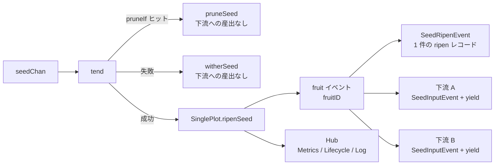

# pkg/plot/plot_single.go

> 📅 最終更新日: 2026/11/13

`plot_single.go` は `pkg/plot` で最もよく使われるノード型 `SinglePlot[S, F]` を定義します。「seed を受け取る → cultivator を並行実行する → fruit を 1 つ生成する → 接続済みのすべての下流へブロードキャストする」という流れを、接続可能・観測可能・再試行可能なジェネリックノードとしてカプセル化します。

`SinglePlot` 自体は非常に薄く、最も素朴な成功セマンティクス（**1 つの seed から 1 つの fruit を育て、その fruit を接続済みの各下流へそのまま転送する**）だけを担当します。それ以外の汎用機能（状態機械、並行スケジューリング、再試行、剪定、seal の伝播、イベント送信、standalone のバッチ実行、結果のエクスポート）はすべて埋め込まれた `basePlot[S, F, F]` が提供します。詳細は `plot.md` を参照してください。

## 役割

- ジェネリックな並行ノード `SinglePlot[S, F]` を公開します（`S` は種子型、`F` は果実型）。
- 埋め込んだ `*basePlot[S, F, F]` で共有骨格を再利用し、`SinglePlot` が `PlotNode` インターフェースを満たして `pkg/farm` からの登録、接続、スケジューリングを受けられるようにします。
- 成功フック `ripenSeed` を注入します：成熟イベントを発行し、すべての下流へ yield を 1 つずつ転送します。

## 中核となるオブジェクト

### `SinglePlot[S, F]` 構造

```go
type SinglePlot[S any, F any] struct {
	*basePlot[S, F, F]
}
```

`SinglePlot` は自身のフィールドを持たず、すべての状態と機能は `*basePlot[S, F, F]` に由来します。

| ジェネリックパラメータ | セマンティクス |
|---------|------|
| `S` | 種子（seed）の入力型。すなわち `cultivator` の引数型 |
| `F` | 果実（fruit）の出力型。すなわち `cultivator` の戻り値型 |

`basePlot` の 3 番目のジェネリックパラメータ（下流 yield 型 `Y`）は本型では `F` に具体化されます。つまり**本ノードの果実型と下流へ出力する型は一致します**。3 種類のノードの比較は次のとおりです：

| ノード | 基底の `basePlot` | 結果型（fruit） | 下流 yield 型 `Y` |
|------|----------------|------------------|--------------------|
| `SinglePlot[S, F]` | `basePlot[S, F, F]` | `F` | `F` |
| `SplitPlot[S, F]` | `basePlot[S, []F, F]` | `[]F` | `F` |
| `RoutePlot[S, Y]` | `basePlot[S, map[string]Y, Y]` | `map[string]Y` | `Y` |

> `ConnectTo` は型アサーションで「上流の `Y`」と「下流の `S`」が一致するかを検証します。したがって `SinglePlot[S, F]` は `S == F` の下流ノードにしか接続できず、それ以外の場合は接続時にただちに型非互換エラーを返します。

## 公開関数

### `NewSinglePlot[S, F](name string, cultivator func(S) (F, error), opts ...Option) *SinglePlot[S, F]`

`SinglePlot` インスタンスを生成します。

| パラメータ | 意味 |
|------|------|
| `name` | plot 名。`Farm` 内で一意である必要があります |
| `cultivator` | 単一の seed を育てる関数。果実またはエラーを返します |
| `opts` | 任意の設定（`option.md` 参照）。`defaultOptions()` の後に順に適用されます |

実装上のポイント：

1. まず `var p *SinglePlot[S, F]` を宣言し、次に `newBasePlot[S, F, F]` で共有骨格を構築し、最後に `base` を `p` に代入します。
2. `newBasePlot` に渡す `ripenSeed` フックはクロージャであり、内部で `p.ripenSeed(...)` を呼び出します。これはまだ代入されていない `p` を捕捉しますが、このクロージャは `StartAsync` 以降の `sprout` / `tend` 経路でしか呼ばれないため、その時点で `p` への代入は必ず完了しています。
3. channel の確保、既定の `EventClient` と `Hub` の初期化、`context` の派生はすべて `newBasePlot` 内で行われます（`plot.md` の「構築」の節を参照）。

### `ripenSeed(seedPayload runtime.Payload[S], fruit F, startTime time.Time)`（未エクスポート）

`SinglePlot` の成功経路の実装で、フックとして `basePlot.ripenSeed` フィールドに書き込まれ、`cultivator` が `nil` エラーを返したときに `basePlot.tend` から呼び出されます。手順：

1. `seedPayload.EventID` を `seedID` として取り出し、`eventClient.Emit("fruit", []int{seedID})` で `fruitID` を採番する。
2. 可読表現を計算する：seed は 50 rune、fruit は 25 rune に切り詰める（`helper.md` 参照）。
3. `scarecrow.SeedRipenEvent` を発行する（`Plot`、`Seed`、`SeedRepr`、`Fruit`、`FruitRepr`、`Elapsed`、`SeedID`、`FruitID`、`Time`）——指標オブザーバはこれに基づいて成功数を +1 し、ライフサイクルオブザーバはこれに基づいて `ripen` レコードを 1 件書き込む（`FruitJSON` は果実の JSON）。
4. `p.yieldChans`（`下流 plot 名 → その下流の seed チャネル`）を走査し、**接続済みの各下流**に対して：
   - `eventClient.Emit("seed", []int{fruitID})` で下流 seed イベント ID を採番する（親イベントは `fruitID`）。
   - `scarecrow.SeedInputEvent` を発行する（`Plot` は下流名、`From` は本ノード名、`Seed` は fruit、`Parents` は `[]int{fruitID}`）。指標オブザーバはこれに基づいて受信側の上流入力と送信側の下流産出を同時に加算する。
   - その下流チャネルへ `runtime.Payload[F]{Value: fruit, EventID: downstreamSeedID}` を送信する。

> セマンティクスの要点：`SinglePlot` の成功経路は「**1 つの fruit を 1 つの下流 yield に転送する**」であり、しかも**接続済みのすべての下流へ 1 回ずつ転送します**（ブロードキャスト）。「宛先を指定した転送」が必要なら `RoutePlot`（`plot_route.md` 参照）、「1 つの seed を複数の下流 yield に分割する」必要があるなら `SplitPlot`（`plot_split.md` 参照）を使用してください。

## 主要なフロー

### seed から下流 yield まで



`basePlot.tend` は `cultivator(seed)` を呼ぶ前に剪定述語を判定し、ヒットした場合は直接 `basePlot.pruneSeed` へ進みます（`cultivator` は呼びません）。そうでなければ結果に応じて分岐します：

- **成功**（`err == nil`）：注入された `ripenSeed`、すなわち本ファイルの実装を呼び出します。
- **失敗**（再試行の枯渇、`retryIf` による拒否、または `panic` が `recover` で捕捉された場合）：`basePlot.witherSeed` を通り、**どの下流へも転送しません**。
- **剪定**（`WithPruneIf` の述語が `true` を返す）：`basePlot.pruneSeed` を通り、**どの下流へも転送しません**。

剪定、再試行ループ、seal の伝播、並行モデルなどの汎用ロジックは `plot.md` を参照してください。

### 指標の基準

1 回の成功で `SeedRipenEvent` は 1 件しか生成されないため：

- 本ノードの `GetFruitNum()`（`Succeeded`）が +1。
- 接続済みの各下流はそれぞれ `SeedInputEvent` を 1 件受け取り（`From` は非空）、その `InputTotal` が +1、本ノードの `DownstreamCounts` の該当ターゲットが +1。

## 使用例

### Standalone モード

```go
package main

import (
	"fmt"

	"github.com/Mr-xiaotian/CelestialGrow/pkg/plot"
)

func main() {
	p := plot.NewSinglePlot("double",
		func(seed int) (int, error) { return seed * 2, nil },
		plot.WithTenders(4),
	)

	p.Run([]int{1, 2, 3, 4, 5}, "INFO")

	records, err := p.Harvest()
	if err != nil {
		panic(err)
	}
	for _, r := range records {
		fmt.Println(r.SeedJSON, r.Status, r.FruitJSON)
	}
}
```

### 再試行あり

```go
package main

import (
	"errors"
	"time"

	"github.com/Mr-xiaotian/CelestialGrow/pkg/plot"
)

var errPermanent = errors.New("permanent")

func main() {
	p := plot.NewSinglePlot("flaky",
		func(seed int) (int, error) {
			if seed == 0 {
				return 0, errPermanent
			}
			return seed * 2, nil
		},
		plot.WithTenders(2),
		plot.WithMaxRetries(3),
		plot.WithRetryDelay(func(attempt int) time.Duration {
			return time.Duration(attempt) * 100 * time.Millisecond
		}),
		plot.WithRetryIf(func(err error) bool {
			return !errors.Is(err, errPermanent)
		}),
	)

	p.Run([]int{0, 1, 2}, "DEBUG")
}
```

### Farm モードで単進単出ノードを 2 つ直列接続

```go
package main

import (
	"fmt"

	"github.com/Mr-xiaotian/CelestialGrow/pkg/farm"
	"github.com/Mr-xiaotian/CelestialGrow/pkg/plot"
)

func main() {
	double := plot.NewSinglePlot("double", func(seed int) (int, error) {
		return seed * 2, nil
	}, plot.WithTenders(2))

	addOne := plot.NewSinglePlot("addOne", func(seed int) (int, error) {
		return seed + 1, nil
	}, plot.WithTenders(2))

	f := farm.NewFarm("demo")
	if err := f.AddPlot(double, addOne); err != nil {
		panic(err)
	}
	if err := f.Connect([]plot.PlotNode{double}, []plot.PlotNode{addOne}); err != nil {
		panic(err)
	}
	if err := f.Run(map[string][]any{"double": {1, 2, 3}}, "INFO"); err != nil {
		panic(err)
	}

	fmt.Println("done")
}
```

> `Farm.Connect` は内部で `ConnectTo` を呼び出し、「int → int」というエッジを確立します：上流 `Y = int`、下流 `S = int` で型が一致します。

## 注意事項

- `NewSinglePlot` は既定で `runtime.NumCPU()` を並行数と channel バッファに使用します。I/O 集約型の処理では `WithTenders` / `WithChanSize` で調整できます。
- `Run(seeds, logLevel)` は **ブロッキング** 呼び出しで、すべての seed の処理が完了するまで戻りません。
- 上流の `F` と下流の `S` の型が一致しない場合、`ConnectTo` は panic せず直ちにエラーを返します。`Farm.AddPlot` / `Farm.Connect` の後にエラーを確認することを推奨します。
- `SinglePlot` はルーティングや分割の機能を提供せず、その転送は「全下流ブロードキャスト」です。宛先を指定した配信として使わないでください。
- 下流がすでに消費を停止していて `seedChan` のバッファが満杯の場合、`ripenSeed` の送信箇所でブロックし、本ノードの tender も遅くなります。
