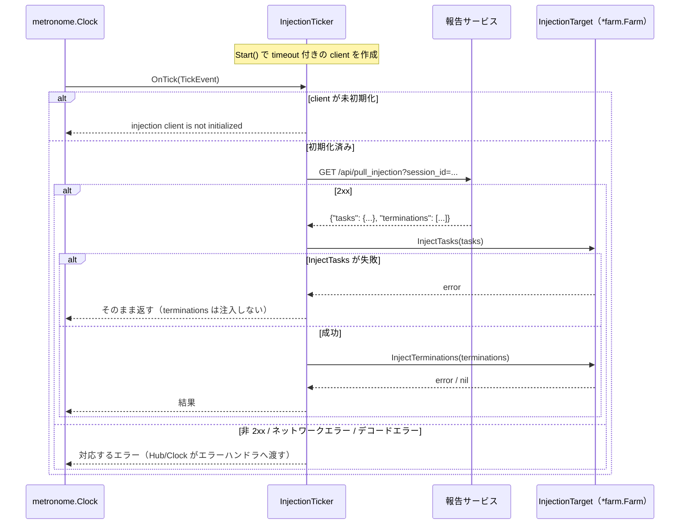

# pkg/reporter/inject.go

> 📅 最終更新日: 2026/11/26

`pkg/reporter/inject.go` は**リモート注入の取得**を実装します：拍ごとにサーバーの `GET /api/pull_injection` を呼び、応答内の `tasks` と `terminations` をローカルのターゲット（通常は `*farm.Farm`）へ渡します。これは「サーバー → ローカルグラフ」方向の唯一の入口であり、`push.go` の「ローカルグラフ → サーバー」方向と相補的です。

## 役割

- リモートから下されたタスクを指定の Plot に注入し、終了が必要な Plot のリストをターゲットへ渡します。
- タイムアウト付きの `*http.Client` を自身で保持します：`Start` で作成し、`Stop` でアイドル接続を閉じます。
- `metronome.Ticker` + `metronome.Lifecycle` として `metronome.Hub` に登録され、統一された拍クロックで駆動されます。

## 主要オブジェクト

### 定数

```go
const (
    DefaultInjectionPeriod = 5               // 默认 5 拍拉取一次
    DefaultPullTimeout     = 3 * time.Second // 单次拉取的 HTTP 超时
)
```

### `type InjectionTarget`（インターフェース）

```go
type InjectionTarget interface {
    InjectTasks(tasks map[string][]any) error
    InjectTerminations(nodes []string) error
}
```

| メソッド | 意味 | 典型的な実装 |
|------|------|----------|
| `InjectTasks(map[string][]any) error` | `Plot 名 -> シードリスト` を対応する Plot に注入します。ターゲットは Plot が登録済みであることを検証する必要があります | `farm.Farm.InjectTasks` |
| `InjectTerminations([]string) error` | これらの Plot が新しいシードを受け取らないことを通知し、処理中のデータを処理し終えてから終了します | `farm.Farm.InjectTerminations` |

`pkg/assembly.StartReportResources` は `*farm.Farm` を（インターフェース引数 `injectionTarget` 経由で）そのまま渡します。`Farm` のこれら 2 つのメソッドは実行期に安全に呼び出せます。

### `type injectionPayload`（非公開）

```go
type injectionPayload struct {
    Tasks        map[string][]any `json:"tasks"`
    Terminations []string         `json:"terminations"`
}
```

サーバーが返す JSON の形状：`{"tasks": {"root": [1, "x"]}, "terminations": ["leaf"]}`。`any` にデコードされるため、数値はすべて `float64` になります（例えば `1` は `1.0` になります）。下流では自身で型アサーションを行う必要があります。

### `type InjectionTicker`

```go
type InjectionTicker struct {
    baseURL   string
    sessionID string
    target    InjectionTarget
    period    int
    timeout   time.Duration
    client    *http.Client
}
```

フィールドはすべて非公開です。`client` のライフサイクルは `Start` / `Stop` に結び付いています。

### 構築：`NewInjectionTicker`

```go
func NewInjectionTicker(
    baseURL string,
    sessionID string,
    target InjectionTarget,
    period int,
    timeout time.Duration,
) (*InjectionTicker, error)
```

検証は**固定の順序**で実行され、先に命中したエラーが先に返されます：

| 順序 | 条件 | 返されるエラー |
|:----:|------|---------|
| 1 | `target == nil` | `reporter: injection target is nil` |
| 2 | `strings.TrimSpace(sessionID) == ""` | `reporter: session id is empty` |
| 3 | `period == 0` → `5` に置換；その後 `period < 1` | `reporter: injection period must be positive, got %d` |
| 4 | `timeout == 0` → `3s` に置換；その後 `timeout < 0` | `reporter: pull timeout must be non-negative, got %s` |
| 5 | `normalizeBaseURL(baseURL)` が失敗 | `base url is empty` / `invalid base url %q` / `base url must use http or https, got %q` |

したがって「空 URL + 空 SessionID」では SessionID のエラーが先に報告されます。`period` / `timeout` の既定値置換は検証より前に行われ、`-1` が既定値に置換されることはありません。

- `baseURL` は `normalizeBaseURL` で正規化されます：前後の空白を除去し、**すべての**末尾 `/` を取り除き、scheme が `http`/`https` で host が非空であることを要求します。
- `timeout` は「0 はタイムアウトなし」ではなく、「0 は既定の 3 秒を使う」を意味します。より長く／短くしたい場合は明示的に正の値を渡す必要があります。

### メソッド

| メソッド | シグネチャ | 役割 |
|------|------|------|
| `TickPeriod` | `func (t *InjectionTicker) TickPeriod() int` | 有効になった拍周期を返します（既定値は埋め込み済み） |
| `Start` | `func (t *InjectionTicker) Start() error` | HTTP クライアントを作成します。常に `nil` を返します |
| `Stop` | `func (t *InjectionTicker) Stop() error` | アイドル接続を閉じてクライアントを空にします。常に `nil` を返します |
| `OnTick` | `func (t *InjectionTicker) OnTick(event metronome.TickEvent) error` | 注入を 1 回取得してターゲットに渡します |

#### `Start` / `Stop` の再入可能性

- `Start` は `client == nil` のときだけ作成し、重複呼び出しで既存のクライアントを置き換えることはありません。
- `Stop` はアイドル接続を閉じたうえで `client` を `nil` にするため、**`Stop` の後に `OnTick` を呼ぶと `reporter: injection client is not initialized` になります**。継続するには再度 `Start` が必要です。
- どちらも `nil` を返すため、戻り値から実際に処理が行われたかは判断できません。

#### `OnTick` の実行詳細

1. `client == nil` → 直ちにエラーを返し、**ネットワークリクエストは一切発行しません**（これが「Start 前に OnTick を呼ぶとエラー」の保証です）。
2. エンドポイントの連結：`baseURL + "/api/pull_injection?session_id=" + url.QueryEscape(sessionID)`。`@` などの文字は `%40` にエスケープされ、サーバー側で `Query().Get("session_id")` がデコードしても元の値になります。
3. `client.Get` の失敗 → `reporter: pull injection: %w`（下層の `url.Error` を保持し、`errors.Is` / `errors.As` が可能）。
4. `StatusCode/100 != 2` → `reporter: pull injection failed: <Status>`（例 `500 Internal Server Error`）。**レスポンスボディは読みません**。
5. JSON デコードの失敗 → `reporter: decode injection payload: %w`。**最初の** JSON 値だけをデコードし、後続の内容は無視されます。レスポンスボディにサイズ上限はありません。
6. 欠落または `null` の `tasks` / `terminations` は空の `map` / 空のスライスに正規化され、ターゲットは常に非 `nil` の値を受け取ります。
7. **先に** `InjectTasks` を呼び、成功した後にのみ `InjectTerminations` を呼びます。ターゲットが返した error は**そのまま返し**、ラップもリトライも行いません。`InjectTasks` が失敗した場合、その拍では終了リストを注入しません。
8. `event`（`TickEvent`）はまったく使用されず、発火タイミングは `metronome` のみが決定します。

| エラー発生源 | エラーテキスト | `errors.Is/As` 可能か |
|----------|----------|----------------------|
| 未 `Start` | `reporter: injection client is not initialized` | — |
| ネットワーク/タイムアウト | `reporter: pull injection: <下層のエラー>` | ✅（`%w`） |
| 非 2xx | `reporter: pull injection failed: <Status>` | — |
| デコード失敗 | `reporter: decode injection payload: <err>` | ✅（`%w`） |
| ターゲットの注入失敗 | ターゲットが返した元の error | ✅（ラップなし） |

## 主要フロー



`metronome.Hub.OnTick` は `OnTick` が返した error を捕捉してエラーハンドラへ渡し、**他の ticker を中断しません**。したがって 1 回の取得失敗で拍が停止することはありません。

## 使用例

### 1 回の取得を手動で駆動する

```go
package main

import (
    "fmt"

    "github.com/Mr-xiaotian/CelestialGrow/pkg/metronome"
    "github.com/Mr-xiaotian/CelestialGrow/pkg/reporter"
)

// demoTarget 演示注入目标的最小实现。
type demoTarget struct{}

func (demoTarget) InjectTasks(tasks map[string][]any) error {
    fmt.Println("tasks:", tasks) // 数字已是 float64
    return nil
}

func (demoTarget) InjectTerminations(nodes []string) error {
    fmt.Println("terminations:", nodes)
    return nil
}

func main() {
    ticker, err := reporter.NewInjectionTicker(
        "http://127.0.0.1:5005/", // 尾部 / 会被规范化去掉
        "demo@1",
        demoTarget{},
        0, // 使用 DefaultInjectionPeriod（5）
        0, // 使用 DefaultPullTimeout（3s）
    )
    if err != nil {
        panic(err)
    }
    fmt.Println("period:", ticker.TickPeriod())

    if err := ticker.Start(); err != nil {
        panic(err)
    }
    defer func() { _ = ticker.Stop() }()

    if err := ticker.OnTick(metronome.TickEvent{Seq: 1}); err != nil {
        fmt.Println("pull failed:", err)
    }
}
```

### 拍クロックへの登録

```go
package main

import (
    "fmt"
    "time"

    "github.com/Mr-xiaotian/CelestialGrow/pkg/metronome"
    "github.com/Mr-xiaotian/CelestialGrow/pkg/reporter"
)

type demoTarget struct{}

func (demoTarget) InjectTasks(tasks map[string][]any) error    { return nil }
func (demoTarget) InjectTerminations(nodes []string) error     { return nil }

func main() {
    ticker, err := reporter.NewInjectionTicker(
        "http://127.0.0.1:5005",
        "demo@1",
        demoTarget{},
        1, // 每拍拉取
        time.Second,
    )
    if err != nil {
        panic(err)
    }

    hub, err := metronome.NewHub()
    if err != nil {
        panic(err)
    }
    if err := hub.AddTicker(ticker); err != nil { // 校验周期、拒绝重复注册
        panic(err)
    }

    clock, err := metronome.NewClock(time.Second, hub)
    if err != nil {
        panic(err)
    }
    if err := hub.Start(); err != nil { // 按注册顺序调用 InjectionTicker.Start
        panic(err)
    }
    if err := clock.Start(); err != nil {
        panic(err)
    }

    time.Sleep(2500 * time.Millisecond) // 供观察两拍

    _ = clock.Stop() // 先停时钟，避免 Stop 与 OnTick 并发
    if err := hub.Stop(); err != nil { // 反向调用 InjectionTicker.Stop
        fmt.Println(err)
    }
}
```

## 注意事項

- **同期ネットワーク IO が拍の goroutine を占有します**：`OnTick` は `metronome.Clock` の唯一のスケジューリング goroutine 内で同期的に実行され、1 回あたり最大 `timeout` までブロックします。同じ拍でその後ろに並ぶ ticker は遅延します。ブロックが基準周期を超えると、`Clock` は**取りこぼした拍をスキップし、補拍しません**（`pkg/metronome/clock.go` 参照）。既定の 3 秒タイムアウトでは、サーバーが応答しないとスナップショットの拍が遅くなります。
- **リトライもバックオフもありません**：失敗は error として Hub のエラーハンドラに報告されるだけです。リトライが必要なら上位層またはサーバー側で実装し、ticker 内にリクエストを溜めないでください。
- **レスポンス内容は検証しません**：`tasks` のキーが既知の Plot か、値をターゲットが受け入れられるかは、すべて `InjectionTarget` の責任です。`Farm.InjectTasks` は対象の Plot が 1 つでも存在しないと全体が失敗します。
- **`OnTick` と `Stop` は並行実行できません**：`Stop` は `client` を直接 `nil` にするため、`t.client` を読む `OnTick` との間にデータ競合があります。正しい使い方は「先にクロックを止め、次に Hub を止める」で、`pkg/assembly` の `StopFunc` はまさに `Clock.Stop → tickerHub.Stop` の順序です。
- **`Stop` は実行中のリクエストをキャンセルしません**：`CloseIdleConnections` はアイドル接続にのみ影響し、実行中の `Get` はタイムアウトするか完了するまで走り続けます。
- **リダイレクトと 3xx**：`http.Client` は既定で最大 10 回のリダイレクトに従い、最終的なステータスコードが 2xx 判定に使われます。リダイレクト先は `normalizeBaseURL` の制約を受けません。
- **TLS/プロキシ**：クローンした `http.DefaultTransport`（`newHTTPClient`）を使うため、`HTTP_PROXY` / `HTTPS_PROXY` などの環境設定を継承します。各 ticker は独立した Transport を保持し、`Stop` は自分のアイドル接続だけを閉じます。
