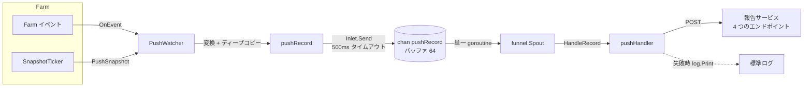
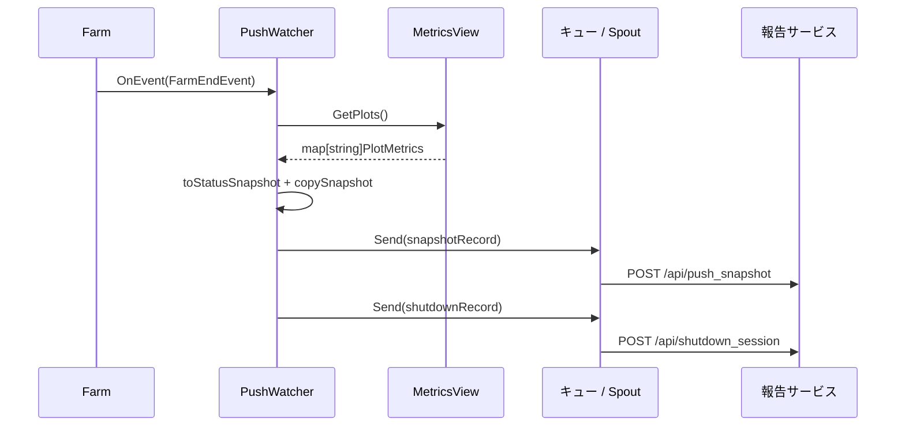

# pkg/reporter/push.go

> 📅 最終更新日: 2026/11/26

`pkg/reporter/push.go` は「ローカルグラフ → 報告サービス」方向のプッシュを担当します：Farm のイベントと周期スナップショットを 4 種類の JSON レコードに変換し、`funnel.Inlet` + `funnel.Spout` の非同期キューを経て、バックグラウンド goroutine が 1 件ずつサーバーの 4 つのエンドポイントへ POST します。

> 同期／非同期の境界：`OnEvent`、`PushSnapshot` は**エンキューだけ**を行い（最大でも `DefaultSendTimeout` までブロック）、実際のネットワーク IO はすべて `Spout` の単一の消費 goroutine 内で発生します。したがって遅いサーバーが Farm のイベント配信スレッドを引き止めることはありませんが、キューの滞留という形でバックプレッシャーになります。

## 役割

- イベント変換：`FarmStartEvent` → グラフメタ情報、`SeedWitherEvent` → エラーレコード、`FarmEndEvent` → 終態スナップショット + セッションのオフライン化。
- 周期スナップショット：`SnapshotTicker` から渡される `map[string]NodeStatus` を受け取り、セッション識別子とタイムスタンプを補ってプッシュします。
- ネットワーク分離：1 件のプッシュ失敗は標準ログに書くだけで、**消費ループを中断せず**、Farm にも伝播しません。

## 主要オブジェクト

### 定数

```go
const (
    DefaultPushBufferSize = 64                      // 队列缓冲条数
    DefaultPushTimeout    = 3 * time.Second         // HTTP 超时 + Spout 优雅关闭超时
    DefaultSendTimeout    = 500 * time.Millisecond  // Inlet.Send 单次入队超时

    defaultGraphMode = "grow"                       // 固定图模式
)
```

`DefaultPushTimeout` には**二重の役割**があります：`http.Client.Timeout` としても、`funnel.NewSpout` のクローズ待ち上限としても使われます。

### `type pushRecord`（閉じたインターフェース）

```go
type pushRecord interface {
    isPushRecord()
}
```

`isPushRecord` は非公開のためパッケージ外では実装できず、`pushHandler.handle` の `type switch` がすべてのレコード型を網羅していると見なせます。未知の型は `default` に落ちて `reporter: unsupported push record %T` を返します。

### 4 種類のレコードと JSON 契約

#### `graphMetaRecord` → `POST /api/push_graph_meta`

| フィールド | JSON キー | 由来 |
|------|---------|------|
| `SessionID` | `session_id` | `PushWatcher.sessionID` |
| `Graph` | `graph` | `FarmStartEvent.Farm` |
| `GraphMode` | `graph_mode` | 固定 `"grow"` |
| `StartTime` | `start_time` | `FarmStartEvent.StartTime` の Unix 浮動小数点秒 |
| `IsDAG` | `is_dag` | `FarmStartEvent.IsDAG` |
| `Nodes` | `nodes` | `FarmStartEvent.Plots` のコピー |
| `Edges` | `edges` | `FarmStartEvent.Edges` のディープコピー。出辺のないノードは `[]` にエンコードされる |
| `SourceNodes` | `source_nodes` | `FarmStartEvent.SourcePlots` のコピー |
| `NodeMeta` | `node_meta` | `FarmStartEvent.NodeMeta` のコピー（`class_name` / `execution_mode` / `max_workers`） |

`FarmStartEvent.Structure`（事前レンダリングされた構造行）は**報告しません**。Web 側がトポロジを自身でレンダリングします。

#### `snapshotRecord` → `POST /api/push_snapshot`

| フィールド | JSON キー | 説明 |
|------|---------|------|
| `SessionID` | `session_id` | セッション識別子 |
| `Timestamp` | `timestamp` | スナップショット時刻（Unix 浮動小数点秒）。周期スナップショットは `time.Now()`、Farm 終了スナップショットは `FarmEndEvent.EndTime` |
| `Snapshot` | `snapshot` | `map[string]NodeStatus`、詳細は [`snapshot.md`](./snapshot.md) |

#### `taskFailRecord` → `POST /api/push_error`

| フィールド | JSON キー | 由来 |
|------|---------|------|
| `SessionID` | `session_id` | セッション識別子 |
| `EventID` | `event_id` | **`SeedWitherEvent.WeedID`**（枯死イベント ID であり、`SeedID` ではない） |
| `Node` | `node` | `SeedWitherEvent.Plot` |
| `Task` | `task_json` | `toJSONValue(SeedWitherEvent.Seed)`、シリアライズできない場合は可読文字列に降格 |
| `ErrorType` | `error_type` | `fmt.Sprintf("%T", Err)`、例 `*errors.errorString` |
| `ErrorMessage` | `error_message` | `fmt.Sprintf("%v", Err)` |
| `Timestamp` | `ts` | `SeedWitherEvent.Time` の Unix 浮動小数点秒 |

> `taskFailRecord` には `result_json` フィールドがありません：ローカルは失敗タスクとエラーテキストのみを報告し、結果のプレースホルダを一切付けません。

#### `shutdownRecord` → `POST /api/shutdown_session`

| フィールド | JSON キー | 説明 |
|------|---------|------|
| `SessionID` | `session_id` | セッション識別子。サーバーはこれに基づいて当該セッションをオフラインにする |

### `type pushHandler`（非公開）

```go
type pushHandler struct {
    baseURL string
    timeout time.Duration
    client  *http.Client
}
```

`funnel.RecordHandler[pushRecord]` の 3 点セットを実装します：

| メソッド | 動作 |
|------|------|
| `BeforeStart()` | `h.client = newHTTPClient(h.timeout)`、常に `nil` を返す |
| `HandleRecord(record)` | `handle` を呼ぶ。**エラー時は `log.Print` するだけで `nil` を返す** |
| `AfterStop()` | `CloseIdleConnections()` してクライアントを空にし、常に `nil` を返す |

`HandleRecord` が常に `nil` を返すのは重要な設計です：`funnel.Spout` 自体がハンドラの戻り値を捨てるため、エラーを自発的に飲み込むことで「伝播できそうに見えて実際には伝播しない」という誤解を避けられます。失敗の可観測性は標準ログに完全に依存します。

#### エンドポイントの配分と `post`

| レコード型 | エンドポイント |
|----------|------|
| `graphMetaRecord` | `/api/push_graph_meta` |
| `snapshotRecord` | `/api/push_snapshot` |
| `taskFailRecord` | `/api/push_error` |
| `shutdownRecord` | `/api/shutdown_session` |

`post(path, payload any)` の手順：

1. `client == nil` → `reporter: push client is not initialized`。通常の経路では `Spout.Start` が先に `BeforeStart` で client を用意してから消費するため、これは防御的な分岐です（例えばハンドラを `Spout` から切り離して直接再利用した場合）。
2. `json.Marshal(payload)` の失敗 → `reporter: marshal <path> payload: %w`。
3. `POST baseURL+path`、`Content-Type: application/json`。
4. トランスポート層のエラー → `reporter: push <path>: %w`。
5. 非 2xx：
   - `io.LimitReader(res.Body, 512)` で最大 **512 バイト**のレスポンスボディを読む；
   - さらに `io.Copy(io.Discard, res.Body)` で残りを読み捨てて接続を再利用可能にする；
   - レスポンスボディが空白除去後に非空ならエラーは `reporter: push <path> failed: <Status>: <body>`、そうでなければ `reporter: push <path> failed: <Status>`。
6. 2xx はそのまま `nil` を返し、レスポンスボディを解析しない。

### `type PushWatcher`

```go
type PushWatcher struct {
    sessionID   string
    metricsView MetricsView
    spout       *funnel.Spout[pushRecord]
    inlet       *funnel.Inlet[pushRecord]
}
```

- `scarecrow.Watcher`（`OnEvent`）、`SnapshotSink`（`PushSnapshot`）、`metronome.Lifecycle`（`Start` / `Stop`）を実装します。
- `metricsView` は `FarmEndEvent` 時に終態スナップショットを追加プッシュするためだけに使われます。

#### 構築：`NewPushWatcher`

```go
func NewPushWatcher(sessionID string, baseURL string, metricsView MetricsView) (*PushWatcher, error)
```

検証順序：

| 順序 | 条件 | エラー |
|:----:|------|------|
| 1 | `strings.TrimSpace(sessionID) == ""` | `reporter: session id is empty` |
| 2 | `metricsView == nil` | `reporter: metrics view is nil` |
| 3 | `normalizeBaseURL(baseURL)` が失敗 | `reporter: base url is empty` / `invalid base url %q` / `must use http or https` |

成功後は固定で組み立てます：

```go
handler := &pushHandler{baseURL: baseURL, timeout: DefaultPushTimeout}
spout := funnel.NewSpout(handler, DefaultPushBufferSize, DefaultPushTimeout) // 缓冲 64，关闭等待 3s
inlet := funnel.NewInlet(spout.GetQueue(), DefaultSendTimeout)              // 入队超时 500ms
```

プッシュのタイムアウトとキュー容量はいずれも構築引数ではなく、セッションごとに調整できません。

#### メソッドと動作

| メソッド | シグネチャ | 動作 |
|------|------|------|
| `Start` | `func (w *PushWatcher) Start() error` | `spout.Start()` に委譲：先に `BeforeStart` で client を作り、次に消費 goroutine を起動 |
| `Stop` | `func (w *PushWatcher) Stop() error` | 先に `inlet.Close()` でブロック中の送信を早期に返し、次に `spout.Stop()`。`shutdown timeout` を返した場合は排出タイムアウト |
| `OnEvent` | `func (w *PushWatcher) OnEvent(event scarecrow.Event) error` | イベント変換 + エンキュー。`Inlet.Send` のエラーのみ上位へ返す |
| `PushSnapshot` | `func (w *PushWatcher) PushSnapshot(snapshot map[string]NodeStatus) error` | `time.Now()` をタイムスタンプとしてスナップショットを 1 回エンキュー |
| `pushSnapshotAt` | `(snapshot, ts time.Time) error`（非公開） | スナップショットをディープコピーしてからエンキュー。`PushSnapshot` と FarmEnd が共用 |

##### `OnEvent` のイベントマッピング

| イベント | 生成されるレコード | 備考 |
|------|-----------|------|
| `scarecrow.FarmStartEvent` | `graphMetaRecord` | `Plots`/`SourcePlots` は `append([]string{}, ...)` でコピー；`Edges` は `copyEdges`；`NodeMeta` は `copyNodeMeta` |
| `scarecrow.SeedWitherEvent` | `taskFailRecord` | `EventID = WeedID`；`Err` が `nil` のとき `error_type="<nil>"`、`error_message="<nil>"` になる |
| `scarecrow.FarmEndEvent` | `snapshotRecord` + `shutdownRecord` | まず `metricsView.GetPlots()` から**終態スナップショット**を投影し `EndTime` でエンキュー、成功した後にのみ shutdown をエンキュー |
| その他のイベント | なし | `nil` を返し、エンキューしない |

FarmEnd の順序保証：2 つのレコードは同じ FIFO キューに入り、**同じ**消費 goroutine が直列に送信するため、サーバーは必ず終態スナップショットを先に受け取り、その後でセッションのオフライン化を受け取ります。終態スナップショットのエンキューが失敗した場合（500ms 以内にキューが満杯のまま）、`OnEvent` はそのエラーを直接返し、**shutdown は送信されません**。

##### `Stop` の排出セマンティクス

1. `inlet.Close()` が内部 context をキャンセルし、ブロック中の `Send` をできるだけ早く `context.Canceled` で返させます。チャネルは閉じません。
2. `spout.Stop()` がチャネルを閉じてバッファを排出し、最大 `DefaultPushTimeout`（3s）待ちます。
3. タイムアウトしなかった場合：`nil` を返し、エンキュー済みのレコードはすべてプッシュが試行されています。
4. タイムアウトした場合：消費 goroutine がキャンセルされ、バッファに残ったレコードは破棄され、`shutdown timeout` を返します。その後も `AfterStop` が実行されてアイドル接続が閉じられます。

## 主要フロー

### イベントからネットワークへの非同期経路



### Farm 終了時のプッシュ順序



## 使用例

```go
package main

import (
    "fmt"

    "github.com/Mr-xiaotian/CelestialGrow/pkg/reporter"
    "github.com/Mr-xiaotian/CelestialGrow/pkg/scarecrow"
)

// emptyMetrics 演示 MetricsView 的最小实现。
type emptyMetrics struct{}

func (emptyMetrics) GetPlots() map[string]scarecrow.PlotMetrics {
    return map[string]scarecrow.PlotMetrics{}
}

func main() {
    watcher, err := reporter.NewPushWatcher("demo@1", "http://127.0.0.1:5005/", emptyMetrics{})
    if err != nil {
        panic(err)
    }
    if err := watcher.Start(); err != nil { // 内部创建 HTTP client 并启动消费 goroutine
        panic(err)
    }

    // 入队，立即返回；网络请求在后台 goroutine 中执行。
    if err := watcher.OnEvent(scarecrow.FarmStartEvent{
        Farm:        "demo",
        IsDAG:       true,
        Plots:       []string{"root"},
        Edges:       map[string][]string{"root": {}},
        SourcePlots: []string{"root"},
    }); err != nil {
        fmt.Println("enqueue failed:", err)
    }

    // 也可直接推一次快照（通常由 SnapshotTicker 调用）。
    if err := watcher.PushSnapshot(map[string]reporter.NodeStatus{
        "root": {Status: 1, TasksInput: 3, TasksProcessed: 2, TasksPending: 1},
    }); err != nil {
        fmt.Println("enqueue failed:", err)
    }

    // 排空队列并关闭连接；超过 3s 会返回 shutdown timeout。
    if err := watcher.Stop(); err != nil {
        fmt.Println("stop:", err)
    }
}
```

`SnapshotTicker` と組み合わせる場合、通常は `NewSnapshotTicker(metricsView, watcher, period)` と書き、ticker は投影だけ、watcher はネットワークを担当させます。

## 注意事項

- **1 件の失敗はログのみ**：`HandleRecord` はすべてのエラーを飲み込み、`HandleRecord` の戻り値は常に `nil` です。プッシュ失敗が Farm の実行を失敗させることも、リトライされることもありません。ログは標準の `log` パッケージ（既定は stderr）を使い、独自のロガーは注入できません。
- **損失ありのキュー**：バッファは 64 件で、`Inlet.Send` は最大 500ms 待ちます。サーバーが継続的に利用不能な場合、突発的なスナップショット／エラーレコードは破棄されます（`Send` が `inlet send timeout after 500ms` を返します）。`Farm.emit` は watcher のエラーを無視するため、Farm 側では感知されません。
- **`Start` 前に `OnEvent` / `PushSnapshot` を呼んでも即座にエラーにはなりません**：レコードはまずバッファに溜まり（最大 64 件）、キューが満杯になって初めて 500ms 後にタイムアウトします。`Start` を一度も呼ばなければ、これらのレコードは永久に送信されません。
- **`Stop` の後は書き込み禁止**：`spout.Stop` がチャネルを閉じているため、以降の `OnEvent`/`PushSnapshot` は panic（`send on closed channel`）する可能性があります。`Stop` は**冪等ではありません**：2 回目の呼び出しは `close` の重複で panic します。`pkg/assembly` の `StopFunc` は真偽値による冪等保護で、順序どおりに呼ばれた場合に 1 回だけ停止することを保証します（並行呼び出しは安全ではありません）。`Start` の重複呼び出しもエラーにはなりませんが、`BeforeStart` が重複実行され**2 つ目**の消費 goroutine が起動して 1 つ目と同じチャネルを奪い合うため、同様に避けるべきです。
- **順序はグローバル FIFO**：セッション内のすべてのレコードが 1 つのキューと 1 つの消費 goroutine を共有するため、リクエストは厳密に直列で順序が安定します。代償として、1 件の遅いリクエスト（最長 3s）が後続のすべてのレコードをブロックします。
- **エンキュー時のコピー範囲**：グラフメタ情報はスライスと隣接リストをコピーし、スナップショットは `copySnapshot` で各ノードとそのカウント辞書をコピーします。`taskFailRecord.Task` は依然として `toJSONValue(Seed)` の結果であり、`Seed` 自体を**ディープコピーしません**。イベント送出後、呼び出し側はシードオブジェクトを変更してはいけません。
- **`graph_mode` は `"grow"` に固定**：現在の実装は設定を受け付けないため、celestialflow-web の `GraphMeta.graph_mode` は常に `grow` になります。
- **終態スナップショットのデータ源は `MetricsView`**：`FarmEndEvent` 自体は指標を持たないため、`metricsView` がまだ `PlotEndEvent` を受け取っていない場合、スナップショット内の該当ノードは `running` のままかもしれません（Hub の配信順序に依存します：FarmEnd はすべての Plot が終了した後に送出されるので、通常は指標は更新済みです）。
- **非 2xx のレスポンスボディは先頭 512 バイトのみ保持**：大きな応答によるメモリ／ログの消費を避けつつ、診断可能なサーバーエラーの要約を提供します。残りのバイトは接続再利用のため読み捨てられます。
- **リダイレクト**：`http.Client` は既定でリダイレクトに従い、`POST` は 301/302/303 で `GET` に書き換えられる可能性があります。サーバーがそのようなステータスコードを返す場合、意味は自身で確認してください。
