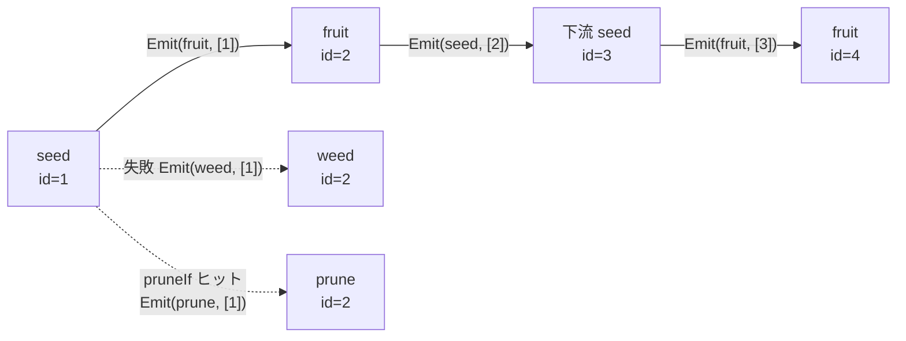
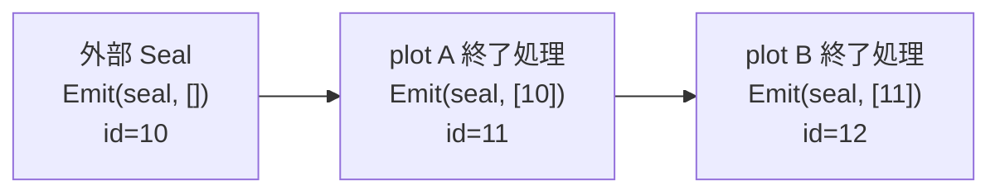
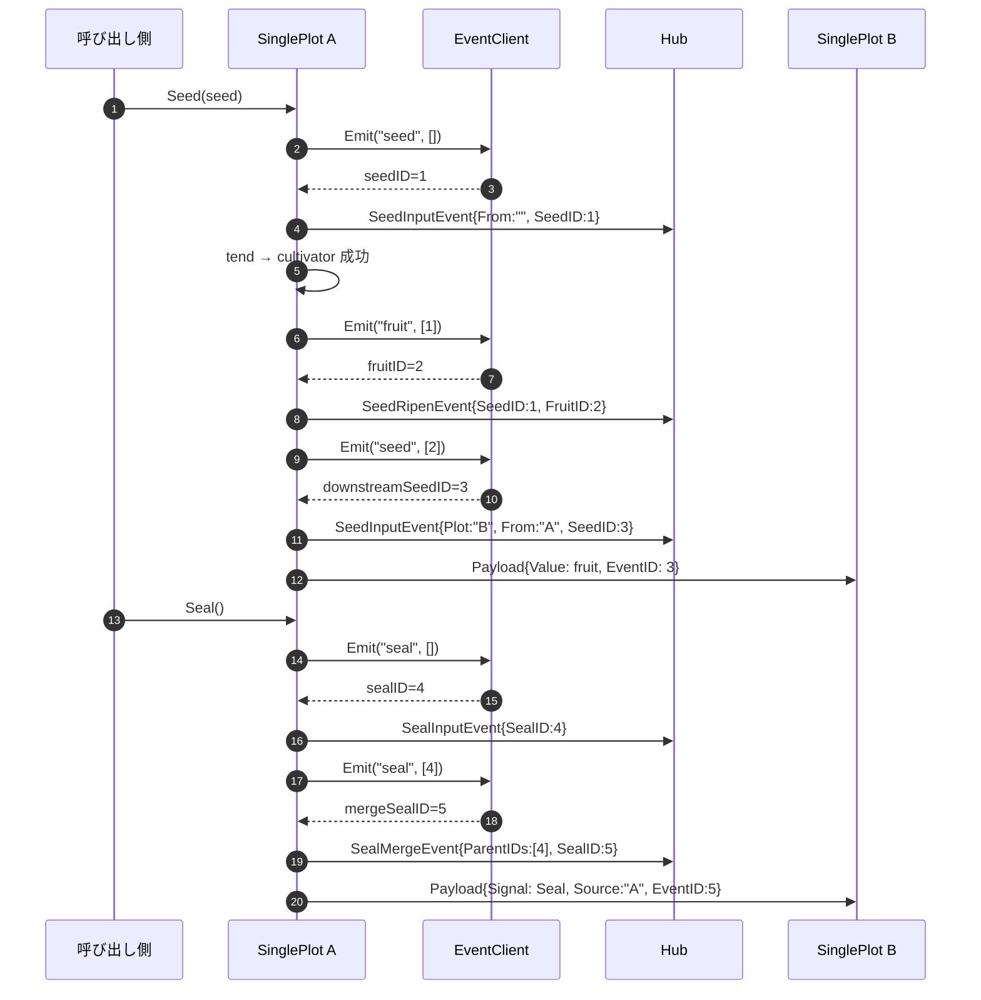
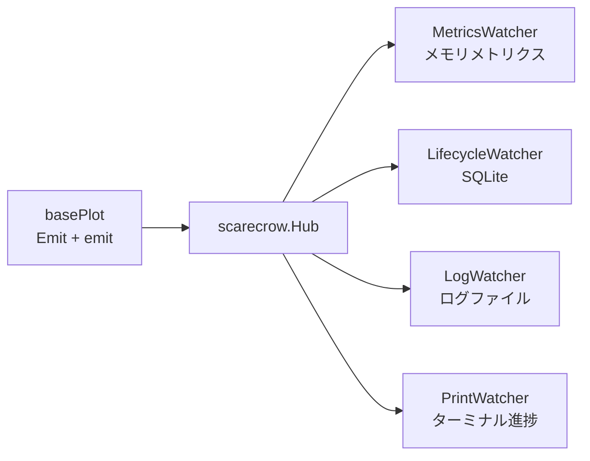

# pkg/runtime/event.go

> 📅 最終更新日: 2026/11/13

`event.go` はランタイムの**イベント ID 割り当て抽象**を定義します。インターフェース `EventClient` には `Emit(type_ string, parents []int) int` というメソッドが 1 つだけあり、既定実装 `LocalEventClient` はミューテックスロックでプロセス内の単調増加カウンターを維持します。`pkg/plot` の `basePlot` は `eventClient` フィールドを通じて ID を取得し、同時にその ID を `pkg/scarecrow` のイベント構造体（`SeedInputEvent.SeedID`、`SeedRipenEvent.FruitID`、`SeedWitherEvent.WeedID` など）へ書き込み、メトリクス・ログ・ライフサイクルオブザーバーが消費できるようにします。

> 「イベント」には 2 つの概念があることに注意してください。本ファイルの `EventClient` は**整数 ID の割り当て**だけを担当します。オブザーバーが実際に消費するのは `pkg/scarecrow/event.go` で閉じて定義された `Event` 構造体です。詳細は [`../scarecrow/event.md`](../scarecrow/event.md) を参照してください。

## 役割

- **イベント ID 割り当て器**の最小契約 `EventClient` を定義し、「ID をどう生成するか」を plot のスケジューリングロジックから切り離します。
- プロセス内で並行安全な既定実装 `LocalEventClient` を提供します。
- `Seed` / `Seal` / `witherSeed` / `pruneSeed` / `ripenSeed` / `sprout` の終了処理などの重要ポイントで単調増加する整数 ID を取得できるようにし、`parents` で「seed → fruit → 下流 seed → …」という因果チェーンをつなぎます。
- これらの ID はイベント構造体とともに `scarecrow.Hub` へ渡り、最終的に `persist.LifecycleWatcher` によって SQLite の `events` / `event_parents` テーブルへ書き込まれます。

> 本パッケージのエクスポートシンボルは `EventClient`、`LocalEventClient`、`NewLocalEventClient`、`(*LocalEventClient).Emit` の**4 つだけ**です。`EventKind` 列挙型も `Event` 構造体もありません。イベント種別（`"seed"` / `"fruit"` / `"weed"` / `"prune"` / `"seal"`）は文字列リテラルとして `pkg/plot` から `Emit` の `type_` 引数へ渡されます。

## 主要なオブジェクト

### `EventClient` インターフェース

イベントクライアントの最小限の発行能力です。runtime パッケージが求めるのは、**イベント ID を 1 つ割り当てる**という 1 点だけです。

```go
type EventClient interface {
	Emit(type_ string, parents []int) int
}
```

| メソッド | 用途 |
|------|------|
| `Emit(type_ string, parents []int) int` | 型が `type_`、直接の親イベント ID が `parents` であるイベントを 1 回宣言し、今回割り当てられたイベント ID を返します |

> `type_` と `parents` は `LocalEventClient` の実装では**署名の契約にしか関与しません**。既定実装は `type_` を永続化せず、`parents` も保存せず、増加するローカル ID を返すだけです。両者の業務的な意味は呼び出し側（`pkg/plot`）が解釈し、`scarecrow.Event` とともにオブザーバーへ渡します。この設計により、将来 plot のコードを変更せずに分散 ID 生成器へ既定実装を置き換えられます。

### `LocalEventClient` 構造体

プロセス内のイベント ID 割り当て器です。`newBasePlot` は各 plot の構築時に既定でこれを作成して使用します。`Farm` は `NewFarm` で 1 つ作成し、登録済みのすべての plot に注入します。

```go
type LocalEventClient struct {
	mu     sync.Mutex
	nextID int
}
```

| フィールド | 型 | 意味 |
|------|------|------|
| `mu` | `sync.Mutex` | `nextID` を保護するミューテックスロックで、`Emit` が並行呼び出しでもアトミックになるようにします |
| `nextID` | `int` | 割り当て済みのイベント ID。ゼロ値は未割り当てを意味し、最初の `Emit` は `1` を返します |

### 構築と発行

```go
func NewLocalEventClient() EventClient

func (e *LocalEventClient) Emit(type_ string, parents []int) int
```

| 関数 | 振る舞い |
|------|------|
| `NewLocalEventClient()` | `EventClient` インターフェース値を返し、内部にゼロ値の `*LocalEventClient`（`nextID = 0`）を保持します |
| `Emit(type_, parents)` | ロックし、`nextID++` し、新しい `nextID` を返してロックを解放します。並行安全で、同じインスタンス上では単調増加します |

```go
c := runtime.NewLocalEventClient()
id1 := c.Emit("seed", []int{})      // 1
id2 := c.Emit("fruit", []int{id1})  // 2
```

> `LocalEventClient` は履歴を保存しません。担当するのは「ID の割り当て」だけで、割り当て済みの ID を問い合わせることはできません。イベントチェーンを追跡する必要がある場合は、オブザーバーが ID と `parents` を `pkg/persist` へ伝える仕組みに依存してください。

## 公開シンボル一覧

| シンボル | 型 | 説明 |
|------|------|------|
| `EventClient` | `interface` | イベント ID 割り当ての最小契約 |
| `LocalEventClient` | `struct`（エクスポート） | プロセス内で並行安全な既定実装 |
| `NewLocalEventClient` | `func() EventClient` | コンストラクタで、インターフェース値を返します |
| `(*LocalEventClient).Emit` | `func(string, []int) int` | 新しい ID を割り当てて返します |

## ID 割り当ての実際の呼び出し箇所

`basePlot` の共通パスは `pkg/plot/plot.go` に、成功パスはノード種別ごとに `pkg/plot/plot_single.go`、`plot_split.go`、`plot_route.go` にあります。すべての呼び出しは現在の plot の `p.eventClient` を使用し、`Farm` 自身は `Emit` を呼びません。

| トリガーメソッド | 所在ファイル / 型 | `type_` | `parents` | その後に発行される `scarecrow.Event` |
|---------|----------------|---------|-----------|------------------------------|
| `Seed` | `plot.go` / `basePlot` | `"seed"` | `[]int{}` | `SeedInputEvent`（`From` は空、`Parents` も空） |
| `Seal` | `plot.go` / `basePlot` | `"seal"` | `[]int{}` | `SealInputEvent` |
| `witherSeed` | `plot.go` / `basePlot` | `"weed"` | `[]int{seedID}` | `SeedWitherEvent`（`WeedID`） |
| `pruneSeed` | `plot.go` / `basePlot` | `"prune"` | `[]int{seedID}` | `SeedPruneEvent`（`PruneID`） |
| `ripenSeed` | `plot_single.go` / `SinglePlot` | `"fruit"` | `[]int{seedID}` | `SeedRipenEvent`（`FruitID`） |
| `ripenSeed` | 同上、下流ごと | `"seed"` | `[]int{fruitID}` | `SeedInputEvent`（`Plot` は下流名、`From` は本ノード名、`Parents = []int{fruitID}`） |
| `ripenSeed` | `plot_split.go` / `SplitPlot` | `"fruit"`（1 回） | `[]int{seedID}` | `SeedRipenEvent` |
| `ripenSeed` | 同上、下流ごと × 果実ごと | `"seed"` | `[]int{fruitID}` | `SeedInputEvent`（各産出につき 1 件） |
| `ripenSeed` | `plot_route.go` / `RoutePlot` | `"fruit"`（1 回） | `[]int{seedID}` | `SeedRipenEvent` |
| `ripenSeed` | 同上、ヒットしたルートごと | `"seed"` | `[]int{fruitID}` | `SeedInputEvent`（未接続のターゲットはスキップ） |
| `sprout` の終了処理 | `plot.go` / `basePlot` | `"seal"` | 収集済みのすべての seal ID | `SealMergeEvent`（`ParentIDs`） |

補足：

- `witherSeed` は 3 つの失敗パスを同時にカバーします。`cultivator` が error を返す、`retryIf` がリトライを拒否する、`tend` の `recover` が panic を捕捉する（`cultivator panic: …` としてラップ）の 3 つです。
- `pruneSeed` は `tend` が `cultivator` を呼び出す前に `pruneIf` にヒットしたときに発火し、fruit を生成せず、下流への転送も行いません。
- `SeedInputEvent` は**配送側**が発行します。上流の `ripenSeed` が `Payload` を下流のチャネルへ書き込む前に発行し、`Plot` フィールドには下流名、`From` には本ノード名を設定します。下流の `sprout` が通常の `Payload` を読み取ったときに、入力イベントを追加で発行することはありません。
- `sprout` の終了処理時の `parents` は `sealedFrom` map から取得した値であるため、**順序は不安定**です。SQLite の `event_parents` は辺のみを記録し、順序には依存しません。

## 因果チェーン

以下では単一インスタンスの `LocalEventClient` と単一のチェーンを例に説明します（ID は 1 から連続して割り当てられます）。



`fruit` → 複数の下流 `seed` になるとファンアウトが形成されます（`SplitPlot` の複数の果実、`RoutePlot` の複数のターゲットも同様です）。`weed` / `prune` はチェーンの終端であり、それ以上産出しません。seal チェーンは「上流のマージ seal → 下流」に沿って伝播します。



（図の A は上流を持たない source plot です。A に他の上流がある場合、マージ seal の `parents` には収集済みのすべての seal ID が含まれます。）

### 1 回の完全な実行におけるイベント順序



> 図では待機の過程を省略しています。`sprout` は `inputClosed` が真であり、かつ処理中のすべての seed が `done` で報告された後にのみマージ seal（`SealMergeEvent`）を発行します。そのため seal は、本ノードが受け取った seed をすべて処理し終えてから下流へブロードキャストされます。

## オブザーバーと永続化の関係

ID 自体は業務情報を運ばず、データベースへの保存は完全にオブザーバーが行います：

- `scarecrow.MetricsWatcher` はイベントのフィールドに基づいて入力 / 成熟 / 枯萎 / 剪枝のカウントと上流・下流の由来分布を維持し、イベント ID は読み取りません。
- `persist.LifecycleWatcher` は 4 種類の seed イベントを `persist.LifecycleRecord` へ変換し、`InsertLifecycleEvent` で `events` + `event_parents` に書き込み、`status` テーブルを更新します。
- `persist.LogWatcher` は可読なログを出力し、`scarecrow.PrintWatcher` は進捗を表示します。どちらもデータベースへは保存しません。
- `MetricsWatcher` / `LifecycleWatcher` / `LogWatcher` は `pkg/assembly` が `Run` / `Start` 時に Hub へ自動登録します。`PrintWatcher` は呼び出し側が `AddWatcher` で手動でマウントする必要があります。



`type_` と保存値の対応関係は次のとおりです（`LifecycleRecord` の `Kind` 定数は `pkg/persist/lifecycle.go` で定義されています）。

| `Emit` の `type_` | イベント | `LifecycleRecord.Kind` | `events.event_type` | `status.status` |
|-------------------|------|------------------------|---------------------|-----------------|
| `"seed"` | `SeedInputEvent` | `"seed"` | `"seed"` | `"seed"` |
| `"fruit"` | `SeedRipenEvent` | `"ripen"` | `"ripen"` | `"ripen"` |
| `"weed"` | `SeedWitherEvent` | `"wither"` | `"wither"` | `"wither"` |
| `"prune"` | `SeedPruneEvent` | `"prune"` | `"prune"` | `"prune"` |
| `"seal"` | `SealInputEvent` / `SealMergeEvent` | （レコードを生成しません） | — | — |

> 命名の階層：`Emit` の `type_` は植物学の比喩（`fruit` / `weed`）を使い、`LifecycleRecord.Kind` と保存値は状態のセマンティクス（`ripen` / `wither`）を使います。`LifecycleRecord.ParentIDs` はイベントのフィールドから取得します。seed の入力は `SeedInputEvent.Parents` を使い、成熟 / 枯萎 / 剪枝はそれぞれ `[]int{SeedID}` を使用します。

## 使用例

### 既定実装の置き換え

ローカルの自動増加 ID をスノーフレーク ID、UUID ハッシュ、外部サービスの割り当て器に置き換えたい場合は、`EventClient` を実装して `SetEventClient` で注入するだけです：

```go
package main

import (
	"fmt"
	"sync/atomic"

	"github.com/Mr-xiaotian/CelestialGrow/pkg/farm"
	"github.com/Mr-xiaotian/CelestialGrow/pkg/plot"
)

// offsetClient 在本地自增序列上叠加固定偏移，便于和外部 ID 空间区分。
type offsetClient struct {
	base int
	next atomic.Int64
}

func (c *offsetClient) Emit(type_ string, parents []int) int {
	// type_ 与 parents 由调用方解释；此处只负责分配唯一 ID。
	return c.base + int(c.next.Add(1))
}

func main() {
	double := plot.NewSinglePlot("double", func(seed int) (int, error) {
		return seed * 2, nil
	})
	format := plot.NewSinglePlot("format", func(seed int) (string, error) {
		return fmt.Sprintf("result=%d", seed), nil
	})

	f := farm.NewFarm("demo_farm")
	if err := f.AddPlot(double, format); err != nil {
		panic(err)
	}
	if err := f.Connect([]plot.PlotNode{double}, []plot.PlotNode{format}); err != nil {
		panic(err)
	}

	client := &offsetClient{base: 1000}
	double.SetEventClient(client) // 覆盖 AddPlot 注入的默认 client
	format.SetEventClient(client) // 同一条链路必须共用同一实例

	if err := f.Run(map[string][]any{"double": {1, 2, 3}}, "INFO"); err != nil {
		panic(err)
	}
}
```

> `Emit` の `type_` / `parents` 引数は必ずシグネチャに含める必要があります。独自実装がそれらを読み取らない場合でも省略できません。そうでなければ `runtime.EventClient` を実装できません。

### 既定実装をラップして統計を取る

`LocalEventClient` は `Len()` / `Current()` のような照会メソッドを提供しません。割り当て済みの数を観察したい場合は、外側で 1 層ラップします：

```go
package main

import (
	"sync/atomic"

	"github.com/Mr-xiaotian/CelestialGrow/pkg/runtime"
)

type countedClient struct {
	inner runtime.EventClient
	n     atomic.Int64
}

func (c *countedClient) Emit(type_ string, parents []int) int {
	id := c.inner.Emit(type_, parents)
	c.n.Add(1)
	return id
}
```

## 重要な詳細

- **並行安全**：`LocalEventClient.Emit` は `sync.Mutex` で `nextID++` を直列化するため、マルチゴルーチンからの並行呼び出しでも返される ID は一意かつ単調増加です。
- **割り当てのみ、保存なし**：可変状態は `nextID` とそれを保護する `mu` だけです。`type_`、`parents`、タイムスタンプはいずれも割り当て器に入りません。
- **ID は 1 から始まる**：ゼロ値の `nextID == 0` なので、最初の `Emit` は 1 を返します。そのため `EventID` を明示的に設定していない `Payload` の該当フィールドはゼロ値 `0` になります。
- **Farm 内で共有**：`farm.NewFarm` は `LocalEventClient` を 1 つ作成し、`Farm.AddPlot` は各 plot に対して `SetEventClient(f.eventClient)` を呼び出します。そのため同じ Farm 内のすべての plot が 1 つの名前空間を共有し、plot をまたぐチェーンでも ID の再利用は発生しません。
- **standalone では個別管理**：Farm を経由せず手動で複数の plot を接続する場合、各 plot の `newBasePlot` がそれぞれ `LocalEventClient` を作成するため、異なる plot で ID が重複する可能性があります。手動で組む場合は、すべてのノードに同じインスタンスを明示的に注入してください。
- **seal は保存されない**：`LifecycleWatcher` は `SealInputEvent` / `SealMergeEvent` を無視するため、seal ID は SQLite へ書き込まれません。メモリ内の `sealedFrom` の集約、`SealMergeEvent` のフィールド、下流の `Payload` の中でのみ受け渡されます。
- **`parents` は直接の親イベント**：因果パス上のすべての祖先ではありません。SQLite では各辺が 1 層だけ接続します。

## 注意事項

- 名前空間を共有する必要がある場面で 2 つの `LocalEventClient` インスタンスを混在させないでください。同じ論理タスクに 2 系統の ID が割り当てられ、`event_parents` の辺関係が壊れます。
- `LocalEventClient` のゼロ値は使用可能ですが、外部からの構築には `NewLocalEventClient()` の使用を推奨します。`EventClient` インターフェース値を取得でき、後から実装をスムーズに置き換えられます。
- 業務イベント種別を追加する場合、`type_` のリテラルだけを変更することはできません。`scarecrow.Event` は閉じた集合であるため、`pkg/scarecrow/event.go` および `MetricsWatcher` / `LifecycleWatcher` / `LogWatcher` / `PrintWatcher` の `type switch` も同期して更新する必要があります。そうしなければ新しいイベントは黙って無視されます。
- オブザーバーはイベント送信側のゴルーチン上で同期的に実行され、`Hub` は非同期キューを提供しません。`OnEvent` 内でブロッキング操作を行うと plot のスケジューリングパスが遅くなるため、避けてください。
