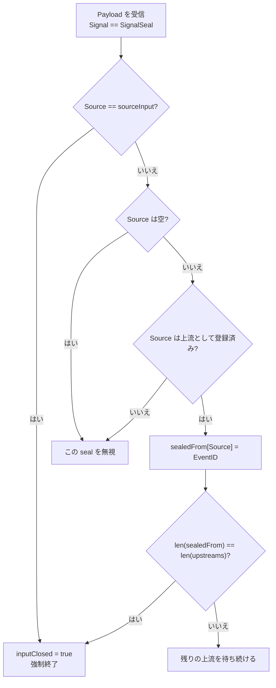

# pkg/runtime/type.go

> 📅 最終更新日: 2026/11/13

`type.go` はパッケージをまたいで共有されるランタイムの基本型を定義します。パイプライン段階の統一データキャリア `Payload[V]`、制御信号の定数 `SignalNone` / `SignalSeal`、そして「seed — fruit」のペア型 `Karma[S, F]` です。`Payload` は `pkg/plot` のノード間データチャネル（`seedChan` / `yieldChans`）の要素型です。`Karma` は現時点では拡張ポイントとして用意されているだけで、ランタイムのメインフローでは使用されていません。

## 役割

- **データ**（seed、yield）と**制御信号**（seal）を同じジェネリック型に統一的にカプセル化し、plot 間の接続に `chan runtime.Payload[X]` が 1 本だけで済むようにします。
- `SignalNone` / `SignalSeal` という 2 つの定数によって、データフローと制御フローを同じチャネルで共存させ、受信側が `Signal` に応じて振り分けます。
- `Source` で seal の由来を識別し、`basePlot.markSealed` が「すべての上流を待つ」か「外部からの強制終了」かを集約して判定できるようにします。
- `Karma` という「seed — fruit」のペア型を提供し、上位層が必要とする可能性のある「振り返り」インターフェースの余地を残します。

> `pkg/runtime` には `Task` / `TaskResult` / `TaskStatus` などのタスクモデルは含まれていません。ランタイムの情報はすべて `pkg/scarecrow` のイベント構造体を通じて外部へ渡され、永続化は `pkg/persist` のオブザーバーが行います（[`event.md`](./event.md) を参照）。

## 主要なオブジェクト

### 制御信号の定数

```go
const (
	SignalNone = iota // 正常数据
	SignalSeal        // 终止信号，通知下游不再有新数据
)
```

| 定数 | 値 | セマンティクス |
|------|----|------|
| `SignalNone` | `0` | この `Payload` は正常なデータ（seed または yield）を運びます |
| `SignalSeal` | `1` | この `Payload` は終了信号で、下流に「本 plot は新しいデータを生成しない」ことを通知します |

設計上のポイント：

- **同じ `chan Payload[V]`** でデータと制御フローを同時に運び、制御信号のために別のチャネルを追加で開くことを避けます。
- `Signal == SignalSeal` のときは `Value` を**読み取りません**。判定は `Signal` と `Source` だけで行います。
- 下流の `sprout` は `SignalSeal` を読み取ると `markSealed` を呼び出し、強制終了か上流の集約待ちかは `Source` で決まります。詳細は本稿の「Seal の集約と `markSealed`」を参照してください。

### `Payload[V]` 構造体

```go
type Payload[V any] struct {
	// Signal与Seed通用
	Signal  int
	EventID int

	// Signal使用
	Source string

	// Seed使用
	Value V
}
```

| フィールド | 型 | 用途 | `SignalSeal` 時のセマンティクス |
|------|------|------|--------------------------|
| `Signal` | `int` | `SignalNone`（正常データ）または `SignalSeal`（終了信号） | 固定で `SignalSeal` |
| `EventID` | `int` | `EventClient.Emit` が割り当てるイベント ID（[`event.md`](./event.md) を参照） | seal イベント ID（メモリ内でのみ使用し、データベースには保存されません） |
| `Source` | `string` | 信号の由来：外部終了は `sourceInput`、内部伝播は上流の plot 名。正常データではこのフィールドを設定しません | seal がどの plot（または `sourceInput`）から来たか |
| `Value` | `V` | 実際のデータ（seed または yield） | **使用しません**。ゼロ値になります |

> フィールドの意味は `Signal` によって決まります。
> - `Signal == SignalNone`：`Value` が有効なデータで、`EventID` はこのデータのイベント ID です。現在の実装では `Source` はゼロ値 `""` のままです。
> - `Signal == SignalSeal`：`Value` は無意味です。`Source` は下流の `markSealed` が由来を判定するために使用します。

### `Karma[S, F]` 構造体

```go
type Karma[S any, F any] struct {
	Seed  S
	Fruit F
}
```

| フィールド | 型 | 意味 |
|------|------|------|
| `Seed` | `S` | 1 つの seed の元の入力 |
| `Fruit` | `F` | この seed が育成を経て生成した fruit |

> `Karma` は現時点で **`pkg/plot` や他のどのパッケージからも使用されていません**。`pkg/runtime` はこれを拡張ポイントとして公開しています（例えば、失敗時にも `Seed` を保存して再生可能なキャッシュにする、あるいは `Harvest` 時に `[]Karma` を返すなど）。本番パスでこれに依存することは避けてください。

## 公開シンボル一覧

| シンボル | 型 | 用途 |
|------|------|------|
| `SignalNone` | `const int` | `Payload.Signal` の値：正常データ |
| `SignalSeal` | `const int` | `Payload.Signal` の値：終了信号 |
| `Payload[V any]` | `struct` | パイプライン段階の統一データキャリアで、データと制御信号を同時に運びます |
| `Karma[S any, F any]` | `struct` | seed — fruit のペア（拡張ポイントとして用意） |

ジェネリックパラメータのセマンティクス：

| パラメータ | 出現位置 | 意味 |
|------|---------|------|
| `V` | `Payload[V]` | そのパイプライン段階が運ぶデータ型です。`seedChan` は `S`、`yieldChans` は `Y` を使用します |
| `S` | `Karma[S, F]` | seed 型 |
| `F` | `Karma[S, F]` | fruit 型 |

## パッケージをまたぐ使用の約束

`Payload[V]` は `pkg/plot` のノード間データチャネルの要素型です（チャネルの定義は `pkg/plot/plot.go` を参照）：

| チャネル | 要素型 | 書き込み点 | 読み取り点 |
|------|----------|--------|--------|
| `basePlot.seedChan` | `chan runtime.Payload[S]` | `basePlot.Seed`、`basePlot.Seal`、上流 plot の `yieldChans` | 現在の plot の `sprout` |
| `basePlot.yieldChans[name]` | `chan runtime.Payload[Y]` | 現在の plot の `ripenSeed`、`sprout` の終了処理 | 下流 plot の `seedChan` |

4 か所の構築ポイント（いずれも `pkg/plot`）：

| 構築ポイント | コード | `Signal` | `Source` | `Value` |
|--------|------|----------|----------|---------|
| `basePlot.Seed` | `runtime.Payload[S]{Value: seed, EventID: seedID}` | `SignalNone`（ゼロ値、明示的に未設定） | `""`（未設定） | seed |
| `basePlot.Seal` | `runtime.Payload[S]{Signal: runtime.SignalSeal, Source: sourceInput, EventID: sealID}` | `SignalSeal` | `"__input__"` | ゼロ値 |
| `ripenSeed` が下流へ転送 | `runtime.Payload[Y]{Value: yield, EventID: downstreamSeedID}` | `SignalNone`（ゼロ値） | `""`（未設定） | fruit / 単一の産出 |
| `sprout` の終了処理でブロードキャスト | `runtime.Payload[Y]{Signal: runtime.SignalSeal, Source: p.name, EventID: sealID}` | `SignalSeal` | 現在の plot 名 | ゼロ値 |

> `sourceInput` は `pkg/plot/constant.go` にある非エクスポート定数で、リテラルは `"__input__"` です。外部パッケージはこれを参照できず、この文字列をハードコードすべきでもありません。「外部からの終了かどうか」は `Seal()` の振る舞いから推論してください。詳細は [`../plot/constant.md`](../plot/constant.md) を参照してください。

> `ConnectTo` は型アサーション `next.GetSeedChanAny().(chan runtime.Payload[Y])` を行うため、上流と下流の `Payload` 要素型は一致していなければなりません。これが「データ / 信号を 2 つの型に分割しない」という強い制約の由来でもあります。

### 下流が受信しても入力イベントを再発行しない

上流の `ripenSeed` は下流のチャネルへ書き込む前に、自分の Hub で `scarecrow.SeedInputEvent` を発行済みです（`Plot` は下流名、`From` は本ノード名、`Parents` は `[]int{fruitID}`）。下流の `sprout` は通常の `Payload` を読み取った後は育成のスケジューリングだけを行い、入力イベントを追加で発行しません。そのためメトリクスとライフサイクルのオブザーバーが見る各入力は、それぞれ 1 つのイベントにのみ対応します。

## Seal の集約と `markSealed`

`basePlot.sprout` は `select` で `SignalSeal` を受け取ると `markSealed(source, sealID, sealedFrom)` を呼び出し、その戻り値で `inputClosed` を**直接上書き**します：

```go
func (p *basePlot[S, F, Y]) markSealed(source string, sealID int, sealedFrom map[string]int) bool {
	if source == sourceInput {
		sealedFrom[sourceInput] = sealID
		return true
	}
	if source == "" {
		return false
	}
	if _, ok := p.upstreams[source]; !ok {
		return false
	}
	sealedFrom[source] = sealID
	return len(sealedFrom) == len(p.upstreams)
}
```



各分岐のセマンティクス：

| `Source` | 振る舞い | 入力が即座に閉じるか |
|----------|------|------------------|
| `sourceInput`（`"__input__"`） | `sealedFrom[sourceInput]` に記録 | **はい**：この seal を受け取った時点で入力を閉じ、未到達の上流 seal は待ちません |
| `""` | そのまま無視 | いいえ |
| `upstreams` に登録されていない名前 | そのまま無視 | いいえ |
| 登録済みの上流名 | `sealedFrom[Source] = EventID` を記録 | 収集済みの由来数が上流数と等しくなったときに閉じる |
| 同じ上流が seal を繰り返し送信 | 同じ key を上書きするため、重複して数えません | 残りの上流がすべて到達したかどうかで決まる |

`upstreams` は上流が `ConnectTo` 時に `AddUpstream(p.name)` を呼び出して登録し、接続確立後は変化しません。そのため現在の実装では、上流を持たない plot は外部の `Seal()` によってのみ閉じられます。

> `inputClosed` は「一度 `true` になったら固定」という粘着性のあるフラグではありません。seal を受け取るたびに `markSealed` の戻り値で上書きされます。外部の `Seal()` が生む seal はその回の `markSealed` に `true` を返させますが、その時点で処理中の seed が残っている（`inFlight > 0`）場合、`sprout` は後続の seal も受け取り続けるため、上流からの seal によって再び `false` に戻される可能性があります。最終的な終了は、次の周回で `shouldFinish()`（`inputClosed && inFlight == 0`）が成立するかどうかで決まります。

### 終了処理と seal イベント

`sprout` は各周回のループ冒頭で次を確認します：

```go
shouldFinish := func() bool {
	return ctxCancel || (inputClosed && inFlight == 0)
}
```

ここで `ctxCancel` は `p.ctx.Done()` に由来します（現在の `basePlot` は `cancel` を保持していますが呼び出し箇所がないため、実際に効くのは後半部分だけです）。`inFlight` は `tend` に入ったがまだ `done` で報告されていない seed の数です。条件を満たすと：

1. `sealedFrom` の value から `parentIDs` を収集し、`p.eventClient.Emit("seal", parentIDs)` を呼び出します。
2. `scarecrow.SealMergeEvent{Plot, ParentIDs, SealID, Time}` を発行します。
3. **すべての** `yieldChans` へ `Payload[Y]{Signal: SignalSeal, Source: p.name, EventID: sealID}` を送信し、その後 `return` します。

> `parentIDs` は map の走査に由来するため**順序は不安定**です。`sourceInput` の seal ID や、閉じる前に受け取った一部の上流 seal ID を含む場合があります。seal イベントは SQLite へ書き込まれず、`LifecycleWatcher` は `SealInputEvent` / `SealMergeEvent` を無視します。

## 使用例

### `seedChan` 上でデータ / 信号を判別する

```go
package main

import (
	"context"

	"github.com/Mr-xiaotian/CelestialGrow/pkg/runtime"
)

func consume[S any](
	ctx context.Context,
	ch <-chan runtime.Payload[S],
	handle func(seed S, eventID int),
	handleSeal func(source string, sealID int),
) {
	for {
		select {
		case p := <-ch:
			switch p.Signal {
			case runtime.SignalNone:
				handle(p.Value, p.EventID)
			case runtime.SignalSeal:
				handleSeal(p.Source, p.EventID)
			}
		case <-ctx.Done():
			return
		}
	}
}
```

### 下流へ送る yield Payload を構築する

```go
package main

import "github.com/Mr-xiaotian/CelestialGrow/pkg/runtime"

func forward[Y any](
	client runtime.EventClient,
	fruitID int,
	yield Y,
	ch chan<- runtime.Payload[Y],
) {
	downstreamSeedID := client.Emit("seed", []int{fruitID})
	ch <- runtime.Payload[Y]{Value: yield, EventID: downstreamSeedID}
}
```

### seal Payload を構築してブロードキャストする

```go
package main

import "github.com/Mr-xiaotian/CelestialGrow/pkg/runtime"

func broadcastSeal[Y any](
	client runtime.EventClient,
	name string,
	parentIDs []int,
	chans map[string]chan runtime.Payload[Y],
) {
	sealID := client.Emit("seal", parentIDs)
	payload := runtime.Payload[Y]{
		Signal:  runtime.SignalSeal,
		Source:  name, // 外部终止时由 pkg/plot 填 sourceInput
		EventID: sealID,
	}
	for _, ch := range chans {
		ch <- payload
	}
}
```

### `Karma` で「seed — fruit」のペアをキャッシュする（プレースホルダー用法）

```go
k := runtime.Karma[S, F]{Seed: seed, Fruit: fruit}
// 业务侧可以把它放进自己管理的回放缓存里
_ = k
```

## 重要な詳細

- **ゼロ値は「正常データ」**：`Signal` のゼロ値は `SignalNone` なので、`Signal` フィールドを書かない `Payload{}` は自動的に正常データを表します。`Seed` / `ripenSeed` はいずれも `Value` / `EventID` のみを設定し、`Signal` を明示的に設定しません。
- **共用のセマンティクス**：`Signal` / `Source` / `Value` は `Signal` の値に応じて個別に使用されるため、すべてのフィールドが意味を持つと仮定しないでください。
- **`Source` は seal 専用**：現在の `pkg/plot` の実装では、正常データの `Source` は常に `""` です。上流の配送情報は `Payload.Source` ではなく `SeedInputEvent.From` に記録されます。
- **seal は `yieldChans` に沿ってのみブロードキャスト**：`sprout` の終了処理時に接続済みのすべての下流へ 1 回ずつ送信します。未接続の plot は受け取りません。
- **強制終了は処理中の seed の影響を受ける**：外部の `Seal()` はその回の `markSealed` で直ちに `true` を返しますが、`inputClosed` は seal を受け取るたびに再代入されます。処理中の seed がまだ終わっておらず、その後さらに集約条件を満たさない seal を受け取ると、閉じた状態が上書きされる可能性があります。最終的な終了は `shouldFinish()`（`inputClosed && inFlight == 0`）で決まります。
- **`EventID` は割り当て器が決める**：`Payload` は運ぶだけで、ID が一意かどうかを検証しません。手動で組む場合は、チェーン全体で 1 つの `runtime.EventClient` を共有する必要があります。

## 注意事項

- `Payload` を「データ専用 / 信号専用」の複数の型に分割しないでください。本フレームワークの設計は「同じパイプラインでデータと制御フローを同時に運ぶ」というもので、型を分割すると `ConnectTo` の型アサーションが壊れます。
- `Signal == SignalSeal` の状況で `Payload.Value` を使用しないでください。その内容は `V` のゼロ値で、セマンティクスは未定義です。
- seal の `Source` を誤って設定すると（例えば内部伝播で誤って `sourceInput` を入れる、未登録の上流名を使うなど）、下流が**早期に終了処理に入る**か、**永久に閉じられなくなる**かのどちらかになります。plot のロジックを独自実装する場合は、seal を手書きせず `basePlot` の `Seal` / `sprout` の実装を再利用してください。
- `Karma` は現在 plot のメインフローでは使用されていません。導入したのは拡張ポイントとして用意するためであり、本番パスでこれに依存することは避けてください。
- ランタイムのメトリクスを観察する必要がある場合は、`scarecrow.MetricsWatcher`（イベントストリームからカウントを再構築）を使用してください。`Payload` にカウンタや状態フィールドを追加しようとしないでください。
