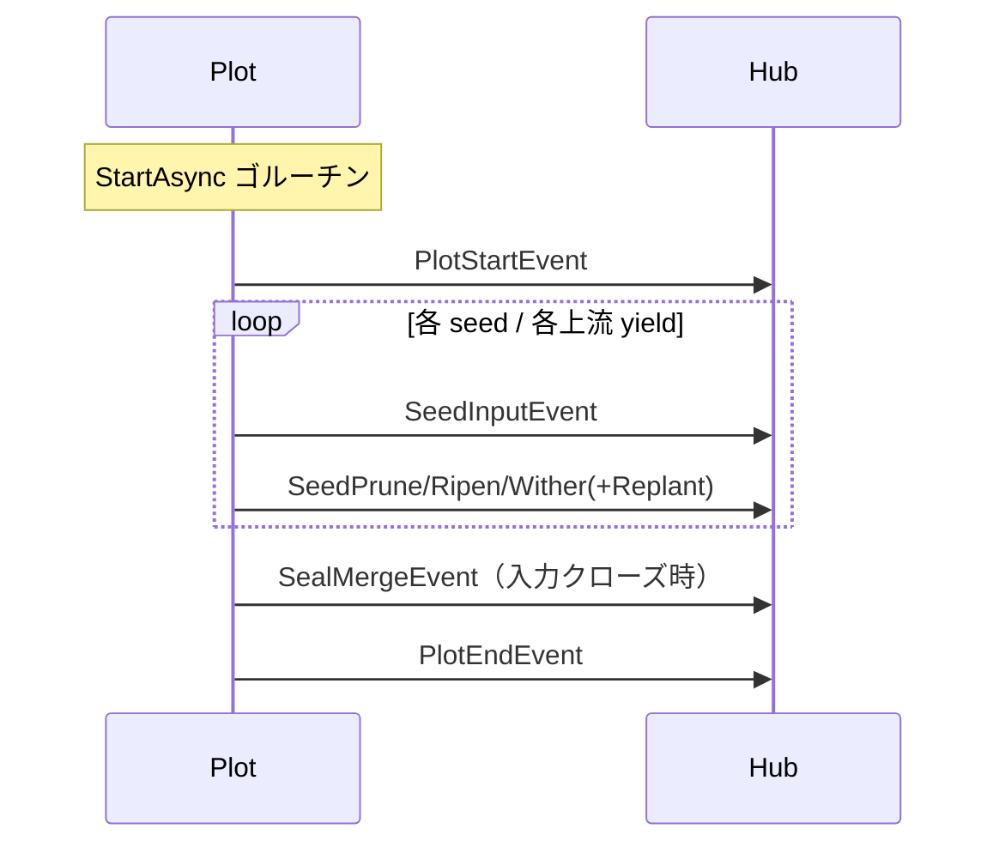

# pkg/scarecrow/event.go

> 📅 最終更新日: 2026/11/13

## 役割

`pkg/scarecrow/event.go` は実行期イベントの**閉じた集合**を定義します：未エクスポートメソッド `isEvent()` だけを持つイベントインターフェース `Event` と、11 個の具体的なイベント構造体です。`pkg/plot` と `pkg/farm` はライフサイクル、seed の出入り、終了シグナルの重要な時点でこれらの構造体値を送出し、オブザーバ（`MetricsWatcher`、`PrintWatcher`、`persist.LogWatcher`、`persist.LifecycleWatcher` など）が `type switch` で消費します。

本ファイルはデータのみを定義し、配信ロジックは含みません——配信は [`hub.md`](./hub.md)、受信側の契約は [`watcher.md`](./watcher.md)、メトリクスの再構築は [`metrics.md`](./metrics.md) を参照してください。

## 主要オブジェクト

### `Event` インターフェース

```go
type Event interface {
    isEvent()
}
```

- メソッドが未エクスポートのため、**パッケージ外から新しいイベント型を追加できません**。したがってすべての `type switch` は全イベントを網羅していると確信できます。代償として、イベントを追加する際は本パッケージを変更し、すべての消費側も同時に更新する必要があります。
- イベントは**値**で渡され（`Hub.OnEvent(event Event)`）、インターフェースの動的型は常に下表の構造体値であり、ポインタではありません。

### イベント一覧

| イベント | 意味 | 生成側（ソース位置） |
|------|------|--------------------|
| `FarmStartEvent` | Farm 起動 | `farm.Farm.start`、seed 注入の前 |
| `FarmEndEvent` | Farm 終了 | `farm.Farm.start` の `defer`、すべての Plot 退出後 |
| `PlotStartEvent` | Plot が `running` へ遷移 | `basePlot.notifyStart`（`StartAsync` ゴルーチン内、`sprout` の前） |
| `PlotEndEvent` | Plot が `done` へ遷移 | `basePlot.notifyFinish`（`sprout` 復帰後、同一ゴルーチン） |
| `SeedInputEvent` | seed が Plot へ入る | `basePlot.Seed`（外部注入）または上流の `ripenSeed`（配送） |
| `SeedRipenEvent` | 栽培成功 | `ripenSeed` |
| `SeedWitherEvent` | 栽培失敗 | `witherSeed`（`cultivator` の panic を `recover` した経路を含む） |
| `SeedPruneEvent` | `PruneIf` に一致し、栽培をスキップ | `pruneSeed` |
| `SeedReplantEvent` | 1 回の再試行が失敗し、まもなく再試行 | `tend` の再試行ループ |
| `SealInputEvent` | 外部終了シグナルが Plot へ入る | `basePlot.Seal` |
| `SealMergeEvent` | 入力が閉じ、終了シグナルをブロードキャスト | `sprout` 退出前 |

### Farm イベント

```go
type FarmStartEvent struct {
    Farm        string              // Farm 名称
    IsDAG       bool                // 是否为有向无环图
    Plots       []string            // Plot 名称列表
    Edges       map[string][]string // 出边邻接表
    SourcePlots []string            // 源 Plot 名称列表
    Structure   []string            // 预先渲染的结构行
    StartTime   time.Time           // 启动时间
}

type FarmEndEvent struct {
    Farm    string        // Farm 名称
    EndTime time.Time     // 结束时间
    Elapsed time.Duration // 运行耗时
}
```

| フィールド | 説明 |
|------|------|
| `Plots` / `Edges` / `SourcePlots` | `Farm.Nodes()`、`Farm.OutEdges()`、`SourceNodes(OrderGraph)` からのスナップショット |
| `Structure` | `Farm.getStructureList()` が事前レンダリングしたグラフ構造のテキスト行。ログや端末で直接出力できるよう、オブザーバがレンダリングを重複実装するのを避ける |
| `IsDAG` | `IsDAG(OrderGraph)` の結果。非 DAG トポロジーでは構造レンダリングの意味が異なる |

### Plot イベント

```go
type PlotStartEvent struct {
    Plot      string
    Tenders   int
    StartTime time.Time
}

type PlotEndEvent struct {
    Plot    string
    EndTime time.Time
    Elapsed time.Duration
}
```

| フィールド | 説明 |
|------|------|
| `Tenders` | その Plot の並行処理ゴルーチン数（`numTenders`）であり、実際に並行実行中の数を表すものではない |
| `StartTime` / `EndTime` | 生成側が `time.Now()` を取得。`MetricsWatcher` はそのままスナップショットへ格納する |
| `Elapsed` | `time.Since(startTime)`。`startTime` は `StartAsync` ゴルーチン開始時に取得した基準値のため、`notifyStart` と `sprout` 全体の所要時間を含む |

`PlotStartEvent` は `state.Store(1)` の後に送出され、`PlotEndEvent` は `state.Store(2)` の後に送出されるため、オブザーバがイベントを受信した時点で `GetState()` はすでに新しい状態と一致しています。ただしイベントが保証するのはその Plot 内での「開始が終了より先」という順序だけで、他の Plot との相対順序は保証されません。

### Seed イベント

```go
type SeedInputEvent struct {
    Plot     string
    From     string
    Seed     any
    SeedRepr string
    SeedID   int
    Parents  []int
    Time     time.Time
}

type SeedRipenEvent struct {
    Plot      string
    Seed      any
    SeedRepr  string
    Fruit     any
    FruitRepr string
    Elapsed   time.Duration
    SeedID    int
    FruitID   int
    Time      time.Time
}

type SeedWitherEvent struct {
    Plot     string
    Seed     any
    SeedRepr string
    Err      error
    Elapsed  time.Duration
    SeedID   int
    WeedID   int
    Time     time.Time
}

type SeedPruneEvent struct {
    Plot     string
    Seed     any
    SeedRepr string
    Elapsed  time.Duration
    SeedID   int
    PruneID  int
    Time     time.Time
}

type SeedReplantEvent struct {
    Plot     string
    Seed     any
    SeedRepr string
    Err      error
    Attempt  int
    SeedID   int
    Time     time.Time
}
```

| フィールド | 説明 |
|------|------|
| `Plot` | イベントが属する Plot 名。`SeedInputEvent` では**受信側**の Plot を表す |
| `From` | 上流の Plot 名。**空文字列は外部から直接注入されたこと**（`Plot.Seed` / `Farm.InjectTasks`）を表し、非空なら上流からの配送を表す |
| `Seed` / `Fruit` | 元のデータ（`any`）。オブザーバが業務フィールドを独自に取り出せるよう、完全なオブジェクトを保持する |
| `SeedRepr` / `FruitRepr` | 生成側が `fmt.Sprintf("%+v", ...)` で作る可読表現。50 / 25 rune を超える場合は先頭と末尾を残し中間を `...` で省略する（`pkg/plot/helper.go` の `trunc`）ため、**完全であることは保証されない** |
| `SeedID` | その seed が現在の Plot へ入ったときに割り当てられるイベント ID。`SeedRipenEvent` / `SeedWitherEvent` / `SeedPruneEvent` / `SeedReplantEvent` の `SeedID` は対応する `SeedInputEvent` を指す |
| `FruitID` / `WeedID` / `PruneID` | それぞれ `runtime.EventClient.Emit("fruit")` / `"weed"` / `"prune"` が生成するもので、`SeedID` とは異なる |
| `Parents` | 入力 seed の親イベント ID。外部注入時は未設定（`nil`）、上流からの配送時は `[]int{FruitID}`（上流の成熟イベントの ID） |
| `Attempt` | すでに失敗して再試行が発生した回数。**1 から始まる**。最大でも `maxRetries` 件 |
| `Err` | 枯死の原因となった最終エラー、または今回の再試行を招いたエラー。`SeedWitherEvent` では `cultivator panic` 由来のラップ済みエラーの場合がある |
| `Elapsed` | 栽培／判定の所要時間。`tend` 内で `startTime` を取得した時点から起算し、再試行ループの `retryDelay` 待機を**含む**が、`seedChan` での待ち行列と並行トークン待ちの時間は**含まない** |

### Seal イベント

```go
type SealInputEvent struct {
    Plot   string
    SealID int
    Time   time.Time
}

type SealMergeEvent struct {
    Plot      string
    ParentIDs []int
    SealID    int
    Time      time.Time
}
```

| フィールド | 説明 |
|------|------|
| `SealInputEvent.SealID` | 外部終了シグナルのイベント ID。`Source=sourceInput` の `SignalSeal` ペイロードとして `seedChan` を伝って運ばれる |
| `SealMergeEvent.ParentIDs` | マージに参加した終了シグナル ID の集合：受信済みの外部終了シグナル ID と各上流の終了シグナル ID |
| `SealMergeEvent.SealID` | マージ後に新しく生成されたイベント ID。その後 `SignalSeal` としてすべての下流へブロードキャストされる |

> 外部終了シグナルは**強い終了意味**を持ちます：`Seal` の後、Plot は残りの上流 seal を待ちません。そのため `ParentIDs` は一部の上流の ID しか含まないことがあります。

## 主要なフロー

```mermaid
flowchart LR
    IN[SeedInputEvent<br/>From が空=外部注入<br/>SeedID=1] --> TEND{tend<br/>PruneIf?}
    TEND -->|一致| PRUNE[SeedPruneEvent<br/>PruneID]
    TEND -->|失敗かつ retryIf 一致| REPLANT[SeedReplantEvent<br/>Attempt=1..maxRetries]
    REPLANT --> TEND
    TEND -->|cultivator 成功| RIPEN[SeedRipenEvent<br/>FruitID]
    TEND -->|最終失敗| WITHER[SeedWitherEvent<br/>WeedID]
    RIPEN -->|下流へ Forward| DOWN[SeedInputEvent<br/>From=上流<br/>Parents=[FruitID]]
```

1 つの Plot 内の全体的な順序は `StartAsync` ゴルーチンが編成します：



Farm レベルの順序は `FarmStartEvent` → 各 Plot のイベント → `FarmEndEvent` です。Farm は自身の Hub を各 Plot の Hub に登録して初めて、Farm レベルのオブザーバがすべての Plot イベントを観測できます（`pkg/farm/farm.go` 参照）。

## 重要な詳細

- **イベントインターフェースは閉じている**：どの `type switch` も「未知のイベント」に遭遇しません。新しいイベント型を追加する際は `MetricsWatcher`、`PrintWatcher`、`persist.LogWatcher`、`persist.LifecycleWatcher` の分岐も合わせて更新する必要があり、さもなければ黙ってデフォルト分岐へ落ちます。
- **スライスとマップは読み取り専用**：`Plots`、`Edges`、`Structure`、`Parents`、`ParentIDs` はいずれも生成側が保持する基盤データであり、値渡しのイベントはヘッダーをコピーするだけです。オブザーバはこれらを**変更してはいけません**。`MetricsWatcher` がスナップショット内で `map` を再構築するのは、内部状態の漏洩を避けるためです。
- **`SeedReplantEvent` は完了カウントを変えない**：これは「まだ再試行する」という中間状態であり、再試行の成否は最終的な `SeedRipenEvent` / `SeedWitherEvent` で表現されます。
- **失敗イベントは必ず結果を伴う**：`tend` の `recover` が panic を `SeedWitherEvent` に変換するため、入力数 = 成熟 + 枯死 + 剪定 + 未完了となり、「黙って消える」seed は発生しません。
- **時間フィールドは単調でない**：複数の `tend` ゴルーチンが並行して動くため、`Time` とイベント到着順には厳密な対応関係がありません。明確な前後制約があるのは `PlotStartEvent` / `PlotEndEvent` の間、および `FarmStartEvent` / `FarmEndEvent` の間だけです。

## 使用例

独自のオブザーバでイベント型ごとに集計します：

```go
package main

import (
    "fmt"

    "github.com/Mr-xiaotian/CelestialGrow/pkg/scarecrow"
)

// eventCounter 统计 Plot 级输入与结果数量。
type eventCounter struct {
    inputs   map[string]int
    ripened  map[string]int
    withered map[string]int
}

func (c *eventCounter) OnEvent(event scarecrow.Event) error {
    switch ev := event.(type) {
    case scarecrow.SeedInputEvent:
        c.inputs[ev.Plot]++
    case scarecrow.SeedRipenEvent:
        c.ripened[ev.Plot]++
    case scarecrow.SeedWitherEvent:
        c.withered[ev.Plot]++
    }
    return nil
}

func main() {
    hub := scarecrow.NewHub(scarecrow.WithErrorHandler(func(err error) {
        fmt.Println("watcher failed:", err)
    }))

    counter := &eventCounter{
        inputs:   map[string]int{},
        ripened:  map[string]int{},
        withered: map[string]int{},
    }
    if err := hub.AddWatcher(counter); err != nil {
        panic(err)
    }

    _ = hub.OnEvent(scarecrow.SeedInputEvent{Plot: "harvester", Seed: 1, SeedID: 1})
    _ = hub.OnEvent(scarecrow.SeedRipenEvent{Plot: "harvester", Seed: 1, SeedID: 1, FruitID: 2})

    fmt.Println(counter.inputs["harvester"], counter.ripened["harvester"]) // 1 1
}
```

実際の Plot にオブザーバを接続します。`PlotStartEvent` を確実に受け取るには `StartAsync` の**前**に登録する必要があり、`Seed` の前に登録すれば少なくともその seed に関するイベントは受け取れます：

```go
package main

import (
    "fmt"

    "github.com/Mr-xiaotian/CelestialGrow/pkg/plot"
    "github.com/Mr-xiaotian/CelestialGrow/pkg/scarecrow"
)

type Seed struct{ ID int }
type Fruit struct{ ID int }

func cultivate(s Seed) (Fruit, error) { return Fruit{ID: s.ID}, nil }

func main() {
    p := plot.NewSinglePlot[Seed, Fruit]("harvester", cultivate)

    if err := p.AddWatcher(scarecrow.WatcherFunc(func(event scarecrow.Event) error {
        if ripen, ok := event.(scarecrow.SeedRipenEvent); ok {
            fmt.Println("ripened:", ripen.FruitRepr)
        }
        return nil
    })); err != nil {
        panic(err)
    }

    p.StartAsync()
    p.Seed(Seed{ID: 1})
    p.Seal()
    p.WaitAsync()
}
```

## 注意事項

- 業務判断に `SeedRepr` / `FruitRepr` を使わないでください：50 / 25 rune を超えると「先頭と末尾を残し、中間を `...`」で省略されるため、表示用途にのみ適しています。
- イベントは値で送られますが、深いコピーを仮定しないでください：`Seed` / `Fruit` は `any` であり、ポインタや `map` を積んでいる場合、オブザーバの変更は生成側にも影響します。
- `SeedInputEvent.From` が空であることが「外部注入」を判断する唯一の確実な根拠です：`Parents` は血縁情報にすぎず、手で `Event` を組み立てる場合（テストやリプレイなど）は `From` と一致する保証がありません。
- イベントは**同期的に配信**されます：オブザーバの所要時間はそのまま生成側の経路に加算され、長時間ブロックすると Plot/Farm の実行を遅らせます。
