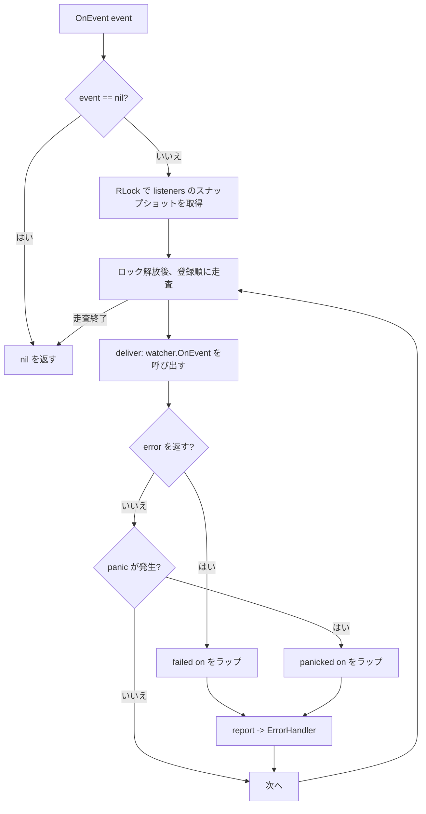
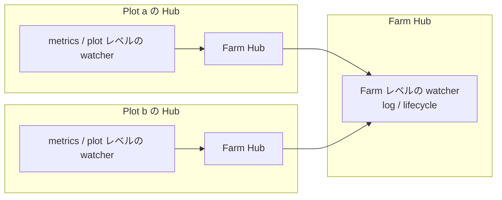

# pkg/scarecrow/hub.go

> 📅 最終更新日: 2026/11/13

## 役割

`pkg/scarecrow/hub.go` はイベント配信センター `Hub` を実装します：`Event` を登録順に**同期的**にすべての `Watcher` へファンアウトし、個々のオブザーバの `error` と `panic` を隔離して設定可能な `ErrorHandler` へ報告します。`Hub` 自身が `Watcher` を実装しているため、別の `Hub` に登録して階層的な配信（Plot Hub → Farm Hub）を構成でき、ジェネリック関数 `Find` で階層内を型ごとに検索できます。

## 主要オブジェクト

### `HubOption` と `WithErrorHandler`

```go
type HubOption func(*Hub)

func WithErrorHandler(handler func(error)) HubOption
```

| オプション | 説明 |
|------|------|
| `WithErrorHandler(handler)` | オブザーバの失敗／panic 時のハンドラを設定する。`nil` を渡すのは未設定と同じで、`defaultErrorHandler` にフォールバックする |

### `Hub`

```go
type Hub struct {
    mu        sync.RWMutex
    listeners []Watcher
    onError   func(error)
}
```

| フィールド | 説明 |
|------|------|
| `mu` | `listeners` を保護する読み書きロック：書き込み（`AddWatcher`）は書き込みロックを保持し、配信はスナップショット取得時だけ読み取りロックを保持する |
| `listeners` | オブザーバのリスト。登録順に保持し、重複を許す |
| `onError` | エラーハンドラ。ゼロ値の Hub では `nil` であり、`report` は既定の出力へフォールバックする |

### コンストラクタとデフォルトハンドラ

| シンボル | シグネチャ | 動作 |
|------|------|------|
| `NewHub` | `func NewHub(opts ...HubOption) *Hub` | オプションを順に適用する。`onError` がまだ `nil` なら `defaultErrorHandler` を設定する |
| `defaultErrorHandler`（未エクスポート） | `func(err error)` | `log.Printf("scarecrow: %v", err)` を実行し、既定では標準エラー出力へ書き出す |

### `AddWatcher`

```go
func (h *Hub) AddWatcher(listener Watcher) error
```

| エラー | 発生条件 |
|------|----------|
| `scarecrow: cannot add nil listener` | `listener == nil`（インターフェース値そのものが nil） |
| `scarecrow: cannot add a hub to itself` | Hub を自分自身に登録した |
| `scarecrow: cyclic hub registration rejected: target hub already contains this hub` | 対象 Hub のネスト階層に現在の Hub がすでに含まれており、登録すると循環が生じる |

- 同じインスタンスの**重複登録**を許可し、配信のたびに毎回呼び出されます。
- 循環検出 `rejectCycle` は**ロック取得前**に完了します：候補 Hub を深さ優先で走査し、現在の Hub に到達したら拒否します。`seen` 集合により、異常なトポロジーでも走査が終了しない事態を防ぎます。

### `OnEvent`

```go
func (h *Hub) OnEvent(event Event) error
```

- `event == nil` の場合はそのまま `nil` を返し、どのオブザーバも呼び出しません。
- 読み取りロックの下で `listeners` のスナップショットを 1 回取得し、その後は**ロックの外で**走査するため、watcher の内部から安全に watcher を追加登録できます。
- 個々のオブザーバのエラーや panic は `deliver` でラップされて `report` へ渡され、残りのオブザーバは実行を続けます。
- **常に `nil` を返します**：オブザーバの障害はエラーハンドラが消費済みで、実行経路へは戻りません（そのため `plot.emit` / `farm.emit` は戻り値を無視できます）。

### `Find`

```go
func Find[T Watcher](hub *Hub) (T, bool)
```

ジェネリックパラメータ `T` は対象のオブザーバ型（インターフェースまたは `*MetricsWatcher` のような具体型）です。

| 規則 | 説明 |
|------|------|
| 検索範囲 | `hub` およびそのネストした Hub（`Hub` 自身も `Watcher`） |
| 優先順序 | まず**直属**のオブザーバを登録順に照合し、その後ネストした Hub へ再帰する |
| 見つからない場合 | `T` のゼロ値と `false` を返す |
| `hub == nil` | ゼロ値と `false` をそのまま返す |
| 防御 | `seen` 集合で訪問済み Hub を記録し、異常なトポロジーによる無限再帰を避ける |

### `deliver` / `report`（未エクスポート）

| 関数 | 動作 |
|------|------|
| `deliver` | `defer recover()` を置く。オブザーバがエラーを返したら `scarecrow: %T failed on %T: %w` で、panic したら `scarecrow: %T panicked on %T: %v` でラップする |
| `report` | `h.onError` を取得し、`nil` なら `defaultErrorHandler` を使う。ハンドラ自身が panic した場合はさらに `defaultErrorHandler` で `scarecrow: error handler panicked: %v` を出力する |

## 主要なフロー

### 配信



### ネストしたトポロジー（プロジェクトでの実際の使い方）



`Farm.start` は `plot.AddWatcher(f.hub)` で Farm Hub を各 Plot Hub に登録するため、Farm レベルの watcher はその Farm 内のすべての Plot のイベントを受け取れます。`Find` も Plot Hub から上へ辿って Farm レベルで登録された `MetricsWatcher` を見つけられます（`basePlot.currentMetrics` はこの経路に依存しています）。

## 重要な詳細

- **コピーオンライトの意味論**：`AddWatcher` は書き込みロック内で `append` するため、置き換わるのは基盤配列だけで、公開済みの要素は書き換えません。`OnEvent` は読み取りロックの下でスライスのスナップショットを 1 回取得し、ロックの外で走査します。したがって並行追加の最中でもスナップショットは完全で、走査にロックは不要です。
- **スナップショットの境界**：配信開始後に登録された watcher はその 1 件のイベントを受け取れず、次のイベントから受け取ります（`Farm.AddWatcher` のコメントも「以降のイベントで初めて届く」と強調しています）。
- **登録順がそのまま呼び出し順**：同一階層内では `AddWatcher` の順に厳密に直列呼び出しされるため、前の watcher がブロックすると後続の watcher が遅れます。
- **循環検出の既知の競合**：検出はロック取得前に完了するため、2 つの Hub が同時に互いを登録する極端な並行状況では検出を回避され得ます。ソースのコメントも「実行時に Hub トポロジーを並行構築することは推奨しない」と明記しています。`Find` の `seen` は異常なトポロジーに対する最後の防御です。
- **ゼロ値でも使用可能**：`var h Hub` でもそのまま `AddWatcher` / `OnEvent` を呼べます。`onError` が `nil` のとき `report` は自動で既定のハンドラへフォールバックします。
- **エラーハンドラも保護される**：`report` 内ではハンドラ呼び出しに `recover` を掛けており、ハンドラの panic が `OnEvent` の「常に nil を返す」という約束を破ることはありません。

## 使用例

### 基本的な配信とエラー分離

```go
package main

import (
    "errors"
    "fmt"

    "github.com/Mr-xiaotian/CelestialGrow/pkg/scarecrow"
)

func main() {
    hub := scarecrow.NewHub(scarecrow.WithErrorHandler(func(err error) {
        fmt.Println("reported:", err)
    }))

    _ = hub.AddWatcher(scarecrow.WatcherFunc(func(scarecrow.Event) error {
        return errors.New("boom")
    }))
    _ = hub.AddWatcher(scarecrow.WatcherFunc(func(scarecrow.Event) error {
        fmt.Println("healthy watcher still runs")
        return nil
    }))

    // OnEvent 永远返回 nil，故障通过 ErrorHandler 上报。
    fmt.Println(hub.OnEvent(scarecrow.PlotStartEvent{Plot: "harvester"}))
    // reported: scarecrow: scarecrow.WatcherFunc failed on scarecrow.PlotStartEvent: boom
    // healthy watcher still runs
    // <nil>
}
```

### ネストした Hub と `Find`

```go
package main

import (
    "fmt"

    "github.com/Mr-xiaotian/CelestialGrow/pkg/scarecrow"
)

func main() {
    metrics := scarecrow.NewMetricsWatcher()

    farmHub := scarecrow.NewHub()
    _ = farmHub.AddWatcher(metrics)

    plotHub := scarecrow.NewHub()
    _ = plotHub.AddWatcher(farmHub) // 把 Farm Hub 嵌套进 Plot Hub

    _ = plotHub.OnEvent(scarecrow.PlotStartEvent{Plot: "harvester", Tenders: 2})
    _ = plotHub.OnEvent(scarecrow.SeedInputEvent{Plot: "harvester", SeedID: 1})

    found, ok := scarecrow.Find[*scarecrow.MetricsWatcher](plotHub)
    if !ok {
        panic("metrics watcher not found")
    }
    snapshot, _ := found.GetPlot("harvester")
    fmt.Println(snapshot.Status, snapshot.InputTotal) // running 1
}
```

### 循環の拒否

```go
package main

import (
    "fmt"

    "github.com/Mr-xiaotian/CelestialGrow/pkg/scarecrow"
)

func main() {
    a, b := scarecrow.NewHub(), scarecrow.NewHub()
    _ = a.AddWatcher(b)

    if err := b.AddWatcher(a); err != nil {
        // scarecrow: cyclic hub registration rejected: target hub already contains this hub
        fmt.Println(err)
    }
}
```

## 注意事項

- 循環検出は並行にトポロジーを構築する際の安全保証ではありません。Hub の階層は起動段階で一度に組み立ててください。
- `Find` は**最初の**一致だけを返します。同じ型のインスタンスを複数登録した場合、結果は登録順と階層（直属優先）に依存します。
- `WithErrorHandler(nil)` はエラー報告を無効化するのではなく、既定の `log.Printf` 出力へフォールバックします。黙らせたい場合は空関数 `func(error) {}` を渡してください。
- 既定のハンドラは標準ライブラリの `log` を使うため、出力先は `log.SetOutput` でグローバルにリダイレクトできます（テストでは `io.Discard` がよく使われます）。
- `Hub` は同期的に配信するため、watcher の所要時間はそのままイベント生成経路に加算されます。遅い watcher は自前で非同期化してください（[`watcher.md`](./watcher.md) 参照）。
